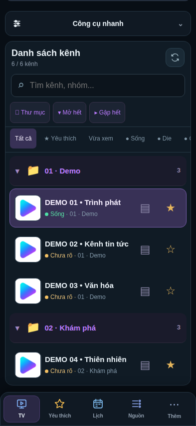
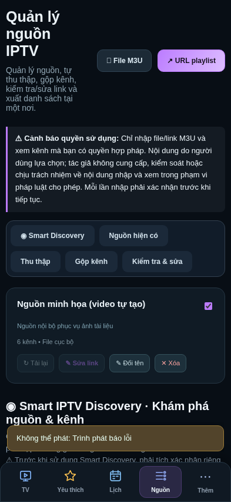
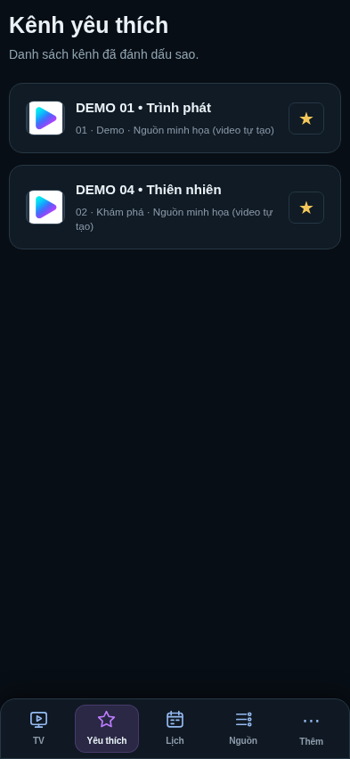
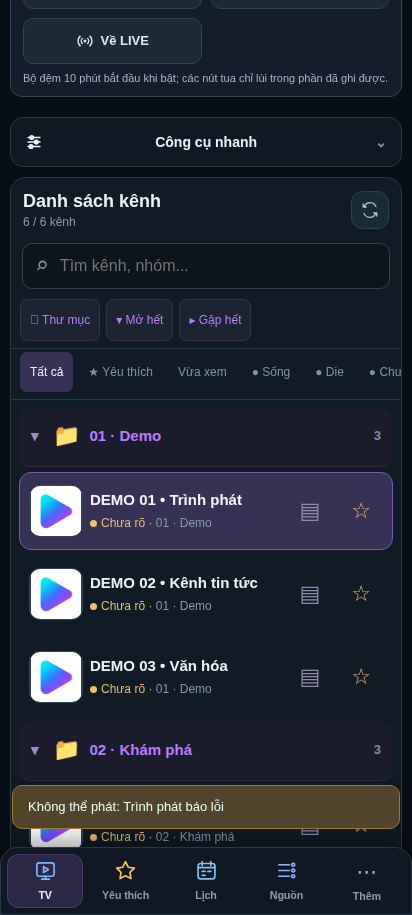
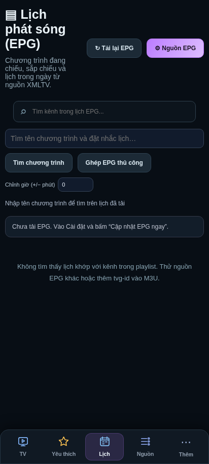
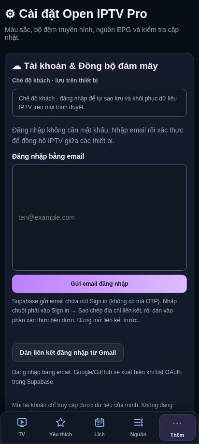

# Open IPTV Pro

**🌐 Ngôn ngữ / Languages / 言語 / 언어 / Langues / Sprachen / Idiomas / 语言**

[Tiếng Việt](README.md) · [English](docs/i18n/README.en.md) · [简体中文](docs/i18n/README.zh.md) · [日本語](docs/i18n/README.ja.md) · [한국어](docs/i18n/README.ko.md) · [Français](docs/i18n/README.fr.md) · [Deutsch](docs/i18n/README.de.md) · [Español](docs/i18n/README.es.md) · [Português](docs/i18n/README.pt.md) · [ไทย](docs/i18n/README.th.md) · [Bahasa Indonesia](docs/i18n/README.id.md) · [Русский](docs/i18n/README.ru.md)

> README tiếng Việt là tài liệu kỹ thuật đầy đủ. Các bản dịch quốc tế là hướng dẫn tóm lược có liên kết đến mã nguồn, bộ cài, ảnh giao diện và thông báo bản quyền chính thức.

## 1. Bản phát hành ổn định — Open IPTV Pro Electron v4.23.76

**Stable mới nhất:** [Open IPTV Pro Electron v4.23.76](https://github.com/trisanghy/open-iptv-pro/releases/latest), được build từ nhánh `main`. GitHub Actions đã build thành công Windows x64 và macOS Apple Silicon/Intel; trải nghiệm thực tế với từng nguồn IPTV và thiết bị vẫn cần kiểm tra riêng.

| Hệ điều hành | Bản chính thức | Tải về |
|---|---|---|
| Windows x64 | v4.23.76 Stable | [Setup EXE](https://github.com/trisanghy/open-iptv-pro/releases/download/v4.23.76/Open-IPTV-Pro-Setup-4.23.76-x64.exe) · [Portable EXE](https://github.com/trisanghy/open-iptv-pro/releases/download/v4.23.76/Open-IPTV-Pro-4.23.76-x64.exe) |
| macOS Apple Silicon | v4.23.76 Stable | [DMG ARM64](https://github.com/trisanghy/open-iptv-pro/releases/download/v4.23.76/Open-IPTV-Pro-4.23.76-mac-arm64.dmg) |
| macOS Intel | v4.23.76 Stable | [DMG x64](https://github.com/trisanghy/open-iptv-pro/releases/download/v4.23.76/Open-IPTV-Pro-4.23.76-mac-x64.dmg) |

[**Tải bản Stable và SHA256SUMS**](https://github.com/trisanghy/open-iptv-pro/releases/latest) · [**Stable cũ v4.23.71**](https://github.com/trisanghy/open-iptv-pro/releases/tag/v4.23.71) · [**Nhật ký thay đổi**](CHANGELOG.md)

**Điểm mới v4.23.76:** icon điều khiển SVG đồng nhất, cải thiện giao diện Light, công cụ đo khả năng GPU encoder (tùy phần cứng và FFmpeg), quản lý cache riêng. **Chưa có pipeline AI upscale 4K hoạt động thực.** Bản DMG chưa ký/notarize có thể bị Gatekeeper cảnh báo; hãy kiểm tra SHA-256 và dùng hướng dẫn bảo mật macOS, không tắt toàn bộ Gatekeeper.

**Quy tắc phát hành:** README trên `main` chỉ quảng bá phiên bản Stable. Các nhánh nghiên cứu, bản thử nghiệm và bộ cài chưa chứng nhận không được thay thế nhãn **Latest**. GitHub Releases là danh mục chung cho cả repository, nên Pre-release vẫn có thể xuất hiện khi duyệt toàn bộ lịch sử Releases; chúng không phải bản Stable.

Open IPTV Pro là ứng dụng mã nguồn mở được phát triển như **một dự án cá nhân**, giúp người dùng phát và tự tổ chức các nguồn IPTV/M3U mà **chính họ cung cấp** trên macOS, Windows, Android, iOS hoặc trình duyệt (tùy phiên bản). Trọng tâm là xem kênh nhanh, quản lý danh sách hiệu quả, ưu tiên Yêu thích, sử dụng thuận tiện trên cửa sổ nhỏ hoặc màn hình lớn, và có thêm công cụ EPG, ghi hình, kiểm tra luồng cùng AI phụ đề ngoại tuyến.

**Ứng dụng là phần mềm trình phát, không phải nhà cung cấp kênh truyền hình hoặc dịch vụ phân phối nội dung.** Người dùng cần có quyền truy cập hợp pháp đối với từng nguồn nội dung được nhập vào.

> ⚠️ **CẢNH BÁO QUYỀN SỬ DỤNG / COPYRIGHT & CONTENT RIGHTS:** Trước khi mở **file M3U**, nhập **URL M3U** hoặc thêm playlist từ repository, ứng dụng yêu cầu người dùng tự tích ô xác nhận có quyền sử dụng nguồn. **Smart Discovery** yêu cầu xác nhận riêng **hai điều khoản về nguồn, bản quyền và trách nhiệm người dùng trước khi tìm/kiểm tra**, rồi xác nhận lại trước khi nhập kênh; có thể hủy. Kênh công khai hoặc kiểm tra phát thành công **không đồng nghĩa được cấp phép**. **Tác giả không cung cấp nội dung, không chịu trách nhiệm về nguồn, chương trình người dùng nhập và xem, hoặc dữ liệu do người dùng quản lý trong phạm vi pháp luật cho phép.** Xem [Thông báo bản quyền và trách nhiệm](COPYRIGHT_NOTICE_V4_23_70.md) và phần tuyên bố ở cuối README.


> **Ảnh cập nhật 19/11/2026:** Thư viện 12 ảnh dưới đây được chụp tự động từ **Web Online thực tế** trên nhánh `web/online` bằng Chromium trong GitHub Actions. Video/playlist minh họa tự tạo, không sử dụng nguồn IPTV riêng tư hay bản quyền bên thứ ba. Ảnh iOS và Android sử dụng **giả lập thiết bị trình duyệt**, không phải ảnh chụp Safari trên iPhone thật hoặc APK/IPA. Ảnh ứng dụng Electron/Rust Lab lịch sử được giữ trong `docs/images` và không bị gọi nhầm là giao diện hiện tại.

Ứng dụng hỗ trợ nguồn IPTV/M3U do người dùng cung cấp hợp pháp, quản lý kênh, EPG, Yêu thích, lịch sử Vừa xem và các công cụ phát tương thích theo từng nền tảng. Chỉ bộ cài Electron v4.23.76 ở trên được giới thiệu là **Stable** trong README này.

## 2. Chức năng chính

### 📺 Trình phát và điều khiển kênh

- **Nguồn IPTV M3U/M3U8:** mở danh sách từ URL hoặc tệp do người dùng nhập, quản lý nhiều nguồn và nhóm kênh.
- **HLS/DASH:** phát video qua các engine phù hợp; hỗ trợ những định dạng/codec và máy chủ tương thích với nền tảng.
- **Chuyển kênh nhanh:** nút kênh trước/sau, danh sách kênh, tìm kiếm, bộ lọc; có thể chuyển kênh không cần quay lại màn hình nguồn.
- **Kênh yêu thích:** đánh dấu, duyệt và truy cập kênh thường xem; hỗ trợ sắp xếp và tổ chức danh sách.
- **Link dự phòng / Auto Failover:** chọn đường dẫn phù hợp và thử nguồn thay thế khi một liên kết không hoạt động theo khả năng engine.
- **Điều khiển phát:** Phát, Tạm dừng (giữ khung hình ở những chế độ tương thích), Dừng hẳn (giải phóng phiên phát), âm lượng, fullscreen và Picture-in-Picture.
- **Tối ưu màn hình:** co giãn trình phát, các thanh công cụ tiện dụng, layout hợp với laptop, cửa sổ thu nhỏ và màn hình lớn.

### 🗂️ Danh sách kênh, EPG và công cụ quản lý

- **EPG/XMLTV:** xem chương trình hiện tại/sắp phát, nhập nguồn lịch phát khi có và kiểm tra thông tin chương trình.
- **Ảnh chụp kênh (Snapshot):** tạo ảnh nhận diện danh sách kênh; khi không có ảnh có thể dùng logo hoặc ký hiệu tên kênh.
- **Quản lý nguồn và thư mục:** thêm/sửa/xóa nguồn, tổ chức nhóm, xử lý link kênh và danh sách trùng hoặc link thay thế.
- **Kiểm tra trạng thái luồng:** quét danh sách, phát hiện lỗi hoặc nguồn không xác minh được; có công cụ chẩn đoán IPTV, Smart Discovery/Doctor theo chức năng sẵn có.
- **Sao lưu/khôi phục:** xuất hoặc nhập dữ liệu và cấu hình khi tính năng hỗ trợ. Người dùng nên tự sao lưu trước khi cập nhật hay đổi máy.
- **Nhiều ngôn ngữ và chế độ hiển thị**, bao gồm Sáng/Tối/AMOLED theo giao diện.

### 🎬 Tính năng xem nâng cao

- **MultiView:** xem nhiều kênh trong cùng cửa sổ khi phần cứng và nguồn cho phép.
- **Timeshift (Tua lại):** sử dụng bộ đệm/tác vụ FFmpeg để tua lại trong phạm vi được hỗ trợ.
- **DVR và ghi hình:** ghi hoặc lên lịch ghi luồng tương thích, lưu tệp trên thiết bị.
- **PiP:** tiếp tục xem trong cửa sổ nổi; tự trở lại giao diện chính theo các tùy chọn hỗ trợ.
- **Cast / AirPlay:** tìm thiết bị và chuyển phát trên các hệ điều hành, mạng và thiết bị hỗ trợ.
- **Công cụ FFmpeg/FFprobe:** hỗ trợ những tác vụ như kiểm tra luồng, snapshot, ghi hình và xử lý âm thanh/video phù hợp.

### 🗣️ Live Caption, Live Translate và TTS ngoại tuyến — bản Desktop

- **Live Caption:** nhận diện lời thoại thành phụ đề khi mô hình có thể hoạt động trên máy.
- **Live Translate:** dịch văn bản phụ đề sang ngôn ngữ đã chọn, theo mô hình và cặp ngôn ngữ được hỗ trợ.
- **TTS / giọng đọc bản dịch:** phát âm văn bản dịch; tùy chọn giọng, tốc độ đọc và giảm âm lượng gốc theo engine.
- **Tùy chỉnh phụ đề hiển thị trên video:** bật/tắt, cỡ chữ, màu, nền, vị trí và xuống dòng cho câu dài.
- **Hỗ trợ CC trong fullscreen và một số chế độ PiP** khi luồng cho phép ghép phụ đề vào hình ảnh.
- **Khôi phục các công tắc AI đã lưu** khi mở ứng dụng theo thiết lập.

**Lưu ý:** Mô hình AI có thể cần tải riêng; chất lượng, ngôn ngữ và độ trễ phụ thuộc CPU/GPU/RAM, hệ điều hành, nguồn video và giấy phép của từng mô hình. Không bảo đảm dịch hay TTS chính xác hoặc đồng bộ tức thời trong mọi tình huống.

### 🎨 Giao diện tùy biến

Electron cung cấp **11 kiểu giao diện**: Current, Minimal, Material 3, Apple HIG, Liquid, Cinema, Fluent, Glass, Broadcast, Bento và Swiss. Các layout này dành cho nhu cầu xem kênh, điều khiển, EPG và Yêu thích khác nhau. Một số layout có thể thu gọn panel **Kênh hiện tại** để tăng diện tích video. Màu nền và độ tương phản thay đổi theo chế độ Sáng/Tối/AMOLED.

## 3. Hình ảnh chụp màn hình mới nhất (Web Online)

Toàn bộ ảnh chụp **từ website Open IPTV Pro Web đang được dựng và kiểm thử**. Mỗi ảnh có thể bấm để mở nguyên kích thước; video demo là video riêng tạo bằng FFmpeg, không phải chương trình IPTV thực tế.

### Desktop Web — 1536 × 960

| Trình phát Web desktop | Quản lý nguồn M3U |
| :---: | :---: |
| [](docs/images/web-gallery/desktop-tv.png) | [](docs/images/web-gallery/desktop-sources.png) |
| Lịch EPG | Cài đặt giao diện |
| [](docs/images/web-gallery/desktop-epg.png) | [](docs/images/web-gallery/desktop-settings.png) |

### Mobile Web — iOS giả lập (393 × 852)

| iOS Web — trình phát | iOS Web — danh sách kênh |
| :---: | :---: |
| [](docs/images/web-gallery/ios-tv.png) | [](docs/images/web-gallery/ios-channels.png) |
| iOS Web — nguồn M3U | iOS Web — yêu thích |
| [](docs/images/web-gallery/ios-sources.png) | [](docs/images/web-gallery/ios-favorites.png) |

### Mobile Web — Android giả lập (412 × 915)

| Android Web — trình phát | Android Web — danh sách kênh |
| :---: | :---: |
| [](docs/images/web-gallery/android-tv.png) | [](docs/images/web-gallery/android-channels.png) |
| Android Web — EPG | Android Web — cài đặt |
| [](docs/images/web-gallery/android-epg.png) | [](docs/images/web-gallery/android-settings.png) |

> **Lưu ý:** Đây là ảnh chụp **Chromium với cấu hình viewport và user agent iOS/Android** trong CI, không phải kết quả đo trên Safari iPhone, Chrome Android thực tế hay ứng dụng mobile native. Ảnh không chứng minh AirPlay/Cast, codec, nguồn IPTV hoặc EPG hoạt động trên mọi thiết bị. Bộ ảnh 12 tệp và thông tin phương pháp nằm trong [thư mục ảnh hiện hành](docs/images/web-gallery/). 
>
> **Ảnh Electron/Rust Lab phiên bản lịch sử:** vẫn được bảo tồn ở [docs/images](docs/images) và [tag v4.23.68](https://github.com/trisanghy/open-iptv-pro/tree/v4.23.68/docs/images), nhưng không dùng những hình này để giới thiệu bản Web mới. Xem thêm [trang chủ với gallery cập nhật](https://trisanghy.github.io/#anh).

## 4. Tải và cài đặt

**Nguồn tải chính thức:** [GitHub Releases — Electron Stable mới nhất](https://github.com/trisanghy/open-iptv-pro/releases/latest). Chỉ tải file theo hệ điều hành và kiến trúc máy.

| Thiết bị | Bản Electron Stable | Tệp cài đặt |
| :--- | :--- | :--- |
| **Mac Apple Silicon (M1/M2/M3/M4...)** | Desktop | [Open-IPTV-Pro-4.23.76-mac-arm64.dmg](https://github.com/trisanghy/open-iptv-pro/releases/download/v4.23.76/Open-IPTV-Pro-4.23.76-mac-arm64.dmg) |
| **Mac Intel** | Desktop | [Open-IPTV-Pro-4.23.76-mac-x64.dmg](https://github.com/trisanghy/open-iptv-pro/releases/download/v4.23.76/Open-IPTV-Pro-4.23.76-mac-x64.dmg) |
| **Windows 10/11 x64** | Setup | [Open-IPTV-Pro-Setup-4.23.76-x64.exe](https://github.com/trisanghy/open-iptv-pro/releases/download/v4.23.76/Open-IPTV-Pro-Setup-4.23.76-x64.exe) |
| **Windows x64 — không muốn cài** | Portable | [Open-IPTV-Pro-4.23.76-x64.exe](https://github.com/trisanghy/open-iptv-pro/releases/download/v4.23.76/Open-IPTV-Pro-4.23.76-x64.exe) |

### Cài trên macOS

1. Xác định CPU trong **Apple menu → About This Mac**, tải DMG **ARM64** nếu là Apple Silicon hoặc **x64** nếu là Intel.
2. Mở tệp `.dmg`, kéo **Open IPTV Pro.app** vào **Applications** nếu bộ cài có cửa sổ kéo thả; mở ứng dụng.
3. Nếu macOS thông báo chưa xác minh nhà phát triển hoặc file chưa ký số, hãy đối chiếu nguồn GitHub và SHA-256 trước. Chỉ khi tin tưởng nguồn tải, sử dụng **System Settings → Privacy & Security → Open Anyway** nếu macOS cung cấp tùy chọn.
4. Thêm playlist M3U hợp pháp của bạn và thiết lập EPG, Yêu thích, giao diện nếu cần.

**Khắc phục lỗi macOS “Open IPTV Pro is damaged and can't be opened”:** Chỉ thực hiện nếu đã tải DMG từ [GitHub Releases chính thức](https://github.com/trisanghy/open-iptv-pro/releases), đối chiếu SHA-256 với tệp checksum của bản phát hành và đã kéo `Open IPTV Pro.app` vào **Applications**. Trước tiên thử **System Settings → Privacy & Security → Open Anyway** nếu macOS cung cấp tùy chọn.

Nếu đã xác minh tệp nguyên vẹn, tin tưởng nguồn tải nhưng ứng dụng vẫn bị chặn do quarantine, mở **Terminal** và chạy đúng lệnh sau (chỉ áp dụng cho Open IPTV Pro):

```bash
xattr -dr com.apple.quarantine "/Applications/Open IPTV Pro.app"
```

Nếu DMG không mở được, checksum không khớp, chữ ký sai hoặc macOS cảnh báo phát hiện phần mềm độc hại, **không vượt cảnh báo**; hãy xóa file, tải lại từ nguồn chính thức và báo lỗi. Lệnh trên không sửa DMG hỏng thực sự.

**Không khuyến nghị tắt Gatekeeper cho toàn bộ hệ thống.**

### Cài trên Windows

1. Tải **Setup EXE** nếu muốn cài thông thường; tải **Portable EXE** nếu muốn dùng bản không cần cài đặt.
2. Mở file, thực hiện các bước của bộ cài nếu dùng Setup. Kiểm tra nguồn và mã SHA-256 trước khi vượt qua cảnh báo SmartScreen.
3. Mở ứng dụng, nhập URL hoặc file M3U của chính bạn, chọn kênh để xem.
4. Khi cập nhật, nên sao lưu dữ liệu đã lưu trước. Không dùng chung hoặc ghi đè thư mục dữ liệu giữa Electron và Rust Lab.

### Web Online — không cần cài

Mở **https://trisanghy.github.io/open-iptv-pro/**, thêm nguồn M3U hợp pháp và sử dụng trực tiếp. Web có hỗ trợ Cloud Sync/Supabase **khi dịch vụ được cấu hình và người dùng đăng nhập**, nhưng trình duyệt có thể giới hạn CORS, codec, autoplay hoặc nội dung hỗn hợp HTTP/HTTPS.

## 5. Bắt đầu sử dụng

1. **Thêm nguồn:** nhập URL M3U hoặc chọn file playlist của bạn; ứng dụng không tự cung cấp kho kênh.
2. **Duyệt và lọc:** mở nhóm, tìm theo tên và chọn kênh muốn phát.
3. **Lưu Yêu thích:** đánh dấu kênh thường xem để truy cập nhanh.
4. **Thêm EPG (nếu có):** cấu hình nguồn XMLTV để xem lịch phát sóng.
5. **Tùy chọn:** kiểm tra trạng thái nguồn, chụp ảnh kênh, thiết lập theme, PiP/Multiview và các công cụ khác.
6. **AI (Desktop):** cài mô hình thích hợp trước khi sử dụng Live Caption/Translate/TTS; kiểm tra khả năng hỗ trợ của thiết bị.
7. **Sao lưu:** lưu playlist và cấu hình quan trọng trước khi đổi máy hoặc nâng cấp.

Các tính năng ghi hình, phát lại, tua lại, Cast, CC và phát video phụ thuộc quyền truy cập nội dung, nguồn stream, codec, phần cứng và nền tảng.

## 6. Chạy và build từ mã nguồn

### Electron Desktop

Yêu cầu **Node.js 22+**, npm, và bộ công cụ native tương ứng để build installer. Trong thư mục gốc repository:

```bash
npm install --no-audit --no-fund
npm test
npm start
```

Build Windows từ nguồn: `BUILD_WINDOWS.bat`; build DMG Mac từ nguồn: `BUILD_MAC_DMG_ONLY.command`.

**Một lệnh Terminal trên Mac để tự tải, build Electron và chỉ giữ một `.app` trong Downloads:**

```bash
bash -c 'set -o pipefail; curl -fsSL https://raw.githubusercontent.com/trisanghy/open-iptv-pro/build-sources/electron-desktop/build-mac-electron.sh | bash'
```

### Web Online

Website đã đóng gói nằm trong [`web/`](web/). Có thể phục vụ `index.html` và các file đi kèm bằng HTTP server tĩnh, ví dụ từ thư mục `web/`:

```bash
python3 -m http.server 8000
```

Mở `http://localhost:8000/`. Mã Web có nhiều giới hạn trình duyệt khác với bản desktop.

## 7. Kiểm tra toàn vẹn và xử lý sự cố

- **Xác minh tải xuống:** tải [SHA256SUMS.txt](https://github.com/trisanghy/open-iptv-pro/releases/download/v4.23.76/SHA256SUMS.txt) cùng installer. Trên Mac dùng `shasum -a 256 <ten-file>` rồi so với checksum công bố; Windows dùng `Get-FileHash <ten-file> -Algorithm SHA256`.
- **Không xem được kênh:** kiểm tra URL, quyền sử dụng, mạng/DNS, khả năng hỗ trợ codec, link dự phòng và giới hạn nguồn phát.
- **Website không phát:** trình duyệt có thể chặn CORS, HTTP hỗn hợp, tự phát tiếng hoặc codec.
- **Không có Live Caption/TTS:** kiểm tra mô hình đã cài, tài nguyên CPU/RAM, ngôn ngữ và quyền hệ điều hành.
- **PiP không có phụ đề:** một số luồng bị hạn chế bởi CORS/DRM nên không thể ghép phụ đề vào hình.
- **Dữ liệu mất sau khi cập nhật:** khôi phục từ backup tự tạo nếu có. Không thể bảo đảm tương thích dữ liệu giữa các phiên bản hoặc giữa Electron và Rust Lab.

Tài liệu: [Hướng dẫn cài đặt](docs/INSTALL_V4_23_70.md) · [Build & Release](docs/BUILD.md) · [So sánh tính năng](docs/COMPARE_EDITIONS_V4_23_70.md) · [Release Notes v4.23.70](RELEASE_NOTES_V4_23_70.md) · [Changelog](CHANGELOG.md) · [Thông báo bản quyền](COPYRIGHT_NOTICE_V4_23_70.md) · [Bản đồ mã nguồn](docs/RELEASE_SOURCE_MAP_V4_23_70.md).

## 8. Giấy phép và đóng góp

Mã nguồn ứng dụng được công bố theo [**MIT License**](LICENSE). Các thư viện, công cụ FFmpeg, engine/giọng AI và mô hình do bên thứ ba cung cấp có thể có điều khoản cấp phép riêng; xem [THIRD_PARTY_NOTICES.md](THIRD_PARTY_NOTICES.md). Nếu sửa đổi hoặc phân phối lại, người sử dụng/phân phối phải tự tuân thủ giấy phép áp dụng và quy định pháp luật liên quan.

Nhánh phát triển: Electron `build-sources/electron-desktop`; Rust Lab `experiment/rust-tauri-v2`; Mobile `experiment/mobile-capacitor-4211`; Web `web/online`. Bản sao Mobile trong `main/mobile` là snapshot của nhánh Mobile tại mốc phát hành nêu trong tài liệu, không tự đồng bộ ngược. Các bản phát hành và tag cũ vẫn được lưu lại để tham khảo; bản `main` đã dọn gọn, không đính kèm lại các ZIP source lỗi thời trong cây mã.

---

## 9. TUYÊN BỐ DỰ ÁN CÁ NHÂN, BẢN QUYỀN NỘI DUNG VÀ MIỄN TRỪ TRÁCH NHIỆM

**Open IPTV Pro chỉ là ứng dụng do cá nhân phát triển, chia sẻ để nghiên cứu, học hỏi và sử dụng theo nhu cầu cá nhân. Đây không phải dịch vụ cung cấp IPTV, bán thuê bao truyền hình, phân phối phim, kênh hay nội dung phát trực tuyến.** Việc cung cấp mã nguồn hoặc phần mềm **không đồng nghĩa với việc cung cấp quyền xem, quyền sở hữu hay giấy phép sử dụng bất kỳ nội dung nào**.

**Người dùng tự chịu hoàn toàn trách nhiệm đối với các nguồn nội dung và dữ liệu do mình thêm vào**, bao gồm nhưng không giới hạn ở URL, M3U/M3U8, XMLTV/EPG, liên kết stream, thông tin tài khoản, playlist, file tải, bản ghi hình, phụ đề, nội dung truyền phát và dữ liệu đồng bộ. Người dùng có trách nhiệm tự xác minh quyền truy cập, bản quyền, tính hợp pháp và điều khoản của từng nhà cung cấp nội dung; không được sử dụng phần mềm để truy cập, lưu trữ hay phát tán nội dung trái phép.

**Tác giả không chịu trách nhiệm đối với dữ liệu của người dùng khi sử dụng ứng dụng**, bao gồm dữ liệu bị mất, bị hỏng, bị thay đổi, ghi đè, không thể khôi phục, lộ hoặc bị bên thứ ba truy cập, cũng như sự cố nguồn phát, kết nối, máy chủ, nội dung và mọi hậu quả phát sinh do việc sử dụng phần mềm, **trong phạm vi pháp luật cho phép**. Người dùng cần chủ động sao lưu và tự bảo vệ thông tin, tài khoản, file ghi hình và dữ liệu cá nhân. Phần mềm được cung cấp **“NGUYÊN TRẠNG” (AS IS)**, không kèm cam kết hoạt động liên tục, không lỗi, không mất dữ liệu hoặc phù hợp với mọi mục đích; xem thêm các điều khoản tại [MIT License](LICENSE).

**Bằng việc tải xuống, sao chép, cài đặt, sử dụng hoặc phân phối lại Open IPTV Pro hay mã nguồn đi kèm, người dùng xác nhận mình đã đọc và hiểu thông báo này; tự chịu trách nhiệm về nguồn nội dung mình cung cấp, hoạt động sử dụng và việc tuân thủ quy định pháp luật hiện hành.** Tuyên bố này không loại trừ những trách nhiệm mà pháp luật bắt buộc không được miễn trừ.

*English notice: Open IPTV Pro is a personal, open-source player project, not an IPTV or content provider. Users are solely responsible for the content sources, credentials, playlists, recordings and other data they add, and for obtaining all necessary rights and permissions. The software is provided “AS IS”, without warranties, and the author disclaims liability for user data and related losses to the maximum extent permitted by applicable law. Downloading or using the application or source indicates acknowledgment of this notice, without overriding non-waivable legal rights.*
