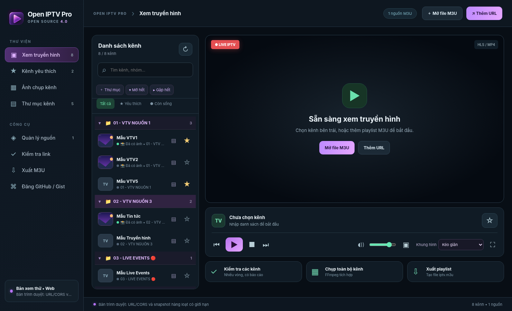
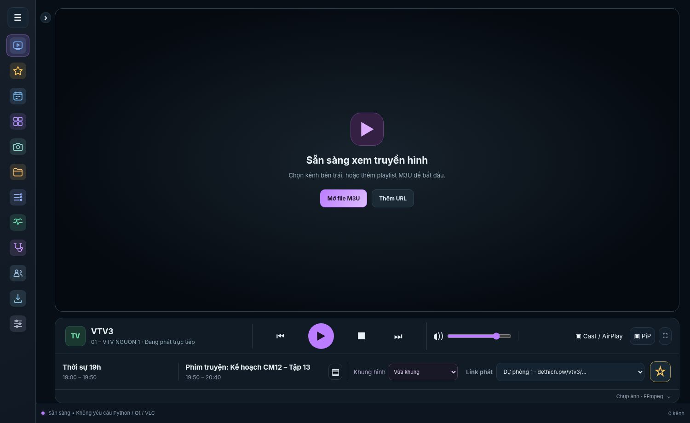
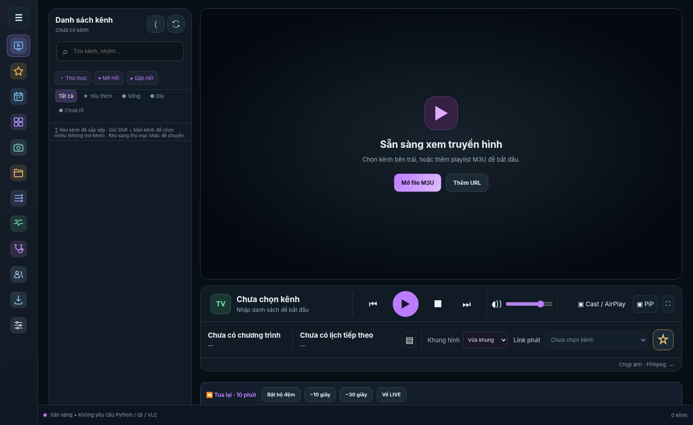
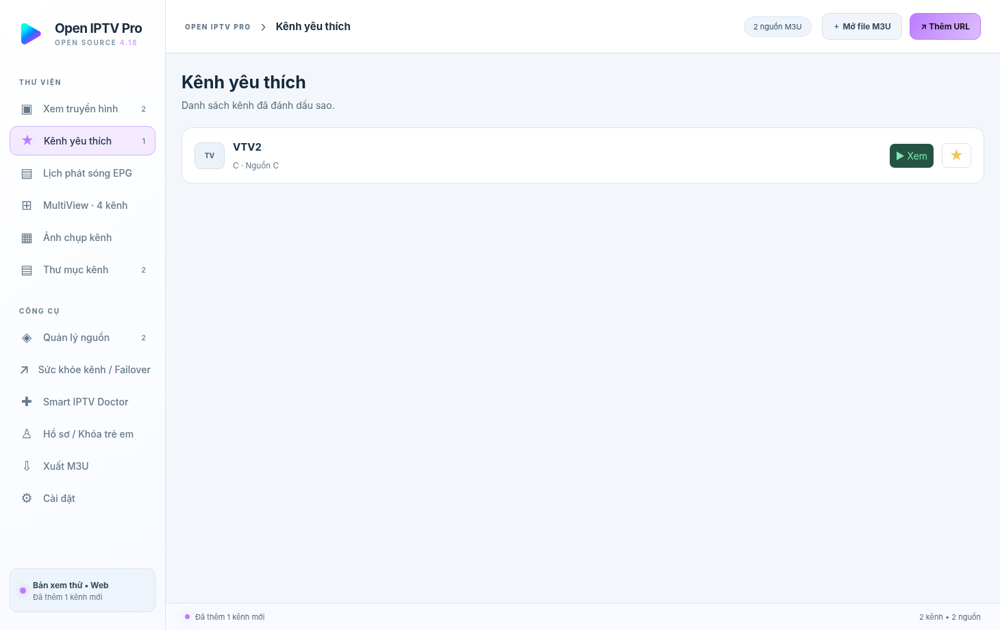
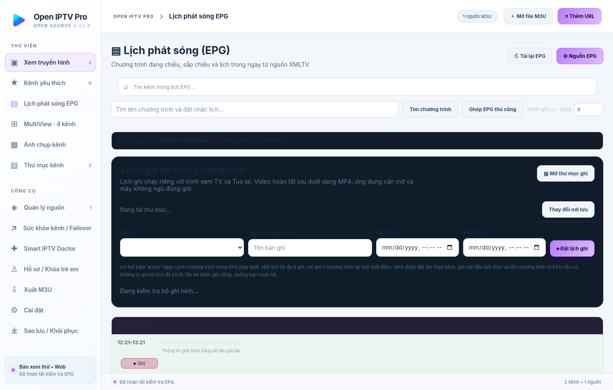
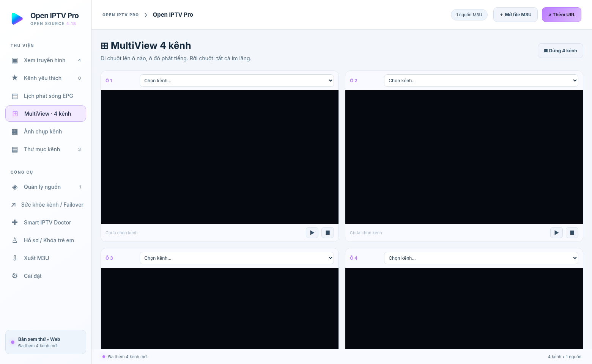
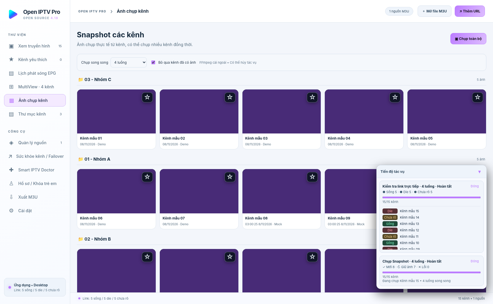
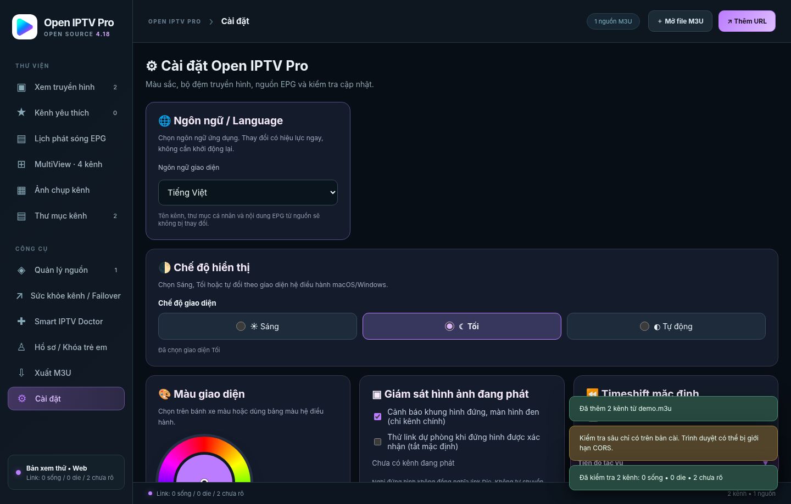
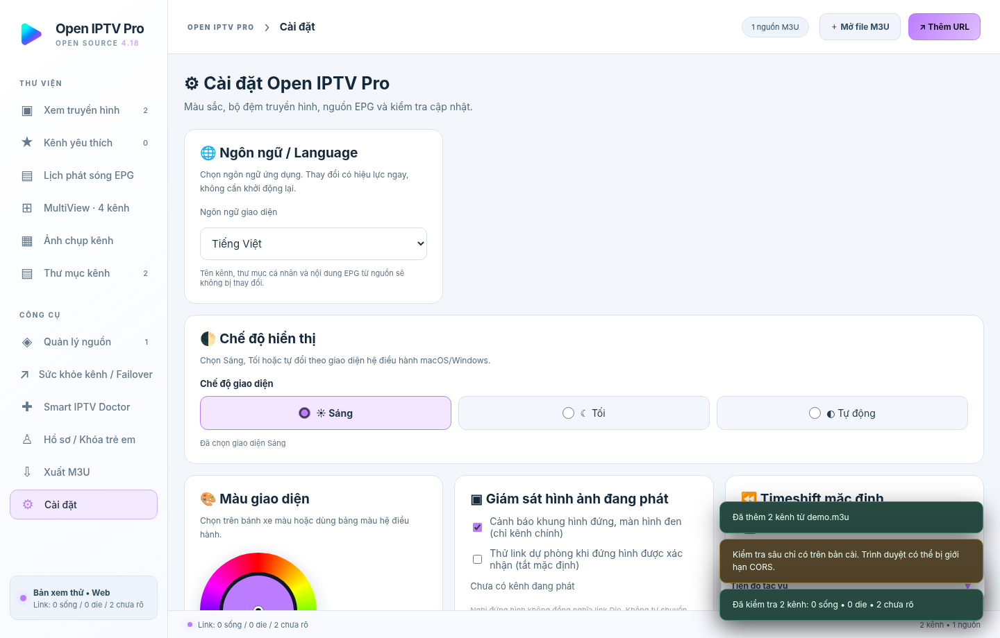

# Open IPTV Pro

**Trình phát IPTV đa nền tảng · Electron Desktop v4.23.68 Stable · Rust Lab v23.8.30 Beta · Web Online**

[**Tải bản cài đặt mới nhất**](https://github.com/trisanghy/open-iptv-pro/releases/tag/v4.23.69) · [**Mở Web Online**](https://trisanghy.github.io/open-iptv-pro/) · [**Xem mã nguồn**](https://github.com/trisanghy/open-iptv-pro) · [**Nhật ký thay đổi**](CHANGELOG.md)

Open IPTV Pro là ứng dụng mã nguồn mở được phát triển như **một dự án cá nhân**, giúp người dùng phát và tự tổ chức các nguồn IPTV/M3U mà **chính họ cung cấp** trên macOS, Windows hoặc trình duyệt. Trọng tâm là xem kênh nhanh, quản lý danh sách hiệu quả, ưu tiên Yêu thích, sử dụng thuận tiện trên cửa sổ nhỏ hoặc màn hình lớn, và có thêm công cụ EPG, ghi hình, kiểm tra luồng cùng AI phụ đề ngoại tuyến.

**Ứng dụng là phần mềm trình phát, không phải nhà cung cấp kênh truyền hình hoặc dịch vụ phân phối nội dung.** Người dùng cần có quyền truy cập hợp pháp đối với từng nguồn nội dung được nhập vào.



> **Về ảnh minh họa:** Các ảnh bên dưới là ảnh chụp **thực tế từ những phiên bản trước của dự án** được lưu tại tag GitHub `v4.23.68`, không phải hình render quảng cáo. Bố cục, tên nút và màu có thể khác một phần so với v4.23.68. Ảnh được nhúng qua link tag bất biến để không đưa lại các ảnh nặng vào mã nguồn `main`.

## 1. Các phiên bản

| Phiên bản | Nền tảng | Đối tượng sử dụng | Trạng thái |
| :--- | :--- | :--- | :--- |
| **Electron Desktop 4.23.68** | macOS Apple Silicon / Intel; Windows x64 | Sử dụng hằng ngày, tính năng đầy đủ nhất | **Stable** |
| **Rust Lab 23.8.30** | macOS, Windows x64 | Trải nghiệm ứng dụng Tauri/Rust nhẹ và các tính năng đang phát triển | **Beta độc lập** |
| **Web Online** | Trình duyệt trên máy tính/thiết bị hỗ trợ | Xem trực tiếp không cài ứng dụng, đồng bộ tài khoản khi cấu hình | **Web** |

**Gói phát hành chung [v4.23.69](https://github.com/trisanghy/open-iptv-pro/releases/tag/v4.23.69)** gồm Electron Desktop **v4.23.68 Stable**, Rust Lab **v23.8.30 Beta** và Web Online cập nhật từ nhánh `web/online` ngày 18/11/2026. Số v4.23.69 là **phiên bản gói tổng hợp**, không phải phiên bản ứng dụng Electron v4.23.69. Bộ cài từng engine giữ đúng số phiên bản và checksum gốc. Xem [hướng dẫn cài đặt](docs/INSTALL_V4_23_69.md), [so sánh ba bản](docs/COMPARE_EDITIONS_V4_23_69.md) và [bản đồ mã nguồn](docs/RELEASE_SOURCE_MAP_V4_23_69.md).

Mã nguồn Electron ở gốc repository (`renderer/`, `src/`); mã Rust/Tauri trong [`rust-lab/`](rust-lab/); và website trong [`web/`](web/). **Không cài Rust Lab đè lên Electron** hoặc mặc định coi dữ liệu hai ứng dụng là tương thích.

## 2. Chức năng chính

### 📺 Trình phát và điều khiển kênh

- **Nguồn IPTV M3U/M3U8:** mở danh sách từ URL hoặc tệp do người dùng nhập, quản lý nhiều nguồn và nhóm kênh.
- **HLS/DASH:** phát video qua các engine phù hợp; hỗ trợ những định dạng/codec và máy chủ tương thích với nền tảng.
- **Chuyển kênh nhanh:** nút kênh trước/sau, danh sách kênh, tìm kiếm, bộ lọc; có thể chuyển kênh không cần quay lại màn hình nguồn.
- **Kênh yêu thích:** đánh dấu, duyệt và truy cập kênh thường xem; hỗ trợ sắp xếp và tổ chức danh sách.
- **Link dự phòng / Auto Failover:** chọn đường dẫn phù hợp và thử nguồn thay thế khi một liên kết không hoạt động theo khả năng engine.
- **Điều khiển phát:** Phát, Tạm dừng (giữ khung hình ở những chế độ tương thích), Dừng hẳn (giải phóng phiên phát), âm lượng, fullscreen và Picture-in-Picture.
- **Tối ưu màn hình:** co giãn trình phát, các thanh công cụ tiện dụng, layout hợp với laptop, cửa sổ thu nhỏ và màn hình lớn.

### 🗂️ Danh sách kênh, EPG và công cụ quản lý

- **EPG/XMLTV:** xem chương trình hiện tại/sắp phát, nhập nguồn lịch phát khi có và kiểm tra thông tin chương trình.
- **Ảnh chụp kênh (Snapshot):** tạo ảnh nhận diện danh sách kênh; khi không có ảnh có thể dùng logo hoặc ký hiệu tên kênh.
- **Quản lý nguồn và thư mục:** thêm/sửa/xóa nguồn, tổ chức nhóm, xử lý link kênh và danh sách trùng hoặc link thay thế.
- **Kiểm tra trạng thái luồng:** quét danh sách, phát hiện lỗi hoặc nguồn không xác minh được; có công cụ chẩn đoán IPTV, Smart Discovery/Doctor theo chức năng sẵn có.
- **Sao lưu/khôi phục:** xuất hoặc nhập dữ liệu và cấu hình khi tính năng hỗ trợ. Người dùng nên tự sao lưu trước khi cập nhật hay đổi máy.
- **Nhiều ngôn ngữ và chế độ hiển thị**, bao gồm Sáng/Tối/AMOLED theo giao diện.

### 🎬 Tính năng xem nâng cao

- **MultiView:** xem nhiều kênh trong cùng cửa sổ khi phần cứng và nguồn cho phép.
- **Timeshift (Tua lại):** sử dụng bộ đệm/tác vụ FFmpeg để tua lại trong phạm vi được hỗ trợ.
- **DVR và ghi hình:** ghi hoặc lên lịch ghi luồng tương thích, lưu tệp trên thiết bị.
- **PiP:** tiếp tục xem trong cửa sổ nổi; tự trở lại giao diện chính theo các tùy chọn hỗ trợ.
- **Cast / AirPlay:** tìm thiết bị và chuyển phát trên các hệ điều hành, mạng và thiết bị hỗ trợ.
- **Công cụ FFmpeg/FFprobe:** hỗ trợ những tác vụ như kiểm tra luồng, snapshot, ghi hình và xử lý âm thanh/video phù hợp.

### 🗣️ Live Caption, Live Translate và TTS ngoại tuyến — bản Desktop

- **Live Caption:** nhận diện lời thoại thành phụ đề khi mô hình có thể hoạt động trên máy.
- **Live Translate:** dịch văn bản phụ đề sang ngôn ngữ đã chọn, theo mô hình và cặp ngôn ngữ được hỗ trợ.
- **TTS / giọng đọc bản dịch:** phát âm văn bản dịch; tùy chọn giọng, tốc độ đọc và giảm âm lượng gốc theo engine.
- **Tùy chỉnh phụ đề hiển thị trên video:** bật/tắt, cỡ chữ, màu, nền, vị trí và xuống dòng cho câu dài.
- **Hỗ trợ CC trong fullscreen và một số chế độ PiP** khi luồng cho phép ghép phụ đề vào hình ảnh.
- **Khôi phục các công tắc AI đã lưu** khi mở ứng dụng theo thiết lập.

**Lưu ý:** Mô hình AI có thể cần tải riêng; chất lượng, ngôn ngữ và độ trễ phụ thuộc CPU/GPU/RAM, hệ điều hành, nguồn video và giấy phép của từng mô hình. Không bảo đảm dịch hay TTS chính xác hoặc đồng bộ tức thời trong mọi tình huống.

### 🎨 Giao diện tùy biến

Electron cung cấp **11 kiểu giao diện**: Current, Minimal, Material 3, Apple HIG, Liquid, Cinema, Fluent, Glass, Broadcast, Bento và Swiss. Các layout này dành cho nhu cầu xem kênh, điều khiển, EPG và Yêu thích khác nhau. Một số layout có thể thu gọn panel **Kênh hiện tại** để tăng diện tích video. Màu nền và độ tương phản thay đổi theo chế độ Sáng/Tối/AMOLED.

## 3. Hình ảnh chụp màn hình

| Trình phát video | Danh sách và chuyển kênh |
| :---: | :---: |
|  |  |
| **Yêu thích** | **EPG / Lịch chương trình** |
|  |  |
| **MultiView** | **Ảnh chụp kênh** |
|  |  |
| **Chế độ tối** | **Chế độ sáng** |
|  |  |

Ảnh về các tính năng khác: [AirPlay / thiết bị phát](https://raw.githubusercontent.com/trisanghy/open-iptv-pro/v4.23.68/docs/images/airplay-devices-v4-21-1.png) · [Toàn bộ ảnh lịch sử](https://github.com/trisanghy/open-iptv-pro/tree/v4.23.68/docs/images).

## 4. Tải và cài đặt

**Nguồn tải chính thức:** [GitHub Releases — Open IPTV Pro v4.23.68](https://github.com/trisanghy/open-iptv-pro/releases/tag/v4.23.68). Chỉ tải file theo hệ điều hành và kiến trúc máy.

| Thiết bị | Bản Electron Stable | Tệp cài đặt |
| :--- | :--- | :--- |
| **Mac Apple Silicon (M1/M2/M3/M4...)** | Desktop | [Open-IPTV-Pro-4.23.68-mac-arm64.dmg](https://github.com/trisanghy/open-iptv-pro/releases/download/v4.23.68/Open-IPTV-Pro-4.23.68-mac-arm64.dmg) |
| **Mac Intel** | Desktop | [Open-IPTV-Pro-4.23.68-mac-x64.dmg](https://github.com/trisanghy/open-iptv-pro/releases/download/v4.23.68/Open-IPTV-Pro-4.23.68-mac-x64.dmg) |
| **Windows 10/11 x64** | Setup | [Open-IPTV-Pro-Setup-4.23.68-x64.exe](https://github.com/trisanghy/open-iptv-pro/releases/download/v4.23.68/Open-IPTV-Pro-Setup-4.23.68-x64.exe) |
| **Windows x64 — không muốn cài** | Portable | [Open-IPTV-Pro-4.23.68-x64.exe](https://github.com/trisanghy/open-iptv-pro/releases/download/v4.23.68/Open-IPTV-Pro-4.23.68-x64.exe) |

### Cài trên macOS

1. Xác định CPU trong **Apple menu → About This Mac**, tải DMG **ARM64** nếu là Apple Silicon hoặc **x64** nếu là Intel.
2. Mở tệp `.dmg`, kéo **Open IPTV Pro.app** vào **Applications** nếu bộ cài có cửa sổ kéo thả; mở ứng dụng.
3. Nếu macOS thông báo chưa xác minh nhà phát triển hoặc file chưa ký số, hãy đối chiếu nguồn GitHub và SHA-256 trước. Chỉ khi tin tưởng nguồn tải, sử dụng **System Settings → Privacy & Security → Open Anyway** nếu macOS cung cấp tùy chọn.
4. Thêm playlist M3U hợp pháp của bạn và thiết lập EPG, Yêu thích, giao diện nếu cần.

**Không khuyến nghị tắt Gatekeeper cho toàn bộ hệ thống.**

### Cài trên Windows

1. Tải **Setup EXE** nếu muốn cài thông thường; tải **Portable EXE** nếu muốn dùng bản không cần cài đặt.
2. Mở file, thực hiện các bước của bộ cài nếu dùng Setup. Kiểm tra nguồn và mã SHA-256 trước khi vượt qua cảnh báo SmartScreen.
3. Mở ứng dụng, nhập URL hoặc file M3U của chính bạn, chọn kênh để xem.
4. Khi cập nhật, nên sao lưu dữ liệu đã lưu trước. Không dùng chung hoặc ghi đè thư mục dữ liệu giữa Electron và Rust Lab.

### Rust Lab (Tauri/Rust Beta)

[**Release Rust Lab v23.8.30**](https://github.com/trisanghy/open-iptv-pro/releases/tag/rust-lab/v23.8.30) có **DMG Universal Mac**, **Windows Setup/Portable** và ZIP mã nguồn riêng. Bản này sử dụng Tauri 2/WebView, có thể yêu cầu **Microsoft Edge WebView2 Runtime** trên Windows. Các tính năng, tương thích stream và dữ liệu không nhất thiết tương đương Electron.

### Web Online — không cần cài

Mở **https://trisanghy.github.io/open-iptv-pro/**, thêm nguồn M3U hợp pháp và sử dụng trực tiếp. Web có hỗ trợ Cloud Sync/Supabase **khi dịch vụ được cấu hình và người dùng đăng nhập**, nhưng trình duyệt có thể giới hạn CORS, codec, autoplay hoặc nội dung hỗn hợp HTTP/HTTPS.

## 5. Bắt đầu sử dụng

1. **Thêm nguồn:** nhập URL M3U hoặc chọn file playlist của bạn; ứng dụng không tự cung cấp kho kênh.
2. **Duyệt và lọc:** mở nhóm, tìm theo tên và chọn kênh muốn phát.
3. **Lưu Yêu thích:** đánh dấu kênh thường xem để truy cập nhanh.
4. **Thêm EPG (nếu có):** cấu hình nguồn XMLTV để xem lịch phát sóng.
5. **Tùy chọn:** kiểm tra trạng thái nguồn, chụp ảnh kênh, thiết lập theme, PiP/Multiview và các công cụ khác.
6. **AI (Desktop):** cài mô hình thích hợp trước khi sử dụng Live Caption/Translate/TTS; kiểm tra khả năng hỗ trợ của thiết bị.
7. **Sao lưu:** lưu playlist và cấu hình quan trọng trước khi đổi máy hoặc nâng cấp.

Các tính năng ghi hình, phát lại, tua lại, Cast, CC và phát video phụ thuộc quyền truy cập nội dung, nguồn stream, codec, phần cứng và nền tảng.

## 6. Chạy và build từ mã nguồn

### Electron Desktop

Yêu cầu **Node.js 22+**, npm, và bộ công cụ native tương ứng để build installer. Trong thư mục gốc repository:

```bash
npm install --no-audit --no-fund
npm test
npm start
```

Build Windows từ nguồn: `BUILD_WINDOWS.bat`; build DMG Mac từ nguồn: `BUILD_MAC_DMG_ONLY.command`.

**Một lệnh Terminal trên Mac để tự tải, build Electron và chỉ giữ một `.app` trong Downloads:**

```bash
bash -c 'set -o pipefail; curl -fsSL https://raw.githubusercontent.com/trisanghy/open-iptv-pro/build-sources/electron-desktop/build-mac-electron.sh | bash'
```

### Rust Lab

Nguồn độc lập nằm trong [`rust-lab/`](rust-lab/), có cấu trúc Tauri/Rust và công cụ build riêng. Để tạo một `.app` trên Mac:

```bash
bash -c 'set -o pipefail; curl -fsSL https://raw.githubusercontent.com/trisanghy/open-iptv-pro/experiment/rust-tauri-v2/scripts/BUILD_RUSTLAB_MAC_ONE_ZIP_FAST.sh | bash'
```

### Web Online

Website đã đóng gói nằm trong [`web/`](web/). Có thể phục vụ `index.html` và các file đi kèm bằng HTTP server tĩnh, ví dụ từ thư mục `web/`:

```bash
python3 -m http.server 8000
```

Mở `http://localhost:8000/`. Mã Web có nhiều giới hạn trình duyệt khác với bản desktop.

## 7. Kiểm tra toàn vẹn và xử lý sự cố

- **Xác minh tải xuống:** tải [SHA256SUMS.txt](https://github.com/trisanghy/open-iptv-pro/releases/download/v4.23.68/SHA256SUMS.txt) cùng installer. Trên Mac dùng `shasum -a 256 <ten-file>` rồi so với checksum công bố; Windows dùng `Get-FileHash <ten-file> -Algorithm SHA256`.
- **Không xem được kênh:** kiểm tra URL, quyền sử dụng, mạng/DNS, khả năng hỗ trợ codec, link dự phòng và giới hạn nguồn phát.
- **Website không phát:** trình duyệt có thể chặn CORS, HTTP hỗn hợp, tự phát tiếng hoặc codec.
- **Không có Live Caption/TTS:** kiểm tra mô hình đã cài, tài nguyên CPU/RAM, ngôn ngữ và quyền hệ điều hành.
- **PiP không có phụ đề:** một số luồng bị hạn chế bởi CORS/DRM nên không thể ghép phụ đề vào hình.
- **Dữ liệu mất sau khi cập nhật:** khôi phục từ backup tự tạo nếu có. Không thể bảo đảm tương thích dữ liệu giữa các phiên bản hoặc giữa Electron và Rust Lab.

Tài liệu: [Hướng dẫn cài đặt](docs/INSTALL_V4_23_68.md) · [Build & Release](docs/BUILD.md) · [So sánh tính năng](docs/COMPARE_EDITIONS_V4_23_68.md) · [Ghi chú v4.23.68](RELEASE_NOTES_V4_23_68.md) · [Changelog](CHANGELOG.md) · [Bản đồ source](docs/RELEASE_SOURCE_MAP_V4_23_68.md).

## 8. Giấy phép và đóng góp

Mã nguồn ứng dụng được công bố theo [**MIT License**](LICENSE). Các thư viện, công cụ FFmpeg, engine/giọng AI và mô hình do bên thứ ba cung cấp có thể có điều khoản cấp phép riêng; xem [THIRD_PARTY_NOTICES.md](THIRD_PARTY_NOTICES.md). Nếu sửa đổi hoặc phân phối lại, người sử dụng/phân phối phải tự tuân thủ giấy phép áp dụng và quy định pháp luật liên quan.

Nhánh phát triển: Electron `build-sources/electron-desktop`; Rust Lab `experiment/rust-tauri-v2`; Web `web/online`. Các bản phát hành và tag cũ vẫn được lưu lại để tham khảo; bản `main` đã dọn gọn, không đính kèm lại các ZIP source lỗi thời trong cây mã.

---

## 9. TUYÊN BỐ DỰ ÁN CÁ NHÂN, BẢN QUYỀN NỘI DUNG VÀ MIỄN TRỪ TRÁCH NHIỆM

**Open IPTV Pro chỉ là ứng dụng do cá nhân phát triển, chia sẻ để nghiên cứu, học hỏi và sử dụng theo nhu cầu cá nhân. Đây không phải dịch vụ cung cấp IPTV, bán thuê bao truyền hình, phân phối phim, kênh hay nội dung phát trực tuyến.** Việc cung cấp mã nguồn hoặc phần mềm **không đồng nghĩa với việc cung cấp quyền xem, quyền sở hữu hay giấy phép sử dụng bất kỳ nội dung nào**.

**Người dùng tự chịu hoàn toàn trách nhiệm đối với các nguồn nội dung và dữ liệu do mình thêm vào**, bao gồm nhưng không giới hạn ở URL, M3U/M3U8, XMLTV/EPG, liên kết stream, thông tin tài khoản, playlist, file tải, bản ghi hình, phụ đề, nội dung truyền phát và dữ liệu đồng bộ. Người dùng có trách nhiệm tự xác minh quyền truy cập, bản quyền, tính hợp pháp và điều khoản của từng nhà cung cấp nội dung; không được sử dụng phần mềm để truy cập, lưu trữ hay phát tán nội dung trái phép.

**Tác giả không chịu trách nhiệm đối với dữ liệu của người dùng khi sử dụng ứng dụng**, bao gồm dữ liệu bị mất, bị hỏng, bị thay đổi, ghi đè, không thể khôi phục, lộ hoặc bị bên thứ ba truy cập, cũng như sự cố nguồn phát, kết nối, máy chủ, nội dung và mọi hậu quả phát sinh do việc sử dụng phần mềm, **trong phạm vi pháp luật cho phép**. Người dùng cần chủ động sao lưu và tự bảo vệ thông tin, tài khoản, file ghi hình và dữ liệu cá nhân. Phần mềm được cung cấp **“NGUYÊN TRẠNG” (AS IS)**, không kèm cam kết hoạt động liên tục, không lỗi, không mất dữ liệu hoặc phù hợp với mọi mục đích; xem thêm các điều khoản tại [MIT License](LICENSE).

**Bằng việc tải xuống, sao chép, cài đặt, sử dụng hoặc phân phối lại Open IPTV Pro hay mã nguồn đi kèm, người dùng xác nhận mình đã đọc và hiểu thông báo này; tự chịu trách nhiệm về nguồn nội dung mình cung cấp, hoạt động sử dụng và việc tuân thủ quy định pháp luật hiện hành.** Tuyên bố này không loại trừ những trách nhiệm mà pháp luật bắt buộc không được miễn trừ.

*English notice: Open IPTV Pro is a personal, open-source player project, not an IPTV or content provider. Users are solely responsible for the content sources, credentials, playlists, recordings and other data they add, and for obtaining all necessary rights and permissions. The software is provided “AS IS”, without warranties, and the author disclaims liability for user data and related losses to the maximum extent permitted by applicable law. Downloading or using the application or source indicates acknowledgment of this notice, without overriding non-waivable legal rights.*
