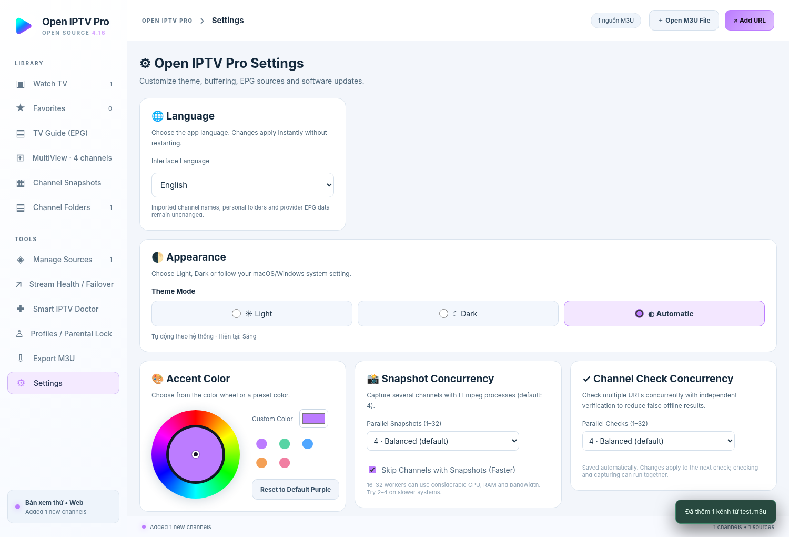

# Open IPTV Pro

## 🇻🇳 Tiếng Việt

**Open IPTV Pro** là phần mềm xem và quản lý IPTV mã nguồn mở dành cho **Windows và macOS**, hỗ trợ 8 ngôn ngữ, danh sách M3U, lịch phát sóng XMLTV EPG, MultiView 4 kênh, Snapshot và kiểm tra/sửa luồng nhiều vòng.

### Tính năng

- **Nguồn M3U:** nhập file hoặc URL, quản lý nhiều nguồn, gộp kênh trùng và link dự phòng.
- **Phát IPTV:** danh sách kênh, thư mục, Yêu thích đồng bộ, xem trước và PiP khi hỗ trợ.
- **EPG & MultiView:** lịch phát sóng, tìm kiếm chương trình, nhắc lịch, xem 4 kênh cùng lúc.
- **Snapshot & kiểm tra link:** chụp ảnh hàng loạt, phân loại Sống / Die / Chưa rõ; tối đa 32 tác vụ kiểm tra và 32 tác vụ chụp đồng thời.
- **Timeshift:** bộ đệm 5 phút kể từ khi bật ghi nếu nguồn hỗ trợ.
- **Tùy chỉnh:** Sáng/Tối/Tự động, màu giao diện, hồ sơ, PIN cơ bản.

### Ngôn ngữ

Vào **Cài đặt → Ngôn ngữ** để chọn Tiếng Việt, English, Español, Português (Brasil), 简体中文, ไทย, ລາວ hoặc ភាសាខ្មែរ. Tên kênh và dữ liệu EPG từ nguồn không tự dịch.

### Cài đặt và build

- Trên Mac dùng `BUILD_MAC.command`; trên Windows dùng `BUILD_WINDOWS.bat`.
- Cần Node.js 22+ và npm để tạo bộ cài. Các bản build chưa ký có thể bị Gatekeeper/SmartScreen chặn.
- Bản 4.15 chỉ dành cho Windows/macOS; không cập nhật Android/iOS.

**Lưu ý:** Không kèm kênh truyền hình hoặc tài khoản thuê bao. Chỉ sử dụng luồng có quyền truy cập. Giấy phép MIT chỉ áp dụng cho mã nguồn phần mềm; dữ liệu truyền hình và thư viện bên thứ ba có giấy phép riêng.

---

## 🇬🇧 English


**Open-source IPTV desktop player for macOS and Windows, featuring an 8-language interface, M3U playlists, XMLTV program guides, four-channel MultiView, snapshots, and multi-pass stream health checks.**


> **v4.15.0 · Desktop only.** Android and iOS source code are intentionally **not** included or updated in this release. The project is licensed under the MIT License; bundled dependencies have their own licenses (see [THIRD_PARTY_NOTICES.md](THIRD_PARTY_NOTICES.md)). This repository does **not** include commercial television streams, pirated playlists, or viewing rights.

## Languages

In **Settings → Language**, choose from:

| Language | Display name | Locale |
| --- | --- | --- |
| Vietnamese | Tiếng Việt | `vi` |
| English | English | `en` |
| Spanish | Español | `es` |
| Portuguese (Brazil) | Português (Brasil) | `pt-BR` |
| Simplified Chinese | 简体中文 | `zh-CN` |
| Thai | ไทย | `th` |
| Lao | ລາວ | `lo` |
| Khmer (Cambodian) | ភាសាខ្មែរ | `km` |

Language changes apply immediately and are saved locally. The application translates navigation, main controls, settings, tooltips, and key workflows; some technical messages may remain in their original wording while translations are being expanded. **Imported channel names, user-created folder names, EPG program names, and source metadata are not machine-translated or modified.** All translation files are available in [`renderer/locales/`](renderer/locales/) and can be improved through pull requests.



## Features

- **Playlist management:** add local M3U files or URLs, refresh sources, import public M3U files from GitHub repositories, merge duplicates, and maintain backup streams.
- **IPTV player:** HLS/MP4 playback, favorites synchronized between screens, channel folders, drag-and-drop channel organization, aspect-ratio controls, and picture-in-picture (where supported).
- **EPG:** XMLTV program guide, mapping options, program search, and reminders while the app is running.
- **MultiView:** watch four channels at once. Hover over a pane to hear its audio; other panes stay muted.
- **Channel snapshots:** preview thumbnails, per-channel capture and bulk capture using bundled FFmpeg.
- **Stream health:** multi-step verification, online/offline/uncertain classification, cautious failover, health history, and Smart IPTV Doctor diagnostics.
- **Performance settings:** independently set up to **32 concurrent URL checks** and **32 snapshot jobs**. For reliability, start with four workers per task.
- **Timeshift:** local five-minute rolling buffer when enabled. The buffer only contains data recorded **since buffering began**, unless the provider supplies DVR/catch-up support.
- **Appearance:** Light, Dark, or automatic system mode; adjustable accent color.
- **Profiles:** separate favorites and basic local parental controls.

### What this app does not promise

Streams may require permissions or provider-specific authentication. A URL can play in a video player yet be inaccessible to automated probes; ambiguous cases are labeled **Unknown**, rather than definitively Offline. EPG coverage and catch-up depend on external sources. Local parental PINs are convenience controls, not operating-system security. Multiview, snapshots, timeshift, and high concurrency may consume significant CPU, RAM, bandwidth and disk space.

## Getting started

1. Download the source ZIP or clone this repository.
2. Import an `.m3u` file using **Open M3U File**, or use **Add URL** to fetch a playlist.
3. Choose a channel to watch. Save channels to Favorites, group them into folders, or open **Manage Sources** for link checks and deduplication.
4. Select **Settings → Language** for another interface language.

**For end users:** install an unsigned `.dmg`/`.exe` built from this repository; builds still need validation on the target operating system. We do not claim to ship signed/notarized installers here.

## Build from source

**Prerequisites:** Git (optional), Node.js 22+ and npm. The provided Mac build script can fetch a verified Node.js copy locally. The Windows build helper may download its build tools. An internet connection is required for the initial `npm install` and build dependencies.

```bash
npm install
npm test
npm run start
```

### macOS

Run `BUILD_MAC.command` from the project directory, or run one of:

```bash
npm run dist:mac:arm64  # Apple Silicon
npm run dist:mac:x64    # Intel
```

The generated `.dmg` is placed in `dist/`. Builds created without a signing identity may be blocked by Gatekeeper; release builds should be signed and notarized.

### Windows

Run `BUILD_WINDOWS.bat`, or install Node.js 22+ and use:

```powershell
npm install
npm test
npm run dist:win
```

Setup and portable `.exe` outputs are placed under `dist/`. Unsigned installers can trigger SmartScreen warnings.

### GitHub Actions

The workflow at `.github/workflows/tao-bo-cai.yml` provides separate Windows x64, macOS Intel and Apple Silicon build jobs. Workflows build source code **without automatically publishing installers**; they upload unsigned artifacts to that workflow run. The repository does not upload your saved IPTV playlists, favorites, EPG, snapshots, or tokens.

## Privacy and data

Application settings and imported playlists are stored on the user's machine. Remote playlist, EPG, streaming and GitHub Release URL requests will contact the respective servers. Do not publish subscription tokens, private playlists, provider credentials, or copyrighted streams in a public Git repository. The **publish to GitHub/Gist** feature has been removed from the app.

## Project structure

```text
renderer/                 Desktop user interface, translations and UI logic
renderer/locales/         Editable JSON translation dictionaries
renderer/i18n.js          Language switching and DOM translation
src/                      Desktop native processes, streaming and FFmpeg integrations
assets/                   Application icons
examples/demo.m3u         Synthetic sample playlist
scripts/                  Platform build helper scripts
tests/                    Node and UI regression tests
docs/                     Additional guides and screenshots
.github/workflows/        CI and installer build jobs
```

## Documentation and contribution

- [Build guide](docs/BUILD.md)
- [Vietnamese guide](docs/README_VI.md)
- [English user guide](docs/USER_GUIDE_EN.md)
- [GitHub repository description](docs/GITHUB_DESCRIPTION_EN.md)
- [Contributing](CONTRIBUTING.md)
- [Security](SECURITY.md)
- [MIT License](LICENSE)

Translations are community-editable. Please preserve placeholders and technical identifiers such as `M3U`, `XMLTV`, `EPG`, `FFmpeg`, `HLS`, and `URL`. Before submitting a translation, run the UI language-switching smoke test and review text clipping on smaller screens.

## Legal notice

Open IPTV Pro is a player and playlist-management application. It does not provide pay-TV accounts, subscriptions or rebroadcasting rights. Use streams only when you have permission to view or redistribute them. This project's MIT license covers the application's own source code only, not the legal status of any third-party streams or EPG data.
