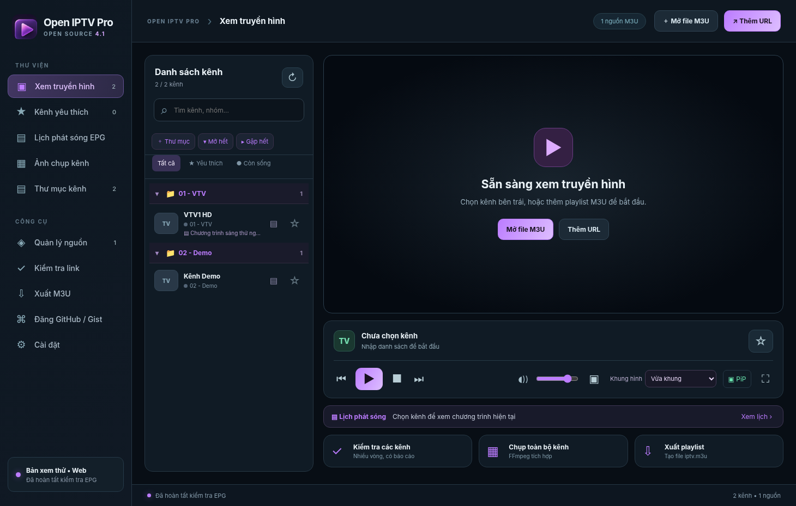
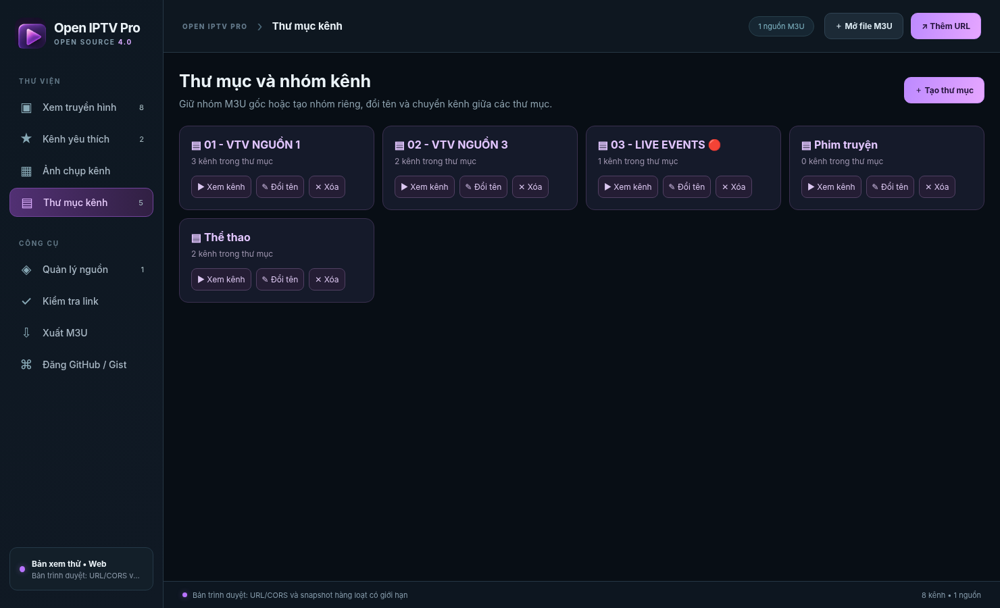
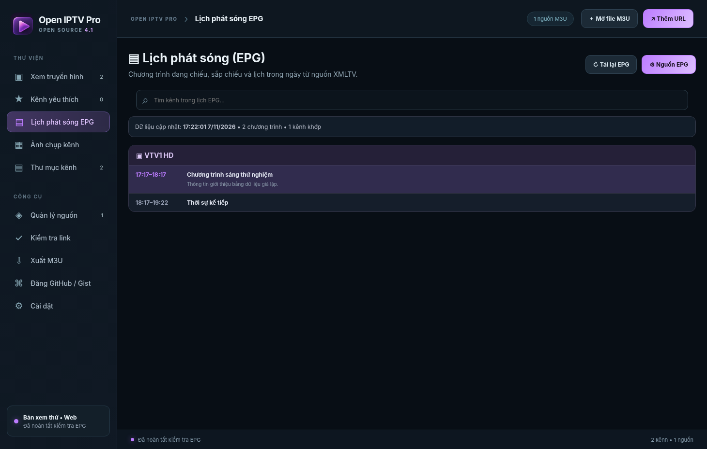
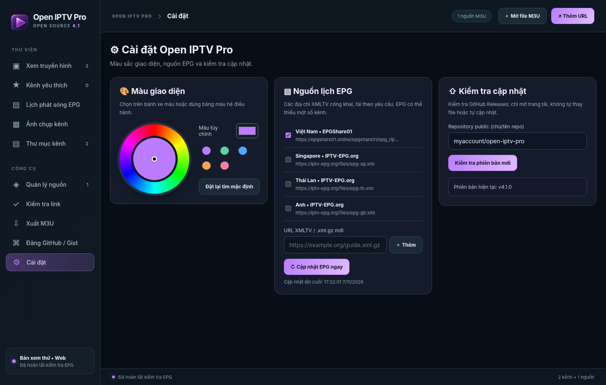

# Open IPTV Pro v4.1.0

**Open IPTV Pro** is an open-source M3U IPTV player for **macOS and Windows** (Electron + HLS.js) featuring XMLTV EPG schedules, Picture-in-Picture, a color wheel theme picker, GitHub release checks, channel folders, favorites, snapshots, and stream health checks. **No channels, playlists, pay-TV access or playback rights are provided.**

> **Current status:** source-code/test release. macOS `.dmg` and Windows `.exe` are generated by GitHub Actions or the included build scripts. No precompiled installer is included in this source ZIP. Builds are unsigned unless separately signed and notarized.

## Features

- Add playlists from **M3U/M3U8 file or URL** and manage, enable, rename, refresh or remove sources.
- Organize channels by **M3U `group-title` folders**, expand/collapse folders, create/rename/delete folders, and move channels between folders.
- Play HTTP(S) **HLS and supported browser video formats**; pause (when supported), next/previous channel, volume and fullscreen.
- Resize modes: **Fit**, **Fill/Crop**, **Stretch** and **Original pixels**; fullscreen padding uses CSS safe-area insets where available (Mac notch).
- **Snapshots:** capture the current channel or use FFmpeg to capture each channel; attach the latest thumbnail to each channel in the list. On desktop, snapshots are stored in the app's user-data folder, not in localStorage.
- Verify links in multiple rounds with classified results (alive/dead/uncertain), export M3U, optionally publish to GitHub/Gist **only after confirmation**.
- **EPG / XMLTV:** preconfigured publicly reachable guide URLs (Vietnam via EPGShare01, Singapore, Thailand and UK via IPTV-EPG.org), custom XMLTV `.xml`/`.xml.gz` HTTPS feed, manual refresh, `tvg-id` / channel-name matching, now/next and EPG schedule page. Downloads occur on demand; the player does not bundle or redistribute third-party programme-guide data. EPG coverage is not guaranteed.
- **Picture-in-Picture:** PiP button next to fullscreen; requires a playing compatible HTML5 video and OS/media support.
- **Theme:** color-wheel hue selection, native color picker and preset swatches in Settings; persisted across restarts.
- **Updates:** check latest **GitHub Releases** from the public `owner/repo` entered in Settings. It never downloads, installs or replaces executables automatically. A public GitHub Release is needed before the check can succeed.
- Clean player: removed the intrusive **LIVE IPTV** and **Đang phát** overlays, keeping status in the app footer and the programme panel.
- Mac Intel + Apple Silicon and Windows x64 installer build workflows.

**Documentation:** [Vietnamese user manual](docs/HUONG_DAN_SU_DUNG.md) · [Screenshot gallery](docs/ANH_MINH_HOA.md) · [Publish to GitHub](docs/DANG_GITHUB.md)

## EPG sources and licensing

The source code for this app is licensed under MIT. The preset **programme-guide URLs are public third-party services**, but publicly available **does not automatically mean open-source licensed data**. Do not repackage or mirror their EPG data without checking each provider's terms.

Preset URLs (accessed only if enabled and refreshed):
- Vietnam: `https://epgshare01.online/epgshare01/epg_ripper_VN1.xml.gz`
- Singapore: `https://iptv-epg.org/files/epg-sg.xml`
- Thailand: `https://iptv-epg.org/files/epg-th.xml`
- United Kingdom: `https://iptv-epg.org/files/epg-gb.xml`

You can generate your own XMLTV guide using the community project's open-source tools at [iptv-org/epg](https://github.com/iptv-org/epg) and supply a hosted XMLTV URL to the app. This repository does not include any scraped listings. Remote downloads are bounded; EPG is cached locally after download, and stale cached data is kept on failed refresh. For best matching, add the `tvg-id` attribute in each M3U `#EXTINF` header; the app also attempts display-name matching.

**Browser-only preview caveat:** `.xml.gz` EPG decompression and some network playback features require the desktop build. The desktop app uses its own HTTPS XMLTV downloader and gzip decoder.

## Download / Install (end user)

1. Open your repository's **Actions** → **Build Open IPTV Pro** → **Run workflow**.
2. Download the relevant build artifact when the workflow succeeds:
   - Mac **Apple Silicon** → `mac-apple-silicon-arm64` DMG.
   - Mac **Intel** → `mac-intel-x64` DMG.
   - Windows 10/11 64-bit → Windows Setup / Portable EXE.
3. Mac: mount DMG → move Open IPTV Pro to Applications. Windows: run Setup EXE or Portable EXE.

**Unsigned builds:** macOS Gatekeeper and Windows SmartScreen may warn. For trusted distribution, provide Apple Developer ID signing + notarization and Windows code signing. There is no guarantee of compatibility with every machine, every OS version, or every media codec.

## Build locally

Requires Internet for dependencies the first time. Scripts download a **local Node.js runtime** if Node is not already installed, verify SHA-256 and install npm dependencies into this project directory; they don't require a global Python/Qt/VLC installation.

**macOS:** double-click `BUILD_MAC.command` or run `bash BUILD_MAC.command`. DMG is written to `dist/` for the current machine's architecture.

**Windows:** double-click `BUILD_WINDOWS.bat` (runs a PowerShell helper). Output: Setup EXE + Portable EXE under `dist/`.

**With Node 22 installed:** `npm install && npm test && npm run start`; to package use `npm run dist:mac:arm64`, `npm run dist:mac:x64`, or `npm run dist:win` on the respective platform.

A universal Mac build is possible with Electron (`npm run dist:mac:universal`), **but FFmpeg bundled for one CPU architecture may need a per-architecture merge**, so the provided CI deliberately publishes **two native Mac DMGs** instead of claiming a universal build is verified.

## Create a NEW public GitHub project

Mac: double-click **`DANG_GITHUB_PUBLIC_MAC.command`** or run `bash DANG_GITHUB_PUBLIC_MAC.command`.

Windows: double-click **`DANG_GITHUB_PUBLIC_WINDOWS.bat`**.

Only the exact files in [`PUBLISH_FILES.txt`](PUBLISH_FILES.txt) are staged, instead of blindly adding every file in the project directory. The script uses **GitHub CLI** (`gh`) and interactive **browser login**, asks for the new repository name, checks that it does not already exist, lists files staged for publication, then requires typing `PUBLIC`. It does **not** overwrite an existing repo, use stored GitHub tokens or automatically upload user playlists. `.gitignore` blocks M3U, snapshot data, local caches, credentials and downloaded packages. **Review staged files before confirming.**

## Data and snapshot thumbnails

Desktop thumbnails live in the per-user application data directory under `snapshots/` and the app maintains image metadata locally. This prevents hundreds of channel snapshots from exhausting browser localStorage. The public repo contains only synthetic demo assets and screenshots. FFmpeg extraction may fail for inaccessible, DRM-protected or unsupported streams; this is not proof that a stream is dead.

## Legal / Security

- Source: [MIT License](LICENSE); dependencies have separate licenses in [Third-party notices](THIRD_PARTY_NOTICES.md).
- In particular review **FFmpeg distribution licensing** before releasing executable builds.
- This software is for streams you are authorized to access. No copyrighted channel content or real IPTV playlist is distributed.
- [Security](SECURITY.md) · [Contributing](CONTRIBUTING.md) · [Build details](docs/BUILD.md) · [Tiếng Việt](docs/README_VI.md)
