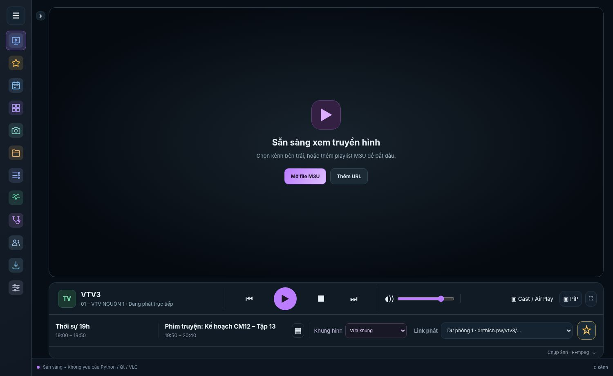
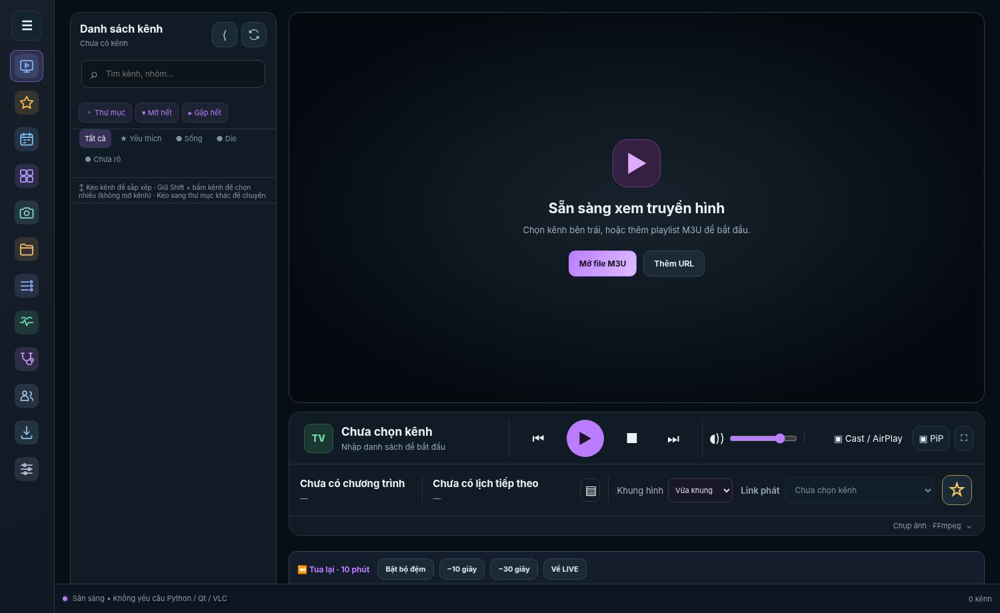

# Open IPTV Pro v4.23.37 — Desktop Source Release

**Date:** 2026-11-16  
**Platforms:** macOS (arm64/x64), Windows (x64)  
**Framework:** Electron 38 / Chromium  
**Repository:** `trisanghy/open-iptv-pro`  
**Version:** `4.23.37`

## Có gì mới

1. **Giao diện trình phát TV hai hàng** — Hàng trên: tên kênh, nút chuyển/phát/dừng kênh, âm lượng, Cast/AirPlay, PiP, fullscreen. Hàng dưới: EPG hiện tại/tiếp theo, khung hình, chọn link chính/dự phòng thủ công, đánh dấu yêu thích. Không đặt thanh điều khiển đè lên video.
2. **Danh sách kênh thu gọn thông minh** — Nút mở lại được giảm còn 50% kích thước, khoảng chừa bên trái cũng giảm tương ứng; vùng phát tận dụng chiều rộng còn lại. Thu gọn/mở lại độc lập với sidebar.
3. **Sidebar thu gọn nhất quán** — Nút ☰ và các biểu tượng menu căn giữa, khoảng cách hợp lý.
4. **Quản lý kênh** — Kéo thả sắp xếp thư mục và kênh; kéo kênh giữa thư mục; Shift-click để chọn nhiều kênh mà không cần checkbox.
5. **Cấu hình gọn hơn** — Hộp chọn số luồng kiểm tra link, số luồng Snapshot và thời lượng bộ đệm tua lại.
6. **Cập nhật trên macOS** — Sau khi tải DMG và kiểm tra toàn vẹn thành công, mở DMG rồi thoát ứng dụng để tiến hành cài đặt thủ công; lỗi mở DMG không buộc ứng dụng thoát. Windows giữ quy trình cập nhật riêng.
7. **Giữ các chức năng desktop** — HLS/DASH, FFmpeg, Timeshift, ghi hình DVR, EPG, Snapshot, MultiView, Cast/AirPlay, Auto Failover, quản lý playlist và giao diện đa chủ đề.

## Ảnh chụp giao diện

*Ảnh chụp bố cục Chromium; dữ liệu EPG/video minh họa, không xác nhận tính ổn định khi phát luồng IPTV thật.*

## Mã nguồn / Build

- [ZIP mã nguồn đúng v4.23.37](source/OpenIPTVPro_Source_v4.23.37.zip)
- SHA-256: `d312ed8e2f82ff9fe195b7f6e29a174949542258fd93d403019e9951a6241f7a`
- Mac một lệnh (nguồn trên nhánh `iptv-build-source`):  
  `bash -c 'set -o pipefail; curl -fsSL https://raw.githubusercontent.com/trisanghy/open-iptv-pro/iptv-build-source/build-mac.sh | bash'`
- Chạy từ source: `npm install`, `npm test`; `npm run dist:mac:arm64` hoặc `npm run dist:win` tùy hệ điều hành.

## Kiểm thử

- 266 bài được ghi nhận: **264 đạt**, **0 thất bại**, **2 bỏ qua**.
- Đã kiểm tra chức năng giao diện & source bằng Chromium/Node; tạo DMG trên máy Mac thật và phát luồng IPTV thực tế vẫn cần kiểm tra sau khi build.

**Lưu ý:** Đây là bản cập nhật mã nguồn GitHub, không phải GitHub Release phát hành DMG/EXE.
