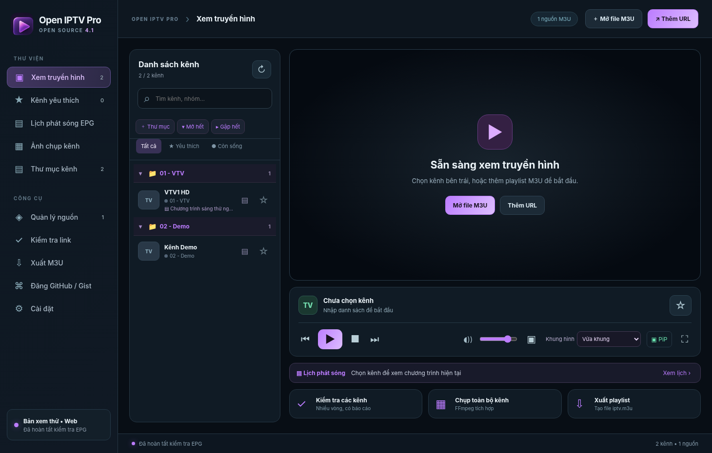
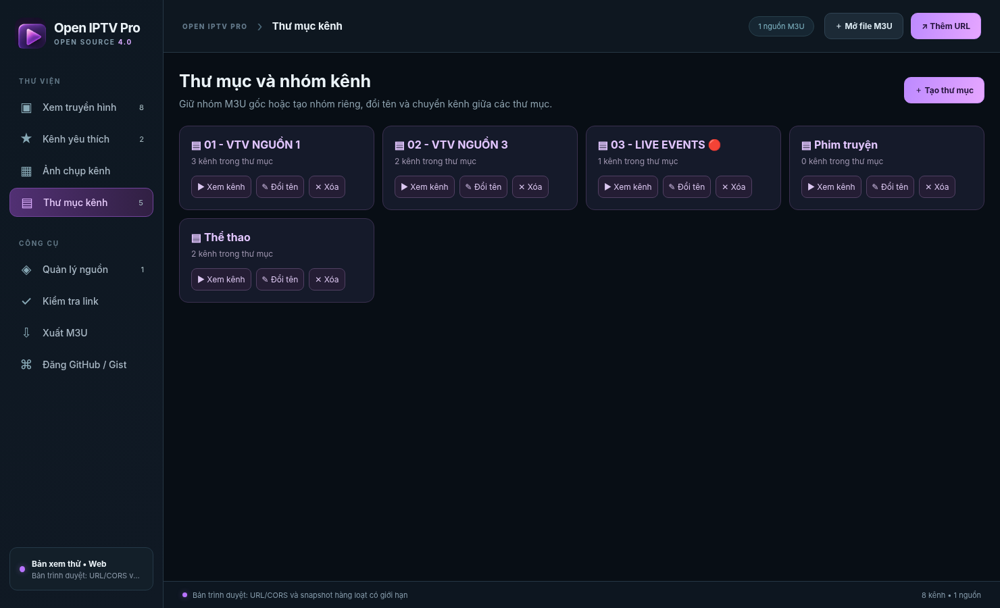
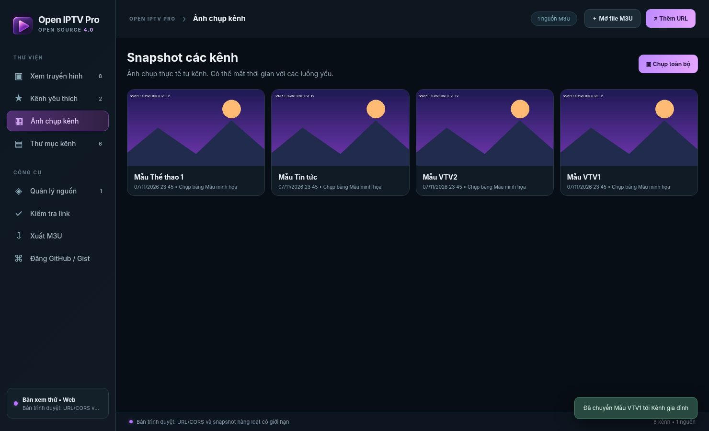
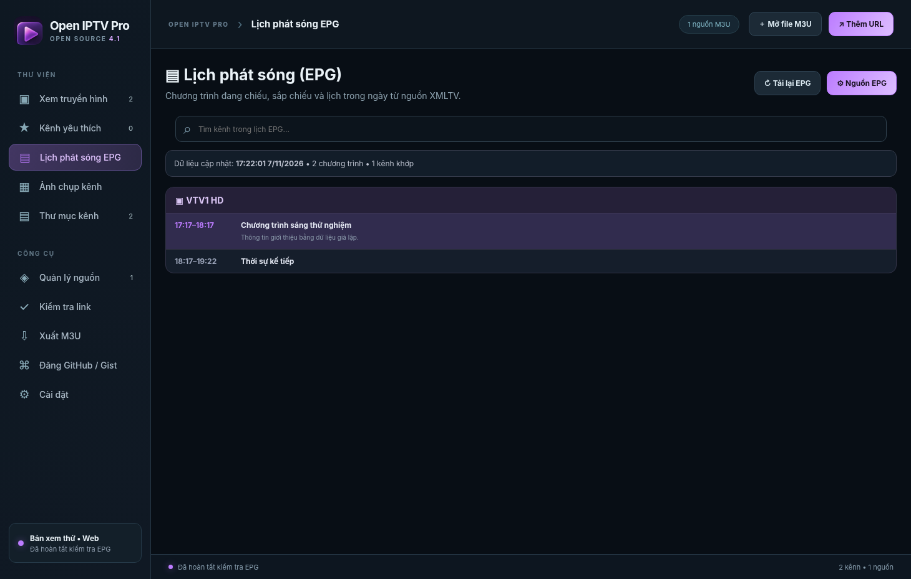
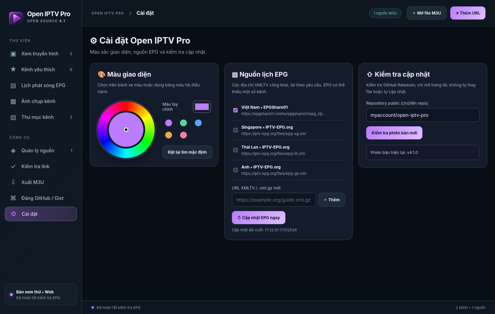
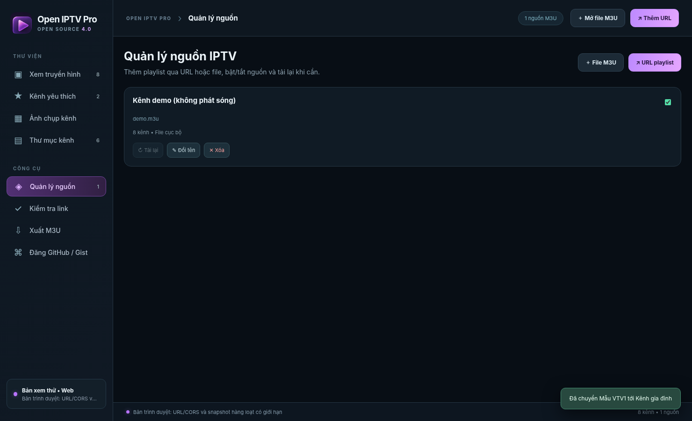

# Ảnh minh họa giao diện

Các ảnh dưới đây là ảnh chụp **giao diện ứng dụng dùng dữ liệu demo/giả lập**, không phải bằng chứng video thật đã phát được trên mọi máy. Ảnh lưu trong `docs/images/`, được phép tái sử dụng cùng tài liệu của dự án theo LICENSE trong phạm vi tác giả có quyền đối với thành phần hình ảnh.

## Giao diện chính

## Quản lý kênh theo thư mục

## Thư viện snapshot demo

## Lịch chương trình EPG

## Bánh xe chọn màu và cài đặt

## Quản lý nguồn

