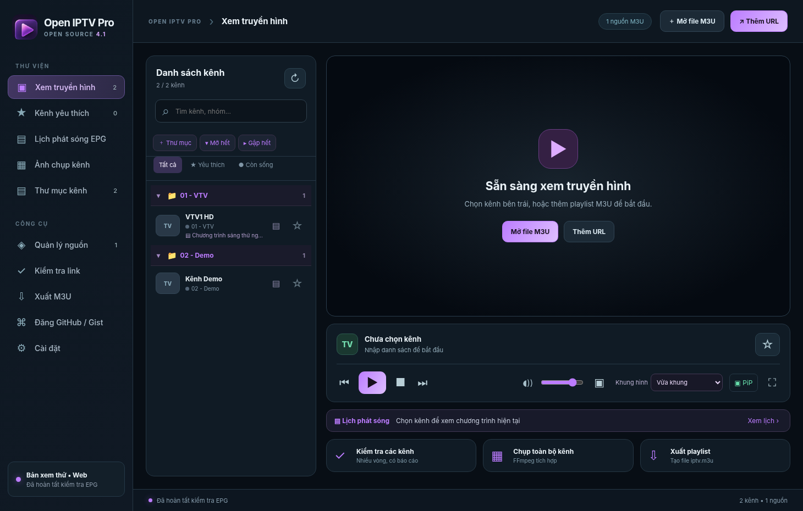
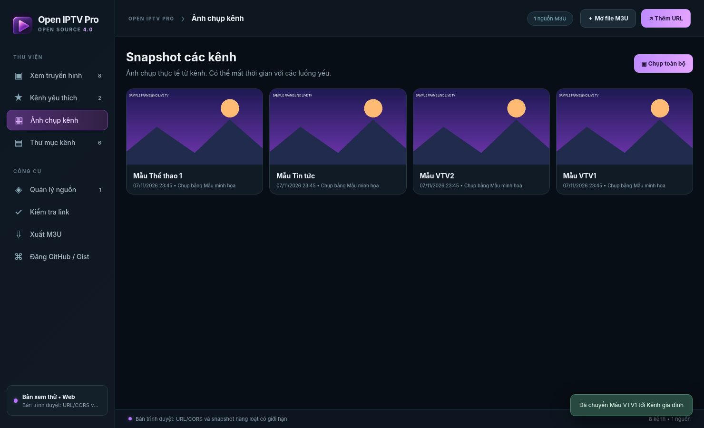
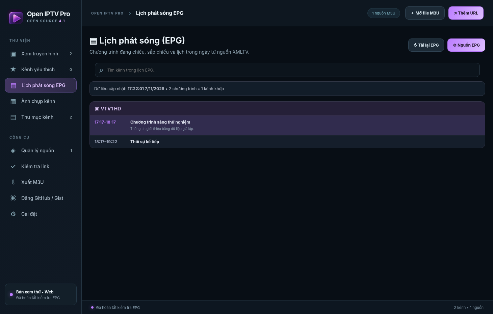
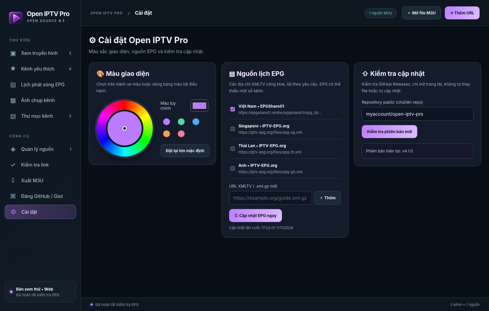

# Hướng dẫn sử dụng Open IPTV Pro 4.1

> Phần mềm chỉ phát các nguồn truyền hình mà bạn có quyền truy cập. Kho mã nguồn này không cung cấp playlist có bản quyền, tài khoản IPTV hoặc nội dung phát sóng.

## 1. Cài đặt

Sau khi workflow GitHub Actions chạy thành công, vào **Actions → Build Open IPTV Pro** và tải tệp ở mục **Artifacts** phù hợp với máy:

- **Mac Apple Silicon (M1/M2/M3/M4...)**: gói `mac-apple-silicon-arm64`, giải nén rồi mở DMG, kéo ứng dụng vào Applications.
- **Mac Intel**: gói `mac-intel-x64`, cài qua DMG tương ứng.
- **Windows 10/11 x64**: gói `windows-x64`, chạy tệp Setup EXE hoặc Portable EXE.

Bộ cài tạo từ mã nguồn ở đây **chưa được ký số**. Nếu macOS/Windows cảnh báo, chỉ mở ứng dụng sau khi bạn đã xác minh nguồn và tin tưởng nội dung. Tránh tắt tính năng bảo mật của hệ điều hành trên toàn máy.

## 2. Nạp danh sách IPTV

- Nhấn **Mở file M3U** để chọn file `.m3u`/`.m3u8` của bạn.
- Hoặc nhấn **Thêm URL** và dán đường dẫn playlist; đặt tên nguồn rồi tải danh sách.
- Vào **Quản lý nguồn** để bật/tắt, làm mới hoặc xóa nguồn. Không đưa URL có thông tin đăng nhập lên GitHub public.

Playlist thử có ở [`examples/demo.m3u`](../examples/demo.m3u), sử dụng các địa chỉ `example.invalid`, **không phát được video thật** và chỉ để minh họa cấu trúc.

## 3. Xem và sắp xếp kênh

- Chọn kênh từ danh sách bên trái, dùng nút **Phát / Tạm dừng / Dừng / Trước / Tiếp**.
- Bấm dấu sao để đưa kênh vào **Yêu thích**.
- Nhóm mặc định đọc từ `group-title` của M3U. Bạn có thể **tạo, đổi tên, xóa, mở/gập thư mục và chuyển kênh sang nhóm**.
- Trong trình phát, chọn **Vừa khung / Lấp đầy / Kéo giãn / Kích thước gốc** theo tỷ lệ màn hình.
- Nhấn **PiP** để đưa video vào cửa sổ nổi khi trình phát và hệ điều hành hỗ trợ.

## 4. Ảnh chụp Snapshot

- Mở một kênh và chọn **Chụp ảnh** để lấy khung hình hiện tại.
- Chọn **Chụp toàn bộ kênh** để thử lấy hình thu nhỏ lần lượt bằng FFmpeg.
- Ảnh gần nhất gắn cạnh tên kênh; mở trang **Ảnh chụp kênh** để xem dạng lưới.
- Ảnh lưu trên thiết bị cá nhân, không được đẩy lên repository. Các luồng bị khóa/DRM hoặc không ổn định có thể không chụp được.

## 5. Kiểm tra link và xuất playlist

- Mở **Kiểm tra link** để kiểm tra nhiều vòng với HTTP/HLS và dữ liệu video khi có thể.
- Xem trạng thái **sống / lỗi / chưa xác định**; kết quả là phép đo tại thời điểm kiểm tra, không bảo đảm link phát liên tục về sau.
- Nhấn **Xuất M3U** để tạo `iptv.m3u`. Theo quy tắc có sẵn, nhóm thứ ba có thể gắn thời điểm kiểm tra và kênh lỗi được phân nhóm 99.
- Công cụ **Đăng GitHub/Gist** trong ứng dụng là dành cho **playlist người dùng**, khác với script đăng **mã nguồn phần mềm** trong thư mục gốc. Chỉ dùng với repository/Gist mà bạn có quyền, và chú ý tính riêng tư.

## 6. Lịch EPG

- Vào **Cài đặt → Nguồn lịch EPG**, chọn nguồn XMLTV và bấm **Cập nhật EPG ngay**.
- Xem chương trình hiện tại/tiếp theo ở trình phát hoặc mở trang **Lịch EPG**.
- Thêm URL HTTPS `.xml` hoặc `.xml.gz` nếu nguồn cài sẵn chưa phù hợp. Ghép kênh ưu tiên `tvg-id`, sau đó thử tên kênh.
- Nguồn EPG công khai không đảm bảo đầy đủ hoặc được phép phân phối lại; dữ liệu không đi kèm repository.

## 7. Cài đặt giao diện và cập nhật

- Vào **Cài đặt → Màu giao diện** để kéo bánh xe màu, chọn màu trong bảng hoặc dùng color picker.
- Vào **Kiểm tra cập nhật**, nhập `tên-tài-khoản/open-iptv-pro` sau khi bạn đã tạo repository và phát hành **GitHub Release**.
- Chức năng chỉ kiểm tra phiên bản và mở trang Release; **không tự cài hoặc ghi đè ứng dụng**.

## Lỗi thường gặp

- **Không phát được HLS:** kiểm tra URL nguồn, thời hạn token của kênh, codec, DRM hoặc mạng. Link HTTP 200 chưa đủ chứng minh video phát được.
- **Không có lịch EPG:** kiểm tra `tvg-id` và phạm vi dữ liệu của nguồn XMLTV.
- **Snapshot trắng/đen:** luồng không hỗ trợ trích khung hình, thiếu dữ liệu hoặc có giới hạn truy cập.
- **PiP không hoạt động:** thử một luồng HTML5 tương thích và đảm bảo video đã chạy.
- **Mac hiện cảnh báo bảo mật:** bản tự build chưa ký số; xem hướng dẫn tại [`BUILD.md`](BUILD.md).
