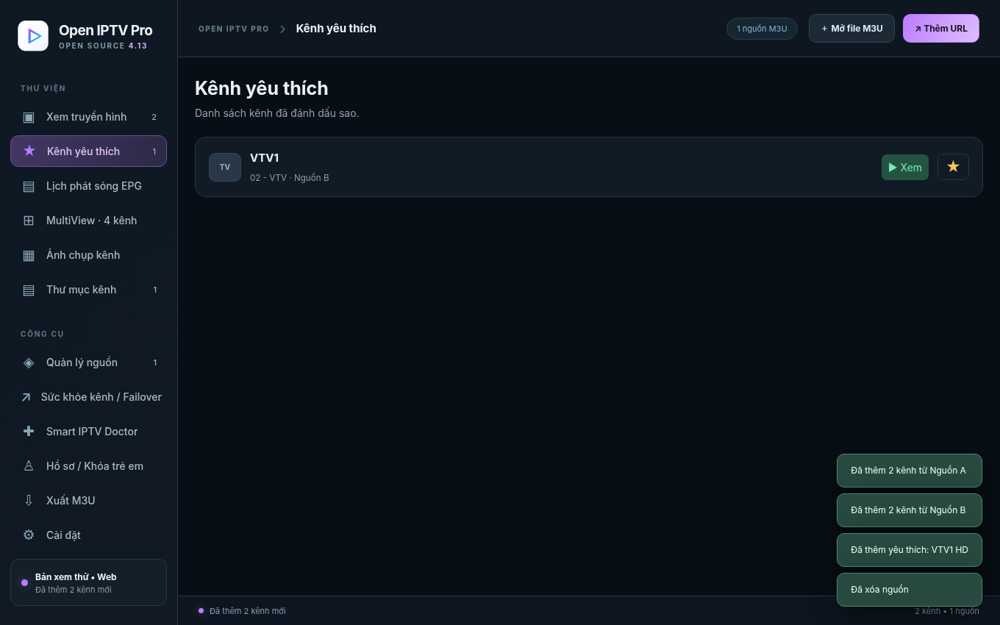

# Open IPTV Pro v4.15 — Hướng dẫn Windows và Mac

**Bản này chỉ dành cho desktop**, không thay đổi Android/iOS.

## Đổi ngôn ngữ giao diện

Vào **Cài đặt → Ngôn ngữ** để chọn một trong 8 ngôn ngữ: Tiếng Việt, English, Español, Português (Brasil), 简体中文, ไทย, ລາວ, ភាសាខ្មែរ.

Giao diện đổi ngay khi chọn và ghi nhớ lần sau mở ứng dụng. Các tên kênh, nhóm M3U do bạn đặt và thông tin chương trình EPG không bị dịch hoặc thay đổi. Phần lớn nhãn điều hướng, Cài đặt và các thao tác chính đã được dịch; một số thông báo kỹ thuật chuyên sâu chưa được dịch hoàn toàn và có thể được hoàn thiện qua tệp `renderer/locales/*.json`.

**Mô tả GitHub tiếng Anh:** `GITHUB_ABOUT_EN.txt` (ngắn) hoặc `docs/GITHUB_DESCRIPTION_EN.md` (đầy đủ). README chính đã viết bằng tiếng Anh.

**Tạo bộ cài:** Mac chạy `BUILD_MAC.command`; Windows chạy `BUILD_WINDOWS.bat`. Đây là mã nguồn chưa có `.dmg`/`.exe` build sẵn.

---

## Mới v4.13 — Đồng bộ yêu thích & icon
- Nút sao ở Xem TV, khung phát, Yêu thích và Snapshot cập nhật đồng thời.
- Giữ trạng thái theo kênh khi đổi nguồn; đồng bộ với hồ sơ.
- Icon mới được đóng gói cho macOS/Windows.

## Mới v4.12 — 32 luồng kiểm tra kênh và 32 Snapshot

Vào **Cài đặt** chọn độc lập số tác vụ đồng thời **1–32** cho kiểm tra link và Snapshot; mặc định vẫn 4. Mức 32 cũng áp dụng khi kiểm tra và thay link dự phòng trong **Quản lý nguồn**. Có thể thay số luồng từ hộp chọn nhanh ở Quản lý nguồn hoặc Ảnh chụp kênh. Có thể chạy cả hai cùng lúc; khi sử dụng 32/32, app có thể chạy tới 64 tác vụ mạng/FFmpeg nên hãy quan sát mức tải CPU, RAM, đường truyền và phản hồi HTTP 429. Thay đổi cấu hình chỉ áp dụng cho lượt chạy tiếp theo.

## Mới v4.11 — Số luồng kiểm tra và Snapshot

Vào **Cài đặt** để chọn độc lập 1–16 luồng kiểm tra link và 1–16 luồng Snapshot, mặc định 4. Có thể chọn nhanh từ **Quản lý nguồn → Kiểm tra & sửa** hoặc **Ảnh chụp kênh**. Thay đổi có hiệu lực ở lượt tiếp theo; không tự hủy tác vụ đang chạy. Tránh đặt 16/16 nếu máy yếu, băng thông hạn chế hoặc máy chủ chặn quá nhiều yêu cầu cùng lúc.

## v4.9 — Đồng bộ Yêu thích & sửa báo Die nhầm

Kênh yêu thích được lưu theo danh tính kênh (không chỉ theo URL). Thêm/xóa/tắt nguồn và cập nhật URL tự đồng bộ danh sách. Khi có nhiều URL của cùng một kênh, trang Yêu thích chỉ hiện một bản. Hồ sơ cá nhân có danh sách yêu thích riêng.

Bộ kiểm tra thử HLS segment gần đây và dữ liệu video với nhiều cách yêu cầu HTTP. Lỗi mạng, HTTP 403/429/5xx hoặc segment hết hạn được đánh dấu **Chưa rõ**; chỉ kết luận **Die** sau khi URL luồng chính trả 404/410 nhất quán qua nhiều vòng. Kênh đã được phát thành công trên trình phát sẽ được cập nhật **Sống**.

**Sau nâng cấp:** kết quả Die từ phiên bản trước được đưa về Chưa rõ. Vào **Quản lý nguồn → Kiểm tra & sửa → Kiểm tra toàn bộ kênh** để lấy kết quả mới. Không phải nhập lại playlist hoặc yêu thích.

## v4.8: Giao diện Sáng/Tối/Tự động & Kiểm tra link trong Quản lý nguồn

- Vào **Cài đặt → Chế độ hiển thị**: chọn **☀ Sáng**, **☾ Tối** hoặc **◐ Tự động**. Mặc định Tự động, theo màu hệ thống và đổi khi hệ điều hành đổi. Thiết lập lưu trên máy, giữ nguyên dữ liệu M3U đã thêm.
- Vào **Quản lý nguồn → Kiểm tra & sửa**: chọn **Kiểm tra toàn bộ kênh** để phân loại Sống/Die/Chưa rõ theo thời gian thực, hoặc **Kiểm tra & thay link dự phòng** để kiểm thử và sửa playlist hợp nhất. Có thanh tiến độ nổi và hủy độc lập.
- Đã bỏ mục **Kiểm tra link** độc lập trên thanh công cụ. Lối tắt tại trang Xem truyền hình dẫn đến đúng phần Quản lý nguồn.

Ảnh minh họa: [Cài đặt giao diện sáng](images/settings-theme-light-v4-8.png) · [Quản lý nguồn](images/source-checks-v4-8.png).

# Open IPTV Pro — Hướng dẫn tiếng Việt

## v4.7: Gộp toàn bộ công cụ vào Quản lý nguồn

Vào **Quản lý nguồn**. Mọi việc đều thực hiện ở đây: xem danh sách nguồn; thêm file/URL; tìm playlist trong repo GitHub công khai; chọn nguồn tự thu thập; phân tích và gộp kênh trùng; kiểm tra/sửa link và chọn dự phòng; xuất M3U đã xác minh; hoàn tác; xem báo cáo. Trang **Thu thập & sửa kênh** riêng đã được bỏ. Chọn thanh điều hướng nhanh đầu trang để đi đến từng phần.

Icon ứng dụng đổi thành **nền sáng, tam giác Play đa sắc** (trong gói có PNG, ICO cho Windows và ICNS cho macOS). Bản hiện tại vẫn là **mã nguồn**; `.dmg` và `.exe` cần chạy script build.

## Mới trong v4.6 – Bộ đệm mặc định, xem trước mọi tab, gộp kênh ở Quản lý nguồn

- **Bật bộ đệm 5 phút tự động:** Vào **Cài đặt → Timeshift mặc định**, bật “Tự bật bộ đệm tua lại 5 phút khi mở kênh”. Thiết lập được nhớ sau khi đóng app. Chỉ hoạt động trên bản desktop có FFmpeg; bộ đệm tích lũy sau khi bắt đầu xem, không có ngay 5 phút quá khứ. Nếu luồng không hỗ trợ, ứng dụng vẫn giữ chế độ LIVE.
- **Xem trước không tiếng:** Rê chuột vào kênh tại Xem TV, Yêu thích, Ảnh chụp kênh, EPG hoặc bảng Sức khỏe kênh. Popup sẽ dùng ảnh snapshot làm poster, sau đó thử phát xem trước ở chế độ tắt tiếng. Nguồn giới hạn số kết nối/CORS có thể không cho phát preview.
- **Gộp kênh trùng:** Vào **Quản lý nguồn**, tích chọn các nguồn M3U cần gộp, bấm **Phân tích kênh trùng** xem số lượng và URL dự phòng, rồi bấm **Gộp kênh đã chọn**. Có nút **Hoàn tác** để phục hồi các nguồn và danh sách trước khi gộp. Kênh chưa xác minh không bị gắn nhãn Sống.

## Cập nhật v4.3: Snapshot theo thư mục và kiểm tra link trực tiếp

- Trang **Ảnh chụp kênh** nhóm ảnh đúng theo thứ tự các thư mục trong M3U hoặc thứ tự bạn đã kéo-thả. Mỗi hàng có 5 ảnh trên cửa sổ rộng; nếu cửa sổ nhỏ, phần mềm tự giảm số cột để tránh tràn màn hình.
- Bạn có thể bấm **Kiểm tra các kênh** và **Chụp toàn bộ kênh** để chạy đồng thời. Hai tác vụ có tiến độ và nút dừng riêng; hủy một tác vụ không hủy tác vụ còn lại.
- Trong lúc kiểm tra, phần mềm hiển thị kết quả **Sống / Die / Chưa rõ** của các kênh đã kiểm tra, cập nhật số lượng ngay khi có kết quả. Đây là kết quả tại thời điểm kiểm thử, không phải đảm bảo liên tục phát được.
- Cửa sổ tiến độ nằm ở góc dưới bên phải, có nút thu gọn. Khi đóng gói desktop, FFmpeg vẫn cần khả dụng để chụp hàng loạt.

## Phần mềm gồm những gì?

- Nhập file hoặc URL M3U/M3U8; quản lý nhiều nguồn.
- Thư mục theo `group-title` trong file M3U, có thể tạo/đổi tên/xóa và chuyển kênh.
- Trình phát HLS/MP4, chuyển kênh, tạm dừng khi luồng hỗ trợ, âm lượng, toàn màn hình.
- Chế độ **Vừa khung**, **Lấp đầy (cắt mép)**, **Kéo giãn**, **Kích thước gốc**.
- **Ảnh chụp gắn kênh**: ảnh chụp hiện ở bên cạnh tên kênh, nằm trong trang Snapshot và lưu qua lần mở ứng dụng.
- Kiểm tra link nhiều vòng và xuất file `iptv.m3u` trên máy. Chức năng đăng GitHub/Gist đã được loại bỏ.
- Mac có xử lý safe-area khi toàn màn hình để giảm tình trạng thanh thông tin bị vùng notch che. Tùy cấu hình màn hình hệ điều hành có thể xử lý khác nhau.

## Tạo bộ cài từ nguồn

- Mac: nhấp đúp `BUILD_MAC.command` (script tự tải Node vào thư mục con nếu thiếu).
- Windows: nhấp đúp `BUILD_WINDOWS.bat`.
- Hoặc tạo repository public, vào GitHub **Actions → Build Open IPTV Pro → Run workflow**, lấy tệp trong Artifacts.

Bộ source ZIP **chưa phải bộ cài đã build**. Hai bản Mac Intel / Apple Silicon được build riêng để tránh xung đột FFmpeg. Bộ cài chưa ký có thể bị Gatekeeper/SmartScreen cảnh báo.

## Thu thập & sửa lỗi từ repository công khai (v4.5)

1. Mở **Thu thập & sửa kênh**. Nhập đúng URL repository GitHub chứa `.m3u` công khai, bấm **Tìm M3U**, đánh dấu các file cần đọc và **Thêm các playlist đã chọn**. Hoặc dùng nguồn URL/file đã nhập trước đó.
2. Sang **Quản lý nguồn**, chọn nguồn, bấm **Phân tích kênh trùng** rồi **Gộp kênh đã chọn** và xác nhận. Kênh trùng được hợp nhất; các URL khác của cùng kênh được lưu làm link dự phòng. Nguồn cũ vẫn được giữ lại ở chế độ tạm ẩn.
3. Bấm **Kiểm tra & sửa link** để thử luồng thực nhiều vòng, chuyển sang link dự phòng chỉ khi nó được xác minh còn phát. Kênh chưa xác minh được không bị loại bỏ tự động.
4. Chọn **Xuất playlist sạch** để xuất riêng kênh đã xác minh sống. Có **Hoàn tác lần gộp** và tùy chọn tự làm mới nguồn mỗi 60 phút khi app đang mở.

Không có chức năng đăng dữ liệu lên GitHub/Gist, không yêu cầu GitHub token. Kết nối repository chỉ ở chế độ đọc công khai; không chạy mã trong repository. Bản thử web bị hạn chế CORS, chức năng kiểm tra phát thực cần bản desktop.

Mã nguồn cấp phép MIT. FFmpeg, Electron, hls.js có điều khoản riêng; đọc `THIRD_PARTY_NOTICES.md` trước khi phát hành bộ cài.

**Quan trọng:** Không đưa playlist cá nhân, token, ảnh chụp nội dung truyền hình có bản quyền lên GitHub public. Chỉ dùng luồng mình có quyền truy cập.

## Tính năng mới trong v4.1

- **Lịch EPG:** Mở **Cài đặt → Nguồn lịch EPG**, bật nguồn Việt Nam hoặc quốc gia khác, bấm **Cập nhật EPG ngay**. Sau đó mở **Lịch phát sóng EPG**. Muốn khớp đúng kênh, nên dùng `tvg-id` chuẩn trong M3U. Có thể nhập URL `.xml`/`.xml.gz` khác; nguồn phải có HTTPS.
- **PiP:** Mở kênh, khi đã có hình thì nhấn **▣ PiP** cạnh nút toàn màn hình. PiP phụ thuộc hỗ trợ của video và hệ điều hành.
- **Màu giao diện:** Vào **Cài đặt → Màu giao diện**, chọn trên bánh xe hoặc color picker. Màu được lưu lại.
- **Kiểm tra cập nhật:** Vào **Cài đặt → Kiểm tra cập nhật**, nhập tên repo GitHub public dưới dạng `tai-khoan/open-iptv-pro`, bấm kiểm tra. Repo cần có GitHub Releases. App không tự cài bản cập nhật.
- Đã **bỏ hai nhãn LIVE IPTV và Đang phát** nằm đè trên video.

Nguồn dữ liệu EPG công khai có thể có điều khoản sử dụng riêng, không đồng nghĩa dữ liệu được phép phân phối lại dưới MIT. Các nguồn cài sẵn chỉ là đường dẫn, dữ liệu không được đóng gói cùng ứng dụng. Bản chạy thử bằng trình duyệt không giải nén `.gz`; chức năng này hỗ trợ trong bản desktop.
