# Positron — Nhật ký tính năng theo phiên bản

**Ưu tiên: tính năng mới hữu ích, không chỉ sửa giao diện.**

Trang này được tạo tự động từ GitHub Releases và ảnh kiểm thử Electron thật. Bấm vào từng phiên bản để đọc mô tả, mở ảnh và tải EXE.

[Xem mã nguồn website](index.html) · [Các bản phát hành](https://github.com/trisanghy/open-iptv-pro/releases) · [Quy tắc ưu tiên tính năng](../../POSITRON_FEATURE_RULES.md)

<strong>P5.1.133</strong> · readable compact channel names above separate favorite controls · ĐANG PHÁT TRIỂN · CẢI TIẾN / SỬA LỖI

**Ứng dụng:** 4.23.217 · **Trạng thái:** ĐANG PHÁT TRIỂN

P5.1.132 genuine Electron screenshot `positron-p51132-empty-search-clear-after-450-real.png` shows two-column 450px grid cards whose long "QA Channel 00…" labels are truncated beside the separate bottom Favorite star. Fix only in multi-result compact native GRID (not list, not wide single-result): reserve a dedicated 34px bottom action row; allow name to wrap to two lines; center the original 34px independent Favorite control below the title. Preserve native play action, keyboard and stored Favorite keys.

*Chưa có ảnh chụp riêng đã xác minh cho phiên bản này.*

[Release / thông tin](https://github.com/trisanghy/open-iptv-pro/tree/Positron) · [Commit](https://github.com/trisanghy/open-iptv-pro/commit/ae597a3d5399410dd97e6077f8b5f6f1764a0d7a)

<strong>P5.1.132</strong> · Mask ghost category text beside sticky All · ĐÃ PHÁT HÀNH · TÍNH NĂNG

**Ứng dụng:** 4.23.216 · **Trạng thái:** ĐÃ PHÁT HÀNH

Fix: when there are imported channels but no search results on All and search/group filters are active, add one native "Xóa bộ lọc và xem tất cả kênh" button. On click clear query and group, render all 18 page-1 cards and restore search focus. Existing CSS reused. Screenshots: `positron-p51132-empty-search-clear-before-450-real.png`, `positron-p51132-empty-search-clear-after-450-real.png`.

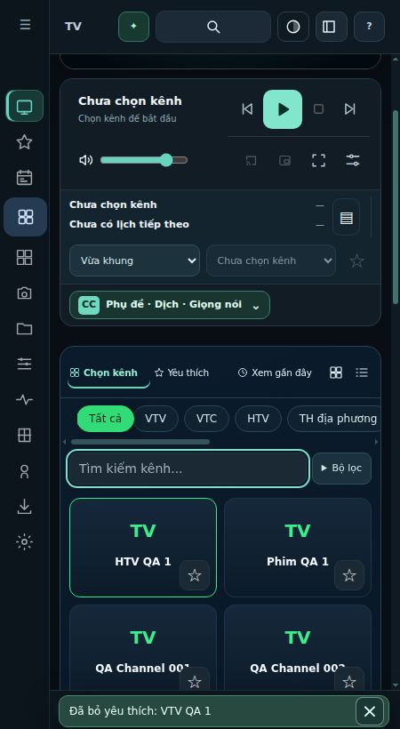

[Release / thông tin](https://github.com/trisanghy/open-iptv-pro/releases/tag/positron/v4.23.216-p5.1.132) · [Commit](https://github.com/trisanghy/open-iptv-pro/commit/eab0be6a1e9e6873894becc3a472b117fb60cea2) · [Tải Windows Setup x64](https://github.com/trisanghy/open-iptv-pro/releases/download/positron/v4.23.216-p5.1.132/Open-IPTV-Pro-Setup-4.23.216-x64.exe) · [Tải gói ảnh QA](https://github.com/trisanghy/open-iptv-pro/releases/download/positron/v4.23.216-p5.1.132/Positron-P51132-20-Real-Screenshots.zip)

<strong>P5.1.129</strong> · Mask ghost category text beside sticky All · ĐÃ PHÁT HÀNH · CẢI TIẾN / SỬA LỖI

**Ứng dụng:** 4.23.213 · **Trạng thái:** ĐÃ PHÁT HÀNH

Fix: native scroll synchronization toggles `po-groups-scrolled`; scoped right-side `::after` mask applies only while scrolled. No changes to playlist, playback, favorites, stored data or group semantics.

[Release / thông tin](https://github.com/trisanghy/open-iptv-pro/releases/tag/positron/v4.23.213-p5.1.129) · [Commit](https://github.com/trisanghy/open-iptv-pro/commit/c3754e3d196f4ef9354a93617f235cd89538166a) · [Tải Windows Setup x64](https://github.com/trisanghy/open-iptv-pro/releases/download/positron/v4.23.213-p5.1.129/Open-IPTV-Pro-Setup-4.23.213-x64.exe) · [Tải gói ảnh QA](https://github.com/trisanghy/open-iptv-pro/releases/download/positron/v4.23.213-p5.1.129/Positron-P51129-20-Real-Screenshots.zip)

<strong>P5.1.128</strong> · Reveal active quick-group after advanced filter change · ĐÃ PHÁT HÀNH · CẢI TIẾN / SỬA LỖI

**Ứng dụng:** 4.23.212 · **Trạng thái:** ĐÃ PHÁT HÀNH

Fix: on explicit dropdown group change, scroll only the currently active matching quick chip into view; resetting to All restores the rail start. Preserve original chip click focus restoration, no group/playlist write or automatic playback. Keep the historical `POSITRON_P5_CHANGELOG.md` intact in the bundled source, publish short notes with a pointer to the full file, and add a Node regression assertion against using full changelog as release notes.

[Release / thông tin](https://github.com/trisanghy/open-iptv-pro/releases/tag/positron/v4.23.212-p5.1.128) · [Commit](https://github.com/trisanghy/open-iptv-pro/commit/7003357116d97ec3d98c76af54071fd4e81b717d) · [Tải Windows Setup x64](https://github.com/trisanghy/open-iptv-pro/releases/download/positron/v4.23.212-p5.1.128/Open-IPTV-Pro-Setup-4.23.212-x64.exe) · [Tải gói ảnh QA](https://github.com/trisanghy/open-iptv-pro/releases/download/positron/v4.23.212-p5.1.128/Positron-P51128-20-Real-Screenshots.zip)

<strong>P5.1.127</strong> · Arrow-key channel group navigation on compact displays · ĐÃ PHÁT HÀNH · TÍNH NĂNG

**Ứng dụng:** 4.23.211 · **Trạng thái:** ĐÃ PHÁT HÀNH

Fix: add an event listener scoped to the native category row to focus previous/next/start/end buttons and scroll their target into view; changes no filters until explicit Enter/Space, preserves All button, no auto-play or source mutation.

[Release / thông tin](https://github.com/trisanghy/open-iptv-pro/releases/tag/positron/v4.23.211-p5.1.127) · [Commit](https://github.com/trisanghy/open-iptv-pro/commit/8bad7fc08d009c3529447d0389a176caabe30648) · [Tải Windows Setup x64](https://github.com/trisanghy/open-iptv-pro/releases/download/positron/v4.23.211-p5.1.127/Open-IPTV-Pro-Setup-4.23.211-x64.exe) · [Tải gói ảnh QA](https://github.com/trisanghy/open-iptv-pro/releases/download/positron/v4.23.211-p5.1.127/Positron-P51127-20-Real-Screenshots.zip)

<strong>P5.1.126</strong> · Mask clipped channel labels behind compact pinned All reset · ĐÃ PHÁT HÀNH · CẢI TIẾN / SỬA LỖI

**Ứng dụng:** 4.23.210 · **Trạng thái:** ĐÃ PHÁT HÀNH

Fix: add a scoped 22px dark mask using the original first chip's own ::before and let it capture pointer events, preventing invisible category selection in the masked region. Do not remove native group controls or modify playlists/playback.

[Release / thông tin](https://github.com/trisanghy/open-iptv-pro/releases/tag/positron/v4.23.210-p5.1.126) · [Commit](https://github.com/trisanghy/open-iptv-pro/commit/9aac59d3c7b66e5689a2d3f24e3da76d704e8483) · [Tải Windows Setup x64](https://github.com/trisanghy/open-iptv-pro/releases/download/positron/v4.23.210-p5.1.126/Open-IPTV-Pro-Setup-4.23.210-x64.exe) · [Tải gói ảnh QA](https://github.com/trisanghy/open-iptv-pro/releases/download/positron/v4.23.210-p5.1.126/Positron-P51126-20-Real-Screenshots.zip)

<strong>P5.1.125</strong> · Pin All Channels reset while browsing compact groups · ĐÃ PHÁT HÀNH · CẢI TIẾN / SỬA LỖI

**Ứng dụng:** 4.23.209 · **Trạng thái:** ĐÃ PHÁT HÀNH

Fix: make only the first native chip position:sticky at the left edge <=600px, preserving the full group catalog, native wheel/touch/keyboard, focus restoration and playlist/player behavior. It remains a normal button, no duplicate UI. New regression: Node test and actual Electron 450px screenshot `positron-p51125-pinned-all-450-real.png` plus geometry, hit-target, actual filter switch/reset, focus, overflow checks.

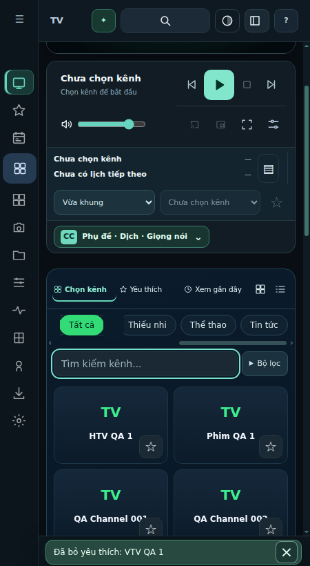

[Release / thông tin](https://github.com/trisanghy/open-iptv-pro/releases/tag/positron/v4.23.209-p5.1.125) · [Commit](https://github.com/trisanghy/open-iptv-pro/commit/b7cc07b69b8c3d503edb39f3284add1695a658ac) · [Tải Windows Setup x64](https://github.com/trisanghy/open-iptv-pro/releases/download/positron/v4.23.209-p5.1.125/Open-IPTV-Pro-Setup-4.23.209-x64.exe) · [Tải gói ảnh QA](https://github.com/trisanghy/open-iptv-pro/releases/download/positron/v4.23.209-p5.1.125/Positron-P51125-20-Real-Screenshots.zip)

<strong>P5.1.124</strong> · Mouse-wheel navigation for compact channel groups · ĐÃ PHÁT HÀNH · CẢI TIẾN / SỬA LỖI

**Ứng dụng:** 4.23.208 · **Trạng thái:** ĐÃ PHÁT HÀNH

Fix: wheel-to-horizontal navigation while rail can move, release native page scroll at edges, toned scroll indicator. Preserve touch, keyboard, group filters, favorite data, playlist and media transport. Verification: new Node regression, actual Electron 450px wheel/color/edge/overflow checks and screenshot `positron-p51124-chip-wheel-450-real.png`. Candidate pending CI, direct after-image and immutable binary release.

[Release / thông tin](https://github.com/trisanghy/open-iptv-pro/releases/tag/positron/v4.23.208-p5.1.124) · [Commit](https://github.com/trisanghy/open-iptv-pro/commit/808e2f8ef5260b4bd9b41dc2747ce3113256181d) · [Tải Windows Setup x64](https://github.com/trisanghy/open-iptv-pro/releases/download/positron/v4.23.208-p5.1.124/Open-IPTV-Pro-Setup-4.23.208-x64.exe) · [Tải gói ảnh QA](https://github.com/trisanghy/open-iptv-pro/releases/download/positron/v4.23.208-p5.1.124/Positron-P51124-20-Real-Screenshots.zip)

<strong>P5.1.123</strong> · Dismissible accessible notifications · ĐÃ PHÁT HÀNH · CẢI TIẾN / SỬA LỖI

**Ứng dụng:** 4.23.207 · **Trạng thái:** ĐÃ PHÁT HÀNH

Fix: at <=600px, success-only notifications dock into 36px existing footer strip at bottom:2px. Long success text ellipsizes, X remains 32x32. Any warnings or errors restore original elevated position/height and severity. Core native toast timers, state, channel data and playback untouched. Electron QA: real 450px footer and toast DOM bounding boxes, warning persistence, no overflow, photo `positron-p51123-success-toast-footer-450-real.png`. Candidate until all six CI jobs, direct visual review and installer Release verified.

[Release / thông tin](https://github.com/trisanghy/open-iptv-pro/releases/tag/positron/v4.23.207-p5.1.123) · [Commit](https://github.com/trisanghy/open-iptv-pro/commit/38011da89d7b384431bbf3babb9da4f581674340) · [Tải Windows Setup x64](https://github.com/trisanghy/open-iptv-pro/releases/download/positron/v4.23.207-p5.1.123/Open-IPTV-Pro-Setup-4.23.207-x64.exe) · [Tải gói ảnh QA](https://github.com/trisanghy/open-iptv-pro/releases/download/positron/v4.23.207-p5.1.123/Positron-P51123-20-Real-Screenshots.zip)

<strong>P5.1.122</strong> · Dismissible accessible notifications · ĐÃ PHÁT HÀNH · CẢI TIẾN / SỬA LỖI

**Ứng dụng:** 4.23.206 · **Trạng thái:** ĐÃ PHÁT HÀNH

Fix: track last genuinely focused control outside #toastArea and restore if still connected and enabled. Preserve native toast timers, severity, M3U, favorites and playback. Actual Electron QA: focus #webChooserSearch, append isolated warning toast, press Enter to dismiss, assert return focus/no overflow; after-image `positron-p51122-toast-focus-return-450-real.png`. Node syntax guard. Candidate until CI and image/release verification.

[Release / thông tin](https://github.com/trisanghy/open-iptv-pro/releases/tag/positron/v4.23.206-p5.1.122) · [Commit](https://github.com/trisanghy/open-iptv-pro/commit/9b5676910c4e9c88250b68f49bfe47e8abcad956) · [Tải Windows Setup x64](https://github.com/trisanghy/open-iptv-pro/releases/download/positron/v4.23.206-p5.1.122/Open-IPTV-Pro-Setup-4.23.206-x64.exe) · [Tải gói ảnh QA](https://github.com/trisanghy/open-iptv-pro/releases/download/positron/v4.23.206-p5.1.122/Positron-P51122-20-Real-Screenshots.zip)

<strong>P5.1.121</strong> · Dismissible accessible notifications · ĐÃ PHÁT HÀNH · TÍNH NĂNG

**Ứng dụng:** 4.23.205 · **Trạng thái:** ĐÃ PHÁT HÀNH

Isolated Positron DOM observer adds keyboard/touch accessible native close button to each notification; original toast data, severity, auto expiration and app playback remain unchanged. Scoped contrast and 32px pointer target; real Electron screenshot `positron-p51121-toast-dismiss-visible-450-real.png` and QA must test mouse click and keyboard Enter, proper accessible label and no overflow.

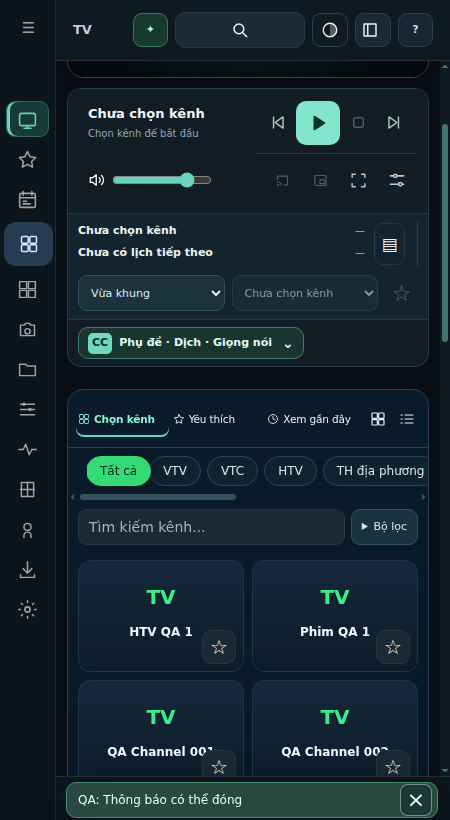

[Release / thông tin](https://github.com/trisanghy/open-iptv-pro/releases/tag/positron/v4.23.205-p5.1.121) · [Commit](https://github.com/trisanghy/open-iptv-pro/commit/daefa5bb1e8119c8d16ddbf22d7b04003881f5b7) · [Tải Windows Setup x64](https://github.com/trisanghy/open-iptv-pro/releases/download/positron/v4.23.205-p5.1.121/Open-IPTV-Pro-Setup-4.23.205-x64.exe) · [Tải gói ảnh QA](https://github.com/trisanghy/open-iptv-pro/releases/download/positron/v4.23.205-p5.1.121/Positron-P51121-20-Real-Screenshots.zip)

<strong>P5.1.120</strong> · Compact mobile success notifications · ĐÃ PHÁT HÀNH · CẢI TIẾN / SỬA LỖI

**Ứng dụng:** 4.23.204 · **Trạng thái:** ĐÃ PHÁT HÀNH

Fix: compact Positron-only CSS shows latest success while retaining warning/error notices, expiry timers and desktop behavior. Real Electron 450px regression with three benign fixture notices, warning visibility, sidebar clearance and no overflow; after screenshot `positron-p51120-compact-toast-stack-450-real.png`.

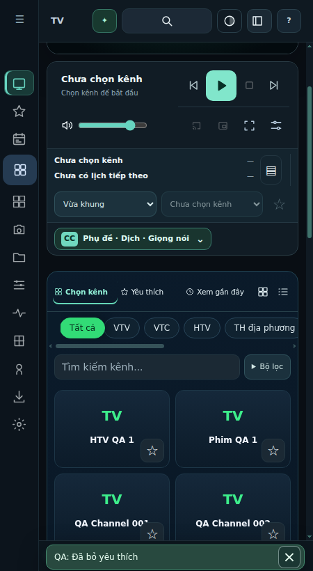

[Release / thông tin](https://github.com/trisanghy/open-iptv-pro/releases/tag/positron/v4.23.204-p5.1.120) · [Commit](https://github.com/trisanghy/open-iptv-pro/commit/2eec95e697ef50b9e2f2c1b420652515005423bc) · [Tải Windows Setup x64](https://github.com/trisanghy/open-iptv-pro/releases/download/positron/v4.23.204-p5.1.120/Open-IPTV-Pro-Setup-4.23.204-x64.exe) · [Tải gói ảnh QA](https://github.com/trisanghy/open-iptv-pro/releases/download/positron/v4.23.204-p5.1.120/Positron-P51120-20-Real-Screenshots.zip)

<strong>P5.1.119</strong> · Live accessible Favorites counter on native chooser tab · ĐÃ PHÁT HÀNH · TÍNH NĂNG

**Ứng dụng:** 4.23.203 · **Trạng thái:** ĐÃ PHÁT HÀNH

Fix: add badge AFTER legacy SVG tab-icon replacement, update its count on every native chooser render from favorites.visible(store), hide at zero, use aria-label "Yêu thích, N kênh", overlay small pill near icon without taking width away from 450px tab row; no playlist data mutation. Final HEAD `9751d3c02c2a293c63301f066b16b079a2d884ff`, immutable tag `positron/v4.23.202-p5.1.118`, GitHub Actions `44935525440` 6/6 success. Node 718: 713 passed, 5 skipped, no failure. Real screenshot opened, 13/13 direct Favorite assertions true including stored key, remove/reverse, focus and no playback; 4 binary release assets verified.

[Release / thông tin](https://github.com/trisanghy/open-iptv-pro/releases/tag/positron/v4.23.203-p5.1.119) · [Commit](https://github.com/trisanghy/open-iptv-pro/commit/f3bd1bf867f939335eb2d96e555be9dd7408e81e) · [Tải Windows Setup x64](https://github.com/trisanghy/open-iptv-pro/releases/download/positron/v4.23.203-p5.1.119/Open-IPTV-Pro-Setup-4.23.203-x64.exe) · [Tải gói ảnh QA](https://github.com/trisanghy/open-iptv-pro/releases/download/positron/v4.23.203-p5.1.119/Positron-P51119-20-Real-Screenshots.zip)

<strong>P5.1.118</strong> · Native bookmark directly on channel tiles without playback · ĐÃ PHÁT HÀNH · TÍNH NĂNG

**Ứng dụng:** 4.23.202 · **Trạng thái:** ĐÃ PHÁT HÀNH

Fix: each main grid tile keeps original native Play button and gains a separate accessible native Favorite button as a sibling, not nested inside Play. Uses existing OpenIPTVFavorites.toggle/getStore/save/render, stable favorite keys, persistence and in-memory rollback if save fails; native Favorites tab reactivity preserved. Compact side mini cards remain native Play buttons. Affected CSS: add wrapper as grid cell, keep P117 one-result full-width behavior, subtle native star with aria-pressed and focus; multi-channel grid, video playback and stored sources unchanged.

[Release / thông tin](https://github.com/trisanghy/open-iptv-pro/releases/tag/positron/v4.23.202-p5.1.118) · [Commit](https://github.com/trisanghy/open-iptv-pro/commit/9751d3c02c2a293c63301f066b16b079a2d884ff) · [Tải Windows Setup x64](https://github.com/trisanghy/open-iptv-pro/releases/download/positron/v4.23.202-p5.1.118/Open-IPTV-Pro-Setup-4.23.202-x64.exe) · [Tải gói ảnh QA](https://github.com/trisanghy/open-iptv-pro/releases/download/positron/v4.23.202-p5.1.118/Positron-P51118-20-Real-Screenshots.zip)

<strong>P5.1.117</strong> · Readable full-width single filtered channel tile on compact view · ĐÃ PHÁT HÀNH · CẢI TIẾN / SỬA LỖI

**Ứng dụng:** 4.23.201 · **Trạng thái:** ĐÃ PHÁT HÀNH

Cause: two-column responsive grid applies even when only one button is visible on the page. Fix: compact-only :only-child channel button spans all grid columns and uses a horizontal logo-title arrangement with original click-to-play, keyboard and list mode preserved; multi-result grid remains two columns.

[Release / thông tin](https://github.com/trisanghy/open-iptv-pro/releases/tag/positron/v4.23.201-p5.1.117) · [Commit](https://github.com/trisanghy/open-iptv-pro/commit/15a29463a11da0679caa367515362c74bfec8029) · [Tải Windows Setup x64](https://github.com/trisanghy/open-iptv-pro/releases/download/positron/v4.23.201-p5.1.117/Open-IPTV-Pro-Setup-4.23.201-x64.exe) · [Tải gói ảnh QA](https://github.com/trisanghy/open-iptv-pro/releases/download/positron/v4.23.201-p5.1.117/Positron-P51117-20-Real-Screenshots.zip)

<strong>P5.1.116</strong> · Validate native quick-category chips against imported groups · ĐÃ PHÁT HÀNH · CẢI TIẾN / SỬA LỖI

**Ứng dụng:** 4.23.200 · **Trạng thái:** ĐÃ PHÁT HÀNH

Fix: quick chips only for actually imported group names (TH matches a separate token rather than the beginning of Thể thao). Selected chip state now uses aria-pressed; native keyboard focus restored after filtering; no changes to stream playback or saved playlists.

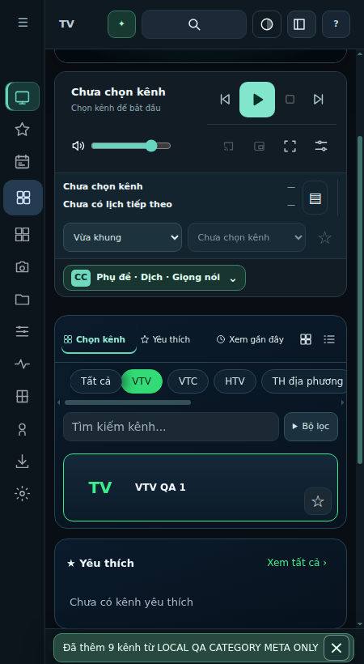

[Release / thông tin](https://github.com/trisanghy/open-iptv-pro/releases/tag/positron/v4.23.200-p5.1.116) · [Commit](https://github.com/trisanghy/open-iptv-pro/commit/68bf5505bc72a73853284574dc3106bfad7e9973) · [Tải Windows Setup x64](https://github.com/trisanghy/open-iptv-pro/releases/download/positron/v4.23.200-p5.1.116/Open-IPTV-Pro-Setup-4.23.200-x64.exe) · [Tải gói ảnh QA](https://github.com/trisanghy/open-iptv-pro/releases/download/positron/v4.23.200-p5.1.116/Positron-P51116-20-Real-Screenshots.zip)

<strong>P5.1.115</strong> · Remove duplicate compact empty Favorites and Recent panels · ĐÃ PHÁT HÀNH · CẢI TIẾN / SỬA LỖI

**Ứng dụng:** 4.23.199 · **Trạng thái:** ĐÃ PHÁT HÀNH

Fix: mark only duplicate empty mini section on its own active tab and hide it only <=650px via scoped CSS. Keep mini section on All, other tabs, desktop, and when actually populated. No stored data, filtering or playback changed.

[Release / thông tin](https://github.com/trisanghy/open-iptv-pro/releases/tag/positron/v4.23.199-p5.1.115) · [Commit](https://github.com/trisanghy/open-iptv-pro/commit/caf6a5bff4a115cac60f8474519e5d6101dfdd87) · [Tải Windows Setup x64](https://github.com/trisanghy/open-iptv-pro/releases/download/positron/v4.23.199-p5.1.115/Open-IPTV-Pro-Setup-4.23.199-x64.exe) · [Tải gói ảnh QA](https://github.com/trisanghy/open-iptv-pro/releases/download/positron/v4.23.199-p5.1.115/Positron-P51115-20-Real-Screenshots.zip)

<strong>P5.1.114</strong> · Actionable Favorites and Recent empty states · ĐÃ PHÁT HÀNH · CẢI TIẾN / SỬA LỖI

**Ứng dụng:** 4.23.198 · **Trạng thái:** ĐÃ PHÁT HÀNH

Fix: context-specific empty messages for Favorites and Recent, native "Xem tất cả kênh" action that clears local search/group filters and restores All tab focus without autoplay; hide pager on one-page or empty results; preserve playlist and favorites data.

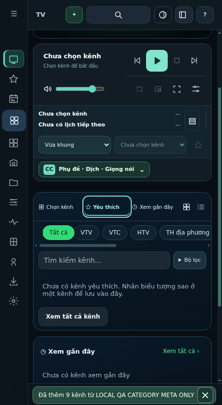

[Release / thông tin](https://github.com/trisanghy/open-iptv-pro/releases/tag/positron/v4.23.198-p5.1.114) · [Commit](https://github.com/trisanghy/open-iptv-pro/commit/257422b56d81d4eca9c8efacfb1aeb4ebd2dab83) · [Tải Windows Setup x64](https://github.com/trisanghy/open-iptv-pro/releases/download/positron/v4.23.198-p5.1.114/Open-IPTV-Pro-Setup-4.23.198-x64.exe) · [Tải gói ảnh QA](https://github.com/trisanghy/open-iptv-pro/releases/download/positron/v4.23.198-p5.1.114/Positron-P51114-20-Real-Screenshots.zip)

<strong>P5.1.113</strong> · Keyboard navigation for native channel chooser tabs · ĐÃ PHÁT HÀNH · TÍNH NĂNG

**Ứng dụng:** 4.23.197 · **Trạng thái:** ĐÃ PHÁT HÀNH

Fix: preserve original native click-to-select, add directional/Home/End keyboard focus, selected tab only in Tab sequence, aria-controls; Favorites/Recent/channel playback and stored data unchanged.

[Release / thông tin](https://github.com/trisanghy/open-iptv-pro/releases/tag/positron/v4.23.197-p5.1.113) · [Commit](https://github.com/trisanghy/open-iptv-pro/commit/e634e2c7c9da33ebb5c54043e4d212ab8d3a40a3) · [Tải Windows Setup x64](https://github.com/trisanghy/open-iptv-pro/releases/download/positron/v4.23.197-p5.1.113/Open-IPTV-Pro-Setup-4.23.197-x64.exe) · [Tải gói ảnh QA](https://github.com/trisanghy/open-iptv-pro/releases/download/positron/v4.23.197-p5.1.113/Positron-P51113-20-Real-Screenshots.zip)

<strong>P5.1.112</strong> · Readable two-column channel cards on compact view · ĐÃ PHÁT HÀNH · CẢI TIẾN / SỬA LỖI

**Ứng dụng:** 4.23.196 · **Trạng thái:** ĐÃ PHÁT HÀNH

Cause: legacy `web-channel-chooser-v42371.css` uses 80px minimum columns at <=650px and single-line ellipsis for labels, making channel titles hard to identify. Fix: narrow <=500x900 unplayed/regular grid (not list mode) uses 2 equal columns with min 145px card width and two-line names; original native channel button, click, logo, pagination, stream logic and responsive desktop layout stay untouched.

[Release / thông tin](https://github.com/trisanghy/open-iptv-pro/releases/tag/positron/v4.23.196-p5.1.112) · [Commit](https://github.com/trisanghy/open-iptv-pro/commit/50a2f2e24710e1727b7fe6a31273cc2808bc30d0) · [Tải Windows Setup x64](https://github.com/trisanghy/open-iptv-pro/releases/download/positron/v4.23.196-p5.1.112/Open-IPTV-Pro-Setup-4.23.196-x64.exe) · [Tải gói ảnh QA](https://github.com/trisanghy/open-iptv-pro/releases/download/positron/v4.23.196-p5.1.112/Positron-P51112-20-Real-Screenshots.zip)

<strong>P5.1.111</strong> · Single-row scrolling channel category filters · ĐÃ PHÁT HÀNH · CẢI TIẾN / SỬA LỖI

**Ứng dụng:** 4.23.195 · **Trạng thái:** ĐÃ PHÁT HÀNH

Fix: Positron <=600px horizontal overflow strip with native buttons all present + focus accessible; `renderGroups()` saves/restores scrollLeft to prevent jumping to the start after selecting a chip near the right side. Group filtering and playlist never altered.

[Release / thông tin](https://github.com/trisanghy/open-iptv-pro/releases/tag/positron/v4.23.195-p5.1.111) · [Commit](https://github.com/trisanghy/open-iptv-pro/commit/ba5a3f4b282ad68a4d5c270fe523935dbf35b00e) · [Tải Windows Setup x64](https://github.com/trisanghy/open-iptv-pro/releases/download/positron/v4.23.195-p5.1.111/Open-IPTV-Pro-Setup-4.23.195-x64.exe) · [Tải gói ảnh QA](https://github.com/trisanghy/open-iptv-pro/releases/download/positron/v4.23.195-p5.1.111/Positron-P51111-20-Real-Screenshots.zip)

<strong>P5.1.110</strong> · Compact idle player on narrow viewports · ĐÃ PHÁT HÀNH · CẢI TIẾN / SỬA LỖI

**Ứng dụng:** 4.23.194 · **Trạng thái:** ĐÃ PHÁT HÀNH

Fix: when viewport <=600x900 only, compact idle onboarding canvas to 164px, remove decorative empty TV icon on narrow view, tighten text/CTA spacing. Native playback retains original 16:9 stage immediately as soon as the empty illustration hides, and remains untouched at fullscreen or larger screens. No playlist or stream changes.

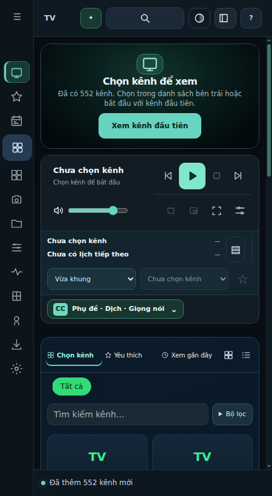

[Release / thông tin](https://github.com/trisanghy/open-iptv-pro/releases/tag/positron/v4.23.194-p5.1.110) · [Commit](https://github.com/trisanghy/open-iptv-pro/commit/75d4acb5bf940eb46ecb868476aca6bda33e99f4) · [Tải Windows Setup x64](https://github.com/trisanghy/open-iptv-pro/releases/download/positron/v4.23.194-p5.1.110/Open-IPTV-Pro-Setup-4.23.194-x64.exe) · [Tải gói ảnh QA](https://github.com/trisanghy/open-iptv-pro/releases/download/positron/v4.23.194-p5.1.110/Positron-P51110-20-Real-Screenshots.zip)

<strong>P5.1.109</strong> · Deduplicate active notifications · ĐÃ PHÁT HÀNH · CẢI TIẾN / SỬA LỖI

**Ứng dụng:** 4.23.193 · **Trạng thái:** ĐÃ PHÁT HÀNH

Fix: coalesce only the same text + severity while the previous toast is still mounted. Different messages or severity remain visible; timeout still removes existing toast after 5.5 seconds. Existing IPTV data, local playlist, player, source and accessibility live region are unchanged.

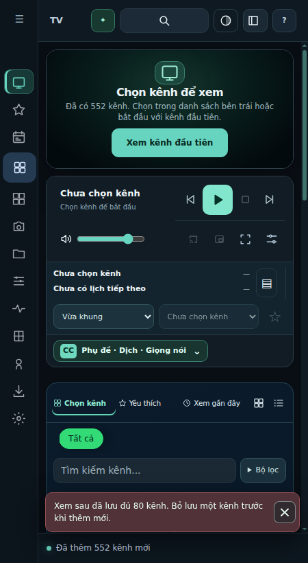

[Release / thông tin](https://github.com/trisanghy/open-iptv-pro/releases/tag/positron/v4.23.193-p5.1.109) · [Commit](https://github.com/trisanghy/open-iptv-pro/commit/1b2c5d4d55f3d60a9ff64f45529aa181d3a9454e) · [Tải Windows Setup x64](https://github.com/trisanghy/open-iptv-pro/releases/download/positron/v4.23.193-p5.1.109/Open-IPTV-Pro-Setup-4.23.193-x64.exe) · [Tải gói ảnh QA](https://github.com/trisanghy/open-iptv-pro/releases/download/positron/v4.23.193-p5.1.109/Positron-P51109-20-Real-Screenshots.zip)

<strong>P5.1.108</strong> · Narrow toast respects icon rail · ĐÃ PHÁT HÀNH · CẢI TIẾN / SỬA LỖI

**Ứng dụng:** 4.23.192 · **Trạng thái:** ĐÃ PHÁT HÀNH

Cause: the shared native `.toast-area` uses right:24px/max-width:380px with no left constraint for the compact sidebar. Fix: Positron-only <=600px notification lane left:66px/right:12px; text wraps safely and the visual toast does not intercept taps. Native toast content, timers, IPTV data and playback remain untouched.

[Release / thông tin](https://github.com/trisanghy/open-iptv-pro/releases/tag/positron/v4.23.192-p5.1.108) · [Commit](https://github.com/trisanghy/open-iptv-pro/commit/a19d24c9858fba65cabc17c0ef478a861e44b0f1) · [Tải Windows Setup x64](https://github.com/trisanghy/open-iptv-pro/releases/download/positron/v4.23.192-p5.1.108/Open-IPTV-Pro-Setup-4.23.192-x64.exe) · [Tải gói ảnh QA](https://github.com/trisanghy/open-iptv-pro/releases/download/positron/v4.23.192-p5.1.108/Positron-P51108-20-Real-Screenshots.zip)

<strong>P5.1.107</strong> · Replace font-dependent chooser icons with native SVG · ĐÃ PHÁT HÀNH · CẢI TIẾN / SỬA LỖI

**Ứng dụng:** 4.23.191 · **Trạng thái:** ĐÃ PHÁT HÀNH

Actual P5.1.106 native Electron TV screenshots at 450px/540px: channel chooser tabs and grid/list toggles still use platform text-glyph symbols (▣, ☆, ◷, ▦, ☷) rather than a coherent icon set. Some appear like isolated small squares. Fix inside Positron branch only: render five deterministic SVG icons, preserve all existing click listeners, role/tab selection, channel playlist data, and no-autoplay semantics. Give grid/list toggles explicit accessible names.

[Release / thông tin](https://github.com/trisanghy/open-iptv-pro/releases/tag/positron/v4.23.191-p5.1.107) · [Commit](https://github.com/trisanghy/open-iptv-pro/commit/ac4670a51959aef9a9e6917c85495184c460bf1a) · [Tải Windows Setup x64](https://github.com/trisanghy/open-iptv-pro/releases/download/positron/v4.23.191-p5.1.107/Open-IPTV-Pro-Setup-4.23.191-x64.exe) · [Tải gói ảnh QA](https://github.com/trisanghy/open-iptv-pro/releases/download/positron/v4.23.191-p5.1.107/Positron-P51107-20-Real-Screenshots.zip)

<strong>P5.1.106</strong> · Remove horizontal overflow in empty WatchFlow · ĐÃ PHÁT HÀNH · CẢI TIẾN / SỬA LỖI

**Ứng dụng:** 4.23.190 · **Trạng thái:** ĐÃ PHÁT HÀNH

Real screenshot P5.1.105 `positron-watchflow-1360-night-real.png` reveals a horizontal scrollbar in compact no-source WatchFlow. Scoped fix matches the 15px padding, preserving playback, saved bookmarks, other modal modes and user data.

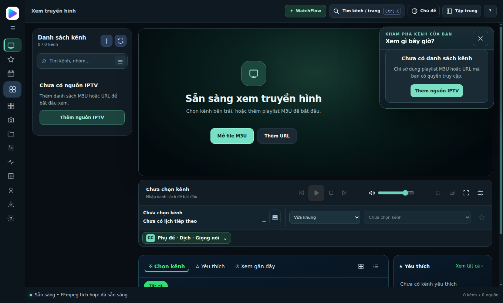

[Release / thông tin](https://github.com/trisanghy/open-iptv-pro/releases/tag/positron/v4.23.190-p5.1.106) · [Commit](https://github.com/trisanghy/open-iptv-pro/commit/19746909a874bdcc659f6948319cee86f0eec1da) · [Tải Windows Setup x64](https://github.com/trisanghy/open-iptv-pro/releases/download/positron/v4.23.190-p5.1.106/Open-IPTV-Pro-Setup-4.23.190-x64.exe) · [Tải gói ảnh QA](https://github.com/trisanghy/open-iptv-pro/releases/download/positron/v4.23.190-p5.1.106/Positron-P51106-20-Real-Screenshots.zip)

<strong>P5.1.105</strong> · Explicitly manage dormant bookmarks with two-step removal · ĐÃ PHÁT HÀNH · TÍNH NĂNG

**Ứng dụng:** 4.23.189 · **Trạng thái:** ĐÃ PHÁT HÀNH

Opened P5.1.104 actual Electron screenshot `positron-p51104-watchlater-unavailable-552-real.png`: status notice tells users a source is unavailable but gives no way to free dormant saved slots while retaining healthy bookmarks. Add opt-in details manager. Display only sanitized normalized bookmark keys, never source URL, token or full M3U. On first click change the action to `Xác nhận bỏ` without any data write; on second confirm revalidate that the selected fingerprint is still unavailable before removing only that bookmark from localStorage. Never auto-remove when source is offline.

[Release / thông tin](https://github.com/trisanghy/open-iptv-pro/releases/tag/positron/v4.23.189-p5.1.105) · [Commit](https://github.com/trisanghy/open-iptv-pro/commit/937db5120885efefe32c62fe3a9476601e76955c) · [Tải Windows Setup x64](https://github.com/trisanghy/open-iptv-pro/releases/download/positron/v4.23.189-p5.1.105/Open-IPTV-Pro-Setup-4.23.189-x64.exe) · [Tải gói ảnh QA](https://github.com/trisanghy/open-iptv-pro/releases/download/positron/v4.23.189-p5.1.105/Positron-P51105-20-Real-Screenshots.zip)

<strong>P5.1.104</strong> · Keep unavailable saved channels visible without deleting data · ĐÃ PHÁT HÀNH · CẢI TIẾN / SỬA LỖI

**Ứng dụng:** 4.23.188 · **Trạng thái:** ĐÃ PHÁT HÀNH

Reviewed actual P5.1.103 Electron screenshot `positron-p51103-watchlater-cap-after-real.png`, inspected the strict 80-entry limit and found stored bookmarks for dead/removed channels are silently hidden by `visible()`; users may think saved data vanished. Add `unavailable(rows,channels)` to count fingerprints with no currently playable matching native channel, source-scoped and without checking stream URLs externally. UI shows a quiet privacy-preserving note while keeping all bookmarks in localStorage for source recovery. No auto-delete, autoplay or network fetch.

[Release / thông tin](https://github.com/trisanghy/open-iptv-pro/releases/tag/positron/v4.23.188-p5.1.104) · [Commit](https://github.com/trisanghy/open-iptv-pro/commit/0e6a64d5d4dbcda6e4131a3375b414e63cb54a52) · [Tải Windows Setup x64](https://github.com/trisanghy/open-iptv-pro/releases/download/positron/v4.23.188-p5.1.104/Open-IPTV-Pro-Setup-4.23.188-x64.exe) · [Tải gói ảnh QA](https://github.com/trisanghy/open-iptv-pro/releases/download/positron/v4.23.188-p5.1.104/Positron-P51104-20-Real-Screenshots.zip)

<strong>P5.1.103</strong> · Safe Watch Later 80-channel capacity without silent eviction · ĐÃ PHÁT HÀNH · CẢI TIẾN / SỬA LỖI

**Ứng dụng:** 4.23.187 · **Trạng thái:** ĐÃ PHÁT HÀNH

Followed the P5.1.102 real `positron-p51102-watch-later-multiterm-552-real.png` screenshot and its saved-list status back into `toggle()`: with 80 saved channels, the 81st was inserted at the front and `compact()` discarded the oldest without warning. Preserve all prior bookmarks: refuse a new save at capacity with `{ok:false,reason:'full'}`; existing saved channels may still be removed, and a new channel may be saved after freeing a slot.

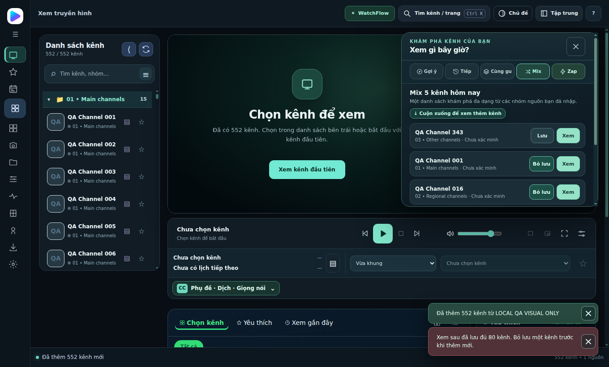

[Release / thông tin](https://github.com/trisanghy/open-iptv-pro/releases/tag/positron/v4.23.187-p5.1.103) · [Commit](https://github.com/trisanghy/open-iptv-pro/commit/ff67dc0c2963ac5cc3c514fdebad65221e10e962) · [Tải Windows Setup x64](https://github.com/trisanghy/open-iptv-pro/releases/download/positron/v4.23.187-p5.1.103/Open-IPTV-Pro-Setup-4.23.187-x64.exe) · [Tải gói ảnh QA](https://github.com/trisanghy/open-iptv-pro/releases/download/positron/v4.23.187-p5.1.103/Positron-P51103-20-Real-Screenshots.zip)

<strong>P5.1.102</strong> · Local search for saved Watch Later channels · ĐÃ PHÁT HÀNH · TÍNH NĂNG

**Ứng dụng:** 4.23.186 · **Trạng thái:** ĐÃ PHÁT HÀNH

Opened real P5.1.101 screenshot `positron-p51101-watch-later-search-552-real.png`: searching only a contiguous substring cannot find saved `QA Channel 001` with cross-field `main 001`, although native group metadata is present. Keep personal bookmarks local; search accent-insensitively across multiple title/group terms, in any order. Do not strip HD, FHD or 4K query tokens as bookmark fingerprints do; punctuation-only input must not accidentally reveal all saved channels.

[Release / thông tin](https://github.com/trisanghy/open-iptv-pro/releases/tag/positron/v4.23.186-p5.1.102) · [Commit](https://github.com/trisanghy/open-iptv-pro/commit/5efab277eaabfb558fed5434e4218408c6286e27) · [Tải Windows Setup x64](https://github.com/trisanghy/open-iptv-pro/releases/download/positron/v4.23.186-p5.1.102/Open-IPTV-Pro-Setup-4.23.186-x64.exe) · [Tải gói ảnh QA](https://github.com/trisanghy/open-iptv-pro/releases/download/positron/v4.23.186-p5.1.102/Positron-P51102-20-Real-Screenshots.zip)

<strong>P5.1.101</strong> · Local search for saved Watch Later channels · ĐÃ PHÁT HÀNH · TÍNH NĂNG

**Ứng dụng:** 4.23.185 · **Trạng thái:** ĐÃ PHÁT HÀNH

Evidence from actual P5.1.100 Electron screenshot and source: saved Watch Later entries are accessible in batches but up to 80 entries require many manual scroll/reveal actions to find a particular channel. Provide a persistent accessible search field on the Continue screen. Filter locally resolved saved channel titles or group names, with Vietnamese accent-insensitive matching, and show result counts. No URL search, network requests, data upload, playlist changes or automatic playback. The local-only bookmark schema remains unchanged.

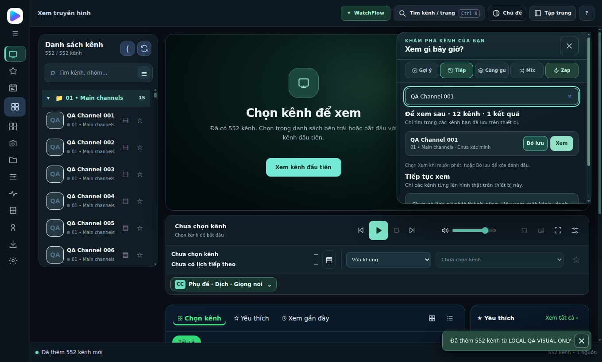

[Release / thông tin](https://github.com/trisanghy/open-iptv-pro/releases/tag/positron/v4.23.185-p5.1.101) · [Commit](https://github.com/trisanghy/open-iptv-pro/commit/a902ab2c34fc4b06e7e93dcbb89744c05593753f) · [Tải Windows Setup x64](https://github.com/trisanghy/open-iptv-pro/releases/download/positron/v4.23.185-p5.1.101/Open-IPTV-Pro-Setup-4.23.185-x64.exe) · [Tải gói ảnh QA](https://github.com/trisanghy/open-iptv-pro/releases/download/positron/v4.23.185-p5.1.101/Positron-P51101-20-Real-Screenshots.zip)

<strong>P5.1.100</strong> · WatchFlow sticky close button and mode navigation · ĐÃ PHÁT HÀNH · CẢI TIẾN / SỬA LỖI

**Ứng dụng:** 4.23.184 · **Trạng thái:** ĐÃ PHÁT HÀNH

Real P5.1.98 Electron screenshots of 12 saved bookmarks demonstrate that the close icon and mode tabs disappear after scrolling to the end, even with accessible bookmark pagination. Keep header and mode selector sticky in the existing WatchFlow dialog, using compact typography and dark background while preserving the native TV transport, EPG, and local-only saved state.

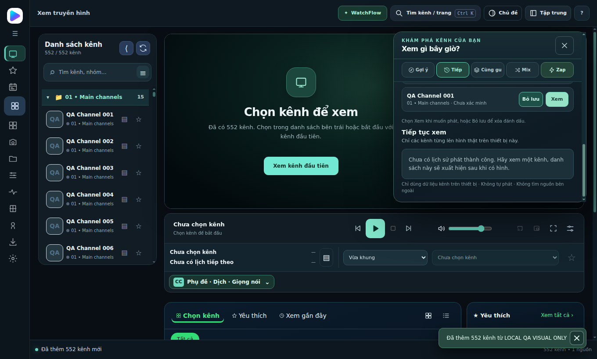

[Release / thông tin](https://github.com/trisanghy/open-iptv-pro/releases/tag/positron/v4.23.184-p5.1.100) · [Commit](https://github.com/trisanghy/open-iptv-pro/commit/060fbad7faebcf5715d3b3dc67e25927527d1041) · [Tải Windows Setup x64](https://github.com/trisanghy/open-iptv-pro/releases/download/positron/v4.23.184-p5.1.100/Open-IPTV-Pro-Setup-4.23.184-x64.exe) · [Tải gói ảnh QA](https://github.com/trisanghy/open-iptv-pro/releases/download/positron/v4.23.184-p5.1.100/Positron-P51100-20-Real-Screenshots.zip)

<strong>P5.1.98</strong> · Watch Later: all saved channels reachable in batches · ĐÃ PHÁT HÀNH · TÍNH NĂNG

**Ứng dụng:** 4.23.182 · **Trạng thái:** ĐÃ PHÁT HÀNH

Research basis: the imported XMLTV guide already backs native EPG search and reminders, but WatchFlow cards show only channel names and source health. IPTVnator's channel list offers Now/Next EPG inline; copy no external assets/code. Enhancement: add only the **currently airing** actual XMLTV programme title under relevant WatchFlow card names, using the existing guide from `IPTVExtras.getGuide()`, `IPTVGuide.current()`, manual channel mapping and saved EPG offset. One line of readable text with full title in a tooltip. No programme title is shown without matching, currently active guide data; no guessed programme info.

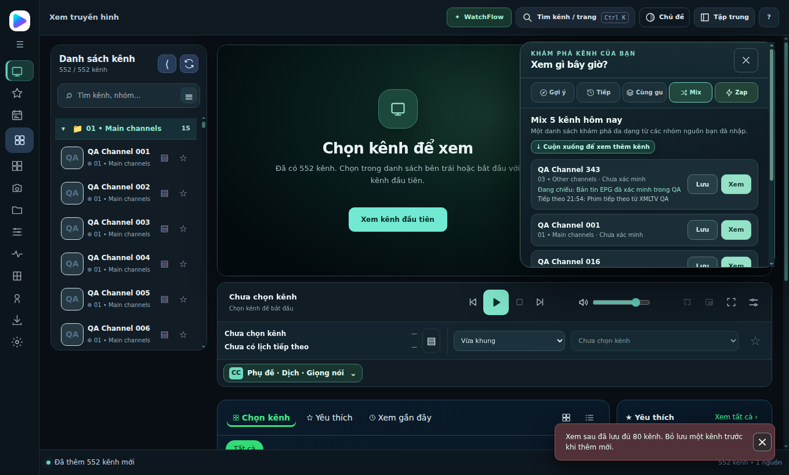

[Release / thông tin](https://github.com/trisanghy/open-iptv-pro/releases/tag/positron/v4.23.182-p5.1.98) · [Commit](https://github.com/trisanghy/open-iptv-pro/commit/420ee5a4a8a0a31ab5b77565f034acae9d25d1a9) · [Tải Windows Setup x64](https://github.com/trisanghy/open-iptv-pro/releases/download/positron/v4.23.182-p5.1.98/Open-IPTV-Pro-Setup-4.23.182-x64.exe) · [Tải gói ảnh QA](https://github.com/trisanghy/open-iptv-pro/releases/download/positron/v4.23.182-p5.1.98/Positron-P5198-20-Real-Screenshots.zip)

<strong>P5.1.96</strong> · WatchFlow Plus Smart Zap, Continue, Similar and Daily Mix · ĐÃ PHÁT HÀNH · TÍNH NĂNG

**Ứng dụng:** 4.23.180 · **Trạng thái:** ĐÃ PHÁT HÀNH

Feature motivation: real open-source IPTV ecosystem increasingly has favorites, history and quick-return interfaces; the existing native history intentionally records only decoded playback, so a separate deliberate 'Xem sau' saves a choice even when the user has not played it. Related research: `POSITRON_FEATURE_RESEARCH_NEXT20_20261121.md`. Implementation: from the original WatchFlow Mix/Similar/Continue cards, add keyboard-accessible `Lưu` / `Bỏ lưu` beside the existing native `Xem`. In the existing Tiếp tab, saved channels appear in a `Để xem sau` section above native successfully played history; no new sixth tab crowds the modal. Save toggle never 

[Release / thông tin](https://github.com/trisanghy/open-iptv-pro/releases/tag/positron/v4.23.180-p5.1.96) · [Commit](https://github.com/trisanghy/open-iptv-pro/commit/20aeb922547ba56061990cad948bbfadaedeef8b) · [Tải Windows Setup x64](https://github.com/trisanghy/open-iptv-pro/releases/download/positron/v4.23.180-p5.1.96/Open-IPTV-Pro-Setup-4.23.180-x64.exe) · [Tải gói ảnh QA](https://github.com/trisanghy/open-iptv-pro/releases/download/positron/v4.23.180-p5.1.96/Positron-P5196-20-Real-Screenshots.zip)

<strong>P5.1.95</strong> · WatchFlow Plus Smart Zap, Continue, Similar and Daily Mix · ĐÃ PHÁT HÀNH · CẢI TIẾN / SỬA LỖI

**Ứng dụng:** 4.23.179 · **Trạng thái:** ĐÃ PHÁT HÀNH

Direct manual review of the REAL P5.1.94 Electron screenshot `positron-p5194-watchflow-scroll-cue-552-real.png` revealed an important new defect: the indicator `↓ Cuộn xuống để xem thêm kênh` sat over the third Mix card's `Xem` button. Pointer-events:none made the button technically clickable, but visual occlusion is unacceptable. P5.1.94 was therefore not counted as a fully reviewed round. Cause: indicator was an absolute-positioned child at the bottom of a 390px, scroll-clipped dialog.

[Release / thông tin](https://github.com/trisanghy/open-iptv-pro/releases/tag/positron/v4.23.179-p5.1.95) · [Commit](https://github.com/trisanghy/open-iptv-pro/commit/8ae65c2a26c0da3d4bc605e1c5aa18283e82a020) · [Tải Windows Setup x64](https://github.com/trisanghy/open-iptv-pro/releases/download/positron/v4.23.179-p5.1.95/Open-IPTV-Pro-Setup-4.23.179-x64.exe) · [Tải gói ảnh QA](https://github.com/trisanghy/open-iptv-pro/releases/download/positron/v4.23.179-p5.1.95/Positron-P5195-20-Real-Screenshots.zip)

<strong>P5.1.94</strong> · WatchFlow Plus Smart Zap, Continue, Similar and Daily Mix · ĐÃ PHÁT HÀNH · CẢI TIẾN / SỬA LỖI

**Ứng dụng:** 4.23.178 · **Trạng thái:** ĐÃ PHÁT HÀNH

Fix: preserve the current 390px max-height and native playback, source files, and user preferences; add a passive on-panel visual cue `↓ Cuộn xuống để xem thêm kênh` only when the final recommendation card is actually outside the panel bounds. Recompute on scroll, resize, mode switch and reopen; hide when the last card becomes visible or panel closes, prevent pointer interception.

[Release / thông tin](https://github.com/trisanghy/open-iptv-pro/releases/tag/positron/v4.23.178-p5.1.94) · [Commit](https://github.com/trisanghy/open-iptv-pro/commit/01c99e34d6d41ff7ca24a32f0704be839818ed92) · [Tải Windows Setup x64](https://github.com/trisanghy/open-iptv-pro/releases/download/positron/v4.23.178-p5.1.94/Open-IPTV-Pro-Setup-4.23.178-x64.exe) · [Tải gói ảnh QA](https://github.com/trisanghy/open-iptv-pro/releases/download/positron/v4.23.178-p5.1.94/Positron-P5194-20-Real-Screenshots.zip)

<strong>P5.1.93</strong> · WatchFlow Plus Smart Zap, Continue, Similar and Daily Mix · ĐÃ PHÁT HÀNH · TÍNH NĂNG

**Ứng dụng:** 4.23.177 · **Trạng thái:** ĐÃ PHÁT HÀNH

New regression tests: 3 groups × 14 channels, 5 picks with [1,2,2] group counts on four dates, no duplicates, different dates rotate, and an actually proven stream remains included. Native Electron 552-channel QA measures rendered card group counts, no autoplay and generates `positron-p5193-group-balanced-mix-552-real.png`. This version is a candidate until test, native screenshot opening, CI and immutable installer assets are verified. No playlist/history modifications and no network or streaming during QA.

[Release / thông tin](https://github.com/trisanghy/open-iptv-pro/releases/tag/positron/v4.23.177-p5.1.93) · [Commit](https://github.com/trisanghy/open-iptv-pro/commit/0d582fb30e70380537a9e3d3ac4258bfe83c60e5) · [Tải Windows Setup x64](https://github.com/trisanghy/open-iptv-pro/releases/download/positron/v4.23.177-p5.1.93/Open-IPTV-Pro-Setup-4.23.177-x64.exe) · [Tải gói ảnh QA](https://github.com/trisanghy/open-iptv-pro/releases/download/positron/v4.23.177-p5.1.93/Positron-P5193-20-Real-Screenshots.zip)

<strong>P5.1.92</strong> · WatchFlow Plus Smart Zap, Continue, Similar and Daily Mix · ĐÃ PHÁT HÀNH · TÍNH NĂNG

**Ứng dụng:** 4.23.176 · **Trạng thái:** ĐÃ PHÁT HÀNH

Added pure `localDay(date)` helper using the device Date local year/month/day. The Mix UI and engine defaults now use the local day consistently, including Smart Zap. Explicit date arguments remain supported, and recommendation health/dedup/privacy continue unchanged. New Node regression launches child processes in `TZ=Asia/Bangkok` and `TZ=UTC` for the **same instant** 2026-11-20T18:30:00Z and confirms Nov21 in Bangkok but Nov20 UTC. Real Electron QA asserts five Mix recommendations remain clickable, mode selected, never autoplay, and local date key; captures `positron-p5192-local-calendar-mix-552-real.png`.

[Release / thông tin](https://github.com/trisanghy/open-iptv-pro/releases/tag/positron/v4.23.176-p5.1.92) · [Commit](https://github.com/trisanghy/open-iptv-pro/commit/720dbd1e0ab38a690a6d263b68300353d4726c68) · [Tải Windows Setup x64](https://github.com/trisanghy/open-iptv-pro/releases/download/positron/v4.23.176-p5.1.92/Open-IPTV-Pro-Setup-4.23.176-x64.exe) · [Tải gói ảnh QA](https://github.com/trisanghy/open-iptv-pro/releases/download/positron/v4.23.176-p5.1.92/Positron-P5192-20-Real-Screenshots.zip)

<strong>P5.1.90</strong> · WatchFlow Plus Smart Zap, Continue, Similar and Daily Mix · ĐÃ PHÁT HÀNH · CẢI TIẾN / SỬA LỖI

**Ứng dụng:** 4.23.174 · **Trạng thái:** ĐÃ PHÁT HÀNH

Remove that dead-end from the **unselected** player UI only. Keep button and settings in DOM, restore it when native selected channel exists, and collapse its panel when selection ends. Monitor native title and component initialization rather than mutating playlists or media pipeline. Node tests and real Electron metadata-only QA assert the button is hidden and not taking space with no current channel; with a temporarily stubbed channel selection it becomes visible, and after restoring native state it hides again, all without starting video. Screenshot `positron-p5190-player-ready-video-lab-hidden-552-metadata-real.png`.

[Release / thông tin](https://github.com/trisanghy/open-iptv-pro/releases/tag/positron/v4.23.174-p5.1.90) · [Commit](https://github.com/trisanghy/open-iptv-pro/commit/8a49f9757459d137c2005762d50fa956b1c3a646) · [Tải Windows Setup x64](https://github.com/trisanghy/open-iptv-pro/releases/download/positron/v4.23.174-p5.1.90/Open-IPTV-Pro-Setup-4.23.174-x64.exe) · [Tải gói ảnh QA](https://github.com/trisanghy/open-iptv-pro/releases/download/positron/v4.23.174-p5.1.90/Positron-P5190-20-Real-Screenshots.zip)

<strong>P5.1.89</strong> · WatchFlow Plus Smart Zap, Continue, Similar and Daily Mix · ĐÃ PHÁT HÀNH · CẢI TIẾN / SỬA LỖI

**Ứng dụng:** 4.23.173 · **Trạng thái:** ĐÃ PHÁT HÀNH

Synchronize only the native *default* `#playingSubtitle` hint with native enabled-channel count. Change the default to `Chọn kênh để bắt đầu` when channels are present, restore the original import hint when none are. Never overwrite status labels after a user stops video or when a channel is already selected or playing. Add Node assertion and real Electron metadata screenshot `positron-p5189-player-ready-subtitle-552-metadata-real.png`, including a CDP check that UI state and caption agree and playback remains stopped.

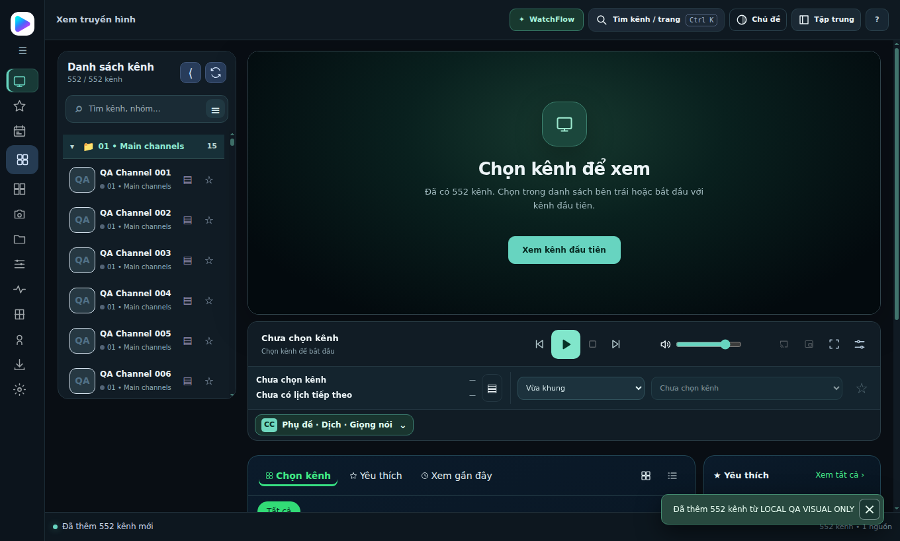

[Release / thông tin](https://github.com/trisanghy/open-iptv-pro/releases/tag/positron/v4.23.173-p5.1.89) · [Commit](https://github.com/trisanghy/open-iptv-pro/commit/2b3e6070e7f086dbd233e29224b9b09d04153dca) · [Tải Windows Setup x64](https://github.com/trisanghy/open-iptv-pro/releases/download/positron/v4.23.173-p5.1.89/Open-IPTV-Pro-Setup-4.23.173-x64.exe) · [Tải gói ảnh QA](https://github.com/trisanghy/open-iptv-pro/releases/download/positron/v4.23.173-p5.1.89/Positron-P5189-20-Real-Screenshots.zip)

<strong>P5.1.88</strong> · WatchFlow Plus Smart Zap, Continue, Similar and Daily Mix · ĐÃ PHÁT HÀNH · CẢI TIẾN / SỬA LỖI

**Ứng dụng:** 4.23.172 · **Trạng thái:** ĐÃ PHÁT HÀNH

Keep the native no-playlist onboarding intact. When enabled native channels are available, show `Chọn kênh để xem` and accurate channel count, preserve the file/URL buttons in DOM but hide them, and offer `Xem kênh đầu tiên` which invokes the existing `IPTVState.playChannel(first.id)` **only after a real user click**. The first eligible enabled source is used; dead and missing-link channels are not selected. No autoplay, playlist mutation or network lookup. Observe native `channelMeta` for source import/removal updates; restore original import actions when there are zero enabled channels. Preserve the existing player, playback and source data.

[Release / thông tin](https://github.com/trisanghy/open-iptv-pro/releases/tag/positron/v4.23.172-p5.1.88) · [Commit](https://github.com/trisanghy/open-iptv-pro/commit/6a6bc1def4b416d5e65d0405a251bf84e1639b48) · [Tải Windows Setup x64](https://github.com/trisanghy/open-iptv-pro/releases/download/positron/v4.23.172-p5.1.88/Open-IPTV-Pro-Setup-4.23.172-x64.exe) · [Tải gói ảnh QA](https://github.com/trisanghy/open-iptv-pro/releases/download/positron/v4.23.172-p5.1.88/Positron-P5188-20-Real-Screenshots.zip)

<strong>P5.1.87</strong> · WatchFlow Plus Smart Zap, Continue, Similar and Daily Mix · ĐÃ PHÁT HÀNH · CẢI TIẾN / SỬA LỖI

**Ứng dụng:** 4.23.171 · **Trạng thái:** ĐÃ PHÁT HÀNH

Replace the short visible label with “Tiếp”; the accessible `aria-label` and `title` remain the complete “Tiếp tục xem”. No watch-history, stream, channel, or EPG behavior changes. Add regression assertions and **real Electron DOM geometry checks** for five mode-label widths (span.scrollWidth <= span.clientWidth) in the same populated WatchFlow screenshot, retaining existing nav overflow and button-width validations.

*Chưa có ảnh chụp riêng đã xác minh cho phiên bản này.*

[Release / thông tin](https://github.com/trisanghy/open-iptv-pro/releases/tag/positron/v4.23.171-p5.1.87) · [Commit](https://github.com/trisanghy/open-iptv-pro/commit/ed257184254e6caa5994d6222b297975702a4bf6) · [Tải Windows Setup x64](https://github.com/trisanghy/open-iptv-pro/releases/download/positron/v4.23.171-p5.1.87/Open-IPTV-Pro-Setup-4.23.171-x64.exe) · [Tải gói ảnh QA](https://github.com/trisanghy/open-iptv-pro/releases/download/positron/v4.23.171-p5.1.87/Positron-P5187-20-Real-Screenshots.zip)

<strong>P5.1.86</strong> · WatchFlow Plus Smart Zap, Continue, Similar and Daily Mix · ĐÃ PHÁT HÀNH · CẢI TIẾN / SỬA LỖI

**Ứng dụng:** 4.23.170 · **Trạng thái:** ĐÃ PHÁT HÀNH

Visual input is the actual Electron 1360×820 screenshot from P5.1.85 at `p5-20-rounds/positron-watchflow-plus-similar-552-metadata-qa-real.png`; popup (top ~72, bottom ~680) covered the entire right part of native player controls (top ~487). Fix desktop-short viewport WatchFlow popup to a 390px *border-box* maximum with an internal scroll bar. Keep five clickable native metadata suggestions and keyboard-accessible controls; don't alter native playback, playlists, history, or recommendations.

*Chưa có ảnh chụp riêng đã xác minh cho phiên bản này.*

[Release / thông tin](https://github.com/trisanghy/open-iptv-pro/releases/tag/positron/v4.23.170-p5.1.86) · [Commit](https://github.com/trisanghy/open-iptv-pro/commit/206892e2a1a5bc1899c6073a61304f95831e6327) · [Tải Windows Setup x64](https://github.com/trisanghy/open-iptv-pro/releases/download/positron/v4.23.170-p5.1.86/Open-IPTV-Pro-Setup-4.23.170-x64.exe) · [Tải gói ảnh QA](https://github.com/trisanghy/open-iptv-pro/releases/download/positron/v4.23.170-p5.1.86/Positron-P5186-20-Real-Screenshots.zip)

<strong>P5.1.85</strong> · WatchFlow Plus Smart Zap, Continue, Similar and Daily Mix · ĐÃ PHÁT HÀNH · CẢI TIẾN / SỬA LỖI

**Ứng dụng:** 4.23.169 · **Trạng thái:** ĐÃ PHÁT HÀNH

Inspected the actual P5.1.84 Electron WatchFlow screenshots. The Similar code first sorted by exact source group but then resorted all matches by playback score and alphabetical name, erasing group ordering for equally proven streams. Fixed evidence-first ordering with same-group as the next tie-breaker. Proven streams retain priority over unverified streams. Input playlists and watch history remain untouched.

*Chưa có ảnh chụp riêng đã xác minh cho phiên bản này.*

[Release / thông tin](https://github.com/trisanghy/open-iptv-pro/releases/tag/positron/v4.23.169-p5.1.85) · [Commit](https://github.com/trisanghy/open-iptv-pro/commit/a02d2b896f23c3e7a65d180a1bca961d37e48189) · [Tải Windows Setup x64](https://github.com/trisanghy/open-iptv-pro/releases/download/positron/v4.23.169-p5.1.85/Open-IPTV-Pro-Setup-4.23.169-x64.exe) · [Tải gói ảnh QA](https://github.com/trisanghy/open-iptv-pro/releases/download/positron/v4.23.169-p5.1.85/Positron-P5185-20-Real-Screenshots.zip)

<strong>P5.1.84</strong> · WatchFlow Plus Smart Zap, Continue, Similar and Daily Mix · ĐÃ PHÁT HÀNH · CẢI TIẾN / SỬA LỖI

**Ứng dụng:** 4.23.168 · **Trạng thái:** ĐÃ PHÁT HÀNH

Actual P5.1.83 TV Electron screenshot shows the channel sidebar occupying substantial space with passive no-channel text and no direct action, in contrast to the functional main player CTA. When native IPTVState.getChannels() has zero channels, replace only the native no-channel description with a compact title, explanation and real source-management CTA. The existing channel list and all metadata/favorites are untouched. MutationObserver tracks native list re-renders; after importing a playlist, the native list appears normally.

*Chưa có ảnh chụp riêng đã xác minh cho phiên bản này.*

[Release / thông tin](https://github.com/trisanghy/open-iptv-pro/releases/tag/positron/v4.23.168-p5.1.84) · [Commit](https://github.com/trisanghy/open-iptv-pro/commit/52134d193cc165e1dda8b0af70515fcb05ada71d) · [Tải Windows Setup x64](https://github.com/trisanghy/open-iptv-pro/releases/download/positron/v4.23.168-p5.1.84/Open-IPTV-Pro-Setup-4.23.168-x64.exe) · [Tải gói ảnh QA](https://github.com/trisanghy/open-iptv-pro/releases/download/positron/v4.23.168-p5.1.84/Positron-P5184-20-Real-Screenshots.zip)

<strong>P5.1.82</strong> · WatchFlow Plus Smart Zap, Continue, Similar and Daily Mix · ĐÃ PHÁT HÀNH · CẢI TIẾN / SỬA LỖI

**Ứng dụng:** 4.23.166 · **Trạng thái:** ĐÃ PHÁT HÀNH

The freshly reviewed P5.1.81 real 450px Electron screenshot revealed that the native `webChannelChooser` beneath the overlay wraps its three filter tabs into two rows, pushing the Recent tab down and wasting scarce height. Under 600px, retain all three native tabs and both layout toggles in a 3-column CSS grid + compact two-button view control, with readable focus states and theme-aware selected color. Do not remove controls or alter filtering behavior.

*Chưa có ảnh chụp riêng đã xác minh cho phiên bản này.*

[Release / thông tin](https://github.com/trisanghy/open-iptv-pro/releases/tag/positron/v4.23.166-p5.1.82) · [Commit](https://github.com/trisanghy/open-iptv-pro/commit/30ca2f00d0a53bd566f70f3c5d6696b70599d1e2) · [Tải Windows Setup x64](https://github.com/trisanghy/open-iptv-pro/releases/download/positron/v4.23.166-p5.1.82/Open-IPTV-Pro-Setup-4.23.166-x64.exe) · [Tải gói ảnh QA](https://github.com/trisanghy/open-iptv-pro/releases/download/positron/v4.23.166-p5.1.82/Positron-P5182-20-Real-Screenshots.zip)

<strong>P5.1.81</strong> · WatchFlow Plus Smart Zap, Continue, Similar and Daily Mix · ĐÃ PHÁT HÀNH · CẢI TIẾN / SỬA LỖI

**Ứng dụng:** 4.23.165 · **Trạng thái:** ĐÃ PHÁT HÀNH

Actual P5.1.80 Electron mix screenshot showed the new five modes wrapped awkwardly into two rows, covering player content and reducing the visible card list. Shorten only the visual button captions and preserve complete localized names via aria-label/title. Force one logical row at desktop and allow horizontal scrolling for very narrow screens; maintain all five mode buttons, Smart Zap manual-only playback and keyboard controls.

*Chưa có ảnh chụp riêng đã xác minh cho phiên bản này.*

[Release / thông tin](https://github.com/trisanghy/open-iptv-pro/releases/tag/positron/v4.23.165-p5.1.81) · [Commit](https://github.com/trisanghy/open-iptv-pro/commit/6db9594f383196554de53a0c961758b5089e6d86) · [Tải Windows Setup x64](https://github.com/trisanghy/open-iptv-pro/releases/download/positron/v4.23.165-p5.1.81/Open-IPTV-Pro-Setup-4.23.165-x64.exe) · [Tải gói ảnh QA](https://github.com/trisanghy/open-iptv-pro/releases/download/positron/v4.23.165-p5.1.81/Positron-P5181-20-Real-Screenshots.zip)

<strong>P5.1.78</strong> · Source selected-section state and accessible current location · ĐÃ PHÁT HÀNH · CẢI TIẾN / SỬA LỖI

**Ứng dụng:** 4.23.162 · **Trạng thái:** ĐÃ PHÁT HÀNH

P5.1.77 actual no-source Electron Doctor screenshot still had six zero-value metrics taking an entire horizontal row, despite advanced diagnostic panels being correctly hidden. While native channel count is zero, hide only `.doctor-metrics` and render a purposeful, labeled introduction with direct access to native source manager; keep both original Doctor V2/V3 sections, all report DOM, and preferences untouched. Restore the complete metric dashboard automatically when actual native channels are added.

*Chưa có ảnh chụp riêng đã xác minh cho phiên bản này.*

[Release / thông tin](https://github.com/trisanghy/open-iptv-pro/releases/tag/positron/v4.23.162-p5.1.78) · [Commit](https://github.com/trisanghy/open-iptv-pro/commit/13bbcad98c2fc4670ad2484c831152f74a3881ea) · [Tải Windows Setup x64](https://github.com/trisanghy/open-iptv-pro/releases/download/positron/v4.23.162-p5.1.78/Open-IPTV-Pro-Setup-4.23.162-x64.exe) · [Tải gói ảnh QA](https://github.com/trisanghy/open-iptv-pro/releases/download/positron/v4.23.162-p5.1.78/Positron-P5178-20-Real-Screenshots.zip)

<strong>P5.1.77</strong> · Source selected-section state and accessible current location · ĐÃ PHÁT HÀNH · CẢI TIẾN / SỬA LỖI

**Ứng dụng:** 4.23.161 · **Trạng thái:** ĐÃ PHÁT HÀNH

P5.1.76 capture failed: screenshot shows the native `#positronDoctorSources` source-import action, but added QA mistakenly looked for an element inside `#doctorReport`. Check the actual native action's visibility and text, simulate its click and assert successful navigation to the native Sources page, then restore Doctor. Preserve empty V2/V3 hiding and full restoration when channels exist.

*Chưa có ảnh chụp riêng đã xác minh cho phiên bản này.*

[Release / thông tin](https://github.com/trisanghy/open-iptv-pro/releases/tag/positron/v4.23.161-p5.1.77) · [Commit](https://github.com/trisanghy/open-iptv-pro/commit/77793fcbd5ea1731b9e205a6ec7ef7683f81b1dc) · [Tải Windows Setup x64](https://github.com/trisanghy/open-iptv-pro/releases/download/positron/v4.23.161-p5.1.77/Open-IPTV-Pro-Setup-4.23.161-x64.exe) · [Tải gói ảnh QA](https://github.com/trisanghy/open-iptv-pro/releases/download/positron/v4.23.161-p5.1.77/Positron-P5177-20-Real-Screenshots.zip)

<strong>P5.1.75</strong> · Source selected-section state and accessible current location · ĐÃ PHÁT HÀNH · CẢI TIẾN / SỬA LỖI

**Ứng dụng:** 4.23.159 · **Trạng thái:** ĐÃ PHÁT HÀNH

P5.1.74 real TV screenshot shows a prominent ‘Nâng cao video bằng AI’ control even though Electron implementation explicitly lacks any live upscale backend; its Apply button does not affect streams. Renamed to ‘Video Lab · Beta’, added honest warning tooltip, renamed fake Apply to capability status, and de-emphasized beta visual chrome. Preserved experimental benchmark, settings, data and real playback.

*Chưa có ảnh chụp riêng đã xác minh cho phiên bản này.*

[Release / thông tin](https://github.com/trisanghy/open-iptv-pro/releases/tag/positron/v4.23.159-p5.1.75) · [Commit](https://github.com/trisanghy/open-iptv-pro/commit/81425eb71ddcf74f76edb7903273ccea08dcfd97) · [Tải Windows Setup x64](https://github.com/trisanghy/open-iptv-pro/releases/download/positron/v4.23.159-p5.1.75/Open-IPTV-Pro-Setup-4.23.159-x64.exe) · [Tải gói ảnh QA](https://github.com/trisanghy/open-iptv-pro/releases/download/positron/v4.23.159-p5.1.75/Positron-P5175-20-Real-Screenshots.zip)

<strong>P5.1.74</strong> · Source selected-section state and accessible current location · ĐÃ PHÁT HÀNH · CẢI TIẾN / SỬA LỖI

**Ứng dụng:** 4.23.158 · **Trạng thái:** ĐÃ PHÁT HÀNH

P5.1.73 actual Electron TV at 1360x820 displayed a 538px empty video stage, pushing useful controls below the fold. On desktop viewports shorter than 900px, only the no-video stage is shortened to provide access to controls. It retains a fluid floor of 280px and bypasses fullscreen. When the player starts video, the original native 16:9 frame remains unchanged.

*Chưa có ảnh chụp riêng đã xác minh cho phiên bản này.*

[Release / thông tin](https://github.com/trisanghy/open-iptv-pro/releases/tag/positron/v4.23.158-p5.1.74) · [Commit](https://github.com/trisanghy/open-iptv-pro/commit/364fc7e65cae890bf7ca989e9f915fdb087dad36) · [Tải Windows Setup x64](https://github.com/trisanghy/open-iptv-pro/releases/download/positron/v4.23.158-p5.1.74/Open-IPTV-Pro-Setup-4.23.158-x64.exe) · [Tải gói ảnh QA](https://github.com/trisanghy/open-iptv-pro/releases/download/positron/v4.23.158-p5.1.74/Positron-P5174-20-Real-Screenshots.zip)

<strong>P5.1.73</strong> · Source selected-section state and accessible current location · ĐÃ PHÁT HÀNH · CẢI TIẾN / SỬA LỖI

**Ứng dụng:** 4.23.157 · **Trạng thái:** ĐÃ PHÁT HÀNH

P5.1.72 real Electron EPG 720 screenshot revealed an unlabeled absolute path beside the folder control. It will wrap badly for long localized user profiles. Added a labeled path field while retaining native `#dvrDirectory` and `#dvrChooseDir`, responsive grid and complete hover tooltip mirrored from the actual native path via MutationObserver. No filesystem calls or data mutations.

*Chưa có ảnh chụp riêng đã xác minh cho phiên bản này.*

[Release / thông tin](https://github.com/trisanghy/open-iptv-pro/releases/tag/positron/v4.23.157-p5.1.73) · [Commit](https://github.com/trisanghy/open-iptv-pro/commit/795b1deb9c810179a1955f1aeba8903f2ebb909c) · [Tải Windows Setup x64](https://github.com/trisanghy/open-iptv-pro/releases/download/positron/v4.23.157-p5.1.73/Open-IPTV-Pro-Setup-4.23.157-x64.exe) · [Tải gói ảnh QA](https://github.com/trisanghy/open-iptv-pro/releases/download/positron/v4.23.157-p5.1.73/Positron-P5173-20-Real-Screenshots.zip)

<strong>P5.1.72</strong> · Source selected-section state and accessible current location · ĐÃ PHÁT HÀNH · CẢI TIẾN / SỬA LỖI

**Ứng dụng:** 4.23.156 · **Trạng thái:** ĐÃ PHÁT HÀNH

P5.1.71 real Electron Sources screenshots show the primary Discover button between Country and Scan scope, and Cancel separated onto a new row at 1360px. Reorder actual native DOM fields so keyboard tab order matches display; use Horizon-only responsive 4-column desktop, 2-column tablet and 1-column narrow Discovery layout. Keep catalog, country, unlimited scope, concurrency, Verify and Cancel IDs/events intact.

*Chưa có ảnh chụp riêng đã xác minh cho phiên bản này.*

[Release / thông tin](https://github.com/trisanghy/open-iptv-pro/releases/tag/positron/v4.23.156-p5.1.72) · [Commit](https://github.com/trisanghy/open-iptv-pro/commit/6481d2418c44472468c11bccdddd58a38723e66c) · [Tải Windows Setup x64](https://github.com/trisanghy/open-iptv-pro/releases/download/positron/v4.23.156-p5.1.72/Open-IPTV-Pro-Setup-4.23.156-x64.exe) · [Tải gói ảnh QA](https://github.com/trisanghy/open-iptv-pro/releases/download/positron/v4.23.156-p5.1.72/Positron-P5172-20-Real-Screenshots.zip)

<strong>P5.1.71</strong> · Source selected-section state and accessible current location · ĐÃ PHÁT HÀNH · CẢI TIẾN / SỬA LỖI

**Ứng dụng:** 4.23.155 · **Trạng thái:** ĐÃ PHÁT HÀNH

Actual P5.1.70 Sources screenshots at 1360 and 720px show TV-specific WatchFlow in source management. Opening is now guarded to TV; changing tabs hides the button and dialog, keeps focus accessible, and restores WatchFlow on return. Native channel rank, play events, playlists, preferences and rights consent are untouched.

*Chưa có ảnh chụp riêng đã xác minh cho phiên bản này.*

[Release / thông tin](https://github.com/trisanghy/open-iptv-pro/releases/tag/positron/v4.23.155-p5.1.71) · [Commit](https://github.com/trisanghy/open-iptv-pro/commit/711f0cae6a0e5f14f299b3df51039d6d8c2d2ab6) · [Tải Windows Setup x64](https://github.com/trisanghy/open-iptv-pro/releases/download/positron/v4.23.155-p5.1.71/Open-IPTV-Pro-Setup-4.23.155-x64.exe) · [Tải gói ảnh QA](https://github.com/trisanghy/open-iptv-pro/releases/download/positron/v4.23.155-p5.1.71/Positron-P5171-20-Real-Screenshots.zip)

<strong>P5.1.70</strong> · Source selected-section state and accessible current location · ĐÃ PHÁT HÀNH · CẢI TIẾN / SỬA LỖI

**Ứng dụng:** 4.23.154 · **Trạng thái:** ĐÃ PHÁT HÀNH

Fix: existing buttons now expose exactly one `aria-current=location` and high-contrast teal selection; clicking each native button updates visual and screen-reader feedback without replacing source jump listeners or mutating IPTV data.

*Chưa có ảnh chụp riêng đã xác minh cho phiên bản này.*

[Release / thông tin](https://github.com/trisanghy/open-iptv-pro/releases/tag/positron/v4.23.154-p5.1.70) · [Commit](https://github.com/trisanghy/open-iptv-pro/commit/329421a79d237f6e160a82c2445d7e2180b48fe8) · [Tải Windows Setup x64](https://github.com/trisanghy/open-iptv-pro/releases/download/positron/v4.23.154-p5.1.70/Open-IPTV-Pro-Setup-4.23.154-x64.exe) · [Tải gói ảnh QA](https://github.com/trisanghy/open-iptv-pro/releases/download/positron/v4.23.154-p5.1.70/Positron-P5170-20-Real-Screenshots.zip)

<strong>P5.1.69</strong> · Source navigation orphan-row responsive repair · ĐÃ PHÁT HÀNH · CẢI TIẾN / SỬA LỖI

**Ứng dụng:** 4.23.153 · **Trạng thái:** ĐÃ PHÁT HÀNH

Cause: legacy `.sources-hub-nav{flex-wrap:wrap}` with button 16px horizontal padding forces an orphan fifth tab at 720px. Fix: in Horizon Sources at <=900px, use compact 10px button padding, nowrap flex, accessible horizontal overflow scroll on narrower viewports. Preserve native data-source-jump and input behaviors.

*Chưa có ảnh chụp riêng đã xác minh cho phiên bản này.*

[Release / thông tin](https://github.com/trisanghy/open-iptv-pro/releases/tag/positron/v4.23.153-p5.1.69) · [Commit](https://github.com/trisanghy/open-iptv-pro/commit/fa6cc662b8d3e6d9b7a2092684d630089e9ba929) · [Tải Windows Setup x64](https://github.com/trisanghy/open-iptv-pro/releases/download/positron/v4.23.153-p5.1.69/Open-IPTV-Pro-Setup-4.23.153-x64.exe) · [Tải gói ảnh QA](https://github.com/trisanghy/open-iptv-pro/releases/download/positron/v4.23.153-p5.1.69/Positron-P5169-20-Real-Screenshots.zip)

<strong>P5.1.63</strong> · Compact empty WatchFlow import repair · ĐÃ PHÁT HÀNH · CẢI TIẾN / SỬA LỖI

**Ứng dụng:** 4.23.147 · **Trạng thái:** ĐÃ PHÁT HÀNH

Cause: WatchFlow's popup never differentiated zero native channels from available recommendations, showing six unusable genre filters and a wide overlay. Code: mark empty playlist at render, narrow the popup to 310px above 1280px, hide unused category filters and keep the native sources entry in its empty state. Populated channel recommendations and playback code remain unchanged.

*Chưa có ảnh chụp riêng đã xác minh cho phiên bản này.*

[Release / thông tin](https://github.com/trisanghy/open-iptv-pro/releases/tag/positron/v4.23.147-p5.1.63) · [Commit](https://github.com/trisanghy/open-iptv-pro/commit/9d4bb04a21a502ead140bc9c167f4648a1b60520) · [Tải Windows Setup x64](https://github.com/trisanghy/open-iptv-pro/releases/download/positron/v4.23.147-p5.1.63/Open-IPTV-Pro-Setup-4.23.147-x64.exe) · [Tải gói ảnh QA](https://github.com/trisanghy/open-iptv-pro/releases/download/positron/v4.23.147-p5.1.63/Positron-P5163-20-Real-Screenshots.zip)

<strong>P5.1.62</strong> · Horizon CC toolbar teal palette repair · ĐÃ PHÁT HÀNH · CẢI TIẾN / SỬA LỖI

**Ứng dụng:** 4.23.146 · **Trạng thái:** ĐÃ PHÁT HÀNH

Repair: only Horizon skin explicitly defines coherent root accent variables and scoped AI toggle/button/mark/hover colors, retaining existing native control listeners, keyboard interaction, playlist, caption, translate and TTS behavior. Proof gate: full Node unit, screenshot Electron TV 600/1360 computed palette/assertions, manually opened AFTER PNG; six-job Mac/Win immutable release.

*Chưa có ảnh chụp riêng đã xác minh cho phiên bản này.*

[Release / thông tin](https://github.com/trisanghy/open-iptv-pro/releases/tag/positron/v4.23.146-p5.1.62) · [Commit](https://github.com/trisanghy/open-iptv-pro/commit/9efed16d9ecf3fdaa7fdc01376ef97f347385d52) · [Tải Windows Setup x64](https://github.com/trisanghy/open-iptv-pro/releases/download/positron/v4.23.146-p5.1.62/Open-IPTV-Pro-Setup-4.23.146-x64.exe) · [Tải gói ảnh QA](https://github.com/trisanghy/open-iptv-pro/releases/download/positron/v4.23.146-p5.1.62/Positron-P5162-20-Real-Screenshots.zip)

<strong>P5.1.61</strong> · Horizon populated folder contrast repair · ĐÃ PHÁT HÀNH · TÍNH NĂNG

**Ứng dụng:** 4.23.145 · **Trạng thái:** ĐÃ PHÁT HÀNH

Fix: scope the populated folder header background/foreground (and arrow/count) to Horizon dark teal; preserve folder click/drag events and source data. Test computed dark RGB background and teal ink in native Electron after importing 552 metadata-only QA channels.

*Chưa có ảnh chụp riêng đã xác minh cho phiên bản này.*

[Release / thông tin](https://github.com/trisanghy/open-iptv-pro/releases/tag/positron/v4.23.145-p5.1.61) · [Commit](https://github.com/trisanghy/open-iptv-pro/commit/7b532fa5adb0acbf2202b34c7c3eedc377c7a623) · [Tải Windows Setup x64](https://github.com/trisanghy/open-iptv-pro/releases/download/positron/v4.23.145-p5.1.61/Open-IPTV-Pro-Setup-4.23.145-x64.exe) · [Tải gói ảnh QA](https://github.com/trisanghy/open-iptv-pro/releases/download/positron/v4.23.145-p5.1.61/Positron-P5161-20-Real-Screenshots.zip)

<strong>P5.1.60</strong> · WatchFlow group-balanced local recommendations · ĐÃ PHÁT HÀNH · TÍNH NĂNG

**Ứng dụng:** 4.23.144 · **Trạng thái:** ĐÃ PHÁT HÀNH

Genuine prior P5.1.59 WatchFlow QA screenshot with 552 metadata-only channels displays three adjacent QA Channel 004/005/006 recommendations all within "01 Main channels" although there are three source groups. Change: retain score-based evidence priority; for same/nearly equal score (within 18 points), pick one per distinct native group before filling remaining slots. Refresh still excludes already-seen items, never changes native data, never requests or plays streams.

*Chưa có ảnh chụp riêng đã xác minh cho phiên bản này.*

[Release / thông tin](https://github.com/trisanghy/open-iptv-pro/releases/tag/positron/v4.23.144-p5.1.60) · [Commit](https://github.com/trisanghy/open-iptv-pro/commit/8b16f057486172314c84a8e70235ce5e0e94a31e) · [Tải Windows Setup x64](https://github.com/trisanghy/open-iptv-pro/releases/download/positron/v4.23.144-p5.1.60/Open-IPTV-Pro-Setup-4.23.144-x64.exe) · [Tải gói ảnh QA](https://github.com/trisanghy/open-iptv-pro/releases/download/positron/v4.23.144-p5.1.60/Positron-P5160-20-Real-Screenshots.zip)

<strong>P5.1.59</strong> · Horizon native scrollbar accent repair · ĐÃ PHÁT HÀNH · CẢI TIẾN / SỬA LỖI

**Ứng dụng:** 4.23.143 · **Trạng thái:** ĐÃ PHÁT HÀNH

Scope correction: set --iptv-scroll-thumb / --iptv-scroll-track only under .po-v3.po-horizon. Preserve scrollbar functionality, user playlists and other themes, add real Electron computed-style tests at 600px and 1360px, leave stream playback unchanged. Gate: full Node test, actual Electron before/after PNG review, Mac/Windows CI and unique release tag. No claim until checks pass.

*Chưa có ảnh chụp riêng đã xác minh cho phiên bản này.*

[Release / thông tin](https://github.com/trisanghy/open-iptv-pro/releases/tag/positron/v4.23.143-p5.1.59) · [Commit](https://github.com/trisanghy/open-iptv-pro/commit/6e7778ba991cc427de34804278316673c0f97e35) · [Tải Windows Setup x64](https://github.com/trisanghy/open-iptv-pro/releases/download/positron/v4.23.143-p5.1.59/Open-IPTV-Pro-Setup-4.23.143-x64.exe) · [Tải gói ảnh QA](https://github.com/trisanghy/open-iptv-pro/releases/download/positron/v4.23.143-p5.1.59/Positron-P5159-20-Real-Screenshots.zip)

<strong>P5.1.58</strong> · Horizon compact title repair · ĐÃ PHÁT HÀNH · CẢI TIẾN / SỬA LỖI

**Ứng dụng:** 4.23.142 · **Trạng thái:** ĐÃ PHÁT HÀNH

Previous release: P5.1.57 / v4.23.141 HEAD 3a8bd1b6c80b5bb6165db1990915f61c47074f6f, successful CI 44874945170. Opened actual Electron screenshot at 600px: `p5-20-rounds/positron-p5-20-real.png`. Top header displayed "Kênh yêu thíchYêu thích" simultaneously.

*Chưa có ảnh chụp riêng đã xác minh cho phiên bản này.*

[Release / thông tin](https://github.com/trisanghy/open-iptv-pro/releases/tag/positron/v4.23.142-p5.1.58) · [Commit](https://github.com/trisanghy/open-iptv-pro/commit/493595f8d143229f5399893218b0f19272647af2) · [Tải Windows Setup x64](https://github.com/trisanghy/open-iptv-pro/releases/download/positron/v4.23.142-p5.1.58/Open-IPTV-Pro-Setup-4.23.142-x64.exe) · [Tải gói ảnh QA](https://github.com/trisanghy/open-iptv-pro/releases/download/positron/v4.23.142-p5.1.58/Positron-P5158-20-Real-Screenshots.zip)

<strong>P5.1.57</strong> · Horizon and verified populated WatchFlow on 552-channel QA · ĐÃ PHÁT HÀNH · CẢI TIẾN / SỬA LỖI

**Ứng dụng:** 4.23.141 · **Trạng thái:** ĐÃ PHÁT HÀNH

Actual Electron WatchFlow 1360 screenshot review discovered dark/low-contrast heading on the panel from legacy Studio theme cascade. The final Horizon layer now uses high-specificity accessible pale title, and the Electron audit asserts computed RGB > 200. WatchFlow integration QA now opens the actual Electron panel after importing the existing 552 strictly metadata-only synthetic QA channels into native IPTVState: confirms 552 eligible channels, 3 native action cards, three *different* suggestions after 'Gợi ý khác', captures a populated WatchFlow PNG, and asserts no channel was played or URL accessed.

*Chưa có ảnh chụp riêng đã xác minh cho phiên bản này.*

[Release / thông tin](https://github.com/trisanghy/open-iptv-pro/releases/tag/positron/v4.23.141-p5.1.57) · [Commit](https://github.com/trisanghy/open-iptv-pro/commit/3a8bd1b6c80b5bb6165db1990915f61c47074f6f) · [Tải Windows Setup x64](https://github.com/trisanghy/open-iptv-pro/releases/download/positron/v4.23.141-p5.1.57/Open-IPTV-Pro-Setup-4.23.141-x64.exe) · [Tải gói ảnh QA](https://github.com/trisanghy/open-iptv-pro/releases/download/positron/v4.23.141-p5.1.57/Positron-P5157-20-Real-Screenshots.zip)

<strong>P5.1.56</strong> · Horizon redesign and WatchFlow local recommendations · ĐÃ PHÁT HÀNH · CẢI TIẾN / SỬA LỖI

**Ứng dụng:** 4.23.140 · **Trạng thái:** ĐÃ PHÁT HÀNH

Source: reviewed actual P5.1.55 Electron TV 1360×823 capture, Actions #44872760322 (artifact #14694268911). The latest capture had 50 successful P4 screenshot iterations but failed the P5 audit because a persisted intentionally expanded navigation rail was incorrectly required to be <=90px. P5.1.55 has NOT been certified/released. Product-level redesign: new final stylesheet `positron-horizon-v4.css` unifies navigation, top command bar, channel library, cinematic stage, player docking, EPG strip and the visuals of Sources, Doctor, Settings, Health and other secondary pages. Removes excessive panel chrome, introduces one restrained mint accent, increase

*Chưa có ảnh chụp riêng đã xác minh cho phiên bản này.*

[Release / thông tin](https://github.com/trisanghy/open-iptv-pro/releases/tag/positron/v4.23.140-p5.1.56) · [Commit](https://github.com/trisanghy/open-iptv-pro/commit/38a28739b8e003f59cb3b863bc8df4a0ddb10e2b) · [Tải Windows Setup x64](https://github.com/trisanghy/open-iptv-pro/releases/download/positron/v4.23.140-p5.1.56/Open-IPTV-Pro-Setup-4.23.140-x64.exe) · [Tải gói ảnh QA](https://github.com/trisanghy/open-iptv-pro/releases/download/positron/v4.23.140-p5.1.56/Positron-P5156-20-Real-Screenshots.zip)

<strong>P5.1.54</strong> · Refined media controls and TV workspace · ĐÃ PHÁT HÀNH · CẢI TIẾN / SỬA LỖI

**Ứng dụng:** 4.23.138 · **Trạng thái:** ĐÃ PHÁT HÀNH

# Positron P5 · 20 scoped upgrades (v4.23.84)

This release preserves all P4.1 source data/feature logic. It adds **20 independent CSS/UX upgrade gates** in `renderer/positron-twenty.css`, a small accessibility companion, and **20 new actual Electron screenshot scenarios** (not AI-generated screenshots). Legacy P4 50-round audit remains in place. The screenshot checks are not a claim of 20 independent AI self-repair cycles.

01. Increase keyboard target legibility.
02. Improve channel-list scrolling.
03. Prevent long channel labels breaking shelves.
04. Clarify secondary-filter disclosure.
05.

*Chưa có ảnh chụp riêng đã xác minh cho phiên bản này.*

[Release / thông tin](https://github.com/trisanghy/open-iptv-pro/releases/tag/positron/v4.23.138-p5.1.54) · [Commit](https://github.com/trisanghy/open-iptv-pro/commit/e96ca46c8af19aa84c344c6df4430186b266e7b8) · [Tải Windows Setup x64](https://github.com/trisanghy/open-iptv-pro/releases/download/positron/v4.23.138-p5.1.54/Open-IPTV-Pro-Setup-4.23.138-x64.exe) · [Tải gói ảnh QA](https://github.com/trisanghy/open-iptv-pro/releases/download/positron/v4.23.138-p5.1.54/Positron-P5154-20-Real-Screenshots.zip)

<strong>P5.1.53</strong> · Remove duplicate empty EPG and refresh search · ĐÃ PHÁT HÀNH · CẢI TIẾN / SỬA LỖI

**Ứng dụng:** 4.23.137 · **Trạng thái:** ĐÃ PHÁT HÀNH

# Positron P5 · 20 scoped upgrades (v4.23.84)

This release preserves all P4.1 source data/feature logic. It adds **20 independent CSS/UX upgrade gates** in `renderer/positron-twenty.css`, a small accessibility companion, and **20 new actual Electron screenshot scenarios** (not AI-generated screenshots). Legacy P4 50-round audit remains in place. The screenshot checks are not a claim of 20 independent AI self-repair cycles.

01. Increase keyboard target legibility.
02. Improve channel-list scrolling.
03. Prevent long channel labels breaking shelves.
04. Clarify secondary-filter disclosure.
05.

*Chưa có ảnh chụp riêng đã xác minh cho phiên bản này.*

[Release / thông tin](https://github.com/trisanghy/open-iptv-pro/releases/tag/positron/v4.23.137-p5.1.53) · [Commit](https://github.com/trisanghy/open-iptv-pro/commit/1ac0fb93d1e9277a61702d17b885818c13da96e4) · [Tải Windows Setup x64](https://github.com/trisanghy/open-iptv-pro/releases/download/positron/v4.23.137-p5.1.53/Open-IPTV-Pro-Setup-4.23.137-x64.exe) · [Tải gói ảnh QA](https://github.com/trisanghy/open-iptv-pro/releases/download/positron/v4.23.137-p5.1.53/Positron-P5153-20-Real-Screenshots.zip)

<strong>P5.1.52</strong> · Hide unusable EPG controls until guide loads · ĐÃ PHÁT HÀNH · CẢI TIẾN / SỬA LỖI

**Ứng dụng:** 4.23.136 · **Trạng thái:** ĐÃ PHÁT HÀNH

# Positron P5 · 20 scoped upgrades (v4.23.84)

This release preserves all P4.1 source data/feature logic. It adds **20 independent CSS/UX upgrade gates** in `renderer/positron-twenty.css`, a small accessibility companion, and **20 new actual Electron screenshot scenarios** (not AI-generated screenshots). Legacy P4 50-round audit remains in place. The screenshot checks are not a claim of 20 independent AI self-repair cycles.

01. Increase keyboard target legibility.
02. Improve channel-list scrolling.
03. Prevent long channel labels breaking shelves.
04. Clarify secondary-filter disclosure.
05.

*Chưa có ảnh chụp riêng đã xác minh cho phiên bản này.*

[Release / thông tin](https://github.com/trisanghy/open-iptv-pro/releases/tag/positron/v4.23.136-p5.1.52) · [Commit](https://github.com/trisanghy/open-iptv-pro/commit/b4feb93fc39706b82497566a51fe1e66b6ac6716) · [Tải Windows Setup x64](https://github.com/trisanghy/open-iptv-pro/releases/download/positron/v4.23.136-p5.1.52/Open-IPTV-Pro-Setup-4.23.136-x64.exe) · [Tải gói ảnh QA](https://github.com/trisanghy/open-iptv-pro/releases/download/positron/v4.23.136-p5.1.52/Positron-P5152-20-Real-Screenshots.zip)

<strong>P5.1.51</strong> · Clear empty EPG search instructions · ĐÃ PHÁT HÀNH · CẢI TIẾN / SỬA LỖI

**Ứng dụng:** 4.23.135 · **Trạng thái:** ĐÃ PHÁT HÀNH

Inspected actual P5.1.49 Electron EPG screenshot at 720px (`positron-p5-17-real.png`): empty DVR history offered manual scheduling while no IPTV channels exist. `renderer/dvr-ui.js` now provides source-import guidance when there are no recordable HTTP(S) channels, while preserving EPG/manual-schedule instructions when channels are available. Existing jobs and DVR APIs unchanged.

*Chưa có ảnh chụp riêng đã xác minh cho phiên bản này.*

[Release / thông tin](https://github.com/trisanghy/open-iptv-pro/releases/tag/positron/v4.23.135-p5.1.51) · [Commit](https://github.com/trisanghy/open-iptv-pro/commit/d70e5f7966926929c42cad6097307ce6df3c0eb5) · [Tải Windows Setup x64](https://github.com/trisanghy/open-iptv-pro/releases/download/positron/v4.23.135-p5.1.51/Open-IPTV-Pro-Setup-4.23.135-x64.exe) · [Tải gói ảnh QA](https://github.com/trisanghy/open-iptv-pro/releases/download/positron/v4.23.135-p5.1.51/Positron-P5151-20-Real-Screenshots.zip)

<strong>P5.1.46</strong> · Compact unavailable DVR scheduler and accurate tag · ĐÃ PHÁT HÀNH · CẢI TIẾN / SỬA LỖI

**Ứng dụng:** 4.23.130 · **Trạng thái:** ĐÃ PHÁT HÀNH

# Positron P5 · 20 scoped upgrades (v4.23.84)

This release preserves all P4.1 source data/feature logic. It adds **20 independent CSS/UX upgrade gates** in `renderer/positron-twenty.css`, a small accessibility companion, and **20 new actual Electron screenshot scenarios** (not AI-generated screenshots). Legacy P4 50-round audit remains in place. The screenshot checks are not a claim of 20 independent AI self-repair cycles.

01. Increase keyboard target legibility.
02. Improve channel-list scrolling.
03. Prevent long channel labels breaking shelves.
04. Clarify secondary-filter disclosure.
05.

*Chưa có ảnh chụp riêng đã xác minh cho phiên bản này.*

[Release / thông tin](https://github.com/trisanghy/open-iptv-pro/releases/tag/positron/v4.23.130-p5.1.46) · [Commit](https://github.com/trisanghy/open-iptv-pro/commit/428217ada04e29b3092a35e13dca89c71d36e053) · [Tải Windows Setup x64](https://github.com/trisanghy/open-iptv-pro/releases/download/positron/v4.23.130-p5.1.46/Open-IPTV-Pro-Setup-4.23.130-x64.exe) · [Tải gói ảnh QA](https://github.com/trisanghy/open-iptv-pro/releases/download/positron/v4.23.130-p5.1.46/Positron-P5146-20-Real-Screenshots.zip)

<strong>P5.1.44</strong> · Guide EPG source setup · ĐÃ PHÁT HÀNH · CẢI TIẾN / SỬA LỖI

**Ứng dụng:** 4.23.129 · **Trạng thái:** ĐÃ PHÁT HÀNH

# Positron P5 · 20 scoped upgrades (v4.23.84)

This release preserves all P4.1 source data/feature logic. It adds **20 independent CSS/UX upgrade gates** in `renderer/positron-twenty.css`, a small accessibility companion, and **20 new actual Electron screenshot scenarios** (not AI-generated screenshots). Legacy P4 50-round audit remains in place. The screenshot checks are not a claim of 20 independent AI self-repair cycles.

01. Increase keyboard target legibility.
02. Improve channel-list scrolling.
03. Prevent long channel labels breaking shelves.
04. Clarify secondary-filter disclosure.
05.

*Chưa có ảnh chụp riêng đã xác minh cho phiên bản này.*

[Release / thông tin](https://github.com/trisanghy/open-iptv-pro/releases/tag/positron/v4.23.129-p5.1.44) · [Commit](https://github.com/trisanghy/open-iptv-pro/commit/41f754be653caf87ffed14c50604f9d272d1cbc7) · [Tải Windows Setup x64](https://github.com/trisanghy/open-iptv-pro/releases/download/positron/v4.23.129-p5.1.44/Open-IPTV-Pro-Setup-4.23.129-x64.exe) · [Tải gói ảnh QA](https://github.com/trisanghy/open-iptv-pro/releases/download/positron/v4.23.129-p5.1.44/Positron-P5145-20-Real-Screenshots.zip)

<strong>P5.1.32</strong> · Replace compact theme glyph with monochrome SVG · ĐÃ PHÁT HÀNH · CẢI TIẾN / SỬA LỖI

**Ứng dụng:** 4.23.116 · **Trạng thái:** ĐÃ PHÁT HÀNH

# Positron P5 · 20 scoped upgrades (v4.23.84)

This release preserves all P4.1 source data/feature logic. It adds **20 independent CSS/UX upgrade gates** in `renderer/positron-twenty.css`, a small accessibility companion, and **20 new actual Electron screenshot scenarios** (not AI-generated screenshots). Legacy P4 50-round audit remains in place. The screenshot checks are not a claim of 20 independent AI self-repair cycles.

01. Increase keyboard target legibility.
02. Improve channel-list scrolling.
03. Prevent long channel labels breaking shelves.
04. Clarify secondary-filter disclosure.
05.

*Chưa có ảnh chụp riêng đã xác minh cho phiên bản này.*

[Release / thông tin](https://github.com/trisanghy/open-iptv-pro/releases/tag/positron/v4.23.116-p5.1.32) · [Commit](https://github.com/trisanghy/open-iptv-pro/commit/ebd254689a615dd11f18d88f825267174f69b8de) · [Tải Windows Setup x64](https://github.com/trisanghy/open-iptv-pro/releases/download/positron/v4.23.116-p5.1.32/Open-IPTV-Pro-Setup-4.23.116-x64.exe) · [Tải gói ảnh QA](https://github.com/trisanghy/open-iptv-pro/releases/download/positron/v4.23.116-p5.1.32/Positron-P5132-20-Real-Screenshots.zip)

<strong>P5.1.31</strong> · Localize TV tools disclosure to Tua lai · ĐÃ PHÁT HÀNH · CẢI TIẾN / SỬA LỖI

**Ứng dụng:** 4.23.115 · **Trạng thái:** ĐÃ PHÁT HÀNH

# Positron P5 · 20 scoped upgrades (v4.23.84)

This release preserves all P4.1 source data/feature logic. It adds **20 independent CSS/UX upgrade gates** in `renderer/positron-twenty.css`, a small accessibility companion, and **20 new actual Electron screenshot scenarios** (not AI-generated screenshots). Legacy P4 50-round audit remains in place. The screenshot checks are not a claim of 20 independent AI self-repair cycles.

01. Increase keyboard target legibility.
02. Improve channel-list scrolling.
03. Prevent long channel labels breaking shelves.
04. Clarify secondary-filter disclosure.
05.

*Chưa có ảnh chụp riêng đã xác minh cho phiên bản này.*

[Release / thông tin](https://github.com/trisanghy/open-iptv-pro/releases/tag/positron/v4.23.115-p5.1.31) · [Commit](https://github.com/trisanghy/open-iptv-pro/commit/62d490ffe41252dcaff472cc98ab86b9408160ad) · [Tải Windows Setup x64](https://github.com/trisanghy/open-iptv-pro/releases/download/positron/v4.23.115-p5.1.31/Open-IPTV-Pro-Setup-4.23.115-x64.exe) · [Tải gói ảnh QA](https://github.com/trisanghy/open-iptv-pro/releases/download/positron/v4.23.115-p5.1.31/Positron-P5131-20-Real-Screenshots.zip)

<strong>P5.1.28</strong> · Compact empty Sources desktop spacing · ĐÃ PHÁT HÀNH · CẢI TIẾN / SỬA LỖI

**Ứng dụng:** 4.23.112 · **Trạng thái:** ĐÃ PHÁT HÀNH

# Positron P5 · 20 scoped upgrades (v4.23.84)

This release preserves all P4.1 source data/feature logic. It adds **20 independent CSS/UX upgrade gates** in `renderer/positron-twenty.css`, a small accessibility companion, and **20 new actual Electron screenshot scenarios** (not AI-generated screenshots). Legacy P4 50-round audit remains in place. The screenshot checks are not a claim of 20 independent AI self-repair cycles.

01. Increase keyboard target legibility.
02. Improve channel-list scrolling.
03. Prevent long channel labels breaking shelves.
04. Clarify secondary-filter disclosure.
05.

*Chưa có ảnh chụp riêng đã xác minh cho phiên bản này.*

[Release / thông tin](https://github.com/trisanghy/open-iptv-pro/releases/tag/positron/v4.23.112-p5.1.28) · [Commit](https://github.com/trisanghy/open-iptv-pro/commit/6f74ad62f9f1f60583acd7b50dcecea2eb5ac51a) · [Tải Windows Setup x64](https://github.com/trisanghy/open-iptv-pro/releases/download/positron/v4.23.112-p5.1.28/Open-IPTV-Pro-Setup-4.23.112-x64.exe) · [Tải gói ảnh QA](https://github.com/trisanghy/open-iptv-pro/releases/download/positron/v4.23.112-p5.1.28/Positron-P5128-20-Real-Screenshots.zip)

<strong>P5.1.26</strong> · Disable no-channel Doctor analysis safely · ĐÃ PHÁT HÀNH · CẢI TIẾN / SỬA LỖI

**Ứng dụng:** 4.23.110 · **Trạng thái:** ĐÃ PHÁT HÀNH

# Positron P5 · 20 scoped upgrades (v4.23.84)

This release preserves all P4.1 source data/feature logic. It adds **20 independent CSS/UX upgrade gates** in `renderer/positron-twenty.css`, a small accessibility companion, and **20 new actual Electron screenshot scenarios** (not AI-generated screenshots). Legacy P4 50-round audit remains in place. The screenshot checks are not a claim of 20 independent AI self-repair cycles.

01. Increase keyboard target legibility.
02. Improve channel-list scrolling.
03. Prevent long channel labels breaking shelves.
04. Clarify secondary-filter disclosure.
05.

*Chưa có ảnh chụp riêng đã xác minh cho phiên bản này.*

[Release / thông tin](https://github.com/trisanghy/open-iptv-pro/releases/tag/positron/v4.23.110-p5.1.26) · [Commit](https://github.com/trisanghy/open-iptv-pro/commit/d31854697e0246d6d5da18486e74c1e074d93add) · [Tải Windows Setup x64](https://github.com/trisanghy/open-iptv-pro/releases/download/positron/v4.23.110-p5.1.26/Open-IPTV-Pro-Setup-4.23.110-x64.exe) · [Tải gói ảnh QA](https://github.com/trisanghy/open-iptv-pro/releases/download/positron/v4.23.110-p5.1.26/Positron-P5126-20-Real-Screenshots.zip)

<strong>P5.1.24</strong> · Correct OS search shortcut hint · ĐÃ PHÁT HÀNH · CẢI TIẾN / SỬA LỖI

**Ứng dụng:** 4.23.108 · **Trạng thái:** ĐÃ PHÁT HÀNH

Fix: use scoped inline recording SVG preserving heading text and dynamic localization, without altering DVR form, data, listeners or scheduling.

*Chưa có ảnh chụp riêng đã xác minh cho phiên bản này.*

[Release / thông tin](https://github.com/trisanghy/open-iptv-pro/releases/tag/positron/v4.23.108-p5.1.24) · [Commit](https://github.com/trisanghy/open-iptv-pro/commit/4c66a3d20d9d3c11b0555f8548c48da4e4605afd) · [Tải Windows Setup x64](https://github.com/trisanghy/open-iptv-pro/releases/download/positron/v4.23.108-p5.1.24/Open-IPTV-Pro-Setup-4.23.108-x64.exe) · [Tải gói ảnh QA](https://github.com/trisanghy/open-iptv-pro/releases/download/positron/v4.23.108-p5.1.24/Positron-P5124-20-Real-Screenshots.zip)

<strong>P5.1.22</strong> · Correct OS search shortcut hint · ĐÃ PHÁT HÀNH · CẢI TIẾN / SỬA LỖI

**Ứng dụng:** 4.23.106 · **Trạng thái:** ĐÃ PHÁT HÀNH

Fix: replace the icon with a monochrome SVG on the existing button; toggle paths for focus/restore, maintain native event and aria-pressed with descriptive label.

*Chưa có ảnh chụp riêng đã xác minh cho phiên bản này.*

[Release / thông tin](https://github.com/trisanghy/open-iptv-pro/releases/tag/positron/v4.23.106-p5.1.22) · [Commit](https://github.com/trisanghy/open-iptv-pro/commit/d3d26dc1122d9671512162d555eba7bfc44c0914) · [Tải Windows Setup x64](https://github.com/trisanghy/open-iptv-pro/releases/download/positron/v4.23.106-p5.1.22/Open-IPTV-Pro-Setup-4.23.106-x64.exe) · [Tải gói ảnh QA](https://github.com/trisanghy/open-iptv-pro/releases/download/positron/v4.23.106-p5.1.22/Positron-P5122-20-Real-Screenshots.zip)

<strong>P5.1.21</strong> · Correct OS search shortcut hint · ĐÃ PHÁT HÀNH · CẢI TIẾN / SỬA LỖI

**Ứng dụng:** 4.23.105 · **Trạng thái:** ĐÃ PHÁT HÀNH

Fix: make the native stream select full width in its own row at <=540px; preserve original events, stream values, Favorites and persisted data. External release blocker: P5.1.18 and P5.1.19 Actions release jobs failed HTTP 403 Resource not accessible by integration despite successful tests, screenshots and installers.

*Chưa có ảnh chụp riêng đã xác minh cho phiên bản này.*

[Release / thông tin](https://github.com/trisanghy/open-iptv-pro/releases/tag/positron/v4.23.105-p5.1.21) · [Commit](https://github.com/trisanghy/open-iptv-pro/commit/073dbf4a530e8162111f271dee93d61a42dbfb57) · [Tải Windows Setup x64](https://github.com/trisanghy/open-iptv-pro/releases/download/positron/v4.23.105-p5.1.21/Open-IPTV-Pro-Setup-4.23.105-x64.exe) · [Tải gói ảnh QA](https://github.com/trisanghy/open-iptv-pro/releases/download/positron/v4.23.105-p5.1.21/Positron-P5121-20-Real-Screenshots.zip)

<strong>P5.1.20</strong> · Correct OS search shortcut hint · ĐÃ PHÁT HÀNH · CẢI TIẾN / SỬA LỖI

**Ứng dụng:** 4.23.104 · **Trạng thái:** ĐÃ PHÁT HÀNH

# Positron P5 · 20 scoped upgrades (v4.23.84)

This release preserves all P4.1 source data/feature logic. It adds **20 independent CSS/UX upgrade gates** in `renderer/positron-twenty.css`, a small accessibility companion, and **20 new actual Electron screenshot scenarios** (not AI-generated screenshots). Legacy P4 50-round audit remains in place. The screenshot checks are not a claim of 20 independent AI self-repair cycles.

01. Increase keyboard target legibility.
02. Improve channel-list scrolling.
03. Prevent long channel labels breaking shelves.
04. Clarify secondary-filter disclosure.
05.

*Chưa có ảnh chụp riêng đã xác minh cho phiên bản này.*

[Release / thông tin](https://github.com/trisanghy/open-iptv-pro/releases/tag/positron/v4.23.104-p5.1.20) · [Commit](https://github.com/trisanghy/open-iptv-pro/commit/0b7b8dc5575323a7675384ac1121fed4f620c873) · [Tải Windows Setup x64](https://github.com/trisanghy/open-iptv-pro/releases/download/positron/v4.23.104-p5.1.20/Open-IPTV-Pro-Setup-4.23.104-x64.exe) · [Tải gói ảnh QA](https://github.com/trisanghy/open-iptv-pro/releases/download/positron/v4.23.104-p5.1.20/Positron-P5120-20-Real-Screenshots.zip)

<strong>P5.1.16</strong> · Vector volume icon · ĐÃ PHÁT HÀNH · CẢI TIẾN / SỬA LỖI

**Ứng dụng:** 4.23.100 · **Trạng thái:** ĐÃ PHÁT HÀNH

# Positron P5 · 20 scoped upgrades (v4.23.84)

This release preserves all P4.1 source data/feature logic. It adds **20 independent CSS/UX upgrade gates** in `renderer/positron-twenty.css`, a small accessibility companion, and **20 new actual Electron screenshot scenarios** (not AI-generated screenshots). Legacy P4 50-round audit remains in place. The screenshot checks are not a claim of 20 independent AI self-repair cycles.

01. Increase keyboard target legibility.
02. Improve channel-list scrolling.
03. Prevent long channel labels breaking shelves.
04. Clarify secondary-filter disclosure.
05.

*Chưa có ảnh chụp riêng đã xác minh cho phiên bản này.*

[Release / thông tin](https://github.com/trisanghy/open-iptv-pro/releases/tag/positron/v4.23.100-p5.1.16) · [Commit](https://github.com/trisanghy/open-iptv-pro/commit/5dec102bfa2fc0bafee67bf9ae404e1afed127dc) · [Tải Windows Setup x64](https://github.com/trisanghy/open-iptv-pro/releases/download/positron/v4.23.100-p5.1.16/Open-IPTV-Pro-Setup-4.23.100-x64.exe) · [Tải gói ảnh QA](https://github.com/trisanghy/open-iptv-pro/releases/download/positron/v4.23.100-p5.1.16/Positron-P5116-20-Real-Screenshots.zip)

<strong>P5.1.12</strong> · P5.1 — Readable search shortcut · ĐÃ PHÁT HÀNH · CẢI TIẾN / SỬA LỖI

**Ứng dụng:** 4.23.96 · **Trạng thái:** ĐÃ PHÁT HÀNH

# Positron P5 · 20 scoped upgrades (v4.23.84)

This release preserves all P4.1 source data/feature logic. It adds **20 independent CSS/UX upgrade gates** in `renderer/positron-twenty.css`, a small accessibility companion, and **20 new actual Electron screenshot scenarios** (not AI-generated screenshots). Legacy P4 50-round audit remains in place. The screenshot checks are not a claim of 20 independent AI self-repair cycles.

01. Increase keyboard target legibility.
02. Improve channel-list scrolling.
03. Prevent long channel labels breaking shelves.
04. Clarify secondary-filter disclosure.
05.

*Chưa có ảnh chụp riêng đã xác minh cho phiên bản này.*

[Release / thông tin](https://github.com/trisanghy/open-iptv-pro/releases/tag/positron/v4.23.96-p5.1.12) · [Commit](https://github.com/trisanghy/open-iptv-pro/commit/02d681889b6e60cbfc38e79ce0b4d5edc8d34a43) · [Tải Windows Setup x64](https://github.com/trisanghy/open-iptv-pro/releases/download/positron/v4.23.96-p5.1.12/Open-IPTV-Pro-Setup-4.23.96-x64.exe) · [Tải gói ảnh QA](https://github.com/trisanghy/open-iptv-pro/releases/download/positron/v4.23.96-p5.1.12/Positron-P5112-20-Real-Screenshots.zip)

<strong>P5.1.11</strong> · P5.1 — Mobile EPG full-title wrapping · ĐÃ PHÁT HÀNH · CẢI TIẾN / SỬA LỖI

**Ứng dụng:** 4.23.95 · **Trạng thái:** ĐÃ PHÁT HÀNH

# Positron P5 · 20 scoped upgrades (v4.23.84)

This release preserves all P4.1 source data/feature logic. It adds **20 independent CSS/UX upgrade gates** in `renderer/positron-twenty.css`, a small accessibility companion, and **20 new actual Electron screenshot scenarios** (not AI-generated screenshots). Legacy P4 50-round audit remains in place. The screenshot checks are not a claim of 20 independent AI self-repair cycles.

01. Increase keyboard target legibility.
02. Improve channel-list scrolling.
03. Prevent long channel labels breaking shelves.
04. Clarify secondary-filter disclosure.
05.

*Chưa có ảnh chụp riêng đã xác minh cho phiên bản này.*

[Release / thông tin](https://github.com/trisanghy/open-iptv-pro/releases/tag/positron/v4.23.95-p5.1.11) · [Commit](https://github.com/trisanghy/open-iptv-pro/commit/5dba72e2a1f037c3eb7f73fdd1fef11882c55e74) · [Tải Windows Setup x64](https://github.com/trisanghy/open-iptv-pro/releases/download/positron/v4.23.95-p5.1.11/Open-IPTV-Pro-Setup-4.23.95-x64.exe) · [Tải gói ảnh QA](https://github.com/trisanghy/open-iptv-pro/releases/download/positron/v4.23.95-p5.1.11/Positron-P5111-20-Real-Screenshots.zip)

<strong>P5.1.10</strong> · P5.1 — Contextual Favorites guidance · ĐÃ PHÁT HÀNH · CẢI TIẾN / SỬA LỖI

**Ứng dụng:** 4.23.94 · **Trạng thái:** ĐÃ PHÁT HÀNH

# Positron P5 · 20 scoped upgrades (v4.23.84)

This release preserves all P4.1 source data/feature logic. It adds **20 independent CSS/UX upgrade gates** in `renderer/positron-twenty.css`, a small accessibility companion, and **20 new actual Electron screenshot scenarios** (not AI-generated screenshots). Legacy P4 50-round audit remains in place. The screenshot checks are not a claim of 20 independent AI self-repair cycles.

01. Increase keyboard target legibility.
02. Improve channel-list scrolling.
03. Prevent long channel labels breaking shelves.
04. Clarify secondary-filter disclosure.
05.

*Chưa có ảnh chụp riêng đã xác minh cho phiên bản này.*

[Release / thông tin](https://github.com/trisanghy/open-iptv-pro/releases/tag/positron/v4.23.94-p5.1.10) · [Commit](https://github.com/trisanghy/open-iptv-pro/commit/1321023c6d4b31eceea49f4e116381a462073195) · [Tải Windows Setup x64](https://github.com/trisanghy/open-iptv-pro/releases/download/positron/v4.23.94-p5.1.10/Open-IPTV-Pro-Setup-4.23.94-x64.exe) · [Tải gói ảnh QA](https://github.com/trisanghy/open-iptv-pro/releases/download/positron/v4.23.94-p5.1.10/Positron-P5110-20-Real-Screenshots.zip)

<strong>P5.1.9</strong> · P5.1 — Favorites empty-state navigation · ĐÃ PHÁT HÀNH · CẢI TIẾN / SỬA LỖI

**Ứng dụng:** 4.23.93 · **Trạng thái:** ĐÃ PHÁT HÀNH

# Positron P5 · 20 scoped upgrades (v4.23.84)

This release preserves all P4.1 source data/feature logic. It adds **20 independent CSS/UX upgrade gates** in `renderer/positron-twenty.css`, a small accessibility companion, and **20 new actual Electron screenshot scenarios** (not AI-generated screenshots). Legacy P4 50-round audit remains in place. The screenshot checks are not a claim of 20 independent AI self-repair cycles.

01. Increase keyboard target legibility.
02. Improve channel-list scrolling.
03. Prevent long channel labels breaking shelves.
04. Clarify secondary-filter disclosure.
05.

*Chưa có ảnh chụp riêng đã xác minh cho phiên bản này.*

[Release / thông tin](https://github.com/trisanghy/open-iptv-pro/releases/tag/positron/v4.23.93-p5.1.9) · [Commit](https://github.com/trisanghy/open-iptv-pro/commit/df5961b731893c12bc6903d7dda2e1c67e9f362d) · [Tải Windows Setup x64](https://github.com/trisanghy/open-iptv-pro/releases/download/positron/v4.23.93-p5.1.9/Open-IPTV-Pro-Setup-4.23.93-x64.exe) · [Tải gói ảnh QA](https://github.com/trisanghy/open-iptv-pro/releases/download/positron/v4.23.93-p5.1.9/Positron-P519-20-Real-Screenshots.zip)

<strong>P5.1.8</strong> · P5.1 — Compact theme button visual repair · ĐÃ PHÁT HÀNH · CẢI TIẾN / SỬA LỖI

**Ứng dụng:** 4.23.92 · **Trạng thái:** ĐÃ PHÁT HÀNH

# Positron P5 · 20 scoped upgrades (v4.23.84)

This release preserves all P4.1 source data/feature logic. It adds **20 independent CSS/UX upgrade gates** in `renderer/positron-twenty.css`, a small accessibility companion, and **20 new actual Electron screenshot scenarios** (not AI-generated screenshots). Legacy P4 50-round audit remains in place. The screenshot checks are not a claim of 20 independent AI self-repair cycles.

01. Increase keyboard target legibility.
02. Improve channel-list scrolling.
03. Prevent long channel labels breaking shelves.
04. Clarify secondary-filter disclosure.
05.

*Chưa có ảnh chụp riêng đã xác minh cho phiên bản này.*

[Release / thông tin](https://github.com/trisanghy/open-iptv-pro/releases/tag/positron/v4.23.92-p5.1.8) · [Commit](https://github.com/trisanghy/open-iptv-pro/commit/58750a8f3decee1f2d85d9f368d80bf129d8f9b5) · [Tải Windows Setup x64](https://github.com/trisanghy/open-iptv-pro/releases/download/positron/v4.23.92-p5.1.8/Open-IPTV-Pro-Setup-4.23.92-x64.exe) · [Tải gói ảnh QA](https://github.com/trisanghy/open-iptv-pro/releases/download/positron/v4.23.92-p5.1.8/Positron-P518-20-Real-Screenshots.zip)

<strong>P5.1.7</strong> · P5.1 — Smart Discovery heading dark-band final repair · ĐÃ PHÁT HÀNH · CẢI TIẾN / SỬA LỖI

**Ứng dụng:** 4.23.91 · **Trạng thái:** ĐÃ PHÁT HÀNH

P5.1.6 real Electron screenshot proved that the Discovery parent background was fixed but `.source-hub-heading` remained a black band due to a separate P4 override. This version carries the verified child override and explicit screenshot regression for both child and parent. Version bumped to avoid overwriting an immutable P5.1.6 tag if its earlier concurrent workflow publishes; neither the old release nor its history are changed. Count as continuation of NEW round 03, not a new independent bugfix cycle.

*Chưa có ảnh chụp riêng đã xác minh cho phiên bản này.*

[Release / thông tin](https://github.com/trisanghy/open-iptv-pro/releases/tag/positron/v4.23.91-p5.1.7) · [Commit](https://github.com/trisanghy/open-iptv-pro/commit/72582484b91aca7c14f0e0665831c2d9b2be30e9) · [Tải Windows Setup x64](https://github.com/trisanghy/open-iptv-pro/releases/download/positron/v4.23.91-p5.1.7/Open-IPTV-Pro-Setup-4.23.91-x64.exe) · [Tải gói ảnh QA](https://github.com/trisanghy/open-iptv-pro/releases/download/positron/v4.23.91-p5.1.7/Positron-P517-20-Real-Screenshots.zip)

<strong>P5.1.6</strong> · P5.1 — Smart Discovery dark-band repair · ĐÃ PHÁT HÀNH · CẢI TIẾN / SỬA LỖI

**Ứng dụng:** 4.23.90 · **Trạng thái:** ĐÃ PHÁT HÀNH

# Positron P5 · 20 scoped upgrades (v4.23.84)

This release preserves all P4.1 source data/feature logic. It adds **20 independent CSS/UX upgrade gates** in `renderer/positron-twenty.css`, a small accessibility companion, and **20 new actual Electron screenshot scenarios** (not AI-generated screenshots). Legacy P4 50-round audit remains in place. The screenshot checks are not a claim of 20 independent AI self-repair cycles.

01. Increase keyboard target legibility.
02. Improve channel-list scrolling.
03. Prevent long channel labels breaking shelves.
04. Clarify secondary-filter disclosure.
05.

*Chưa có ảnh chụp riêng đã xác minh cho phiên bản này.*

[Release / thông tin](https://github.com/trisanghy/open-iptv-pro/releases/tag/positron/v4.23.90-p5.1.6) · [Commit](https://github.com/trisanghy/open-iptv-pro/commit/7a1a10ba7eaee1b17505a3d3e536ec3c17e8cf41) · [Tải Windows Setup x64](https://github.com/trisanghy/open-iptv-pro/releases/download/positron/v4.23.90-p5.1.6/Open-IPTV-Pro-Setup-4.23.90-x64.exe) · [Tải gói ảnh QA](https://github.com/trisanghy/open-iptv-pro/releases/download/positron/v4.23.90-p5.1.6/Positron-P516-20-Real-Screenshots.zip)

<strong>P5.1.5</strong> · P5.1 — 720px Sources header ellipsis repair · ĐÃ PHÁT HÀNH · CẢI TIẾN / SỬA LỖI

**Ứng dụng:** 4.23.89 · **Trạng thái:** ĐÃ PHÁT HÀNH

# Positron P5 · 20 scoped upgrades (v4.23.84)

This release preserves all P4.1 source data/feature logic. It adds **20 independent CSS/UX upgrade gates** in `renderer/positron-twenty.css`, a small accessibility companion, and **20 new actual Electron screenshot scenarios** (not AI-generated screenshots). Legacy P4 50-round audit remains in place. The screenshot checks are not a claim of 20 independent AI self-repair cycles.

01. Increase keyboard target legibility.
02. Improve channel-list scrolling.
03. Prevent long channel labels breaking shelves.
04. Clarify secondary-filter disclosure.
05.

*Chưa có ảnh chụp riêng đã xác minh cho phiên bản này.*

[Release / thông tin](https://github.com/trisanghy/open-iptv-pro/releases/tag/positron/v4.23.89-p5.1.5) · [Commit](https://github.com/trisanghy/open-iptv-pro/commit/eb544b5a2f0501859a8ff4130e746f0bb90ec07a) · [Tải Windows Setup x64](https://github.com/trisanghy/open-iptv-pro/releases/download/positron/v4.23.89-p5.1.5/Open-IPTV-Pro-Setup-4.23.89-x64.exe) · [Tải gói ảnh QA](https://github.com/trisanghy/open-iptv-pro/releases/download/positron/v4.23.89-p5.1.5/Positron-P515-20-Real-Screenshots.zip)

<strong>P5.1.4</strong> · P5.1 — Compact active-page heading repair · ĐÃ PHÁT HÀNH · CẢI TIẾN / SỬA LỖI

**Ứng dụng:** 4.23.88 · **Trạng thái:** ĐÃ PHÁT HÀNH

# Positron P5 · 20 scoped upgrades (v4.23.84)

This release preserves all P4.1 source data/feature logic. It adds **20 independent CSS/UX upgrade gates** in `renderer/positron-twenty.css`, a small accessibility companion, and **20 new actual Electron screenshot scenarios** (not AI-generated screenshots). Legacy P4 50-round audit remains in place. The screenshot checks are not a claim of 20 independent AI self-repair cycles.

01. Increase keyboard target legibility.
02. Improve channel-list scrolling.
03. Prevent long channel labels breaking shelves.
04. Clarify secondary-filter disclosure.
05.

*Chưa có ảnh chụp riêng đã xác minh cho phiên bản này.*

[Release / thông tin](https://github.com/trisanghy/open-iptv-pro/releases/tag/positron/v4.23.88-p5.1.4) · [Commit](https://github.com/trisanghy/open-iptv-pro/commit/2a7e6ee43751c4d6b89b493bab1281c1add1fc13) · [Tải Windows Setup x64](https://github.com/trisanghy/open-iptv-pro/releases/download/positron/v4.23.88-p5.1.4/Open-IPTV-Pro-Setup-4.23.88-x64.exe) · [Tải gói ảnh QA](https://github.com/trisanghy/open-iptv-pro/releases/download/positron/v4.23.88-p5.1.4/Positron-P514-20-Real-Screenshots.zip)

<strong>P5.1.3</strong> · P5.1 — Vector fullscreen control repair · ĐÃ PHÁT HÀNH · CẢI TIẾN / SỬA LỖI

**Ứng dụng:** 4.23.87 · **Trạng thái:** ĐÃ PHÁT HÀNH

From real P5.1.2 Electron TV screenshot at 450px: the fullscreen control appeared as a tiny unclear glyph beside Cast/PiP. Replace its content with a clear stroke SVG while retaining the original button node and playback/fullscreen event handlers.

*Chưa có ảnh chụp riêng đã xác minh cho phiên bản này.*

[Release / thông tin](https://github.com/trisanghy/open-iptv-pro/releases/tag/positron/v4.23.87-p5.1.3) · [Commit](https://github.com/trisanghy/open-iptv-pro/commit/d654707cd3b8440f6218814fd1b9dff6333c8da6) · [Tải Windows Setup x64](https://github.com/trisanghy/open-iptv-pro/releases/download/positron/v4.23.87-p5.1.3/Open-IPTV-Pro-Setup-4.23.87-x64.exe) · [Tải gói ảnh QA](https://github.com/trisanghy/open-iptv-pro/releases/download/positron/v4.23.87-p5.1.3/Positron-P513-20-Real-Screenshots.zip)

<strong>P5.1.2</strong> · P5.1 — Compact sidebar badge and screenshot clipping regression · ĐÃ PHÁT HÀNH · CẢI TIẾN / SỬA LỖI

**Ứng dụng:** 4.23.86 · **Trạng thái:** ĐÃ PHÁT HÀNH

P5.1.1 screenshot `positron-p5-18-real.png` Settings revealed the replacement P5.1.1 badge partly hidden under the hamburger button. Fix with a compact release badge `P5.1.2`. Extend real Electron screenshot audit with badge clipping and menu intersection checks on desktop widths; preserve all IPTV state and playback.

*Chưa có ảnh chụp riêng đã xác minh cho phiên bản này.*

[Release / thông tin](https://github.com/trisanghy/open-iptv-pro/releases/tag/positron/v4.23.86-p5.1.2) · [Commit](https://github.com/trisanghy/open-iptv-pro/commit/cf04f42baf8d58b86db63897ad3d7ae986f0a663) · [Tải Windows Setup x64](https://github.com/trisanghy/open-iptv-pro/releases/download/positron/v4.23.86-p5.1.2/Open-IPTV-Pro-Setup-4.23.86-x64.exe) · [Tải gói ảnh QA](https://github.com/trisanghy/open-iptv-pro/releases/download/positron/v4.23.86-p5.1.2/Positron-P512-20-Real-Screenshots.zip)

---

Ảnh chỉ xuất hiện nếu có PNG thực từ GitHub Release. Mỗi lần nhánh Positron được cập nhật, GitHub Actions tạo lại trang Markdown và đồng bộ ảnh mà không force-push hay sửa nhánh web/online.
