# Positron — Nhật ký tính năng theo phiên bản

**Ưu tiên: tính năng mới hữu ích, không chỉ sửa giao diện.**

Trang này được tạo tự động từ GitHub Releases và ảnh kiểm thử Electron thật. Bấm vào từng phiên bản để đọc mô tả, mở ảnh và tải EXE.

[Mở WEBSITE changelog tương tác](https://raw.githack.com/trisanghy/open-iptv-pro/Positron/docs/positron-features/index.html) · [Giao diện HTML trong repository](index.html) · [Các bản phát hành](https://github.com/trisanghy/open-iptv-pro/releases) · [Nhật ký Git tiếng Việt](LOG_GIT_TIENG_VIET.md) · [Quy tắc ưu tiên tính năng](../../POSITRON_FEATURE_RULES.md)

<strong>P5.1.147</strong> · đặt nhắc trước 10 phút cho chương trình EPG sắp chiếu · CHƯA CÓ BẢN PHÁT HÀNH · CẢI TIẾN / SỬA LỖI

**Ứng dụng:** 4.23.231 · **Trạng thái:** CHƯA CÓ BẢN PHÁT HÀNH

Feature priority: NEW — Thêm nút chuông độc lập trên thẻ kênh có lịch XMLTV sắp chiếu, cho phép đặt nhắc trước 10 phút bằng hệ thống nhắc lịch thật đã có; không cần mở trang EPG và tuyệt đối không tự phát video. User action: Trong Chọn kênh bật “Sắp chiếu” hoặc “Đang chiếu (EPG)”, tìm kênh có chương trình tiếp theo, nhấn nút chuông ở góc phải trên để lưu nhắc. Nhấn lần nữa nhận thông báo đã có nhắc, không tạo lịch trùng.

*Chưa có ảnh chụp riêng đã xác minh cho phiên bản này.*

[Bản phát hành / thông tin](https://github.com/trisanghy/open-iptv-pro/tree/Positron) · [Xem thay đổi Git](https://github.com/trisanghy/open-iptv-pro/commit/c4e84e9e87c537de2197b097b284ff91e83818a6)

<strong>P5.1.146</strong> · Thanh tiến độ và phút còn lại theo lịch XMLTV · CHƯA CÓ BẢN PHÁT HÀNH · CẢI TIẾN / SỬA LỖI

**Ứng dụng:** 4.23.230 · **Trạng thái:** CHƯA CÓ BẢN PHÁT HÀNH

Feature priority: NEW — Xem tiến độ ước tính của chương trình **theo lịch EPG**, gồm thanh phần trăm và số phút còn lại. Không mô tả là tiến độ phát video thực tế. User action: TV → Chọn kênh → Bộ lọc → “Có chương trình đang chiếu (EPG)”, xem “Theo lịch EPG: 50% · còn 15 phút” trên thẻ kênh. Không có dữ liệu EPG hợp lệ hoặc tắt bộ lọc thì ẩn tiến độ.

*Chưa có ảnh chụp riêng đã xác minh cho phiên bản này.*

[Bản phát hành / thông tin](https://github.com/trisanghy/open-iptv-pro/blob/Positron/POSITRON_P5_CHANGELOG.md)

<strong>P5.1.145</strong> · Tùy chỉnh mốc lọc EPG sắp chiếu 15, 30, 60 phút · CHƯA CÓ BẢN PHÁT HÀNH · CẢI TIẾN / SỬA LỖI

**Ứng dụng:** 4.23.229 · **Trạng thái:** CHƯA CÓ BẢN PHÁT HÀNH

Feature priority: NEW — Cho phép chọn khoảng thời gian 15, 30 hoặc 60 phút khi lọc chương trình sắp chiếu. Danh sách thay đổi tức thì theo giờ phát thật từ XMLTV đã nhập, không tự tải thêm lịch hay tác động playlist. User action: Mở TV → Chọn kênh → Bộ lọc → bật “Sắp chiếu” → chọn “Khoảng thời gian” 15, 30 hoặc 60 phút. Hệ thống cập nhật bộ lọc ngay, người dùng tắt chế độ để trở về danh sách đầy đủ.

*Chưa có ảnh chụp riêng đã xác minh cho phiên bản này.*

[Bản phát hành / thông tin](https://github.com/trisanghy/open-iptv-pro/blob/Positron/POSITRON_P5_CHANGELOG.md)

<strong>P5.1.144</strong> · Sắp xếp chương trình EPG sắp phát sớm nhất · CHƯA CÓ BẢN PHÁT HÀNH · CẢI TIẾN / SỬA LỖI

**Ứng dụng:** 4.23.228 · **Trạng thái:** CHƯA CÓ BẢN PHÁT HÀNH

Feature priority: NEW — Thêm tùy chọn sắp xếp kênh theo thời điểm bắt đầu chương trình tiếp theo từ lịch XMLTV thực tế đã nhập; kênh chưa có EPG vẫn giữ lại cuối danh sách và không mất nguồn. User action: Mở TV → Chọn kênh → Bộ lọc → Sắp xếp → “Chương trình sắp phát sớm nhất (EPG)”; các kênh có chương trình gần tới đứng đầu, trên thẻ hiện giờ và tên chương trình. Chọn “Tên A → Z” để trở về như cũ.

*Chưa có ảnh chụp riêng đã xác minh cho phiên bản này.*

[Bản phát hành / thông tin](https://github.com/trisanghy/open-iptv-pro/blob/Positron/POSITRON_P5_CHANGELOG.md)

<strong>P5.1.143</strong> · Lọc chương trình sắp chiếu trong 60 phút · CHƯA CÓ BẢN PHÁT HÀNH · CẢI TIẾN / SỬA LỖI

**Ứng dụng:** 4.23.227 · **Trạng thái:** CHƯA CÓ BẢN PHÁT HÀNH

Feature priority: NEW — Lọc kênh có chương trình sẽ bắt đầu trong 60 phút tới từ EPG/XMLTV đã nhập, kể cả kênh chưa có chương trình đang phát. Hiện giờ phát và tên, tìm tên không dấu. Tách biệt và loại trừ bộ lọc “Đang chiếu”. User action: TV → Chọn kênh → Bộ lọc → “Sắp chiếu trong 60 phút (EPG)”; tìm “phim sap chieu”. Không tự mở nguồn phát, đặt lịch nhắc, tải XMLTV mới hay thay đổi playlist.

*Chưa có ảnh chụp riêng đã xác minh cho phiên bản này.*

[Bản phát hành / thông tin](https://github.com/trisanghy/open-iptv-pro/blob/Positron/POSITRON_P5_CHANGELOG.md)

<strong>P5.1.142</strong> · Xem lịch chương trình tiếp theo ngay trên thẻ kênh · CHƯA CÓ BẢN PHÁT HÀNH · CẢI TIẾN / SỬA LỖI

**Ứng dụng:** 4.23.226 · **Trạng thái:** CHƯA CÓ BẢN PHÁT HÀNH

Feature priority: NEW — Hiển thị tên và giờ bắt đầu chương trình sắp phát bên dưới chương trình hiện tại trên thẻ kênh, chỉ khi người dùng bật bộ lọc EPG và chỉ từ lịch XMLTV có thật đã nhập; không tự mở nguồn ngoài, tự phát video hay đặt nhắc lịch. User action: Mở TV → Chọn kênh → Bộ lọc → bật “Có chương trình đang chiếu (EPG)”; thẻ kênh sẽ hiện “Theo EPG: ...” và “Tiếp theo HH:MM: ...” khi lịch XMLTV có chương trình kế tiếp.

*Chưa có ảnh chụp riêng đã xác minh cho phiên bản này.*

[Bản phát hành / thông tin](https://github.com/trisanghy/open-iptv-pro/blob/Positron/POSITRON_P5_CHANGELOG.md)

<strong>P5.1.141</strong> · Tìm theo tên chương trình đang chiếu · ĐÃ PHÁT HÀNH · CẢI TIẾN / SỬA LỖI

**Ứng dụng:** 4.23.225 · **Trạng thái:** ĐÃ PHÁT HÀNH

Feature priority: NEW — Cho phép tìm kênh bằng **tên chương trình đang chiếu** từ XMLTV hiện có ngay trong giao diện TV, không cần mở trang Lịch phát sóng; tìm tiếng Việt không dấu và nhiều từ linh hoạt. Chỉ bật tính năng khi người dùng chủ động lọc EPG. User action: Mở Chọn kênh → Bộ lọc → Có chương trình đang chiếu (EPG), nhập tên chương trình như “tin yeu thich” để tìm kênh đang có chương trình đó theo XMLTV; nhấn vào thẻ mới phát.

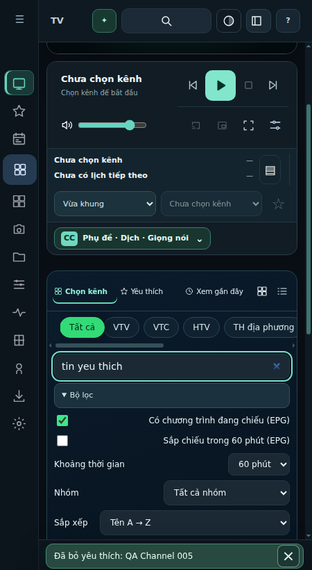

[Bản phát hành / thông tin](https://github.com/trisanghy/open-iptv-pro/releases/tag/positron/v4.23.225-p5.1.141) · [Xem thay đổi Git](https://github.com/trisanghy/open-iptv-pro/commit/361a2830232bc83a820cb5375c0be6cc9de8e704) · [Tải Windows Setup x64](https://github.com/trisanghy/open-iptv-pro/releases/download/positron/v4.23.225-p5.1.141/Open-IPTV-Pro-Setup-4.23.225-x64.exe) · [Tải gói ảnh QA](https://github.com/trisanghy/open-iptv-pro/releases/download/positron/v4.23.225-p5.1.141/Positron-P51141-20-Real-Screenshots.zip)

<strong>P5.1.140</strong> · Lọc kênh đang có chương trình từ XMLTV · CHƯA CÓ BẢN PHÁT HÀNH · CẢI TIẾN / SỬA LỖI

**Ứng dụng:** 4.23.224 · **Trạng thái:** CHƯA CÓ BẢN PHÁT HÀNH

Feature priority: NEW — Thêm bộ lọc chỉ hiển thị các kênh có chương trình hiện tại trong lịch EPG/XMLTV đã nhập, kèm tên chương trình ngay trên thẻ; không dự đoán lịch phát và không kiểm tra hoặc tự mở luồng mạng. User action: Mở Chọn kênh → Bộ lọc → bật “Có chương trình đang chiếu (EPG)”; chọn kênh có tên chương trình theo lịch, hoặc tắt bộ lọc để xem toàn bộ.

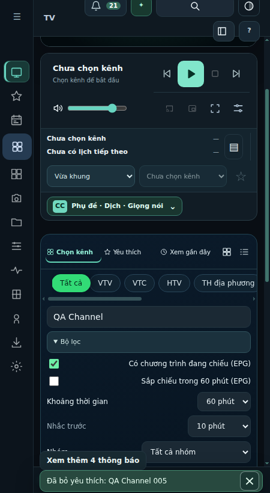

[Bản phát hành / thông tin](https://github.com/trisanghy/open-iptv-pro/blob/Positron/POSITRON_P5_CHANGELOG.md)

<strong>P5.1.139</strong> · Ưu tiên kênh yêu thích lên đầu · CHƯA CÓ BẢN PHÁT HÀNH · CẢI TIẾN / SỬA LỖI

**Ứng dụng:** 4.23.223 · **Trạng thái:** CHƯA CÓ BẢN PHÁT HÀNH

Feature priority: NEW — Thêm tùy chọn sắp xếp “Yêu thích lên đầu” trong danh sách kênh, đưa kênh đã đánh dấu sao lên trước nhưng giữ các kênh khác theo thứ tự tên; chỉ thay đổi cách hiển thị, không sửa playlist hay dữ liệu nguồn. User action: Mở Chọn kênh, mở Bộ lọc rồi chọn Sắp xếp → Yêu thích lên đầu; có thể trở lại Tên A → Z/Z → A ngay lập tức.

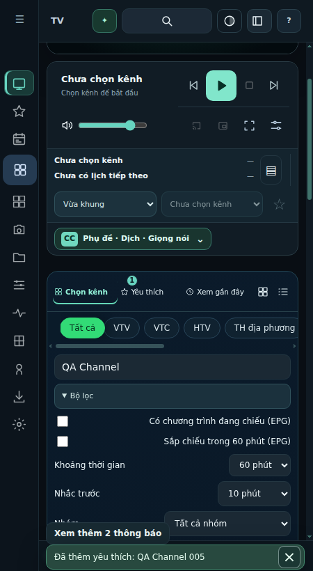

[Bản phát hành / thông tin](https://github.com/trisanghy/open-iptv-pro/blob/Positron/POSITRON_P5_CHANGELOG.md)

<strong>P5.1.138</strong> · Chuyển trang kênh bằng PageDown/PageUp · CHƯA CÓ BẢN PHÁT HÀNH · CẢI TIẾN / SỬA LỖI

**Ứng dụng:** 4.23.222 · **Trạng thái:** CHƯA CÓ BẢN PHÁT HÀNH

Feature priority: NEW — Duyệt xuyên qua các trang kênh dài chỉ bằng hai phím PageDown/PageUp, giữ tiêu điểm vào thẻ ở trang mới và không tự phát; hữu ích khi danh sách có hàng trăm kênh. User action: Mở Chọn kênh, dùng Enter chọn thẻ rồi nhấn PageDown để sang trang kế tiếp và chọn kênh đầu; PageUp trở về trang trước và chọn thẻ cuối, nhấn Enter trên thẻ mới phát.

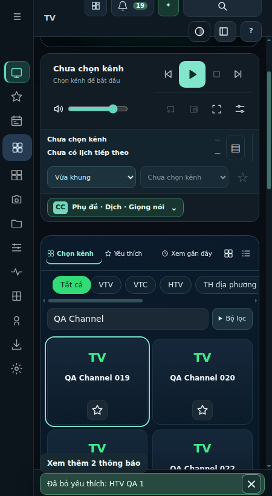

[Bản phát hành / thông tin](https://github.com/trisanghy/open-iptv-pro/blob/Positron/POSITRON_P5_CHANGELOG.md)

<strong>P5.1.137</strong> · Duyệt thẻ kênh bằng phím mũi tên · ĐÃ PHÁT HÀNH · CẢI TIẾN / SỬA LỖI

**Ứng dụng:** 4.23.221 · **Trạng thái:** ĐÃ PHÁT HÀNH

Feature priority: NEW — Điều hướng các kênh ngay trong Chọn kênh bằng bốn phím mũi tên và Home/End, bám đúng vị trí thẻ ở cả dạng lưới và danh sách; không cần Tab qua từng nút yêu thích và không tự phát video. User action: Mở Chọn kênh, nhập “QA Channel” rồi Enter để chọn thẻ đầu tiên; dùng ← → ↑ ↓ để di chuyển theo vị trí kênh, Home về đầu và End tới cuối; chỉ Enter trên thẻ mới phát.

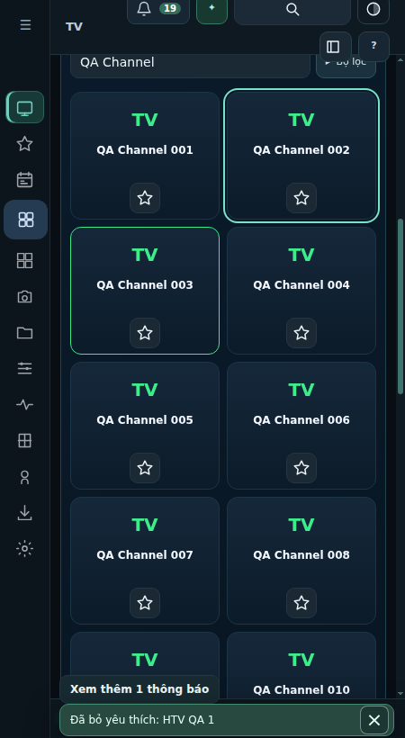

[Bản phát hành / thông tin](https://github.com/trisanghy/open-iptv-pro/releases/tag/positron/v4.23.221-p5.1.137) · [Xem thay đổi Git](https://github.com/trisanghy/open-iptv-pro/commit/6d8b23968e30a4264feca3cd58b44ace6d1720ee) · [Tải Windows Setup x64](https://github.com/trisanghy/open-iptv-pro/releases/download/positron/v4.23.221-p5.1.137/Open-IPTV-Pro-Setup-4.23.221-x64.exe) · [Tải gói ảnh QA](https://github.com/trisanghy/open-iptv-pro/releases/download/positron/v4.23.221-p5.1.137/Positron-P51137-20-Real-Screenshots.zip)

<strong>P5.1.136</strong> · Enter chọn kết quả tìm kênh · ĐÃ PHÁT HÀNH · CẢI TIẾN / SỬA LỖI

**Ứng dụng:** 4.23.220 · **Trạng thái:** ĐÃ PHÁT HÀNH

Feature priority: NEW — Chuyển tiêu điểm bàn phím tới thẻ kênh phù hợp đầu tiên sau khi tìm kiếm, tránh phải dùng chuột và không tự phát hoặc thay đổi dữ liệu người dùng. User action: Mở Chọn kênh ở TV, nhập tên kênh vào Tìm kiếm rồi nhấn Enter để chọn thẻ đầu tiên; nhấn Enter thêm lần nữa trên thẻ mới phát kênh nếu muốn.

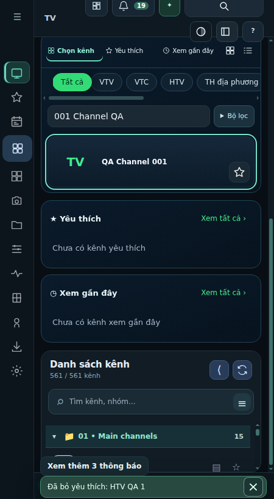

[Bản phát hành / thông tin](https://github.com/trisanghy/open-iptv-pro/releases/tag/positron/v4.23.220-p5.1.136) · [Xem thay đổi Git](https://github.com/trisanghy/open-iptv-pro/commit/a883e66d3a727ee4e007253869dd811269c9bec3) · [Tải Windows Setup x64](https://github.com/trisanghy/open-iptv-pro/releases/download/positron/v4.23.220-p5.1.136/Open-IPTV-Pro-Setup-4.23.220-x64.exe) · [Tải gói ảnh QA](https://github.com/trisanghy/open-iptv-pro/releases/download/positron/v4.23.220-p5.1.136/Positron-P51136-20-Real-Screenshots.zip)

<strong>P5.1.135</strong> · Tìm kênh nhiều từ không đúng thứ tự · ĐÃ PHÁT HÀNH · CẢI TIẾN / SỬA LỖI

**Ứng dụng:** 4.23.219 · **Trạng thái:** ĐÃ PHÁT HÀNH

Feature priority: NEW — Tìm được kênh bằng nhiều từ khóa trong tên và nhóm dù đảo thứ tự, có khoảng trắng lặp hoặc gõ tiếng Việt không dấu; không truy cập URL, không tự phát video và không đổi dữ liệu. User action: Mở Chọn kênh, gõ "001 Channel QA" hoặc "qa 001" vào Tìm kiếm; kết quả "QA Channel 001" xuất hiện mà không cần gõ chính xác thứ tự.

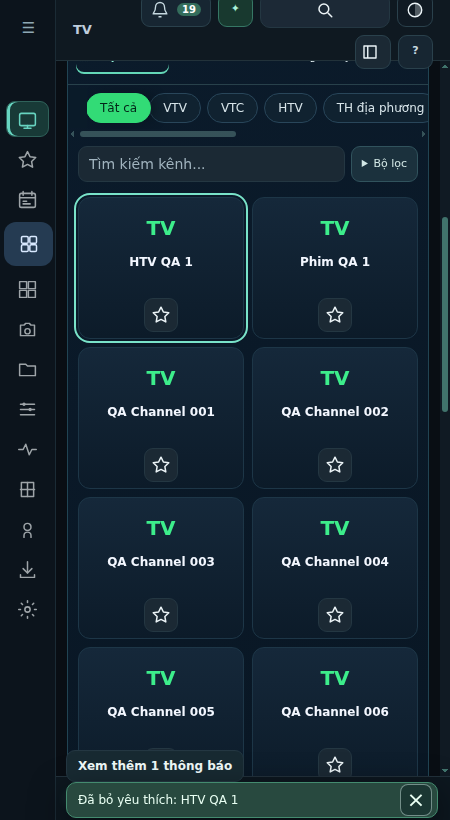

[Bản phát hành / thông tin](https://github.com/trisanghy/open-iptv-pro/releases/tag/positron/v4.23.219-p5.1.135) · [Xem thay đổi Git](https://github.com/trisanghy/open-iptv-pro/commit/f257bf79031549cc75d4eb5f3beb463786930daf) · [Tải Windows Setup x64](https://github.com/trisanghy/open-iptv-pro/releases/download/positron/v4.23.219-p5.1.135/Open-IPTV-Pro-Setup-4.23.219-x64.exe) · [Tải gói ảnh QA](https://github.com/trisanghy/open-iptv-pro/releases/download/positron/v4.23.219-p5.1.135/Positron-P51135-20-Real-Screenshots.zip)

<strong>P5.1.134</strong> · Nhấn F để thêm/bỏ Yêu thích và dùng biểu tượng sao SVG · ĐÃ PHÁT HÀNH · CẢI TIẾN / SỬA LỖI

**Ứng dụng:** 4.23.218 · **Trạng thái:** ĐÃ PHÁT HÀNH

Khi chọn một thẻ kênh, nhấn phím F để thêm kênh vào Yêu thích; nhấn lần nữa để bỏ lưu mà không phát video. Nút sao sử dụng SVG 20 px đồng nhất thay ký tự phụ thuộc phông chữ, giữ nguyên dữ liệu đã lưu, thao tác chuột và bàn phím.

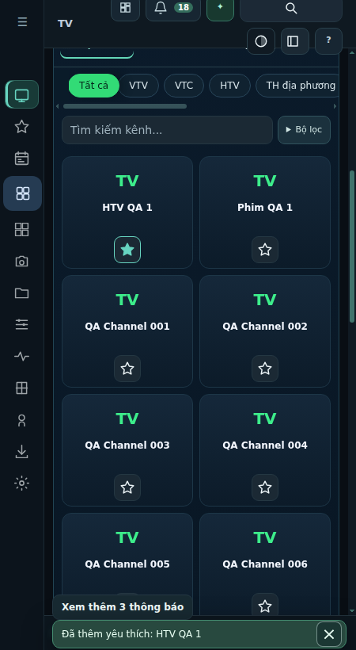

[Bản phát hành / thông tin](https://github.com/trisanghy/open-iptv-pro/releases/tag/positron/v4.23.218-p5.1.134) · [Xem thay đổi Git](https://github.com/trisanghy/open-iptv-pro/commit/d973e0886eae15c9fed6f8bee1886639bbfaa46e) · [Tải Windows Setup x64](https://github.com/trisanghy/open-iptv-pro/releases/download/positron/v4.23.218-p5.1.134/Open-IPTV-Pro-Setup-4.23.218-x64.exe) · [Tải gói ảnh QA](https://github.com/trisanghy/open-iptv-pro/releases/download/positron/v4.23.218-p5.1.134/Positron-P51134-20-Real-Screenshots.zip)

<strong>P5.1.133</strong> · Tên kênh dễ đọc hơn, nút Yêu thích tách riêng · CHƯA CÓ BẢN PHÁT HÀNH · CẢI TIẾN / SỬA LỖI

**Ứng dụng:** 4.23.217 · **Trạng thái:** CHƯA CÓ BẢN PHÁT HÀNH

Ở cửa sổ 450 px, tên kênh dài bị cắt cạnh nút hình sao. Bản này dành hàng riêng cho nút Yêu thích, cho phép tên kênh xuống hai dòng mà vẫn giữ nguyên thao tác phát và dữ liệu đã lưu.

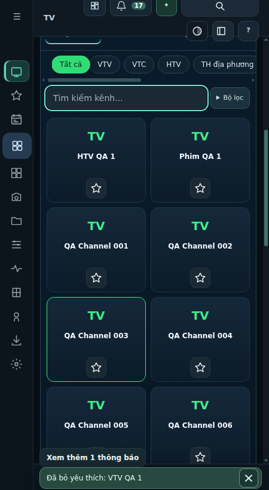

[Bản phát hành / thông tin](https://github.com/trisanghy/open-iptv-pro/blob/Positron/POSITRON_P5_CHANGELOG.md)

<strong>P5.1.132</strong> · Xóa nhanh bộ lọc khi tìm không thấy kênh · ĐÃ PHÁT HÀNH · TÍNH NĂNG

**Ứng dụng:** 4.23.216 · **Trạng thái:** ĐÃ PHÁT HÀNH

Khi tìm kiếm hoặc chọn nhóm mà không có kết quả, xuất hiện nút “Xóa bộ lọc và xem tất cả kênh”. Nhấn nút sẽ xóa truy vấn, khôi phục danh sách và đưa con trỏ về ô tìm kiếm; không tự phát kênh.

[Bản phát hành / thông tin](https://github.com/trisanghy/open-iptv-pro/releases/tag/positron/v4.23.216-p5.1.132) · [Xem thay đổi Git](https://github.com/trisanghy/open-iptv-pro/commit/eab0be6a1e9e6873894becc3a472b117fb60cea2) · [Tải Windows Setup x64](https://github.com/trisanghy/open-iptv-pro/releases/download/positron/v4.23.216-p5.1.132/Open-IPTV-Pro-Setup-4.23.216-x64.exe) · [Tải gói ảnh QA](https://github.com/trisanghy/open-iptv-pro/releases/download/positron/v4.23.216-p5.1.132/Positron-P51132-20-Real-Screenshots.zip)

<strong>P5.1.131</strong> · Tìm kênh tiếng Việt không dấu, kể cả chữ đ · CHƯA CÓ BẢN PHÁT HÀNH · CẢI TIẾN / SỬA LỖI

**Ứng dụng:** 4.23.215 · **Trạng thái:** CHƯA CÓ BẢN PHÁT HÀNH

Bổ sung quy đổi chữ “đ” thành “d” khi tìm kiếm. Ví dụ, gõ “dia phuong” có thể tìm nhóm “TH địa phương”. Tên và nhóm kênh gốc không bị thay đổi.

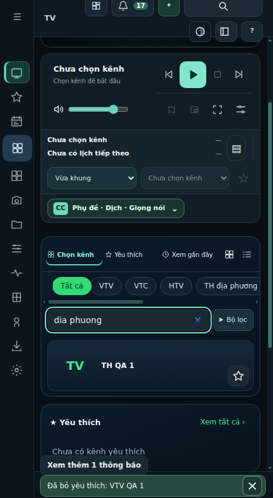

[Bản phát hành / thông tin](https://github.com/trisanghy/open-iptv-pro/blob/Positron/POSITRON_P5_CHANGELOG.md)

<strong>P5.1.130</strong> · Ẩn phần viền thừa ở nút lọc nhóm kênh · CHƯA CÓ BẢN PHÁT HÀNH · CẢI TIẾN / SỬA LỖI

**Ứng dụng:** 4.23.214 · **Trạng thái:** CHƯA CÓ BẢN PHÁT HÀNH

Mở rộng vùng che có điều kiện cho thanh nhóm kênh cuộn ngang, xử lý nét viền còn lộ cạnh “Tất cả”. Các nút nhóm bên cạnh vẫn bấm được và không ảnh hưởng phát kênh.

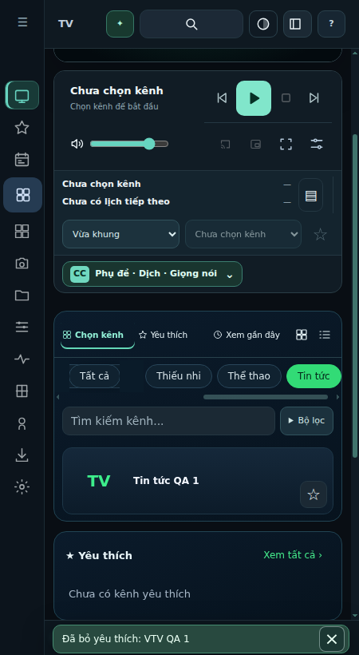

[Bản phát hành / thông tin](https://github.com/trisanghy/open-iptv-pro/blob/Positron/POSITRON_P5_CHANGELOG.md)

<strong>P5.1.129</strong> · Sửa chữ nhóm kênh bị lộ cạnh nút “Tất cả” · ĐÃ PHÁT HÀNH · CẢI TIẾN / SỬA LỖI

**Ứng dụng:** 4.23.213 · **Trạng thái:** ĐÃ PHÁT HÀNH

Theo ảnh Electron 450 px, một phần chữ của nhóm bị cuộn lọt ra cạnh nút “Tất cả”. Đồng bộ trạng thái cuộn và chỉ che phần chữ thừa khi thực sự cuộn ngang.

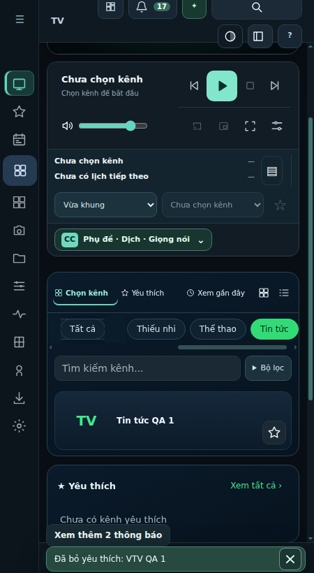

[Bản phát hành / thông tin](https://github.com/trisanghy/open-iptv-pro/releases/tag/positron/v4.23.213-p5.1.129) · [Xem thay đổi Git](https://github.com/trisanghy/open-iptv-pro/commit/c3754e3d196f4ef9354a93617f235cd89538166a) · [Tải Windows Setup x64](https://github.com/trisanghy/open-iptv-pro/releases/download/positron/v4.23.213-p5.1.129/Open-IPTV-Pro-Setup-4.23.213-x64.exe) · [Tải gói ảnh QA](https://github.com/trisanghy/open-iptv-pro/releases/download/positron/v4.23.213-p5.1.129/Positron-P51129-20-Real-Screenshots.zip)

<strong>P5.1.128</strong> · Tự đưa nhóm đang chọn vào vùng nhìn thấy · ĐÃ PHÁT HÀNH · CẢI TIẾN / SỬA LỖI

**Ứng dụng:** 4.23.212 · **Trạng thái:** ĐÃ PHÁT HÀNH

Khi đổi nhóm bằng bộ lọc nâng cao, thanh nhóm kênh tự cuộn để hiện nút nhóm đang được chọn. Chọn “Tất cả” sẽ đưa thanh về đầu.

[Bản phát hành / thông tin](https://github.com/trisanghy/open-iptv-pro/releases/tag/positron/v4.23.212-p5.1.128) · [Xem thay đổi Git](https://github.com/trisanghy/open-iptv-pro/commit/7003357116d97ec3d98c76af54071fd4e81b717d) · [Tải Windows Setup x64](https://github.com/trisanghy/open-iptv-pro/releases/download/positron/v4.23.212-p5.1.128/Open-IPTV-Pro-Setup-4.23.212-x64.exe) · [Tải gói ảnh QA](https://github.com/trisanghy/open-iptv-pro/releases/download/positron/v4.23.212-p5.1.128/Positron-P51128-20-Real-Screenshots.zip)

<strong>P5.1.127</strong> · Dùng phím mũi tên để duyệt nhóm kênh · ĐÃ PHÁT HÀNH · TÍNH NĂNG

**Ứng dụng:** 4.23.211 · **Trạng thái:** ĐÃ PHÁT HÀNH

Cho phép chuyển tiêu điểm giữa các nhóm bằng phím mũi tên, Home và End trên màn hình hẹp. Chỉ thay đổi bộ lọc khi người dùng chọn nhóm.

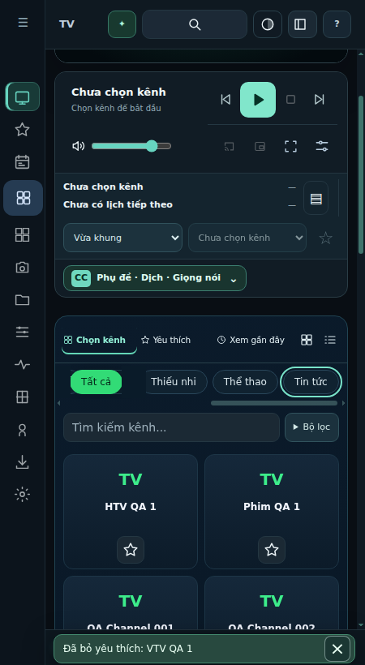

[Bản phát hành / thông tin](https://github.com/trisanghy/open-iptv-pro/releases/tag/positron/v4.23.211-p5.1.127) · [Xem thay đổi Git](https://github.com/trisanghy/open-iptv-pro/commit/8bad7fc08d009c3529447d0389a176caabe30648) · [Tải Windows Setup x64](https://github.com/trisanghy/open-iptv-pro/releases/download/positron/v4.23.211-p5.1.127/Open-IPTV-Pro-Setup-4.23.211-x64.exe) · [Tải gói ảnh QA](https://github.com/trisanghy/open-iptv-pro/releases/download/positron/v4.23.211-p5.1.127/Positron-P51127-20-Real-Screenshots.zip)

<strong>P5.1.126</strong> · Che tên nhóm kênh bị khuất sau nút “Tất cả” · ĐÃ PHÁT HÀNH · CẢI TIẾN / SỬA LỖI

**Ứng dụng:** 4.23.210 · **Trạng thái:** ĐÃ PHÁT HÀNH

Thêm vùng che phía dưới nút “Tất cả” được ghim khi thanh nhóm cuộn ngang, tránh hiển thị chữ chồng và tránh chọn nhầm nhóm bị che.

[Bản phát hành / thông tin](https://github.com/trisanghy/open-iptv-pro/releases/tag/positron/v4.23.210-p5.1.126) · [Xem thay đổi Git](https://github.com/trisanghy/open-iptv-pro/commit/9aac59d3c7b66e5689a2d3f24e3da76d704e8483) · [Tải Windows Setup x64](https://github.com/trisanghy/open-iptv-pro/releases/download/positron/v4.23.210-p5.1.126/Open-IPTV-Pro-Setup-4.23.210-x64.exe) · [Tải gói ảnh QA](https://github.com/trisanghy/open-iptv-pro/releases/download/positron/v4.23.210-p5.1.126/Positron-P51126-20-Real-Screenshots.zip)

<strong>P5.1.125</strong> · Ghim nút “Tất cả” khi cuộn nhóm kênh · ĐÃ PHÁT HÀNH · CẢI TIẾN / SỬA LỖI

**Ứng dụng:** 4.23.209 · **Trạng thái:** ĐÃ PHÁT HÀNH

Giữ nút đặt lại “Tất cả” ở mép trái của thanh nhóm kênh trên cửa sổ hẹp. Các nhóm còn lại vẫn hỗ trợ cuộn, cảm ứng và bàn phím.

[Bản phát hành / thông tin](https://github.com/trisanghy/open-iptv-pro/releases/tag/positron/v4.23.209-p5.1.125) · [Xem thay đổi Git](https://github.com/trisanghy/open-iptv-pro/commit/b7cc07b69b8c3d503edb39f3284add1695a658ac) · [Tải Windows Setup x64](https://github.com/trisanghy/open-iptv-pro/releases/download/positron/v4.23.209-p5.1.125/Open-IPTV-Pro-Setup-4.23.209-x64.exe) · [Tải gói ảnh QA](https://github.com/trisanghy/open-iptv-pro/releases/download/positron/v4.23.209-p5.1.125/Positron-P51125-20-Real-Screenshots.zip)

<strong>P5.1.124</strong> · Cuộn nhóm kênh ngang bằng bánh xe chuột · ĐÃ PHÁT HÀNH · CẢI TIẾN / SỬA LỖI

**Ứng dụng:** 4.23.208 · **Trạng thái:** ĐÃ PHÁT HÀNH

Dùng bánh xe chuột để di chuyển thanh nhóm kênh theo chiều ngang khi còn nội dung cần cuộn. Khi tới mép, trả thao tác cuộn về trang như bình thường.

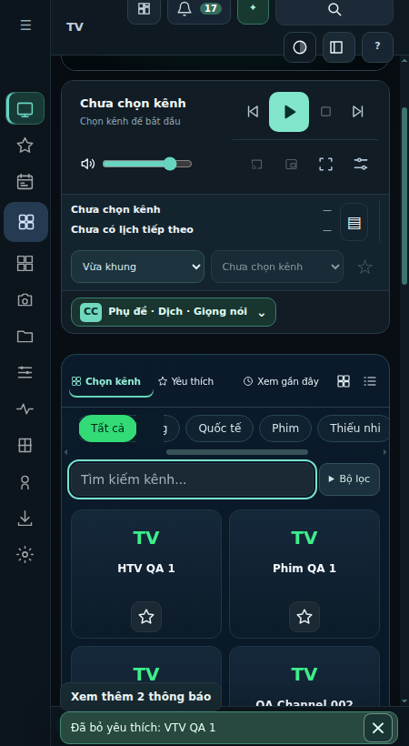

[Bản phát hành / thông tin](https://github.com/trisanghy/open-iptv-pro/releases/tag/positron/v4.23.208-p5.1.124) · [Xem thay đổi Git](https://github.com/trisanghy/open-iptv-pro/commit/808e2f8ef5260b4bd9b41dc2747ce3113256181d) · [Tải Windows Setup x64](https://github.com/trisanghy/open-iptv-pro/releases/download/positron/v4.23.208-p5.1.124/Open-IPTV-Pro-Setup-4.23.208-x64.exe) · [Tải gói ảnh QA](https://github.com/trisanghy/open-iptv-pro/releases/download/positron/v4.23.208-p5.1.124/Positron-P51124-20-Real-Screenshots.zip)

<strong>P5.1.123</strong> · Thông báo trên màn hình nhỏ không che nội dung · ĐÃ PHÁT HÀNH · CẢI TIẾN / SỬA LỖI

**Ứng dụng:** 4.23.207 · **Trạng thái:** ĐÃ PHÁT HÀNH

Đưa thông báo thành công vào dải gọn phía dưới và giữ nút đóng. Các thông báo cảnh báo/lỗi vẫn được ưu tiên hiển thị.

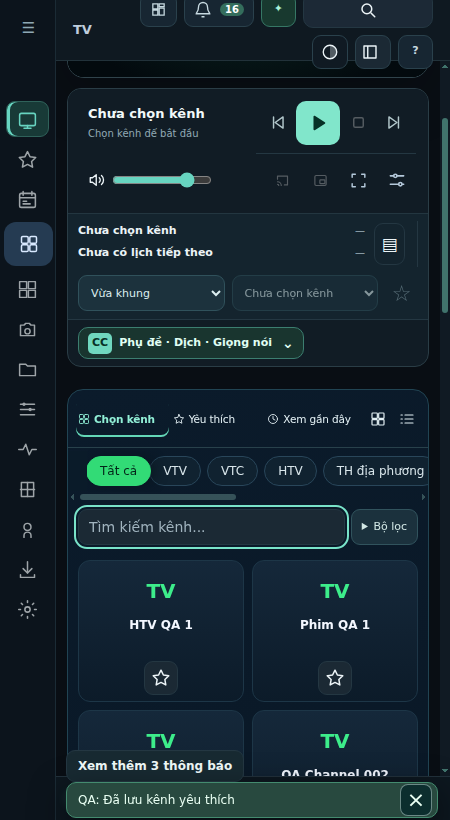

[Bản phát hành / thông tin](https://github.com/trisanghy/open-iptv-pro/releases/tag/positron/v4.23.207-p5.1.123) · [Xem thay đổi Git](https://github.com/trisanghy/open-iptv-pro/commit/38011da89d7b384431bbf3babb9da4f581674340) · [Tải Windows Setup x64](https://github.com/trisanghy/open-iptv-pro/releases/download/positron/v4.23.207-p5.1.123/Open-IPTV-Pro-Setup-4.23.207-x64.exe) · [Tải gói ảnh QA](https://github.com/trisanghy/open-iptv-pro/releases/download/positron/v4.23.207-p5.1.123/Positron-P51123-20-Real-Screenshots.zip)

<strong>P5.1.122</strong> · Đóng thông báo và khôi phục vị trí bàn phím · ĐÃ PHÁT HÀNH · CẢI TIẾN / SỬA LỖI

**Ứng dụng:** 4.23.206 · **Trạng thái:** ĐÃ PHÁT HÀNH

Khi đóng thông báo, tiêu điểm quay lại điều khiển trước đó thay vì bị mất. Giữ nguyên thời gian tự tắt, mức cảnh báo và các chức năng khác.

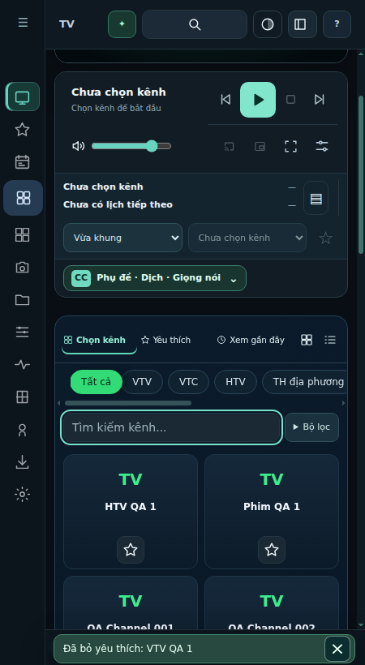

[Bản phát hành / thông tin](https://github.com/trisanghy/open-iptv-pro/releases/tag/positron/v4.23.206-p5.1.122) · [Xem thay đổi Git](https://github.com/trisanghy/open-iptv-pro/commit/9b5676910c4e9c88250b68f49bfe47e8abcad956) · [Tải Windows Setup x64](https://github.com/trisanghy/open-iptv-pro/releases/download/positron/v4.23.206-p5.1.122/Open-IPTV-Pro-Setup-4.23.206-x64.exe) · [Tải gói ảnh QA](https://github.com/trisanghy/open-iptv-pro/releases/download/positron/v4.23.206-p5.1.122/Positron-P51122-20-Real-Screenshots.zip)

<strong>P5.1.121</strong> · Thêm nút đóng thông báo bằng chuột hoặc bàn phím · ĐÃ PHÁT HÀNH · TÍNH NĂNG

**Ứng dụng:** 4.23.205 · **Trạng thái:** ĐÃ PHÁT HÀNH

Bổ sung nút đóng có thể dùng bằng cảm ứng và bàn phím cho thông báo trong Positron. Không thay đổi nội dung và thời gian tự tắt của thông báo.

[Bản phát hành / thông tin](https://github.com/trisanghy/open-iptv-pro/releases/tag/positron/v4.23.205-p5.1.121) · [Xem thay đổi Git](https://github.com/trisanghy/open-iptv-pro/commit/daefa5bb1e8119c8d16ddbf22d7b04003881f5b7) · [Tải Windows Setup x64](https://github.com/trisanghy/open-iptv-pro/releases/download/positron/v4.23.205-p5.1.121/Open-IPTV-Pro-Setup-4.23.205-x64.exe) · [Tải gói ảnh QA](https://github.com/trisanghy/open-iptv-pro/releases/download/positron/v4.23.205-p5.1.121/Positron-P51121-20-Real-Screenshots.zip)

<strong>P5.1.120</strong> · Rút gọn các thông báo thành công trên màn hình hẹp · ĐÃ PHÁT HÀNH · CẢI TIẾN / SỬA LỖI

**Ứng dụng:** 4.23.204 · **Trạng thái:** ĐÃ PHÁT HÀNH

Chỉ hiện thông báo thành công mới nhất ở cửa sổ hẹp để không che danh sách kênh; cảnh báo, lỗi và bộ hẹn giờ vẫn hoạt động.

[Bản phát hành / thông tin](https://github.com/trisanghy/open-iptv-pro/releases/tag/positron/v4.23.204-p5.1.120) · [Xem thay đổi Git](https://github.com/trisanghy/open-iptv-pro/commit/2eec95e697ef50b9e2f2c1b420652515005423bc) · [Tải Windows Setup x64](https://github.com/trisanghy/open-iptv-pro/releases/download/positron/v4.23.204-p5.1.120/Open-IPTV-Pro-Setup-4.23.204-x64.exe) · [Tải gói ảnh QA](https://github.com/trisanghy/open-iptv-pro/releases/download/positron/v4.23.204-p5.1.120/Positron-P51120-20-Real-Screenshots.zip)

<strong>P5.1.119</strong> · Hiển thị số kênh Yêu thích trực tiếp trên tab · ĐÃ PHÁT HÀNH · TÍNH NĂNG

**Ứng dụng:** 4.23.203 · **Trạng thái:** ĐÃ PHÁT HÀNH

Thêm huy hiệu đếm số kênh đã lưu ở tab Yêu thích. Số được cập nhật khi thêm/bỏ sao và ẩn khi bằng không; có nhãn hỗ trợ truy cập.

[Bản phát hành / thông tin](https://github.com/trisanghy/open-iptv-pro/releases/tag/positron/v4.23.203-p5.1.119) · [Xem thay đổi Git](https://github.com/trisanghy/open-iptv-pro/commit/f3bd1bf867f939335eb2d96e555be9dd7408e81e) · [Tải Windows Setup x64](https://github.com/trisanghy/open-iptv-pro/releases/download/positron/v4.23.203-p5.1.119/Open-IPTV-Pro-Setup-4.23.203-x64.exe) · [Tải gói ảnh QA](https://github.com/trisanghy/open-iptv-pro/releases/download/positron/v4.23.203-p5.1.119/Positron-P51119-20-Real-Screenshots.zip)

<strong>P5.1.118</strong> · Đánh dấu Yêu thích ngay trên thẻ kênh · ĐÃ PHÁT HÀNH · TÍNH NĂNG

**Ứng dụng:** 4.23.202 · **Trạng thái:** ĐÃ PHÁT HÀNH

Thêm nút hình sao riêng trên từng thẻ kênh. Người dùng có thể lưu hoặc bỏ Yêu thích mà không cần phát kênh trước.

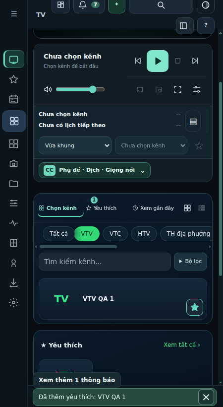

[Bản phát hành / thông tin](https://github.com/trisanghy/open-iptv-pro/releases/tag/positron/v4.23.202-p5.1.118) · [Xem thay đổi Git](https://github.com/trisanghy/open-iptv-pro/commit/9751d3c02c2a293c63301f066b16b079a2d884ff) · [Tải Windows Setup x64](https://github.com/trisanghy/open-iptv-pro/releases/download/positron/v4.23.202-p5.1.118/Open-IPTV-Pro-Setup-4.23.202-x64.exe) · [Tải gói ảnh QA](https://github.com/trisanghy/open-iptv-pro/releases/download/positron/v4.23.202-p5.1.118/Positron-P51118-20-Real-Screenshots.zip)

<strong>P5.1.117</strong> · Một kênh lọc được hiển thị rộng và dễ đọc · ĐÃ PHÁT HÀNH · CẢI TIẾN / SỬA LỖI

**Ứng dụng:** 4.23.201 · **Trạng thái:** ĐÃ PHÁT HÀNH

Khi chỉ còn một kênh trong kết quả lọc trên màn hình hẹp, thẻ kênh tự chiếm toàn bộ hàng thay vì bó hẹp trong nửa cột.

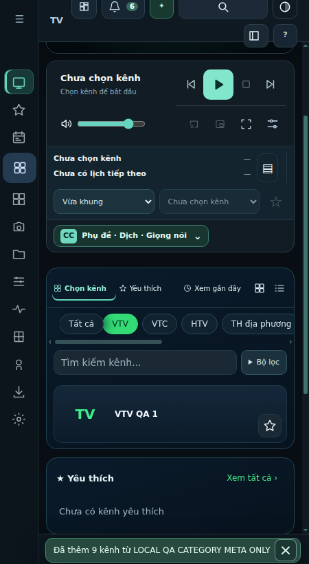

[Bản phát hành / thông tin](https://github.com/trisanghy/open-iptv-pro/releases/tag/positron/v4.23.201-p5.1.117) · [Xem thay đổi Git](https://github.com/trisanghy/open-iptv-pro/commit/15a29463a11da0679caa367515362c74bfec8029) · [Tải Windows Setup x64](https://github.com/trisanghy/open-iptv-pro/releases/download/positron/v4.23.201-p5.1.117/Open-IPTV-Pro-Setup-4.23.201-x64.exe) · [Tải gói ảnh QA](https://github.com/trisanghy/open-iptv-pro/releases/download/positron/v4.23.201-p5.1.117/Positron-P51117-20-Real-Screenshots.zip)

<strong>P5.1.116</strong> · Chỉ hiển thị nhóm kênh thật trong danh sách · ĐÃ PHÁT HÀNH · CẢI TIẾN / SỬA LỖI

**Ứng dụng:** 4.23.200 · **Trạng thái:** ĐÃ PHÁT HÀNH

Thanh lọc nhanh lấy nhóm có trong nguồn M3U đã nhập, không hiện nhóm rỗng. Trạng thái nút được chọn và khả năng dùng bàn phím được cải thiện.

[Bản phát hành / thông tin](https://github.com/trisanghy/open-iptv-pro/releases/tag/positron/v4.23.200-p5.1.116) · [Xem thay đổi Git](https://github.com/trisanghy/open-iptv-pro/commit/68bf5505bc72a73853284574dc3106bfad7e9973) · [Tải Windows Setup x64](https://github.com/trisanghy/open-iptv-pro/releases/download/positron/v4.23.200-p5.1.116/Open-IPTV-Pro-Setup-4.23.200-x64.exe) · [Tải gói ảnh QA](https://github.com/trisanghy/open-iptv-pro/releases/download/positron/v4.23.200-p5.1.116/Positron-P51116-20-Real-Screenshots.zip)

<strong>P5.1.115</strong> · Bỏ hướng dẫn trùng ở Yêu thích và Gần đây · ĐÃ PHÁT HÀNH · CẢI TIẾN / SỬA LỖI

**Ứng dụng:** 4.23.199 · **Trạng thái:** ĐÃ PHÁT HÀNH

Trên màn hình hẹp, ẩn bảng phụ rỗng bị lặp với thông báo chính của tab đang mở. Các bảng hữu ích khác vẫn được giữ lại.

[Bản phát hành / thông tin](https://github.com/trisanghy/open-iptv-pro/releases/tag/positron/v4.23.199-p5.1.115) · [Xem thay đổi Git](https://github.com/trisanghy/open-iptv-pro/commit/caf6a5bff4a115cac60f8474519e5d6101dfdd87) · [Tải Windows Setup x64](https://github.com/trisanghy/open-iptv-pro/releases/download/positron/v4.23.199-p5.1.115/Open-IPTV-Pro-Setup-4.23.199-x64.exe) · [Tải gói ảnh QA](https://github.com/trisanghy/open-iptv-pro/releases/download/positron/v4.23.199-p5.1.115/Positron-P51115-20-Real-Screenshots.zip)

<strong>P5.1.114</strong> · Hướng dẫn rõ ràng khi Yêu thích hoặc Gần đây trống · ĐÃ PHÁT HÀNH · CẢI TIẾN / SỬA LỖI

**Ứng dụng:** 4.23.198 · **Trạng thái:** ĐÃ PHÁT HÀNH

Phân biệt chưa có Yêu thích, chưa có lịch sử và lọc không ra kết quả. Thêm nút “Xem tất cả kênh” để quay lại thư viện.

[Bản phát hành / thông tin](https://github.com/trisanghy/open-iptv-pro/releases/tag/positron/v4.23.198-p5.1.114) · [Xem thay đổi Git](https://github.com/trisanghy/open-iptv-pro/commit/257422b56d81d4eca9c8efacfb1aeb4ebd2dab83) · [Tải Windows Setup x64](https://github.com/trisanghy/open-iptv-pro/releases/download/positron/v4.23.198-p5.1.114/Open-IPTV-Pro-Setup-4.23.198-x64.exe) · [Tải gói ảnh QA](https://github.com/trisanghy/open-iptv-pro/releases/download/positron/v4.23.198-p5.1.114/Positron-P51114-20-Real-Screenshots.zip)

<strong>P5.1.113</strong> · Điều hướng các tab thư viện kênh bằng bàn phím · ĐÃ PHÁT HÀNH · TÍNH NĂNG

**Ứng dụng:** 4.23.197 · **Trạng thái:** ĐÃ PHÁT HÀNH

Hỗ trợ phím mũi tên, Home và End để chuyển tab; giữ trạng thái được chọn, tiêu điểm và các thao tác chuột vốn có.

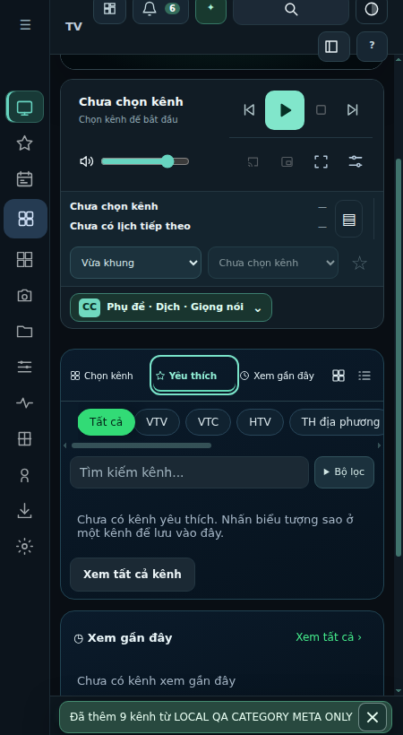

[Bản phát hành / thông tin](https://github.com/trisanghy/open-iptv-pro/releases/tag/positron/v4.23.197-p5.1.113) · [Xem thay đổi Git](https://github.com/trisanghy/open-iptv-pro/commit/e634e2c7c9da33ebb5c54043e4d212ab8d3a40a3) · [Tải Windows Setup x64](https://github.com/trisanghy/open-iptv-pro/releases/download/positron/v4.23.197-p5.1.113/Open-IPTV-Pro-Setup-4.23.197-x64.exe) · [Tải gói ảnh QA](https://github.com/trisanghy/open-iptv-pro/releases/download/positron/v4.23.197-p5.1.113/Positron-P51113-20-Real-Screenshots.zip)

<strong>P5.1.112</strong> · Thẻ kênh hai cột dễ đọc hơn trên màn hình hẹp · ĐÃ PHÁT HÀNH · CẢI TIẾN / SỬA LỖI

**Ứng dụng:** 4.23.196 · **Trạng thái:** ĐÃ PHÁT HÀNH

Thay lưới thẻ quá nhỏ bằng hai cột và cho phép tên kênh hiển thị nhiều dòng, tránh cắt mất tên.

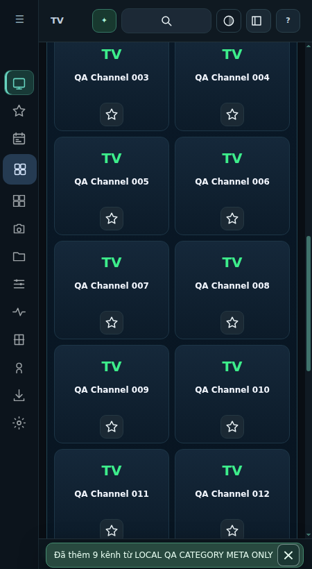

[Bản phát hành / thông tin](https://github.com/trisanghy/open-iptv-pro/releases/tag/positron/v4.23.196-p5.1.112) · [Xem thay đổi Git](https://github.com/trisanghy/open-iptv-pro/commit/50a2f2e24710e1727b7fe6a31273cc2808bc30d0) · [Tải Windows Setup x64](https://github.com/trisanghy/open-iptv-pro/releases/download/positron/v4.23.196-p5.1.112/Open-IPTV-Pro-Setup-4.23.196-x64.exe) · [Tải gói ảnh QA](https://github.com/trisanghy/open-iptv-pro/releases/download/positron/v4.23.196-p5.1.112/Positron-P51112-20-Real-Screenshots.zip)

<strong>P5.1.111</strong> · Bộ lọc nhóm kênh gọn trong một hàng cuộn · ĐÃ PHÁT HÀNH · CẢI TIẾN / SỬA LỖI

**Ứng dụng:** 4.23.195 · **Trạng thái:** ĐÃ PHÁT HÀNH

Hiển thị nhóm trong một hàng cuộn ngang thay vì xuống nhiều dòng. Giữ vị trí thanh cuộn sau khi chọn nhóm.

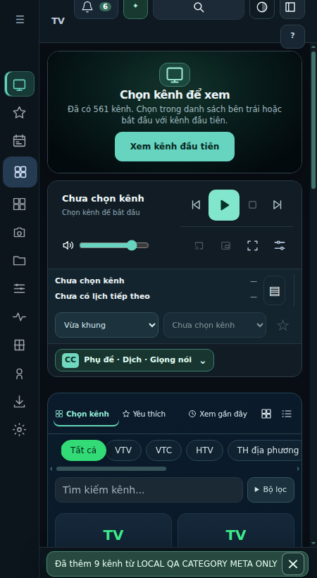

[Bản phát hành / thông tin](https://github.com/trisanghy/open-iptv-pro/releases/tag/positron/v4.23.195-p5.1.111) · [Xem thay đổi Git](https://github.com/trisanghy/open-iptv-pro/commit/ba5a3f4b282ad68a4d5c270fe523935dbf35b00e) · [Tải Windows Setup x64](https://github.com/trisanghy/open-iptv-pro/releases/download/positron/v4.23.195-p5.1.111/Open-IPTV-Pro-Setup-4.23.195-x64.exe) · [Tải gói ảnh QA](https://github.com/trisanghy/open-iptv-pro/releases/download/positron/v4.23.195-p5.1.111/Positron-P51111-20-Real-Screenshots.zip)

<strong>P5.1.110</strong> · Thu gọn màn hình phát khi chưa chọn kênh · ĐÃ PHÁT HÀNH · CẢI TIẾN / SỬA LỖI

**Ứng dụng:** 4.23.194 · **Trạng thái:** ĐÃ PHÁT HÀNH

Ở cửa sổ hẹp và chưa phát gì, thu gọn vùng giới thiệu để đưa phần tìm kênh lên cao hơn. Khung video thực vẫn giữ tỷ lệ.

[Bản phát hành / thông tin](https://github.com/trisanghy/open-iptv-pro/releases/tag/positron/v4.23.194-p5.1.110) · [Xem thay đổi Git](https://github.com/trisanghy/open-iptv-pro/commit/75d4acb5bf940eb46ecb868476aca6bda33e99f4) · [Tải Windows Setup x64](https://github.com/trisanghy/open-iptv-pro/releases/download/positron/v4.23.194-p5.1.110/Open-IPTV-Pro-Setup-4.23.194-x64.exe) · [Tải gói ảnh QA](https://github.com/trisanghy/open-iptv-pro/releases/download/positron/v4.23.194-p5.1.110/Positron-P51110-20-Real-Screenshots.zip)

<strong>P5.1.109</strong> · Không lặp thông báo đang hiển thị · ĐÃ PHÁT HÀNH · CẢI TIẾN / SỬA LỖI

**Ứng dụng:** 4.23.193 · **Trạng thái:** ĐÃ PHÁT HÀNH

Nếu một thông báo cùng nội dung và mức độ vẫn đang mở, không tạo bản trùng. Thông báo khác hoặc mức cảnh báo khác vẫn xuất hiện.

[Bản phát hành / thông tin](https://github.com/trisanghy/open-iptv-pro/releases/tag/positron/v4.23.193-p5.1.109) · [Xem thay đổi Git](https://github.com/trisanghy/open-iptv-pro/commit/1b2c5d4d55f3d60a9ff64f45529aa181d3a9454e) · [Tải Windows Setup x64](https://github.com/trisanghy/open-iptv-pro/releases/download/positron/v4.23.193-p5.1.109/Open-IPTV-Pro-Setup-4.23.193-x64.exe) · [Tải gói ảnh QA](https://github.com/trisanghy/open-iptv-pro/releases/download/positron/v4.23.193-p5.1.109/Positron-P51109-20-Real-Screenshots.zip)

<strong>P5.1.108</strong> · Thông báo không đè lên thanh biểu tượng · ĐÃ PHÁT HÀNH · CẢI TIẾN / SỬA LỖI

**Ứng dụng:** 4.23.192 · **Trạng thái:** ĐÃ PHÁT HÀNH

Giới hạn vị trí thông báo trong cửa sổ hẹp để không che thanh điều hướng có biểu tượng bên trái.

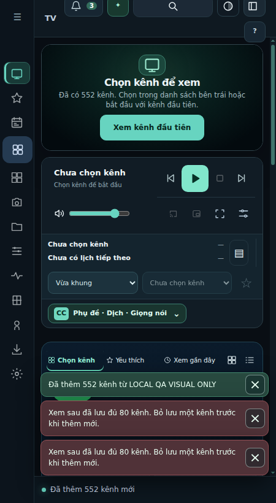

[Bản phát hành / thông tin](https://github.com/trisanghy/open-iptv-pro/releases/tag/positron/v4.23.192-p5.1.108) · [Xem thay đổi Git](https://github.com/trisanghy/open-iptv-pro/commit/a19d24c9858fba65cabc17c0ef478a861e44b0f1) · [Tải Windows Setup x64](https://github.com/trisanghy/open-iptv-pro/releases/download/positron/v4.23.192-p5.1.108/Open-IPTV-Pro-Setup-4.23.192-x64.exe) · [Tải gói ảnh QA](https://github.com/trisanghy/open-iptv-pro/releases/download/positron/v4.23.192-p5.1.108/Positron-P51108-20-Real-Screenshots.zip)

<strong>P5.1.107</strong> · Thay biểu tượng chữ bằng SVG thống nhất · ĐÃ PHÁT HÀNH · CẢI TIẾN / SỬA LỖI

**Ứng dụng:** 4.23.191 · **Trạng thái:** ĐÃ PHÁT HÀNH

Các nút tab thư viện kênh và chế độ xem dùng biểu tượng SVG thay cho ký tự phụ thuộc phông chữ. Thao tác và nhãn hỗ trợ truy cập được giữ nguyên.

[Bản phát hành / thông tin](https://github.com/trisanghy/open-iptv-pro/releases/tag/positron/v4.23.191-p5.1.107) · [Xem thay đổi Git](https://github.com/trisanghy/open-iptv-pro/commit/ac4670a51959aef9a9e6917c85495184c460bf1a) · [Tải Windows Setup x64](https://github.com/trisanghy/open-iptv-pro/releases/download/positron/v4.23.191-p5.1.107/Open-IPTV-Pro-Setup-4.23.191-x64.exe) · [Tải gói ảnh QA](https://github.com/trisanghy/open-iptv-pro/releases/download/positron/v4.23.191-p5.1.107/Positron-P51107-20-Real-Screenshots.zip)

<strong>P5.1.106</strong> · Bỏ thanh cuộn ngang thừa trong WatchFlow trống · ĐÃ PHÁT HÀNH · CẢI TIẾN / SỬA LỖI

**Ứng dụng:** 4.23.190 · **Trạng thái:** ĐÃ PHÁT HÀNH

Sửa khoảng cách ở hộp WatchFlow khi chưa có nguồn để không xuất hiện thanh cuộn ngang không cần thiết.

[Bản phát hành / thông tin](https://github.com/trisanghy/open-iptv-pro/releases/tag/positron/v4.23.190-p5.1.106) · [Xem thay đổi Git](https://github.com/trisanghy/open-iptv-pro/commit/19746909a874bdcc659f6948319cee86f0eec1da) · [Tải Windows Setup x64](https://github.com/trisanghy/open-iptv-pro/releases/download/positron/v4.23.190-p5.1.106/Open-IPTV-Pro-Setup-4.23.190-x64.exe) · [Tải gói ảnh QA](https://github.com/trisanghy/open-iptv-pro/releases/download/positron/v4.23.190-p5.1.106/Positron-P51106-20-Real-Screenshots.zip)

<strong>P5.1.105</strong> · Dọn dấu trang mất nguồn bằng hai bước xác nhận · ĐÃ PHÁT HÀNH · TÍNH NĂNG

**Ứng dụng:** 4.23.189 · **Trạng thái:** ĐÃ PHÁT HÀNH

Bổ sung thao tác xử lý dấu trang Xem sau không còn nguồn hợp lệ, có bước xác nhận rõ ràng để tránh xóa nhầm.

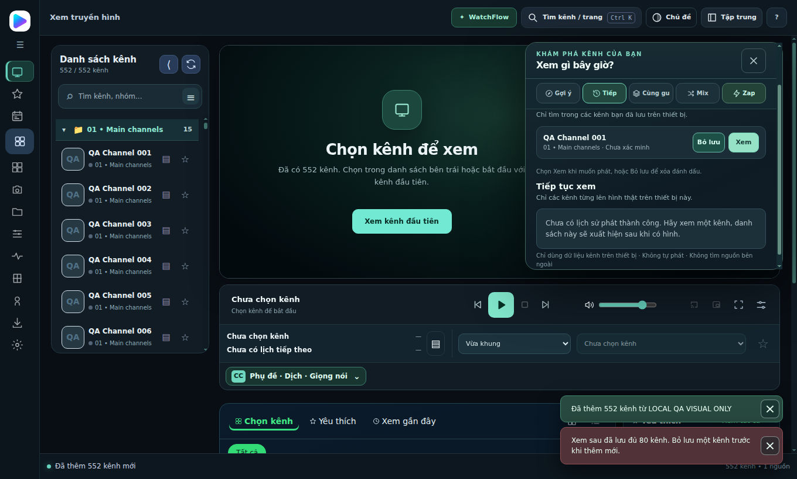

[Bản phát hành / thông tin](https://github.com/trisanghy/open-iptv-pro/releases/tag/positron/v4.23.189-p5.1.105) · [Xem thay đổi Git](https://github.com/trisanghy/open-iptv-pro/commit/937db5120885efefe32c62fe3a9476601e76955c) · [Tải Windows Setup x64](https://github.com/trisanghy/open-iptv-pro/releases/download/positron/v4.23.189-p5.1.105/Open-IPTV-Pro-Setup-4.23.189-x64.exe) · [Tải gói ảnh QA](https://github.com/trisanghy/open-iptv-pro/releases/download/positron/v4.23.189-p5.1.105/Positron-P51105-20-Real-Screenshots.zip)

<strong>P5.1.104</strong> · Thông báo nguồn Xem sau không còn hoạt động · ĐÃ PHÁT HÀNH · CẢI TIẾN / SỬA LỖI

**Ứng dụng:** 4.23.188 · **Trạng thái:** ĐÃ PHÁT HÀNH

Phát hiện dấu trang đã lưu nhưng nguồn không còn sẵn có; thông báo rõ tình trạng mà không tự xóa dữ liệu đã lưu.

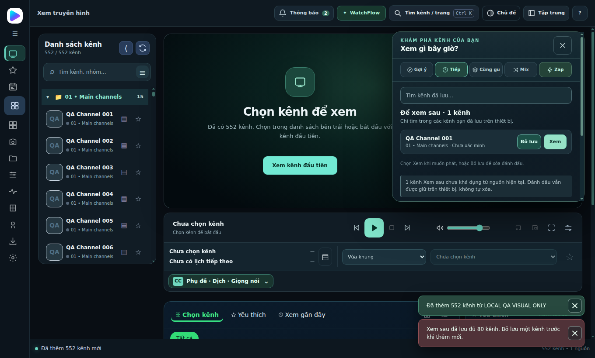

[Bản phát hành / thông tin](https://github.com/trisanghy/open-iptv-pro/releases/tag/positron/v4.23.188-p5.1.104) · [Xem thay đổi Git](https://github.com/trisanghy/open-iptv-pro/commit/0e6a64d5d4dbcda6e4131a3375b414e63cb54a52) · [Tải Windows Setup x64](https://github.com/trisanghy/open-iptv-pro/releases/download/positron/v4.23.188-p5.1.104/Open-IPTV-Pro-Setup-4.23.188-x64.exe) · [Tải gói ảnh QA](https://github.com/trisanghy/open-iptv-pro/releases/download/positron/v4.23.188-p5.1.104/Positron-P51104-20-Real-Screenshots.zip)

<strong>P5.1.103</strong> · Không tự loại dấu trang Xem sau khi đủ 80 mục · ĐÃ PHÁT HÀNH · CẢI TIẾN / SỬA LỖI

**Ứng dụng:** 4.23.187 · **Trạng thái:** ĐÃ PHÁT HÀNH

Khi đạt giới hạn 80 kênh lưu Xem sau, ngăn việc âm thầm loại kênh cũ. Người dùng được thông báo để tự quyết định.

[Bản phát hành / thông tin](https://github.com/trisanghy/open-iptv-pro/releases/tag/positron/v4.23.187-p5.1.103) · [Xem thay đổi Git](https://github.com/trisanghy/open-iptv-pro/commit/ff67dc0c2963ac5cc3c514fdebad65221e10e962) · [Tải Windows Setup x64](https://github.com/trisanghy/open-iptv-pro/releases/download/positron/v4.23.187-p5.1.103/Open-IPTV-Pro-Setup-4.23.187-x64.exe) · [Tải gói ảnh QA](https://github.com/trisanghy/open-iptv-pro/releases/download/positron/v4.23.187-p5.1.103/Positron-P51103-20-Real-Screenshots.zip)

<strong>P5.1.102</strong> · Tìm Xem sau theo nhiều từ, nhóm và chất lượng · ĐÃ PHÁT HÀNH · TÍNH NĂNG

**Ứng dụng:** 4.23.186 · **Trạng thái:** ĐÃ PHÁT HÀNH

Cải thiện tìm kiếm dấu trang đã lưu bằng nhiều từ khóa và thông tin nhóm/chất lượng, thay vì chỉ khớp chuỗi liền nhau.

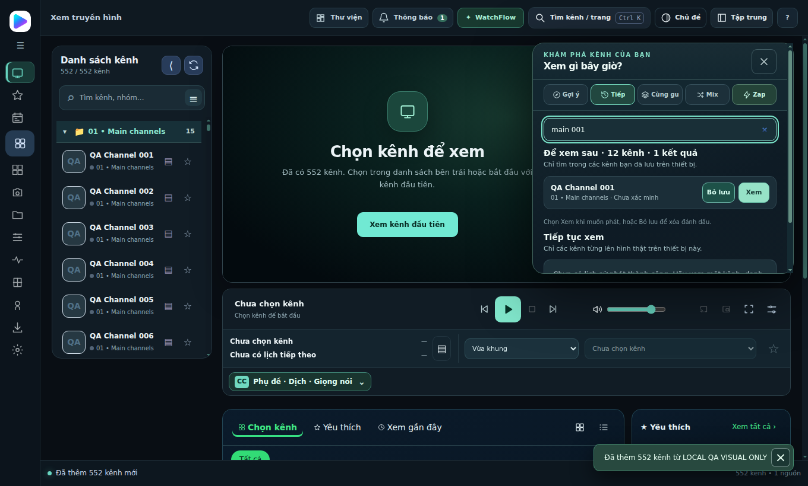

[Bản phát hành / thông tin](https://github.com/trisanghy/open-iptv-pro/releases/tag/positron/v4.23.186-p5.1.102) · [Xem thay đổi Git](https://github.com/trisanghy/open-iptv-pro/commit/5efab277eaabfb558fed5434e4218408c6286e27) · [Tải Windows Setup x64](https://github.com/trisanghy/open-iptv-pro/releases/download/positron/v4.23.186-p5.1.102/Open-IPTV-Pro-Setup-4.23.186-x64.exe) · [Tải gói ảnh QA](https://github.com/trisanghy/open-iptv-pro/releases/download/positron/v4.23.186-p5.1.102/Positron-P51102-20-Real-Screenshots.zip)

<strong>P5.1.101</strong> · Tìm kiếm trong toàn bộ danh sách Xem sau · ĐÃ PHÁT HÀNH · TÍNH NĂNG

**Ứng dụng:** 4.23.185 · **Trạng thái:** ĐÃ PHÁT HÀNH

Thêm ô tìm kiếm cục bộ cho tối đa 80 kênh đã lưu Xem sau, hỗ trợ không dấu, không gửi dữ liệu lên mạng và không tự phát video.

[Bản phát hành / thông tin](https://github.com/trisanghy/open-iptv-pro/releases/tag/positron/v4.23.185-p5.1.101) · [Xem thay đổi Git](https://github.com/trisanghy/open-iptv-pro/commit/a902ab2c34fc4b06e7e93dcbb89744c05593753f) · [Tải Windows Setup x64](https://github.com/trisanghy/open-iptv-pro/releases/download/positron/v4.23.185-p5.1.101/Open-IPTV-Pro-Setup-4.23.185-x64.exe) · [Tải gói ảnh QA](https://github.com/trisanghy/open-iptv-pro/releases/download/positron/v4.23.185-p5.1.101/Positron-P51101-20-Real-Screenshots.zip)

<strong>P5.1.100</strong> · Giữ thanh tiêu đề WatchFlow khi cuộn danh sách dài · ĐÃ PHÁT HÀNH · CẢI TIẾN / SỬA LỖI

**Ứng dụng:** 4.23.184 · **Trạng thái:** ĐÃ PHÁT HÀNH

Cố định tiêu đề và các tab WatchFlow khi cuộn sâu trong danh sách Xem sau, giúp nút đóng và điều hướng luôn dễ tìm.

[Bản phát hành / thông tin](https://github.com/trisanghy/open-iptv-pro/releases/tag/positron/v4.23.184-p5.1.100) · [Xem thay đổi Git](https://github.com/trisanghy/open-iptv-pro/commit/060fbad7faebcf5715d3b3dc67e25927527d1041) · [Tải Windows Setup x64](https://github.com/trisanghy/open-iptv-pro/releases/download/positron/v4.23.184-p5.1.100/Open-IPTV-Pro-Setup-4.23.184-x64.exe) · [Tải gói ảnh QA](https://github.com/trisanghy/open-iptv-pro/releases/download/positron/v4.23.184-p5.1.100/Positron-P51100-20-Real-Screenshots.zip)

<strong>P5.1.99</strong> · Xem chương trình sắp phát từ lịch XMLTV · CHƯA CÓ BẢN PHÁT HÀNH · TÍNH NĂNG

**Ứng dụng:** 4.23.183 · **Trạng thái:** CHƯA CÓ BẢN PHÁT HÀNH

Bên cạnh chương trình đang phát, WatchFlow hiển thị chương trình tiếp theo và giờ bắt đầu khi có dữ liệu XMLTV hợp lệ. Không tự suy đoán tên chương trình.

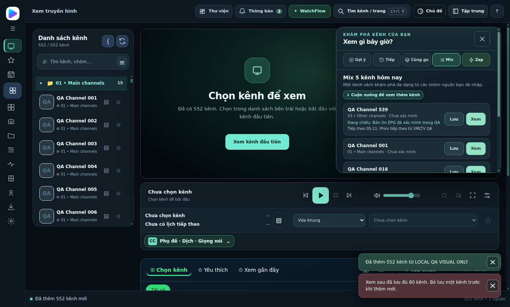

[Bản phát hành / thông tin](https://github.com/trisanghy/open-iptv-pro/blob/Positron/POSITRON_P5_CHANGELOG.md)

<strong>P5.1.98</strong> · Hiển thị tên chương trình đang phát trong WatchFlow · ĐÃ PHÁT HÀNH · TÍNH NĂNG

**Ứng dụng:** 4.23.182 · **Trạng thái:** ĐÃ PHÁT HÀNH

Kết hợp dữ liệu lịch XMLTV đã nhập để thẻ gợi ý WatchFlow hiện chương trình đang phát, thay vì chỉ tên kênh.

[Bản phát hành / thông tin](https://github.com/trisanghy/open-iptv-pro/releases/tag/positron/v4.23.182-p5.1.98) · [Xem thay đổi Git](https://github.com/trisanghy/open-iptv-pro/commit/420ee5a4a8a0a31ab5b77565f034acae9d25d1a9) · [Tải Windows Setup x64](https://github.com/trisanghy/open-iptv-pro/releases/download/positron/v4.23.182-p5.1.98/Open-IPTV-Pro-Setup-4.23.182-x64.exe) · [Tải gói ảnh QA](https://github.com/trisanghy/open-iptv-pro/releases/download/positron/v4.23.182-p5.1.98/Positron-P5198-20-Real-Screenshots.zip)

<strong>P5.1.97</strong> · Xem được mọi kênh đã lưu trong Xem sau · CHƯA CÓ BẢN PHÁT HÀNH · CẢI TIẾN / SỬA LỖI

**Ứng dụng:** 4.23.181 · **Trạng thái:** CHƯA CÓ BẢN PHÁT HÀNH

Bổ sung cách duyệt các dấu trang vượt quá tám kênh đầu tiên, giúp truy cập đủ danh sách đã lưu.

[Bản phát hành / thông tin](https://github.com/trisanghy/open-iptv-pro/blob/Positron/POSITRON_P5_CHANGELOG.md)

<strong>P5.1.96</strong> · Lưu kênh Xem sau riêng tư trên thiết bị · ĐÃ PHÁT HÀNH · TÍNH NĂNG

**Ứng dụng:** 4.23.180 · **Trạng thái:** ĐÃ PHÁT HÀNH

Bổ sung danh sách Xem sau cục bộ để người dùng lưu kênh muốn quay lại. Không tải dữ liệu lên máy chủ và không tự phát.

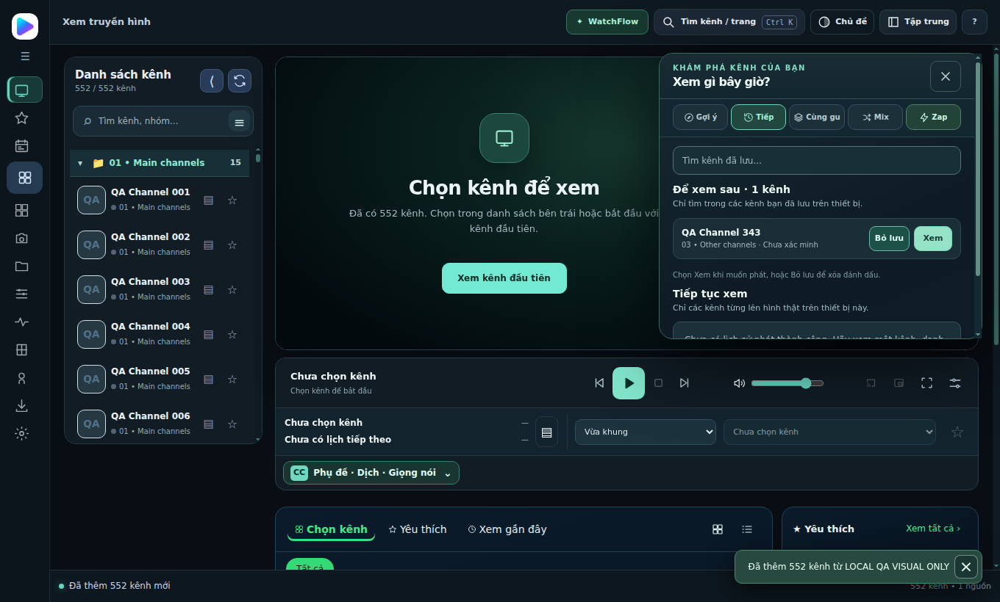

[Bản phát hành / thông tin](https://github.com/trisanghy/open-iptv-pro/releases/tag/positron/v4.23.180-p5.1.96) · [Xem thay đổi Git](https://github.com/trisanghy/open-iptv-pro/commit/20aeb922547ba56061990cad948bbfadaedeef8b) · [Tải Windows Setup x64](https://github.com/trisanghy/open-iptv-pro/releases/download/positron/v4.23.180-p5.1.96/Open-IPTV-Pro-Setup-4.23.180-x64.exe) · [Tải gói ảnh QA](https://github.com/trisanghy/open-iptv-pro/releases/download/positron/v4.23.180-p5.1.96/Positron-P5196-20-Real-Screenshots.zip)

<strong>P5.1.95</strong> · Sửa dấu hiệu cuộn WatchFlow bị che · ĐÃ PHÁT HÀNH · CẢI TIẾN / SỬA LỖI

**Ứng dụng:** 4.23.179 · **Trạng thái:** ĐÃ PHÁT HÀNH

Điều chỉnh vị trí chỉ báo cuộn dựa trên ảnh kiểm thử thực, tránh lớp chỉ dẫn nằm đè lên nội dung thẻ.

[Bản phát hành / thông tin](https://github.com/trisanghy/open-iptv-pro/releases/tag/positron/v4.23.179-p5.1.95) · [Xem thay đổi Git](https://github.com/trisanghy/open-iptv-pro/commit/8ae65c2a26c0da3d4bc605e1c5aa18283e82a020) · [Tải Windows Setup x64](https://github.com/trisanghy/open-iptv-pro/releases/download/positron/v4.23.179-p5.1.95/Open-IPTV-Pro-Setup-4.23.179-x64.exe) · [Tải gói ảnh QA](https://github.com/trisanghy/open-iptv-pro/releases/download/positron/v4.23.179-p5.1.95/Positron-P5195-20-Real-Screenshots.zip)

<strong>P5.1.94</strong> · Báo hiệu còn gợi ý WatchFlow phía dưới · ĐÃ PHÁT HÀNH · CẢI TIẾN / SỬA LỖI

**Ứng dụng:** 4.23.178 · **Trạng thái:** ĐÃ PHÁT HÀNH

Thêm dấu hiệu trực quan khi danh sách gợi ý WatchFlow còn nội dung bên dưới, giúp người dùng biết có thể cuộn xem thêm.

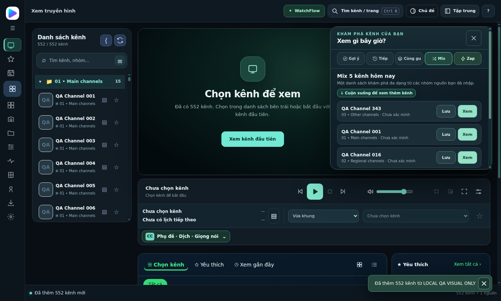

[Bản phát hành / thông tin](https://github.com/trisanghy/open-iptv-pro/releases/tag/positron/v4.23.178-p5.1.94) · [Xem thay đổi Git](https://github.com/trisanghy/open-iptv-pro/commit/01c99e34d6d41ff7ca24a32f0704be839818ed92) · [Tải Windows Setup x64](https://github.com/trisanghy/open-iptv-pro/releases/download/positron/v4.23.178-p5.1.94/Open-IPTV-Pro-Setup-4.23.178-x64.exe) · [Tải gói ảnh QA](https://github.com/trisanghy/open-iptv-pro/releases/download/positron/v4.23.178-p5.1.94/Positron-P5194-20-Real-Screenshots.zip)

<strong>P5.1.93</strong> · Phân bổ gợi ý Mix cân bằng giữa các nhóm nguồn · ĐÃ PHÁT HÀNH · TÍNH NĂNG

**Ứng dụng:** 4.23.177 · **Trạng thái:** ĐÃ PHÁT HÀNH

Điều chỉnh cách chọn gợi ý Mix theo ngày để không tập trung quá nhiều kênh trong một nhóm, đồng thời vẫn dựa trên dữ liệu phát thực tế.

[Bản phát hành / thông tin](https://github.com/trisanghy/open-iptv-pro/releases/tag/positron/v4.23.177-p5.1.93) · [Xem thay đổi Git](https://github.com/trisanghy/open-iptv-pro/commit/0d582fb30e70380537a9e3d3ac4258bfe83c60e5) · [Tải Windows Setup x64](https://github.com/trisanghy/open-iptv-pro/releases/download/positron/v4.23.177-p5.1.93/Open-IPTV-Pro-Setup-4.23.177-x64.exe) · [Tải gói ảnh QA](https://github.com/trisanghy/open-iptv-pro/releases/download/positron/v4.23.177-p5.1.93/Positron-P5193-20-Real-Screenshots.zip)

<strong>P5.1.92</strong> · Tính đúng ngày địa phương cho Mix và Smart Zap · ĐÃ PHÁT HÀNH · TÍNH NĂNG

**Ứng dụng:** 4.23.176 · **Trạng thái:** ĐÃ PHÁT HÀNH

Dùng ngày theo múi giờ của thiết bị khi tạo gợi ý Mix hằng ngày và chuyển kênh thông minh, tránh lệch ngày.

[Bản phát hành / thông tin](https://github.com/trisanghy/open-iptv-pro/releases/tag/positron/v4.23.176-p5.1.92) · [Xem thay đổi Git](https://github.com/trisanghy/open-iptv-pro/commit/720dbd1e0ab38a690a6d263b68300353d4726c68) · [Tải Windows Setup x64](https://github.com/trisanghy/open-iptv-pro/releases/download/positron/v4.23.176-p5.1.92/Open-IPTV-Pro-Setup-4.23.176-x64.exe) · [Tải gói ảnh QA](https://github.com/trisanghy/open-iptv-pro/releases/download/positron/v4.23.176-p5.1.92/Positron-P5192-20-Real-Screenshots.zip)

<strong>P5.1.91</strong> · Đồng bộ biểu tượng Phát/Tạm dừng theo bản Web · CHƯA CÓ BẢN PHÁT HÀNH · CẢI TIẾN / SỬA LỖI

**Ứng dụng:** 4.23.175 · **Trạng thái:** CHƯA CÓ BẢN PHÁT HÀNH

Sử dụng hình SVG Phát và Tạm dừng tương ứng với bộ biểu tượng trên nhánh Web, giữ kích thước và đường nét đồng nhất.

[Bản phát hành / thông tin](https://github.com/trisanghy/open-iptv-pro/blob/Positron/POSITRON_P5_CHANGELOG.md)

<strong>P5.1.90</strong> · Ẩn thử nghiệm Video Lab khi chưa chọn kênh · ĐÃ PHÁT HÀNH · CẢI TIẾN / SỬA LỖI

**Ứng dụng:** 4.23.174 · **Trạng thái:** ĐÃ PHÁT HÀNH

Không hiện công cụ Video Lab khi người dùng chưa chọn kênh, tránh nút dẫn vào tính năng chưa có nội dung. Cài đặt không bị xóa.

[Bản phát hành / thông tin](https://github.com/trisanghy/open-iptv-pro/releases/tag/positron/v4.23.174-p5.1.90) · [Xem thay đổi Git](https://github.com/trisanghy/open-iptv-pro/commit/8a49f9757459d137c2005762d50fa956b1c3a646) · [Tải Windows Setup x64](https://github.com/trisanghy/open-iptv-pro/releases/download/positron/v4.23.174-p5.1.90/Open-IPTV-Pro-Setup-4.23.174-x64.exe) · [Tải gói ảnh QA](https://github.com/trisanghy/open-iptv-pro/releases/download/positron/v4.23.174-p5.1.90/Positron-P5190-20-Real-Screenshots.zip)

<strong>P5.1.89</strong> · Trạng thái trình phát phản ánh số kênh có sẵn · ĐÃ PHÁT HÀNH · CẢI TIẾN / SỬA LỖI

**Ứng dụng:** 4.23.173 · **Trạng thái:** ĐÃ PHÁT HÀNH

Thay lời hướng dẫn mặc định dựa trên việc danh sách có kênh khả dụng hay không, giúp người dùng biết bước tiếp theo.

[Bản phát hành / thông tin](https://github.com/trisanghy/open-iptv-pro/releases/tag/positron/v4.23.173-p5.1.89) · [Xem thay đổi Git](https://github.com/trisanghy/open-iptv-pro/commit/2b3e6070e7f086dbd233e29224b9b09d04153dca) · [Tải Windows Setup x64](https://github.com/trisanghy/open-iptv-pro/releases/download/positron/v4.23.173-p5.1.89/Open-IPTV-Pro-Setup-4.23.173-x64.exe) · [Tải gói ảnh QA](https://github.com/trisanghy/open-iptv-pro/releases/download/positron/v4.23.173-p5.1.89/Positron-P5189-20-Real-Screenshots.zip)

<strong>P5.1.88</strong> · Hướng dẫn bắt đầu xem dựa trên playlist thực · ĐÃ PHÁT HÀNH · CẢI TIẾN / SỬA LỖI

**Ứng dụng:** 4.23.172 · **Trạng thái:** ĐÃ PHÁT HÀNH

Khi đã có danh sách kênh, hiển thị lời mời chọn kênh và số kênh thực tế. Khi chưa có nguồn, giữ hướng dẫn nhập danh sách.

[Bản phát hành / thông tin](https://github.com/trisanghy/open-iptv-pro/releases/tag/positron/v4.23.172-p5.1.88) · [Xem thay đổi Git](https://github.com/trisanghy/open-iptv-pro/commit/6a6bc1def4b416d5e65d0405a251bf84e1639b48) · [Tải Windows Setup x64](https://github.com/trisanghy/open-iptv-pro/releases/download/positron/v4.23.172-p5.1.88/Open-IPTV-Pro-Setup-4.23.172-x64.exe) · [Tải gói ảnh QA](https://github.com/trisanghy/open-iptv-pro/releases/download/positron/v4.23.172-p5.1.88/Positron-P5188-20-Real-Screenshots.zip)

<strong>P5.1.87</strong> · Tab Tiếp tục xem gọn và dễ đọc · ĐÃ PHÁT HÀNH · CẢI TIẾN / SỬA LỖI

**Ứng dụng:** 4.23.171 · **Trạng thái:** ĐÃ PHÁT HÀNH

Rút gọn nhãn hiển thị thành “Tiếp” khi cần, trong khi nhãn đầy đủ “Tiếp tục xem” vẫn được giữ cho hỗ trợ truy cập.

*Chưa có ảnh chụp riêng đã xác minh cho phiên bản này.*

[Bản phát hành / thông tin](https://github.com/trisanghy/open-iptv-pro/releases/tag/positron/v4.23.171-p5.1.87) · [Xem thay đổi Git](https://github.com/trisanghy/open-iptv-pro/commit/ed257184254e6caa5994d6222b297975702a4bf6) · [Tải Windows Setup x64](https://github.com/trisanghy/open-iptv-pro/releases/download/positron/v4.23.171-p5.1.87/Open-IPTV-Pro-Setup-4.23.171-x64.exe) · [Tải gói ảnh QA](https://github.com/trisanghy/open-iptv-pro/releases/download/positron/v4.23.171-p5.1.87/Positron-P5187-20-Real-Screenshots.zip)

<strong>P5.1.86</strong> · Hộp WatchFlow không che trình phát · ĐÃ PHÁT HÀNH · CẢI TIẾN / SỬA LỖI

**Ứng dụng:** 4.23.170 · **Trạng thái:** ĐÃ PHÁT HÀNH

Giới hạn bố cục hộp gợi ý WatchFlow để không đè lên vùng video và các điều khiển quan trọng.

*Chưa có ảnh chụp riêng đã xác minh cho phiên bản này.*

[Bản phát hành / thông tin](https://github.com/trisanghy/open-iptv-pro/releases/tag/positron/v4.23.170-p5.1.86) · [Xem thay đổi Git](https://github.com/trisanghy/open-iptv-pro/commit/206892e2a1a5bc1899c6073a61304f95831e6327) · [Tải Windows Setup x64](https://github.com/trisanghy/open-iptv-pro/releases/download/positron/v4.23.170-p5.1.86/Open-IPTV-Pro-Setup-4.23.170-x64.exe) · [Tải gói ảnh QA](https://github.com/trisanghy/open-iptv-pro/releases/download/positron/v4.23.170-p5.1.86/Positron-P5186-20-Real-Screenshots.zip)

<strong>P5.1.85</strong> · Xếp hạng kênh tương tự tốt hơn trong WatchFlow · ĐÃ PHÁT HÀNH · CẢI TIẾN / SỬA LỖI

**Ứng dụng:** 4.23.169 · **Trạng thái:** ĐÃ PHÁT HÀNH

Điều chỉnh thứ tự gợi ý Tương tự để ưu tiên nhóm kênh phù hợp trước khi xét điểm chất lượng phát.

*Chưa có ảnh chụp riêng đã xác minh cho phiên bản này.*

[Bản phát hành / thông tin](https://github.com/trisanghy/open-iptv-pro/releases/tag/positron/v4.23.169-p5.1.85) · [Xem thay đổi Git](https://github.com/trisanghy/open-iptv-pro/commit/a02d2b896f23c3e7a65d180a1bca961d37e48189) · [Tải Windows Setup x64](https://github.com/trisanghy/open-iptv-pro/releases/download/positron/v4.23.169-p5.1.85/Open-IPTV-Pro-Setup-4.23.169-x64.exe) · [Tải gói ảnh QA](https://github.com/trisanghy/open-iptv-pro/releases/download/positron/v4.23.169-p5.1.85/Positron-P5185-20-Real-Screenshots.zip)

<strong>P5.1.84</strong> · Thêm thao tác hữu ích khi danh sách kênh trống · ĐÃ PHÁT HÀNH · CẢI TIẾN / SỬA LỖI

**Ứng dụng:** 4.23.168 · **Trạng thái:** ĐÃ PHÁT HÀNH

Hiển thị hướng dẫn và thao tác nhập nguồn ngay ở thanh danh sách kênh khi chưa có kênh để xem.

*Chưa có ảnh chụp riêng đã xác minh cho phiên bản này.*

[Bản phát hành / thông tin](https://github.com/trisanghy/open-iptv-pro/releases/tag/positron/v4.23.168-p5.1.84) · [Xem thay đổi Git](https://github.com/trisanghy/open-iptv-pro/commit/52134d193cc165e1dda8b0af70515fcb05ada71d) · [Tải Windows Setup x64](https://github.com/trisanghy/open-iptv-pro/releases/download/positron/v4.23.168-p5.1.84/Open-IPTV-Pro-Setup-4.23.168-x64.exe) · [Tải gói ảnh QA](https://github.com/trisanghy/open-iptv-pro/releases/download/positron/v4.23.168-p5.1.84/Positron-P5184-20-Real-Screenshots.zip)

<strong>P5.1.83</strong> · Điều khiển phụ của trình phát gọn hơn trên 600 px · CHƯA CÓ BẢN PHÁT HÀNH · CẢI TIẾN / SỬA LỖI

**Ứng dụng:** Chưa xác minh · **Trạng thái:** CHƯA CÓ BẢN PHÁT HÀNH

Sắp xếp lại các lựa chọn phụ của trình phát trên cửa sổ hẹp để tránh chiếm quá nhiều chiều cao.

*Chưa có ảnh chụp riêng đã xác minh cho phiên bản này.*

[Bản phát hành / thông tin](https://github.com/trisanghy/open-iptv-pro/blob/Positron/POSITRON_P5_CHANGELOG.md)

<strong>P5.1.82</strong> · Bộ chọn kênh một hàng trên màn hình nhỏ · ĐÃ PHÁT HÀNH · CẢI TIẾN / SỬA LỖI

**Ứng dụng:** 4.23.166 · **Trạng thái:** ĐÃ PHÁT HÀNH

Các tab lọc của thư viện kênh được bố trí lại trên một hàng khi cửa sổ hẹp, hạn chế xuống dòng không cần thiết.

*Chưa có ảnh chụp riêng đã xác minh cho phiên bản này.*

[Bản phát hành / thông tin](https://github.com/trisanghy/open-iptv-pro/releases/tag/positron/v4.23.166-p5.1.82) · [Xem thay đổi Git](https://github.com/trisanghy/open-iptv-pro/commit/30ca2f00d0a53bd566f70f3c5d6696b70599d1e2) · [Tải Windows Setup x64](https://github.com/trisanghy/open-iptv-pro/releases/download/positron/v4.23.166-p5.1.82/Open-IPTV-Pro-Setup-4.23.166-x64.exe) · [Tải gói ảnh QA](https://github.com/trisanghy/open-iptv-pro/releases/download/positron/v4.23.166-p5.1.82/Positron-P5182-20-Real-Screenshots.zip)

<strong>P5.1.81</strong> · Thanh công cụ WatchFlow Plus nằm trên một hàng · ĐÃ PHÁT HÀNH · CẢI TIẾN / SỬA LỖI

**Ứng dụng:** 4.23.165 · **Trạng thái:** ĐÃ PHÁT HÀNH

Sắp xếp các chế độ WatchFlow Plus thành một hàng dễ sử dụng, tránh chiếm vùng hiển thị của video và danh sách.

*Chưa có ảnh chụp riêng đã xác minh cho phiên bản này.*

[Bản phát hành / thông tin](https://github.com/trisanghy/open-iptv-pro/releases/tag/positron/v4.23.165-p5.1.81) · [Xem thay đổi Git](https://github.com/trisanghy/open-iptv-pro/commit/6db9594f383196554de53a0c961758b5089e6d86) · [Tải Windows Setup x64](https://github.com/trisanghy/open-iptv-pro/releases/download/positron/v4.23.165-p5.1.81/Open-IPTV-Pro-Setup-4.23.165-x64.exe) · [Tải gói ảnh QA](https://github.com/trisanghy/open-iptv-pro/releases/download/positron/v4.23.165-p5.1.81/Positron-P5181-20-Real-Screenshots.zip)

<strong>P5.1.80</strong> · WatchFlow Plus: nhiều cách khám phá kênh · CHƯA CÓ BẢN PHÁT HÀNH · CẢI TIẾN / SỬA LỖI

**Ứng dụng:** 4.23.164 · **Trạng thái:** CHƯA CÓ BẢN PHÁT HÀNH

Thử nghiệm các chế độ gợi ý và chuyển kênh nhanh, gồm Smart Zap và Mix, dựa trên thông tin nguồn và hành vi xem cục bộ; chỉ phát khi người dùng thao tác.

*Chưa có ảnh chụp riêng đã xác minh cho phiên bản này.*

[Bản phát hành / thông tin](https://github.com/trisanghy/open-iptv-pro/blob/Positron/POSITRON_P5_CHANGELOG.md)

<strong>P5.1.79</strong> · Tên công cụ trình phát rõ nghĩa hơn · CHƯA CÓ BẢN PHÁT HÀNH · TÍNH NĂNG

**Ứng dụng:** Chưa xác minh · **Trạng thái:** CHƯA CÓ BẢN PHÁT HÀNH

Thay nút dấu ba chấm khó hiểu bằng nhãn mở công cụ rõ hơn, giúp tìm Tua lại và ghi hình.

*Chưa có ảnh chụp riêng đã xác minh cho phiên bản này.*

[Bản phát hành / thông tin](https://github.com/trisanghy/open-iptv-pro/blob/Positron/POSITRON_P5_CHANGELOG.md)

<strong>P5.1.78</strong> · Màn hình chẩn đoán khi chưa có nguồn gọn hơn · ĐÃ PHÁT HÀNH · CẢI TIẾN / SỬA LỖI

**Ứng dụng:** 4.23.162 · **Trạng thái:** ĐÃ PHÁT HÀNH

Ẩn các chỉ số bằng không chưa hữu ích ở trạng thái chưa nhập nguồn, tập trung vào hướng dẫn bắt đầu.

*Chưa có ảnh chụp riêng đã xác minh cho phiên bản này.*

[Bản phát hành / thông tin](https://github.com/trisanghy/open-iptv-pro/releases/tag/positron/v4.23.162-p5.1.78) · [Xem thay đổi Git](https://github.com/trisanghy/open-iptv-pro/commit/13bbcad98c2fc4670ad2484c831152f74a3881ea) · [Tải Windows Setup x64](https://github.com/trisanghy/open-iptv-pro/releases/download/positron/v4.23.162-p5.1.78/Open-IPTV-Pro-Setup-4.23.162-x64.exe) · [Tải gói ảnh QA](https://github.com/trisanghy/open-iptv-pro/releases/download/positron/v4.23.162-p5.1.78/Positron-P5178-20-Real-Screenshots.zip)

<strong>P5.1.77</strong> · Kiểm tra lại nút nhập nguồn trong Chẩn đoán · ĐÃ PHÁT HÀNH · CẢI TIẾN / SỬA LỖI

**Ứng dụng:** 4.23.161 · **Trạng thái:** ĐÃ PHÁT HÀNH

Bổ sung kiểm thử ảnh để xác minh nút nhập nguồn thật của trang Chẩn đoán khi chưa có kênh.

*Chưa có ảnh chụp riêng đã xác minh cho phiên bản này.*

[Bản phát hành / thông tin](https://github.com/trisanghy/open-iptv-pro/releases/tag/positron/v4.23.161-p5.1.77) · [Xem thay đổi Git](https://github.com/trisanghy/open-iptv-pro/commit/77793fcbd5ea1731b9e205a6ec7ef7683f81b1dc) · [Tải Windows Setup x64](https://github.com/trisanghy/open-iptv-pro/releases/download/positron/v4.23.161-p5.1.77/Open-IPTV-Pro-Setup-4.23.161-x64.exe) · [Tải gói ảnh QA](https://github.com/trisanghy/open-iptv-pro/releases/download/positron/v4.23.161-p5.1.77/Positron-P5177-20-Real-Screenshots.zip)

<strong>P5.1.76</strong> · Chẩn đoán thông minh cho trạng thái chưa có nguồn · CHƯA CÓ BẢN PHÁT HÀNH · CẢI TIẾN / SỬA LỖI

**Ứng dụng:** Chưa xác minh · **Trạng thái:** CHƯA CÓ BẢN PHÁT HÀNH

Tập trung trang Chẩn đoán vào thao tác thêm nguồn trước khi hiển thị các bảng kiểm tra nâng cao chưa sử dụng được.

*Chưa có ảnh chụp riêng đã xác minh cho phiên bản này.*

[Bản phát hành / thông tin](https://github.com/trisanghy/open-iptv-pro/blob/Positron/POSITRON_P5_CHANGELOG.md)

<strong>P5.1.75</strong> · Thông báo rõ giới hạn Video Lab thử nghiệm · ĐÃ PHÁT HÀNH · CẢI TIẾN / SỬA LỖI

**Ứng dụng:** 4.23.159 · **Trạng thái:** ĐÃ PHÁT HÀNH

Nêu rõ chức năng nâng cao hình ảnh bằng AI hiện chưa có hệ thống xử lý video trực tiếp đã xác minh, tránh gây hiểu nhầm.

*Chưa có ảnh chụp riêng đã xác minh cho phiên bản này.*

[Bản phát hành / thông tin](https://github.com/trisanghy/open-iptv-pro/releases/tag/positron/v4.23.159-p5.1.75) · [Xem thay đổi Git](https://github.com/trisanghy/open-iptv-pro/commit/81425eb71ddcf74f76edb7903273ccea08dcfd97) · [Tải Windows Setup x64](https://github.com/trisanghy/open-iptv-pro/releases/download/positron/v4.23.159-p5.1.75/Open-IPTV-Pro-Setup-4.23.159-x64.exe) · [Tải gói ảnh QA](https://github.com/trisanghy/open-iptv-pro/releases/download/positron/v4.23.159-p5.1.75/Positron-P5175-20-Real-Screenshots.zip)

<strong>P5.1.74</strong> · Tận dụng chiều cao màn hình máy tính hợp lý · ĐÃ PHÁT HÀNH · CẢI TIẾN / SỬA LỖI

**Ứng dụng:** 4.23.158 · **Trạng thái:** ĐÃ PHÁT HÀNH

Thu gọn vùng phát trống trên cửa sổ máy tính thấp để các điều khiển hữu ích không bị đẩy xuống dưới.

*Chưa có ảnh chụp riêng đã xác minh cho phiên bản này.*

[Bản phát hành / thông tin](https://github.com/trisanghy/open-iptv-pro/releases/tag/positron/v4.23.158-p5.1.74) · [Xem thay đổi Git](https://github.com/trisanghy/open-iptv-pro/commit/364fc7e65cae890bf7ca989e9f915fdb087dad36) · [Tải Windows Setup x64](https://github.com/trisanghy/open-iptv-pro/releases/download/positron/v4.23.158-p5.1.74/Open-IPTV-Pro-Setup-4.23.158-x64.exe) · [Tải gói ảnh QA](https://github.com/trisanghy/open-iptv-pro/releases/download/positron/v4.23.158-p5.1.74/Positron-P5174-20-Real-Screenshots.zip)

<strong>P5.1.73</strong> · Đường dẫn lưu bản ghi DVR rõ ràng và an toàn · ĐÃ PHÁT HÀNH · CẢI TIẾN / SỬA LỖI

**Ứng dụng:** 4.23.157 · **Trạng thái:** ĐÃ PHÁT HÀNH

Cải thiện nhãn và cách trình bày đường dẫn lưu bản ghi, tránh chuỗi đường dẫn dài làm vỡ bố cục.

*Chưa có ảnh chụp riêng đã xác minh cho phiên bản này.*

[Bản phát hành / thông tin](https://github.com/trisanghy/open-iptv-pro/releases/tag/positron/v4.23.157-p5.1.73) · [Xem thay đổi Git](https://github.com/trisanghy/open-iptv-pro/commit/795b1deb9c810179a1955f1aeba8903f2ebb909c) · [Tải Windows Setup x64](https://github.com/trisanghy/open-iptv-pro/releases/download/positron/v4.23.157-p5.1.73/Open-IPTV-Pro-Setup-4.23.157-x64.exe) · [Tải gói ảnh QA](https://github.com/trisanghy/open-iptv-pro/releases/download/positron/v4.23.157-p5.1.73/Positron-P5173-20-Real-Screenshots.zip)

<strong>P5.1.72</strong> · Sắp xếp bộ lọc Smart Discovery dễ dùng hơn · ĐÃ PHÁT HÀNH · CẢI TIẾN / SỬA LỖI

**Ứng dụng:** 4.23.156 · **Trạng thái:** ĐÃ PHÁT HÀNH

Đưa các điều khiển khám phá nguồn về thứ tự thao tác tự nhiên, tránh các nút và lựa chọn nằm rời rạc.

*Chưa có ảnh chụp riêng đã xác minh cho phiên bản này.*

[Bản phát hành / thông tin](https://github.com/trisanghy/open-iptv-pro/releases/tag/positron/v4.23.156-p5.1.72) · [Xem thay đổi Git](https://github.com/trisanghy/open-iptv-pro/commit/6481d2418c44472468c11bccdddd58a38723e66c) · [Tải Windows Setup x64](https://github.com/trisanghy/open-iptv-pro/releases/download/positron/v4.23.156-p5.1.72/Open-IPTV-Pro-Setup-4.23.156-x64.exe) · [Tải gói ảnh QA](https://github.com/trisanghy/open-iptv-pro/releases/download/positron/v4.23.156-p5.1.72/Positron-P5172-20-Real-Screenshots.zip)

<strong>P5.1.71</strong> · Chỉ mở WatchFlow đúng ngữ cảnh màn hình TV · ĐÃ PHÁT HÀNH · CẢI TIẾN / SỬA LỖI

**Ứng dụng:** 4.23.155 · **Trạng thái:** ĐÃ PHÁT HÀNH

Ẩn thao tác WatchFlow khi đang quản lý nguồn và đóng bảng khi chuyển khỏi trang TV, giữ nguyên kênh và nguồn.

*Chưa có ảnh chụp riêng đã xác minh cho phiên bản này.*

[Bản phát hành / thông tin](https://github.com/trisanghy/open-iptv-pro/releases/tag/positron/v4.23.155-p5.1.71) · [Xem thay đổi Git](https://github.com/trisanghy/open-iptv-pro/commit/711f0cae6a0e5f14f299b3df51039d6d8c2d2ab6) · [Tải Windows Setup x64](https://github.com/trisanghy/open-iptv-pro/releases/download/positron/v4.23.155-p5.1.71/Open-IPTV-Pro-Setup-4.23.155-x64.exe) · [Tải gói ảnh QA](https://github.com/trisanghy/open-iptv-pro/releases/download/positron/v4.23.155-p5.1.71/Positron-P5171-20-Real-Screenshots.zip)

<strong>P5.1.70</strong> · Đánh dấu rõ mục đang chọn trong quản lý nguồn · ĐÃ PHÁT HÀNH · CẢI TIẾN / SỬA LỖI

**Ứng dụng:** 4.23.154 · **Trạng thái:** ĐÃ PHÁT HÀNH

Tăng tương phản mục điều hướng đang chọn và gắn nhãn vị trí hiện tại cho công cụ hỗ trợ truy cập.

*Chưa có ảnh chụp riêng đã xác minh cho phiên bản này.*

[Bản phát hành / thông tin](https://github.com/trisanghy/open-iptv-pro/releases/tag/positron/v4.23.154-p5.1.70) · [Xem thay đổi Git](https://github.com/trisanghy/open-iptv-pro/commit/329421a79d237f6e160a82c2445d7e2180b48fe8) · [Tải Windows Setup x64](https://github.com/trisanghy/open-iptv-pro/releases/download/positron/v4.23.154-p5.1.70/Open-IPTV-Pro-Setup-4.23.154-x64.exe) · [Tải gói ảnh QA](https://github.com/trisanghy/open-iptv-pro/releases/download/positron/v4.23.154-p5.1.70/Positron-P5170-20-Real-Screenshots.zip)

<strong>P5.1.69</strong> · Sửa hàng điều hướng nguồn bị tách lẻ · ĐÃ PHÁT HÀNH · CẢI TIẾN / SỬA LỖI

**Ứng dụng:** 4.23.153 · **Trạng thái:** ĐÃ PHÁT HÀNH

Điều chỉnh bố cục điều hướng quản lý nguồn ở cửa sổ khoảng 720 px để không còn một nút bị rớt xuống hàng riêng.

*Chưa có ảnh chụp riêng đã xác minh cho phiên bản này.*

[Bản phát hành / thông tin](https://github.com/trisanghy/open-iptv-pro/releases/tag/positron/v4.23.153-p5.1.69) · [Xem thay đổi Git](https://github.com/trisanghy/open-iptv-pro/commit/fa6cc662b8d3e6d9b7a2092684d630089e9ba929) · [Tải Windows Setup x64](https://github.com/trisanghy/open-iptv-pro/releases/download/positron/v4.23.153-p5.1.69/Open-IPTV-Pro-Setup-4.23.153-x64.exe) · [Tải gói ảnh QA](https://github.com/trisanghy/open-iptv-pro/releases/download/positron/v4.23.153-p5.1.69/Positron-P5169-20-Real-Screenshots.zip)

<strong>P5.1.68</strong> · Thay biểu tượng menu bằng SVG bốn ô · CHƯA CÓ BẢN PHÁT HÀNH · CẢI TIẾN / SỬA LỖI

**Ứng dụng:** 4.23.152 · **Trạng thái:** CHƯA CÓ BẢN PHÁT HÀNH

Đưa biểu tượng SVG bốn ô vào nút mở menu sẵn có, giữ nguyên nhãn, trạng thái mở và thao tác.

*Chưa có ảnh chụp riêng đã xác minh cho phiên bản này.*

[Bản phát hành / thông tin](https://github.com/trisanghy/open-iptv-pro/blob/Positron/POSITRON_P5_CHANGELOG.md)

<strong>P5.1.67</strong> · Tự đóng WatchFlow khi rời trang TV · CHƯA CÓ BẢN PHÁT HÀNH · CẢI TIẾN / SỬA LỖI

**Ứng dụng:** 4.23.151 · **Trạng thái:** CHƯA CÓ BẢN PHÁT HÀNH

Theo dõi trang TV đang được mở và đóng bảng WatchFlow khi người dùng chuyển trang, không làm thay đổi dữ liệu hoặc kênh đang phát.

*Chưa có ảnh chụp riêng đã xác minh cho phiên bản này.*

[Bản phát hành / thông tin](https://github.com/trisanghy/open-iptv-pro/blob/Positron/POSITRON_P5_CHANGELOG.md)

<strong>P5.1.66</strong> · Nút đóng WatchFlow rõ và dễ bấm hơn · CHƯA CÓ BẢN PHÁT HÀNH · CẢI TIẾN / SỬA LỖI

**Ứng dụng:** 4.23.150 · **Trạng thái:** CHƯA CÓ BẢN PHÁT HÀNH

Thay ký tự biểu tượng bằng SVG 20 px và mở rộng vùng chạm của nút đóng, giữ hỗ trợ phím Escape.

*Chưa có ảnh chụp riêng đã xác minh cho phiên bản này.*

[Bản phát hành / thông tin](https://github.com/trisanghy/open-iptv-pro/blob/Positron/POSITRON_P5_CHANGELOG.md)

<strong>P5.1.65</strong> · Khôi phục tiêu điểm sau khi đóng WatchFlow · CHƯA CÓ BẢN PHÁT HÀNH · CẢI TIẾN / SỬA LỖI

**Ứng dụng:** 4.23.149 · **Trạng thái:** CHƯA CÓ BẢN PHÁT HÀNH

Sau khi đóng WatchFlow, đưa tiêu điểm về nút phù hợp ở trang TV để người dùng tiếp tục thao tác bằng bàn phím.

*Chưa có ảnh chụp riêng đã xác minh cho phiên bản này.*

[Bản phát hành / thông tin](https://github.com/trisanghy/open-iptv-pro/blob/Positron/POSITRON_P5_CHANGELOG.md)

<strong>P5.1.64</strong> · Ẩn đoạn giới thiệu WatchFlow thừa khi chưa có kênh · CHƯA CÓ BẢN PHÁT HÀNH · CẢI TIẾN / SỬA LỖI

**Ứng dụng:** 4.23.148 · **Trạng thái:** CHƯA CÓ BẢN PHÁT HÀNH

Bỏ đoạn hướng dẫn lặp ở trạng thái trống, vẫn giữ nguyên bố cục và các gợi ý khi có kênh.

*Chưa có ảnh chụp riêng đã xác minh cho phiên bản này.*

[Bản phát hành / thông tin](https://github.com/trisanghy/open-iptv-pro/blob/Positron/POSITRON_P5_CHANGELOG.md)

<strong>P5.1.63</strong> · Hướng dẫn nhập nguồn rõ ràng trong WatchFlow trống · ĐÃ PHÁT HÀNH · CẢI TIẾN / SỬA LỖI

**Ứng dụng:** 4.23.147 · **Trạng thái:** ĐÃ PHÁT HÀNH

Khi chưa có nguồn kênh, hiện cách thêm IPTV thay vì các bộ lọc thể loại không thể dùng.

*Chưa có ảnh chụp riêng đã xác minh cho phiên bản này.*

[Bản phát hành / thông tin](https://github.com/trisanghy/open-iptv-pro/releases/tag/positron/v4.23.147-p5.1.63) · [Xem thay đổi Git](https://github.com/trisanghy/open-iptv-pro/commit/9d4bb04a21a502ead140bc9c167f4648a1b60520) · [Tải Windows Setup x64](https://github.com/trisanghy/open-iptv-pro/releases/download/positron/v4.23.147-p5.1.63/Open-IPTV-Pro-Setup-4.23.147-x64.exe) · [Tải gói ảnh QA](https://github.com/trisanghy/open-iptv-pro/releases/download/positron/v4.23.147-p5.1.63/Positron-P5163-20-Real-Screenshots.zip)

<strong>P5.1.62</strong> · Đồng bộ màu thanh phụ đề CC trong giao diện Horizon · ĐÃ PHÁT HÀNH · CẢI TIẾN / SỬA LỖI

**Ứng dụng:** 4.23.146 · **Trạng thái:** ĐÃ PHÁT HÀNH

Chỉnh màu các điều khiển phụ đề và AI theo bảng màu Horizon; không thay đổi hành vi công cụ.

*Chưa có ảnh chụp riêng đã xác minh cho phiên bản này.*

[Bản phát hành / thông tin](https://github.com/trisanghy/open-iptv-pro/releases/tag/positron/v4.23.146-p5.1.62) · [Xem thay đổi Git](https://github.com/trisanghy/open-iptv-pro/commit/9efed16d9ecf3fdaa7fdc01376ef97f347385d52) · [Tải Windows Setup x64](https://github.com/trisanghy/open-iptv-pro/releases/download/positron/v4.23.146-p5.1.62/Open-IPTV-Pro-Setup-4.23.146-x64.exe) · [Tải gói ảnh QA](https://github.com/trisanghy/open-iptv-pro/releases/download/positron/v4.23.146-p5.1.62/Positron-P5162-20-Real-Screenshots.zip)

<strong>P5.1.61</strong> · Tăng độ tương phản thư mục có dữ liệu trong Horizon · ĐÃ PHÁT HÀNH · TÍNH NĂNG

**Ứng dụng:** 4.23.145 · **Trạng thái:** ĐÃ PHÁT HÀNH

Chỉnh nền, chữ và mũi tên của thư mục có kênh để dễ đọc trên giao diện tối, không ảnh hưởng kéo thả.

*Chưa có ảnh chụp riêng đã xác minh cho phiên bản này.*

[Bản phát hành / thông tin](https://github.com/trisanghy/open-iptv-pro/releases/tag/positron/v4.23.145-p5.1.61) · [Xem thay đổi Git](https://github.com/trisanghy/open-iptv-pro/commit/7b532fa5adb0acbf2202b34c7c3eedc377c7a623) · [Tải Windows Setup x64](https://github.com/trisanghy/open-iptv-pro/releases/download/positron/v4.23.145-p5.1.61/Open-IPTV-Pro-Setup-4.23.145-x64.exe) · [Tải gói ảnh QA](https://github.com/trisanghy/open-iptv-pro/releases/download/positron/v4.23.145-p5.1.61/Positron-P5161-20-Real-Screenshots.zip)

<strong>P5.1.60</strong> · Gợi ý WatchFlow cân bằng theo nhóm kênh · ĐÃ PHÁT HÀNH · TÍNH NĂNG

**Ứng dụng:** 4.23.144 · **Trạng thái:** ĐÃ PHÁT HÀNH

Phân bổ gợi ý WatchFlow từ các nhóm nguồn khác nhau thay vì chọn liên tiếp quá nhiều kênh trong một nhóm.

*Chưa có ảnh chụp riêng đã xác minh cho phiên bản này.*

[Bản phát hành / thông tin](https://github.com/trisanghy/open-iptv-pro/releases/tag/positron/v4.23.144-p5.1.60) · [Xem thay đổi Git](https://github.com/trisanghy/open-iptv-pro/commit/8b16f057486172314c84a8e70235ce5e0e94a31e) · [Tải Windows Setup x64](https://github.com/trisanghy/open-iptv-pro/releases/download/positron/v4.23.144-p5.1.60/Open-IPTV-Pro-Setup-4.23.144-x64.exe) · [Tải gói ảnh QA](https://github.com/trisanghy/open-iptv-pro/releases/download/positron/v4.23.144-p5.1.60/Positron-P5160-20-Real-Screenshots.zip)

<strong>P5.1.59</strong> · Đồng bộ màu thanh cuộn của Horizon · ĐÃ PHÁT HÀNH · CẢI TIẾN / SỬA LỖI

**Ứng dụng:** 4.23.143 · **Trạng thái:** ĐÃ PHÁT HÀNH

Chỉnh màu thanh cuộn theo giao diện Horizon mà không thay đổi hành vi cuộn hoặc các chủ đề khác.

*Chưa có ảnh chụp riêng đã xác minh cho phiên bản này.*

[Bản phát hành / thông tin](https://github.com/trisanghy/open-iptv-pro/releases/tag/positron/v4.23.143-p5.1.59) · [Xem thay đổi Git](https://github.com/trisanghy/open-iptv-pro/commit/6e7778ba991cc427de34804278316673c0f97e35) · [Tải Windows Setup x64](https://github.com/trisanghy/open-iptv-pro/releases/download/positron/v4.23.143-p5.1.59/Open-IPTV-Pro-Setup-4.23.143-x64.exe) · [Tải gói ảnh QA](https://github.com/trisanghy/open-iptv-pro/releases/download/positron/v4.23.143-p5.1.59/Positron-P5159-20-Real-Screenshots.zip)

<strong>P5.1.58</strong> · Sửa tiêu đề bị chật trên giao diện Horizon hẹp · ĐÃ PHÁT HÀNH · CẢI TIẾN / SỬA LỖI

**Ứng dụng:** 4.23.142 · **Trạng thái:** ĐÃ PHÁT HÀNH

Sửa cách hiển thị tiêu đề ở cửa sổ khoảng 600 px theo ảnh Electron thực tế để không bị cắt, chồng chữ.

*Chưa có ảnh chụp riêng đã xác minh cho phiên bản này.*

[Bản phát hành / thông tin](https://github.com/trisanghy/open-iptv-pro/releases/tag/positron/v4.23.142-p5.1.58) · [Xem thay đổi Git](https://github.com/trisanghy/open-iptv-pro/commit/493595f8d143229f5399893218b0f19272647af2) · [Tải Windows Setup x64](https://github.com/trisanghy/open-iptv-pro/releases/download/positron/v4.23.142-p5.1.58/Open-IPTV-Pro-Setup-4.23.142-x64.exe) · [Tải gói ảnh QA](https://github.com/trisanghy/open-iptv-pro/releases/download/positron/v4.23.142-p5.1.58/Positron-P5158-20-Real-Screenshots.zip)

<strong>P5.1.57</strong> · Hoàn thiện Horizon và WatchFlow có dữ liệu thử nghiệm · ĐÃ PHÁT HÀNH · CẢI TIẾN / SỬA LỖI

**Ứng dụng:** 4.23.141 · **Trạng thái:** ĐÃ PHÁT HÀNH

Kiểm tra WatchFlow với dữ liệu kênh giả lập và sửa tiêu đề thiếu tương phản trên nền tối.

*Chưa có ảnh chụp riêng đã xác minh cho phiên bản này.*

[Bản phát hành / thông tin](https://github.com/trisanghy/open-iptv-pro/releases/tag/positron/v4.23.141-p5.1.57) · [Xem thay đổi Git](https://github.com/trisanghy/open-iptv-pro/commit/3a8bd1b6c80b5bb6165db1990915f61c47074f6f) · [Tải Windows Setup x64](https://github.com/trisanghy/open-iptv-pro/releases/download/positron/v4.23.141-p5.1.57/Open-IPTV-Pro-Setup-4.23.141-x64.exe) · [Tải gói ảnh QA](https://github.com/trisanghy/open-iptv-pro/releases/download/positron/v4.23.141-p5.1.57/Positron-P5157-20-Real-Screenshots.zip)

<strong>P5.1.56</strong> · Thiết kế lại Horizon và gợi ý WatchFlow cục bộ · ĐÃ PHÁT HÀNH · CẢI TIẾN / SỬA LỖI

**Ứng dụng:** 4.23.140 · **Trạng thái:** ĐÃ PHÁT HÀNH

Bổ sung lớp bố cục Horizon và các gợi ý WatchFlow dựa trên dữ liệu có sẵn cục bộ, kèm ảnh kiểm thử Electron.

*Chưa có ảnh chụp riêng đã xác minh cho phiên bản này.*

[Bản phát hành / thông tin](https://github.com/trisanghy/open-iptv-pro/releases/tag/positron/v4.23.140-p5.1.56) · [Xem thay đổi Git](https://github.com/trisanghy/open-iptv-pro/commit/38a28739b8e003f59cb3b863bc8df4a0ddb10e2b) · [Tải Windows Setup x64](https://github.com/trisanghy/open-iptv-pro/releases/download/positron/v4.23.140-p5.1.56/Open-IPTV-Pro-Setup-4.23.140-x64.exe) · [Tải gói ảnh QA](https://github.com/trisanghy/open-iptv-pro/releases/download/positron/v4.23.140-p5.1.56/Positron-P5156-20-Real-Screenshots.zip)

<strong>P5.1.54</strong> · Tinh chỉnh điều khiển phát và không gian TV · ĐÃ PHÁT HÀNH · CẢI TIẾN / SỬA LỖI

**Ứng dụng:** 4.23.138 · **Trạng thái:** ĐÃ PHÁT HÀNH

Điều chỉnh bộ công cụ phát video và bố cục trang TV, giữ các nguồn kênh và chức năng vốn có.

*Chưa có ảnh chụp riêng đã xác minh cho phiên bản này.*

[Bản phát hành / thông tin](https://github.com/trisanghy/open-iptv-pro/releases/tag/positron/v4.23.138-p5.1.54) · [Xem thay đổi Git](https://github.com/trisanghy/open-iptv-pro/commit/e96ca46c8af19aa84c344c6df4430186b266e7b8) · [Tải Windows Setup x64](https://github.com/trisanghy/open-iptv-pro/releases/download/positron/v4.23.138-p5.1.54/Open-IPTV-Pro-Setup-4.23.138-x64.exe) · [Tải gói ảnh QA](https://github.com/trisanghy/open-iptv-pro/releases/download/positron/v4.23.138-p5.1.54/Positron-P5154-20-Real-Screenshots.zip)

<strong>P5.1.53</strong> · Bỏ phần lịch EPG trống bị lặp và làm mới tìm kiếm · ĐÃ PHÁT HÀNH · CẢI TIẾN / SỬA LỖI

**Ứng dụng:** 4.23.137 · **Trạng thái:** ĐÃ PHÁT HÀNH

Giảm nội dung EPG trùng khi chưa có dữ liệu và cải thiện cách trình bày ô tìm lịch.

*Chưa có ảnh chụp riêng đã xác minh cho phiên bản này.*

[Bản phát hành / thông tin](https://github.com/trisanghy/open-iptv-pro/releases/tag/positron/v4.23.137-p5.1.53) · [Xem thay đổi Git](https://github.com/trisanghy/open-iptv-pro/commit/1ac0fb93d1e9277a61702d17b885818c13da96e4) · [Tải Windows Setup x64](https://github.com/trisanghy/open-iptv-pro/releases/download/positron/v4.23.137-p5.1.53/Open-IPTV-Pro-Setup-4.23.137-x64.exe) · [Tải gói ảnh QA](https://github.com/trisanghy/open-iptv-pro/releases/download/positron/v4.23.137-p5.1.53/Positron-P5153-20-Real-Screenshots.zip)

<strong>P5.1.52</strong> · Ẩn công cụ EPG chưa dùng được khi lịch chưa tải · ĐÃ PHÁT HÀNH · CẢI TIẾN / SỬA LỖI

**Ứng dụng:** 4.23.136 · **Trạng thái:** ĐÃ PHÁT HÀNH

Không cho thao tác các công cụ lịch chương trình khi chưa có dữ liệu hướng dẫn truyền hình hợp lệ.

*Chưa có ảnh chụp riêng đã xác minh cho phiên bản này.*

[Bản phát hành / thông tin](https://github.com/trisanghy/open-iptv-pro/releases/tag/positron/v4.23.136-p5.1.52) · [Xem thay đổi Git](https://github.com/trisanghy/open-iptv-pro/commit/b4feb93fc39706b82497566a51fe1e66b6ac6716) · [Tải Windows Setup x64](https://github.com/trisanghy/open-iptv-pro/releases/download/positron/v4.23.136-p5.1.52/Open-IPTV-Pro-Setup-4.23.136-x64.exe) · [Tải gói ảnh QA](https://github.com/trisanghy/open-iptv-pro/releases/download/positron/v4.23.136-p5.1.52/Positron-P5152-20-Real-Screenshots.zip)

<strong>P5.1.51</strong> · Sửa màn hình DVR trống theo ảnh kiểm thử · ĐÃ PHÁT HÀNH · CẢI TIẾN / SỬA LỖI

**Ứng dụng:** 4.23.135 · **Trạng thái:** ĐÃ PHÁT HÀNH

Điều chỉnh trang ghi hình khi chưa có kênh, tránh hiển thị lịch hẹn không thể sử dụng.

*Chưa có ảnh chụp riêng đã xác minh cho phiên bản này.*

[Bản phát hành / thông tin](https://github.com/trisanghy/open-iptv-pro/releases/tag/positron/v4.23.135-p5.1.51) · [Xem thay đổi Git](https://github.com/trisanghy/open-iptv-pro/commit/d70e5f7966926929c42cad6097307ce6df3c0eb5) · [Tải Windows Setup x64](https://github.com/trisanghy/open-iptv-pro/releases/download/positron/v4.23.135-p5.1.51/Open-IPTV-Pro-Setup-4.23.135-x64.exe) · [Tải gói ảnh QA](https://github.com/trisanghy/open-iptv-pro/releases/download/positron/v4.23.135-p5.1.51/Positron-P5151-20-Real-Screenshots.zip)

<strong>P5.1.46</strong> · Thu gọn lịch DVR không khả dụng và sửa nhãn bản phát hành · ĐÃ PHÁT HÀNH · CẢI TIẾN / SỬA LỖI

**Ứng dụng:** 4.23.130 · **Trạng thái:** ĐÃ PHÁT HÀNH

Cải thiện bố cục lịch ghi hình khi chưa có dữ liệu, đồng thời đồng bộ nhãn phiên bản.

*Chưa có ảnh chụp riêng đã xác minh cho phiên bản này.*

[Bản phát hành / thông tin](https://github.com/trisanghy/open-iptv-pro/releases/tag/positron/v4.23.130-p5.1.46) · [Xem thay đổi Git](https://github.com/trisanghy/open-iptv-pro/commit/428217ada04e29b3092a35e13dca89c71d36e053) · [Tải Windows Setup x64](https://github.com/trisanghy/open-iptv-pro/releases/download/positron/v4.23.130-p5.1.46/Open-IPTV-Pro-Setup-4.23.130-x64.exe) · [Tải gói ảnh QA](https://github.com/trisanghy/open-iptv-pro/releases/download/positron/v4.23.130-p5.1.46/Positron-P5146-20-Real-Screenshots.zip)

<strong>P5.1.44</strong> · Hướng dẫn thiết lập nguồn dữ liệu EPG · ĐÃ PHÁT HÀNH · CẢI TIẾN / SỬA LỖI

**Ứng dụng:** 4.23.129 · **Trạng thái:** ĐÃ PHÁT HÀNH

Bổ sung hướng dẫn đưa nguồn lịch phát sóng vào ứng dụng.

*Chưa có ảnh chụp riêng đã xác minh cho phiên bản này.*

[Bản phát hành / thông tin](https://github.com/trisanghy/open-iptv-pro/releases/tag/positron/v4.23.129-p5.1.44) · [Xem thay đổi Git](https://github.com/trisanghy/open-iptv-pro/commit/41f754be653caf87ffed14c50604f9d272d1cbc7) · [Tải Windows Setup x64](https://github.com/trisanghy/open-iptv-pro/releases/download/positron/v4.23.129-p5.1.44/Open-IPTV-Pro-Setup-4.23.129-x64.exe) · [Tải gói ảnh QA](https://github.com/trisanghy/open-iptv-pro/releases/download/positron/v4.23.129-p5.1.44/Positron-P5145-20-Real-Screenshots.zip)

<strong>P5.1.32</strong> · Thay biểu tượng chủ đề nhỏ bằng SVG một màu · ĐÃ PHÁT HÀNH · CẢI TIẾN / SỬA LỖI

**Ứng dụng:** 4.23.116 · **Trạng thái:** ĐÃ PHÁT HÀNH

Dùng biểu tượng chủ đề dạng SVG thay cho ký tự hệ thống khó nhìn ở màn hình hẹp.

*Chưa có ảnh chụp riêng đã xác minh cho phiên bản này.*

[Bản phát hành / thông tin](https://github.com/trisanghy/open-iptv-pro/releases/tag/positron/v4.23.116-p5.1.32) · [Xem thay đổi Git](https://github.com/trisanghy/open-iptv-pro/commit/ebd254689a615dd11f18d88f825267174f69b8de) · [Tải Windows Setup x64](https://github.com/trisanghy/open-iptv-pro/releases/download/positron/v4.23.116-p5.1.32/Open-IPTV-Pro-Setup-4.23.116-x64.exe) · [Tải gói ảnh QA](https://github.com/trisanghy/open-iptv-pro/releases/download/positron/v4.23.116-p5.1.32/Positron-P5132-20-Real-Screenshots.zip)

<strong>P5.1.31</strong> · Việt hóa tên công cụ Tua lại · ĐÃ PHÁT HÀNH · CẢI TIẾN / SỬA LỖI

**Ứng dụng:** 4.23.115 · **Trạng thái:** ĐÃ PHÁT HÀNH

Thay tên nút mở công cụ tua lại bằng lời tiếng Việt dễ hiểu.

*Chưa có ảnh chụp riêng đã xác minh cho phiên bản này.*

[Bản phát hành / thông tin](https://github.com/trisanghy/open-iptv-pro/releases/tag/positron/v4.23.115-p5.1.31) · [Xem thay đổi Git](https://github.com/trisanghy/open-iptv-pro/commit/62d490ffe41252dcaff472cc98ab86b9408160ad) · [Tải Windows Setup x64](https://github.com/trisanghy/open-iptv-pro/releases/download/positron/v4.23.115-p5.1.31/Open-IPTV-Pro-Setup-4.23.115-x64.exe) · [Tải gói ảnh QA](https://github.com/trisanghy/open-iptv-pro/releases/download/positron/v4.23.115-p5.1.31/Positron-P5131-20-Real-Screenshots.zip)

<strong>P5.1.28</strong> · Sửa khoảng cách trang Nguồn khi chưa có dữ liệu · ĐÃ PHÁT HÀNH · CẢI TIẾN / SỬA LỖI

**Ứng dụng:** 4.23.112 · **Trạng thái:** ĐÃ PHÁT HÀNH

Giảm các vùng trống dư trong trang quản lý nguồn trên máy tính.

*Chưa có ảnh chụp riêng đã xác minh cho phiên bản này.*

[Bản phát hành / thông tin](https://github.com/trisanghy/open-iptv-pro/releases/tag/positron/v4.23.112-p5.1.28) · [Xem thay đổi Git](https://github.com/trisanghy/open-iptv-pro/commit/6f74ad62f9f1f60583acd7b50dcecea2eb5ac51a) · [Tải Windows Setup x64](https://github.com/trisanghy/open-iptv-pro/releases/download/positron/v4.23.112-p5.1.28/Open-IPTV-Pro-Setup-4.23.112-x64.exe) · [Tải gói ảnh QA](https://github.com/trisanghy/open-iptv-pro/releases/download/positron/v4.23.112-p5.1.28/Positron-P5128-20-Real-Screenshots.zip)

<strong>P5.1.26</strong> · Vô hiệu hóa kiểm tra Chẩn đoán khi chưa có kênh · ĐÃ PHÁT HÀNH · CẢI TIẾN / SỬA LỖI

**Ứng dụng:** 4.23.110 · **Trạng thái:** ĐÃ PHÁT HÀNH

Không cho chạy thao tác phân tích chưa có dữ liệu trên trang Chẩn đoán, tránh báo cáo sai.

*Chưa có ảnh chụp riêng đã xác minh cho phiên bản này.*

[Bản phát hành / thông tin](https://github.com/trisanghy/open-iptv-pro/releases/tag/positron/v4.23.110-p5.1.26) · [Xem thay đổi Git](https://github.com/trisanghy/open-iptv-pro/commit/d31854697e0246d6d5da18486e74c1e074d93add) · [Tải Windows Setup x64](https://github.com/trisanghy/open-iptv-pro/releases/download/positron/v4.23.110-p5.1.26/Open-IPTV-Pro-Setup-4.23.110-x64.exe) · [Tải gói ảnh QA](https://github.com/trisanghy/open-iptv-pro/releases/download/positron/v4.23.110-p5.1.26/Positron-P5126-20-Real-Screenshots.zip)

<strong>P5.1.25</strong> · Sửa nút xóa kênh khi chưa có kênh nào · CHƯA CÓ BẢN PHÁT HÀNH · CẢI TIẾN / SỬA LỖI

**Ứng dụng:** 4.23.109 · **Trạng thái:** CHƯA CÓ BẢN PHÁT HÀNH

Đặt điều khiển ở trạng thái vô hiệu hóa rõ ràng khi chưa có kênh; tự kích hoạt lại khi có dữ liệu.

*Chưa có ảnh chụp riêng đã xác minh cho phiên bản này.*

[Bản phát hành / thông tin](https://github.com/trisanghy/open-iptv-pro/blob/Positron/POSITRON_P5_CHANGELOG.md)

<strong>P5.1.24</strong> · Biểu tượng ghi hình DVR rõ hơn · ĐÃ PHÁT HÀNH · CẢI TIẾN / SỬA LỖI

**Ứng dụng:** 4.23.108 · **Trạng thái:** ĐÃ PHÁT HÀNH

Thay biểu tượng ghi hình bằng SVG đồng nhất mà không ảnh hưởng lịch hẹn và dữ liệu.

*Chưa có ảnh chụp riêng đã xác minh cho phiên bản này.*

[Bản phát hành / thông tin](https://github.com/trisanghy/open-iptv-pro/releases/tag/positron/v4.23.108-p5.1.24) · [Xem thay đổi Git](https://github.com/trisanghy/open-iptv-pro/commit/4c66a3d20d9d3c11b0555f8548c48da4e4605afd) · [Tải Windows Setup x64](https://github.com/trisanghy/open-iptv-pro/releases/download/positron/v4.23.108-p5.1.24/Open-IPTV-Pro-Setup-4.23.108-x64.exe) · [Tải gói ảnh QA](https://github.com/trisanghy/open-iptv-pro/releases/download/positron/v4.23.108-p5.1.24/Positron-P5124-20-Real-Screenshots.zip)

<strong>P5.1.23</strong> · Thu gọn hướng dẫn Nguồn ở cửa sổ hẹp · CHƯA CÓ BẢN PHÁT HÀNH · CẢI TIẾN / SỬA LỖI

**Ứng dụng:** 4.23.107 · **Trạng thái:** CHƯA CÓ BẢN PHÁT HÀNH

Giảm khoảng đệm của hướng dẫn nhập nguồn và khám phá nguồn khi chưa có danh sách.

*Chưa có ảnh chụp riêng đã xác minh cho phiên bản này.*

[Bản phát hành / thông tin](https://github.com/trisanghy/open-iptv-pro/blob/Positron/POSITRON_P5_CHANGELOG.md)

<strong>P5.1.22</strong> · Nút điều khiển hình ảnh SVG rõ ràng hơn · ĐÃ PHÁT HÀNH · CẢI TIẾN / SỬA LỖI

**Ứng dụng:** 4.23.106 · **Trạng thái:** ĐÃ PHÁT HÀNH

Thay ký tự biểu tượng bằng SVG đơn sắc, giữ trạng thái bật/tắt và tên điều khiển.

*Chưa có ảnh chụp riêng đã xác minh cho phiên bản này.*

[Bản phát hành / thông tin](https://github.com/trisanghy/open-iptv-pro/releases/tag/positron/v4.23.106-p5.1.22) · [Xem thay đổi Git](https://github.com/trisanghy/open-iptv-pro/commit/d3d26dc1122d9671512162d555eba7bfc44c0914) · [Tải Windows Setup x64](https://github.com/trisanghy/open-iptv-pro/releases/download/positron/v4.23.106-p5.1.22/Open-IPTV-Pro-Setup-4.23.106-x64.exe) · [Tải gói ảnh QA](https://github.com/trisanghy/open-iptv-pro/releases/download/positron/v4.23.106-p5.1.22/Positron-P5122-20-Real-Screenshots.zip)

<strong>P5.1.21</strong> · Sửa bố cục lựa chọn luồng phát trên cửa sổ nhỏ · ĐÃ PHÁT HÀNH · CẢI TIẾN / SỬA LỖI

**Ứng dụng:** 4.23.105 · **Trạng thái:** ĐÃ PHÁT HÀNH

Đưa bộ chọn đường phát thành một hàng đủ rộng trong cửa sổ rất hẹp.

*Chưa có ảnh chụp riêng đã xác minh cho phiên bản này.*

[Bản phát hành / thông tin](https://github.com/trisanghy/open-iptv-pro/releases/tag/positron/v4.23.105-p5.1.21) · [Xem thay đổi Git](https://github.com/trisanghy/open-iptv-pro/commit/073dbf4a530e8162111f271dee93d61a42dbfb57) · [Tải Windows Setup x64](https://github.com/trisanghy/open-iptv-pro/releases/download/positron/v4.23.105-p5.1.21/Open-IPTV-Pro-Setup-4.23.105-x64.exe) · [Tải gói ảnh QA](https://github.com/trisanghy/open-iptv-pro/releases/download/positron/v4.23.105-p5.1.21/Positron-P5121-20-Real-Screenshots.zip)

<strong>P5.1.20</strong> · Phím tắt tìm kiếm phù hợp hệ điều hành · ĐÃ PHÁT HÀNH · CẢI TIẾN / SỬA LỖI

**Ứng dụng:** 4.23.104 · **Trạng thái:** ĐÃ PHÁT HÀNH

Hiển thị gợi ý phím tắt tìm kiếm theo hệ điều hành đang sử dụng.

*Chưa có ảnh chụp riêng đã xác minh cho phiên bản này.*

[Bản phát hành / thông tin](https://github.com/trisanghy/open-iptv-pro/releases/tag/positron/v4.23.104-p5.1.20) · [Xem thay đổi Git](https://github.com/trisanghy/open-iptv-pro/commit/0b7b8dc5575323a7675384ac1121fed4f620c873) · [Tải Windows Setup x64](https://github.com/trisanghy/open-iptv-pro/releases/download/positron/v4.23.104-p5.1.20/Open-IPTV-Pro-Setup-4.23.104-x64.exe) · [Tải gói ảnh QA](https://github.com/trisanghy/open-iptv-pro/releases/download/positron/v4.23.104-p5.1.20/Positron-P5120-20-Real-Screenshots.zip)

<strong>P5.1.16</strong> · Biểu tượng âm lượng dạng vector · ĐÃ PHÁT HÀNH · CẢI TIẾN / SỬA LỖI

**Ứng dụng:** 4.23.100 · **Trạng thái:** ĐÃ PHÁT HÀNH

Sử dụng biểu tượng âm lượng có nét đồng nhất, không phụ thuộc phông chữ.

*Chưa có ảnh chụp riêng đã xác minh cho phiên bản này.*

[Bản phát hành / thông tin](https://github.com/trisanghy/open-iptv-pro/releases/tag/positron/v4.23.100-p5.1.16) · [Xem thay đổi Git](https://github.com/trisanghy/open-iptv-pro/commit/5dec102bfa2fc0bafee67bf9ae404e1afed127dc) · [Tải Windows Setup x64](https://github.com/trisanghy/open-iptv-pro/releases/download/positron/v4.23.100-p5.1.16/Open-IPTV-Pro-Setup-4.23.100-x64.exe) · [Tải gói ảnh QA](https://github.com/trisanghy/open-iptv-pro/releases/download/positron/v4.23.100-p5.1.16/Positron-P5116-20-Real-Screenshots.zip)

<strong>P5.1.12</strong> · Gợi ý phím tắt tìm kiếm dễ đọc hơn · ĐÃ PHÁT HÀNH · CẢI TIẾN / SỬA LỖI

**Ứng dụng:** 4.23.96 · **Trạng thái:** ĐÃ PHÁT HÀNH

Chỉnh cách trình bày gợi ý phím tắt trong ô tìm kiếm.

*Chưa có ảnh chụp riêng đã xác minh cho phiên bản này.*

[Bản phát hành / thông tin](https://github.com/trisanghy/open-iptv-pro/releases/tag/positron/v4.23.96-p5.1.12) · [Xem thay đổi Git](https://github.com/trisanghy/open-iptv-pro/commit/02d681889b6e60cbfc38e79ce0b4d5edc8d34a43) · [Tải Windows Setup x64](https://github.com/trisanghy/open-iptv-pro/releases/download/positron/v4.23.96-p5.1.12/Open-IPTV-Pro-Setup-4.23.96-x64.exe) · [Tải gói ảnh QA](https://github.com/trisanghy/open-iptv-pro/releases/download/positron/v4.23.96-p5.1.12/Positron-P5112-20-Real-Screenshots.zip)

<strong>P5.1.11</strong> · Tên chương trình EPG xuống dòng trên di động · ĐÃ PHÁT HÀNH · CẢI TIẾN / SỬA LỖI

**Ứng dụng:** 4.23.95 · **Trạng thái:** ĐÃ PHÁT HÀNH

Cho phép tiêu đề chương trình dài hiển thị đủ dòng khi xem lịch trên màn hình nhỏ.

*Chưa có ảnh chụp riêng đã xác minh cho phiên bản này.*

[Bản phát hành / thông tin](https://github.com/trisanghy/open-iptv-pro/releases/tag/positron/v4.23.95-p5.1.11) · [Xem thay đổi Git](https://github.com/trisanghy/open-iptv-pro/commit/5dba72e2a1f037c3eb7f73fdd1fef11882c55e74) · [Tải Windows Setup x64](https://github.com/trisanghy/open-iptv-pro/releases/download/positron/v4.23.95-p5.1.11/Open-IPTV-Pro-Setup-4.23.95-x64.exe) · [Tải gói ảnh QA](https://github.com/trisanghy/open-iptv-pro/releases/download/positron/v4.23.95-p5.1.11/Positron-P5111-20-Real-Screenshots.zip)

<strong>P5.1.10</strong> · Hướng dẫn thao tác Yêu thích theo ngữ cảnh · ĐÃ PHÁT HÀNH · CẢI TIẾN / SỬA LỖI

**Ứng dụng:** 4.23.94 · **Trạng thái:** ĐÃ PHÁT HÀNH

Hiển thị lời hướng dẫn phù hợp khi chưa có hoặc đang xem danh sách Yêu thích.

*Chưa có ảnh chụp riêng đã xác minh cho phiên bản này.*

[Bản phát hành / thông tin](https://github.com/trisanghy/open-iptv-pro/releases/tag/positron/v4.23.94-p5.1.10) · [Xem thay đổi Git](https://github.com/trisanghy/open-iptv-pro/commit/1321023c6d4b31eceea49f4e116381a462073195) · [Tải Windows Setup x64](https://github.com/trisanghy/open-iptv-pro/releases/download/positron/v4.23.94-p5.1.10/Open-IPTV-Pro-Setup-4.23.94-x64.exe) · [Tải gói ảnh QA](https://github.com/trisanghy/open-iptv-pro/releases/download/positron/v4.23.94-p5.1.10/Positron-P5110-20-Real-Screenshots.zip)

<strong>P5.1.9</strong> · Điều hướng từ trạng thái Yêu thích trống · ĐÃ PHÁT HÀNH · CẢI TIẾN / SỬA LỖI

**Ứng dụng:** 4.23.93 · **Trạng thái:** ĐÃ PHÁT HÀNH

Thêm đường quay về xem kênh khi danh sách Yêu thích chưa có mục nào.

*Chưa có ảnh chụp riêng đã xác minh cho phiên bản này.*

[Bản phát hành / thông tin](https://github.com/trisanghy/open-iptv-pro/releases/tag/positron/v4.23.93-p5.1.9) · [Xem thay đổi Git](https://github.com/trisanghy/open-iptv-pro/commit/df5961b731893c12bc6903d7dda2e1c67e9f362d) · [Tải Windows Setup x64](https://github.com/trisanghy/open-iptv-pro/releases/download/positron/v4.23.93-p5.1.9/Open-IPTV-Pro-Setup-4.23.93-x64.exe) · [Tải gói ảnh QA](https://github.com/trisanghy/open-iptv-pro/releases/download/positron/v4.23.93-p5.1.9/Positron-P519-20-Real-Screenshots.zip)

<strong>P5.1.8</strong> · Sửa nút đổi chủ đề trên màn hình hẹp · ĐÃ PHÁT HÀNH · CẢI TIẾN / SỬA LỖI

**Ứng dụng:** 4.23.92 · **Trạng thái:** ĐÃ PHÁT HÀNH

Tăng độ rõ của nút chuyển chủ đề và tránh chèn lên nội dung.

*Chưa có ảnh chụp riêng đã xác minh cho phiên bản này.*

[Bản phát hành / thông tin](https://github.com/trisanghy/open-iptv-pro/releases/tag/positron/v4.23.92-p5.1.8) · [Xem thay đổi Git](https://github.com/trisanghy/open-iptv-pro/commit/58750a8f3decee1f2d85d9f368d80bf129d8f9b5) · [Tải Windows Setup x64](https://github.com/trisanghy/open-iptv-pro/releases/download/positron/v4.23.92-p5.1.8/Open-IPTV-Pro-Setup-4.23.92-x64.exe) · [Tải gói ảnh QA](https://github.com/trisanghy/open-iptv-pro/releases/download/positron/v4.23.92-p5.1.8/Positron-P518-20-Real-Screenshots.zip)

<strong>P5.1.7</strong> · Sửa nền tối còn sót trong Khám phá nguồn · ĐÃ PHÁT HÀNH · CẢI TIẾN / SỬA LỖI

**Ứng dụng:** 4.23.91 · **Trạng thái:** ĐÃ PHÁT HÀNH

Theo ảnh Electron, vùng nền Khám phá nguồn đã cải thiện nhưng còn dải tối ở phần tiêu đề; tiếp tục sửa lớp giao diện này.

*Chưa có ảnh chụp riêng đã xác minh cho phiên bản này.*

[Bản phát hành / thông tin](https://github.com/trisanghy/open-iptv-pro/releases/tag/positron/v4.23.91-p5.1.7) · [Xem thay đổi Git](https://github.com/trisanghy/open-iptv-pro/commit/72582484b91aca7c14f0e0665831c2d9b2be30e9) · [Tải Windows Setup x64](https://github.com/trisanghy/open-iptv-pro/releases/download/positron/v4.23.91-p5.1.7/Open-IPTV-Pro-Setup-4.23.91-x64.exe) · [Tải gói ảnh QA](https://github.com/trisanghy/open-iptv-pro/releases/download/positron/v4.23.91-p5.1.7/Positron-P517-20-Real-Screenshots.zip)

<strong>P5.1.6</strong> · Đồng bộ nền tối của Smart Discovery · ĐÃ PHÁT HÀNH · CẢI TIẾN / SỬA LỖI

**Ứng dụng:** 4.23.90 · **Trạng thái:** ĐÃ PHÁT HÀNH

Sửa dải nền tối không phù hợp tại khu vực Khám phá nguồn.

*Chưa có ảnh chụp riêng đã xác minh cho phiên bản này.*

[Bản phát hành / thông tin](https://github.com/trisanghy/open-iptv-pro/releases/tag/positron/v4.23.90-p5.1.6) · [Xem thay đổi Git](https://github.com/trisanghy/open-iptv-pro/commit/7a1a10ba7eaee1b17505a3d3e536ec3c17e8cf41) · [Tải Windows Setup x64](https://github.com/trisanghy/open-iptv-pro/releases/download/positron/v4.23.90-p5.1.6/Open-IPTV-Pro-Setup-4.23.90-x64.exe) · [Tải gói ảnh QA](https://github.com/trisanghy/open-iptv-pro/releases/download/positron/v4.23.90-p5.1.6/Positron-P516-20-Real-Screenshots.zip)

<strong>P5.1.5</strong> · Sửa tiêu đề trang Nguồn ở độ rộng 720 px · ĐÃ PHÁT HÀNH · CẢI TIẾN / SỬA LỖI

**Ứng dụng:** 4.23.89 · **Trạng thái:** ĐÃ PHÁT HÀNH

Điều chỉnh tiêu đề Nguồn để không bị cắt bằng dấu ba chấm quá sớm.

*Chưa có ảnh chụp riêng đã xác minh cho phiên bản này.*

[Bản phát hành / thông tin](https://github.com/trisanghy/open-iptv-pro/releases/tag/positron/v4.23.89-p5.1.5) · [Xem thay đổi Git](https://github.com/trisanghy/open-iptv-pro/commit/eb544b5a2f0501859a8ff4130e746f0bb90ec07a) · [Tải Windows Setup x64](https://github.com/trisanghy/open-iptv-pro/releases/download/positron/v4.23.89-p5.1.5/Open-IPTV-Pro-Setup-4.23.89-x64.exe) · [Tải gói ảnh QA](https://github.com/trisanghy/open-iptv-pro/releases/download/positron/v4.23.89-p5.1.5/Positron-P515-20-Real-Screenshots.zip)

<strong>P5.1.4</strong> · Sửa tiêu đề trang đang mở trên màn hình hẹp · ĐÃ PHÁT HÀNH · CẢI TIẾN / SỬA LỖI

**Ứng dụng:** 4.23.88 · **Trạng thái:** ĐÃ PHÁT HÀNH

Cải thiện cách căn và hiển thị tiêu đề trang khi thanh điều hướng thu nhỏ.

*Chưa có ảnh chụp riêng đã xác minh cho phiên bản này.*

[Bản phát hành / thông tin](https://github.com/trisanghy/open-iptv-pro/releases/tag/positron/v4.23.88-p5.1.4) · [Xem thay đổi Git](https://github.com/trisanghy/open-iptv-pro/commit/2a7e6ee43751c4d6b89b493bab1281c1add1fc13) · [Tải Windows Setup x64](https://github.com/trisanghy/open-iptv-pro/releases/download/positron/v4.23.88-p5.1.4/Open-IPTV-Pro-Setup-4.23.88-x64.exe) · [Tải gói ảnh QA](https://github.com/trisanghy/open-iptv-pro/releases/download/positron/v4.23.88-p5.1.4/Positron-P514-20-Real-Screenshots.zip)

<strong>P5.1.3</strong> · Nút Toàn màn hình rõ hơn · ĐÃ PHÁT HÀNH · CẢI TIẾN / SỬA LỖI

**Ứng dụng:** 4.23.87 · **Trạng thái:** ĐÃ PHÁT HÀNH

Thay biểu tượng toàn màn hình khó nhận biết bằng hình vector dễ hiểu.

*Chưa có ảnh chụp riêng đã xác minh cho phiên bản này.*

[Bản phát hành / thông tin](https://github.com/trisanghy/open-iptv-pro/releases/tag/positron/v4.23.87-p5.1.3) · [Xem thay đổi Git](https://github.com/trisanghy/open-iptv-pro/commit/d654707cd3b8440f6218814fd1b9dff6333c8da6) · [Tải Windows Setup x64](https://github.com/trisanghy/open-iptv-pro/releases/download/positron/v4.23.87-p5.1.3/Open-IPTV-Pro-Setup-4.23.87-x64.exe) · [Tải gói ảnh QA](https://github.com/trisanghy/open-iptv-pro/releases/download/positron/v4.23.87-p5.1.3/Positron-P513-20-Real-Screenshots.zip)

<strong>P5.1.2</strong> · Đặt lại vị trí huy hiệu phiên bản · ĐÃ PHÁT HÀNH · CẢI TIẾN / SỬA LỖI

**Ứng dụng:** 4.23.86 · **Trạng thái:** ĐÃ PHÁT HÀNH

Sửa huy hiệu phiên bản bị che một phần bởi nút menu trên màn hình hẹp.

*Chưa có ảnh chụp riêng đã xác minh cho phiên bản này.*

[Bản phát hành / thông tin](https://github.com/trisanghy/open-iptv-pro/releases/tag/positron/v4.23.86-p5.1.2) · [Xem thay đổi Git](https://github.com/trisanghy/open-iptv-pro/commit/cf04f42baf8d58b86db63897ad3d7ae986f0a663) · [Tải Windows Setup x64](https://github.com/trisanghy/open-iptv-pro/releases/download/positron/v4.23.86-p5.1.2/Open-IPTV-Pro-Setup-4.23.86-x64.exe) · [Tải gói ảnh QA](https://github.com/trisanghy/open-iptv-pro/releases/download/positron/v4.23.86-p5.1.2/Positron-P512-20-Real-Screenshots.zip)

<strong>P5.1.1</strong> · Hiển thị đúng phiên bản Positron P5.1.1 · CHƯA CÓ BẢN PHÁT HÀNH · CẢI TIẾN / SỬA LỖI

**Ứng dụng:** 4.23.85 · **Trạng thái:** CHƯA CÓ BẢN PHÁT HÀNH

Thay nhãn phiên bản cũ còn sót ở thanh bên bằng nhãn Positron phù hợp.

*Chưa có ảnh chụp riêng đã xác minh cho phiên bản này.*

[Bản phát hành / thông tin](https://github.com/trisanghy/open-iptv-pro/blob/Positron/POSITRON_P5_CHANGELOG.md)

---

Ảnh chỉ xuất hiện nếu có PNG thực từ GitHub Release. Mỗi lần nhánh Positron được cập nhật, GitHub Actions tạo lại trang Markdown và đồng bộ ảnh mà không force-push hay sửa nhánh web/online.
