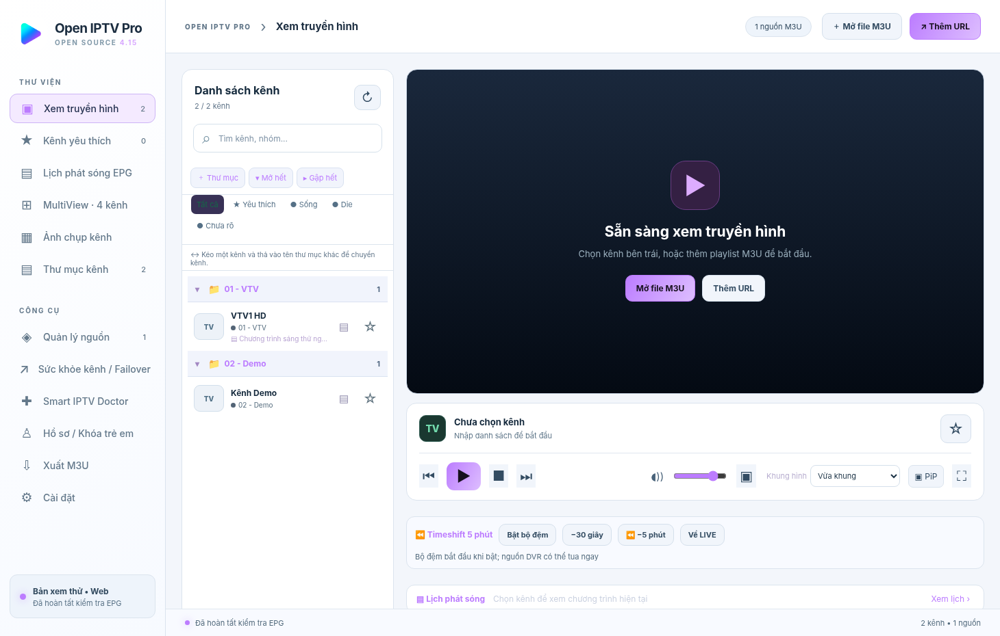
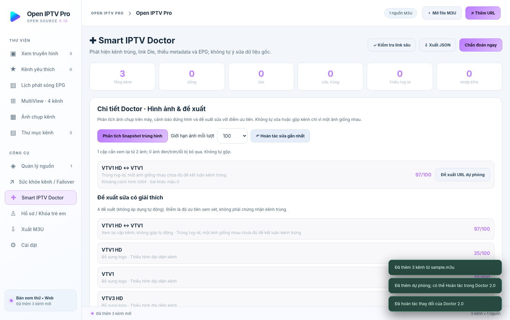
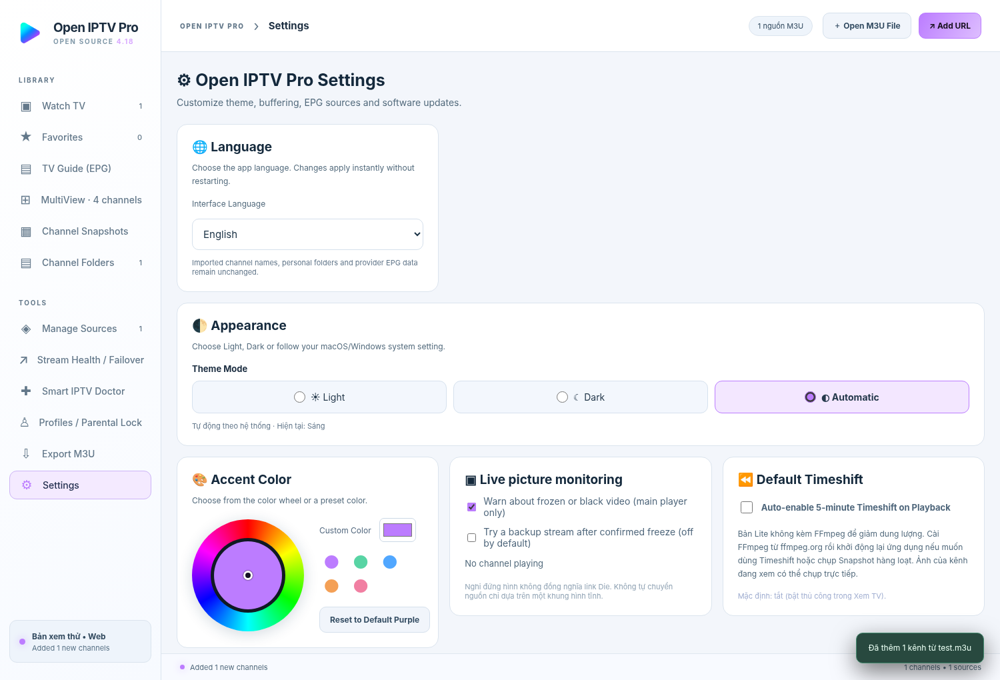

> **Open IPTV Pro v4.19 Full UI / Bản đầy đủ** — FFmpeg được tích hợp vào ứng dụng; giữ nguyên Timeshift 5 phút, Snapshot hàng loạt, kiểm tra 32 luồng, MultiView, Doctor 2.0, EPG, PiP, Failover và cập nhật phiên bản. Giao diện được thu gọn, không cắt chức năng.
> **English:** Full edition bundles FFmpeg and retains every desktop function; only the interface is simplified. macOS and Windows source; Android/iOS unchanged.

> **v4.19 Full UI (Windows/macOS):** Bộ cài không còn nhúng FFmpeg để giảm dung lượng. Timeshift và Snapshot hàng loạt cần FFmpeg cài riêng; xem [Ghi chú tối ưu VI/EN](docs/OPTIMIZATION_V4_18_VI_EN.md). Các bản build Mac tách riêng Apple Silicon và Intel.

# Open IPTV Pro

## 🇻🇳 Tiếng Việt

**Open IPTV Pro** là phần mềm xem và quản lý IPTV mã nguồn mở dành cho **Windows và macOS**. Ứng dụng hỗ trợ 8 ngôn ngữ, danh sách M3U, lịch phát sóng EPG, MultiView 4 kênh, ảnh xem trước, kiểm tra nhiều vòng và sửa link dự phòng.



### Tính năng chính

- **Nguồn IPTV:** nhập file hoặc URL M3U, quản lý nhiều nguồn, thu thập M3U công khai, gộp kênh trùng và giữ link dự phòng.
- **Xem truyền hình:** tìm kiếm, thư mục, kéo thả kênh, đồng bộ Yêu thích giữa các màn hình, chế độ cửa sổ nổi PiP khi được hỗ trợ.
- **EPG:** lịch phát sóng XMLTV, ghép kênh, tìm chương trình và nhắc lịch khi ứng dụng đang chạy.
- **MultiView:** xem 4 kênh cùng lúc; rê chuột vào ô nào thì ô đó phát tiếng.
- **Snapshot:** chụp và hiển thị ảnh theo kênh, có thể chạy nhiều tác vụ cùng lúc bằng FFmpeg.
- **Kiểm tra & sửa link:** phân loại Sống / Die / Chưa rõ, kiểm tra nhiều vòng, tự dùng link dự phòng đã xác minh. Hỗ trợ tối đa 32 tác vụ kiểm tra và 32 tác vụ chụp ảnh đồng thời.
- **Timeshift:** lưu bộ đệm 5 phút kể từ khi bật ghi (không thể tua về trước thời điểm bắt đầu lưu nếu nhà cung cấp không hỗ trợ).
- **Cá nhân hóa:** giao diện Sáng / Tối / Tự động, bánh xe chọn màu, hồ sơ riêng và khóa PIN cơ bản.

### Smart IPTV Doctor 2.0 (v4.17)

- **Freeze Detector:** giám sát video chính theo thời gian thực, cảnh báo khung hình đứng hoặc màn hình đen nhưng không vội kết luận link Die. Tùy chọn thử link dự phòng khi đứng hình được xác nhận được **tắt mặc định**.
- **Visual Channel Deduplication:** quét Snapshot đã lưu, đối chiếu dấu vân tay hình ảnh và metadata để đề xuất kênh nghi trùng; **không tự gộp** khi chỉ có một ảnh giống nhau.
- **Doctor 2.0:** điểm ưu tiên đề xuất sửa, phát hiện kênh bị báo Die dù từng phát thành công, thêm dự phòng đã xác minh sau khi bạn chấp thuận, hoàn tác và xuất báo cáo JSON.



Chi tiết: [Hướng dẫn Doctor 2.0 (Việt/Anh)](docs/DOCTOR_V4_17_VI_EN.md). Phần mới chỉ dành cho Windows/macOS.

### Cập nhật phiên bản tự động (v4.16)

Vào **Cài đặt → Cập nhật phiên bản** để kiểm tra GitHub Releases, tải phiên bản mới có tiến độ và xác nhận cài đặt. Mặc định bật **Tự kiểm tra khi mở ứng dụng** và **Tự tải bản mới**, có thể tắt riêng. Nếu bản cài chưa ký hoặc là Portable, app tải bộ cài có checksum SHA256 rồi yêu cầu mở thủ công; không tự thực thi file tải về. Nếu chỉ có mã nguồn hoặc chưa có Release, app hiển thị hướng dẫn rõ ràng.

> **Lần nâng cấp đầu tiên:** v4.15 chưa có trình cập nhật tự tải/cài nên phải **cài v4.16 thủ công một lần**. Để bản Mac tự cài cập nhật về sau, cần ký bằng Apple Developer ID và notarize; bản Windows nên được ký. Xem [Hướng dẫn cập nhật và phát hành](docs/AUTO_UPDATE_VI.md).

### 8 ngôn ngữ giao diện

Vào **Cài đặt → Ngôn ngữ** để chọn: Tiếng Việt, English, Español, Português (Brasil), 简体中文, ไทย, ລາວ hoặc ភាសាខ្មែរ. Thiết lập được lưu sau khi đóng ứng dụng. Tên kênh, tên nhóm M3U và dữ liệu EPG không bị tự động dịch. Một số thông báo kỹ thuật chuyên sâu có thể chưa được dịch hết.

### Sử dụng và cài đặt

1. Mở ứng dụng và chọn **Mở file M3U** hoặc **Thêm URL**.
2. Chọn kênh để phát; có thể đánh dấu Yêu thích và sắp xếp theo thư mục.
3. Vào **Quản lý nguồn** để thu thập, gộp, kiểm tra và sửa link.
4. Vào **Cài đặt** để chọn ngôn ngữ, màu giao diện, số luồng kiểm tra và Snapshot.

**Tạo bộ cài từ mã nguồn:** cần Node.js 22+, npm và Internet cho lần cài gói đầu tiên. Trên Mac chạy `BUILD_MAC.command` (hoặc `npm run dist:mac:arm64` / `npm run dist:mac:x64`); trên Windows chạy `BUILD_WINDOWS.bat` (hoặc `npm run dist:win`). File build nằm trong `dist/`. Bộ cài chưa ký có thể gặp cảnh báo bảo mật; cần ký và notarize trước khi phát hành chính thức.

**Lưu ý pháp lý và quyền riêng tư:** phần mềm không cung cấp kênh trả phí, tài khoản thuê bao hay quyền phát lại nội dung. Chỉ sử dụng luồng bạn có quyền truy cập; không đăng playlist riêng, thông tin đăng nhập hoặc token lên GitHub public. Giấy phép MIT áp dụng cho mã nguồn của ứng dụng, còn FFmpeg, Electron, hls.js và dữ liệu EPG có điều khoản riêng tại [THIRD_PARTY_NOTICES.md](THIRD_PARTY_NOTICES.md).

Bản **v4.19** chỉ cập nhật phần mềm **Windows/macOS**, không cập nhật Android/iOS. Có thể xem hướng dẫn chi tiết tại [Hướng dẫn tiếng Việt](docs/README_VI.md), [Hướng dẫn build](docs/BUILD.md) và [MIT License](LICENSE).

---

## 🇬🇧 English

**Open-source IPTV desktop player for macOS and Windows, featuring an 8-language interface, M3U playlists, XMLTV program guides, four-channel MultiView, snapshots, and multi-pass stream health checks.**


> **v4.19.0 · Desktop only.** Android and iOS source code are intentionally **not** included or updated in this release. The project is licensed under the MIT License; bundled dependencies have their own licenses (see [THIRD_PARTY_NOTICES.md](THIRD_PARTY_NOTICES.md)). This repository does **not** include commercial television streams, pirated playlists, or viewing rights.

## Visual Stream Diagnostics (v4.17)

**Smart IPTV Doctor 2.0** adds on-device video freeze/black-screen warnings, local perceptual comparison of saved channel snapshots (review only, no automatic merge), prioritized recommendations and undo for the last change. Recently verified backup URLs can be added after confirmation. These features never treat a static scene or one matching frame as proof a stream is dead or two channels are identical. See [Doctor 2.0 guide (Vietnamese/English)](docs/DOCTOR_V4_17_VI_EN.md).

## In-app updates (v4.16)

**Settings → Software Updates** checks the official GitHub Releases repository, reports available versions, downloads with progress and SHA256 validation, and automatically downloads an available verified update (configurable) and asks permission before installing/restarting. Signed installed desktop builds can update in-app when GitHub Releases includes proper metadata and installers. Unsigned/portable builds download a verified installer for **manual** installation. A source-code-only Release cannot be installed. See [Update instructions (Vietnamese)](docs/AUTO_UPDATE_VI.md).

**Migration:** users of v4.15 must install v4.16 manually once, because the old version does not contain the new updater. macOS automatic installation requires Developer ID signing and notarization; Windows signing is recommended.

## Languages

In **Settings → Language**, choose from:

| Language | Display name | Locale |
| --- | --- | --- |
| Vietnamese | Tiếng Việt | `vi` |
| English | English | `en` |
| Spanish | Español | `es` |
| Portuguese (Brazil) | Português (Brasil) | `pt-BR` |
| Simplified Chinese | 简体中文 | `zh-CN` |
| Thai | ไทย | `th` |
| Lao | ລາວ | `lo` |
| Khmer (Cambodian) | ភាសាខ្មែរ | `km` |

Language changes apply immediately and are saved locally. The application translates navigation, main controls, settings, tooltips, and key workflows; some technical messages may remain in their original wording while translations are being expanded. **Imported channel names, user-created folder names, EPG program names, and source metadata are not machine-translated or modified.** All translation files are available in [`renderer/locales/`](renderer/locales/) and can be improved through pull requests.



## Features

- **Playlist management:** add local M3U files or URLs, refresh sources, import public M3U files from GitHub repositories, merge duplicates, and maintain backup streams.
- **IPTV player:** HLS/MP4 playback, favorites synchronized between screens, channel folders, drag-and-drop channel organization, aspect-ratio controls, and picture-in-picture (where supported).
- **EPG:** XMLTV program guide, mapping options, program search, and reminders while the app is running.
- **MultiView:** watch four channels at once. Hover over a pane to hear its audio; other panes stay muted.
- **Channel snapshots:** preview thumbnails, per-channel capture and bulk capture using bundled FFmpeg.
- **Stream health:** multi-step verification, online/offline/uncertain classification, cautious failover, health history, and Smart IPTV Doctor diagnostics.
- **Performance settings:** independently set up to **32 concurrent URL checks** and **32 snapshot jobs**. For reliability, start with four workers per task.
- **Timeshift:** local five-minute rolling buffer when enabled. The buffer only contains data recorded **since buffering began**, unless the provider supplies DVR/catch-up support.
- **Appearance:** Light, Dark, or automatic system mode; adjustable accent color.
- **Profiles:** separate favorites and basic local parental controls.

### What this app does not promise

Streams may require permissions or provider-specific authentication. A URL can play in a video player yet be inaccessible to automated probes; ambiguous cases are labeled **Unknown**, rather than definitively Offline. EPG coverage and catch-up depend on external sources. Local parental PINs are convenience controls, not operating-system security. Multiview, snapshots, timeshift, and high concurrency may consume significant CPU, RAM, bandwidth and disk space.

## Getting started

1. Download the source ZIP or clone this repository.
2. Import an `.m3u` file using **Open M3U File**, or use **Add URL** to fetch a playlist.
3. Choose a channel to watch. Save channels to Favorites, group them into folders, or open **Manage Sources** for link checks and deduplication.
4. Select **Settings → Language** for another interface language.

**For end users:** install an unsigned `.dmg`/`.exe` built from this repository; builds still need validation on the target operating system. We do not claim to ship signed/notarized installers here.

## Build from source

**Prerequisites:** Git (optional), Node.js 22+ and npm. The provided Mac build script can fetch a verified Node.js copy locally. The Windows build helper may download its build tools. An internet connection is required for the initial `npm install` and build dependencies.

```bash
npm install
npm test
npm run start
```

### macOS

Run `BUILD_MAC.command` from the project directory, or run one of:

```bash
npm run dist:mac:arm64  # Apple Silicon
npm run dist:mac:x64    # Intel
```

The generated `.dmg` is placed in `dist/`. Builds created without a signing identity may be blocked by Gatekeeper; release builds should be signed and notarized.

### Windows

Run `BUILD_WINDOWS.bat`, or install Node.js 22+ and use:

```powershell
npm install
npm test
npm run dist:win
```

Setup and portable `.exe` outputs are placed under `dist/`. Unsigned installers can trigger SmartScreen warnings.

### GitHub Actions

The workflow at `.github/workflows/tao-bo-cai.yml` provides separate Windows x64, macOS Intel and Apple Silicon build jobs. Workflows build source code **without automatically publishing installers**; they upload unsigned artifacts to that workflow run. The repository does not upload your saved IPTV playlists, favorites, EPG, snapshots, or tokens.

## Privacy and data

Application settings and imported playlists are stored on the user's machine. Remote playlist, EPG, streaming and GitHub Release URL requests will contact the respective servers. Do not publish subscription tokens, private playlists, provider credentials, or copyrighted streams in a public Git repository. The **publish to GitHub/Gist** feature has been removed from the app.

## Project structure

```text
renderer/                 Desktop user interface, translations and UI logic
renderer/locales/         Editable JSON translation dictionaries
renderer/i18n.js          Language switching and DOM translation
src/                      Desktop native processes, streaming and FFmpeg integrations
assets/                   Application icons
examples/demo.m3u         Synthetic sample playlist
scripts/                  Platform build helper scripts
tests/                    Node and UI regression tests
docs/                     Additional guides and screenshots
.github/workflows/        CI and installer build jobs
```

## Documentation and contribution

- [Build guide](docs/BUILD.md)
- [Vietnamese guide](docs/README_VI.md)
- [English user guide](docs/USER_GUIDE_EN.md)
- [GitHub repository description](docs/GITHUB_DESCRIPTION_EN.md)
- [Contributing](CONTRIBUTING.md)
- [Security](SECURITY.md)
- [MIT License](LICENSE)

Translations are community-editable. Please preserve placeholders and technical identifiers such as `M3U`, `XMLTV`, `EPG`, `FFmpeg`, `HLS`, and `URL`. Before submitting a translation, run the UI language-switching smoke test and review text clipping on smaller screens.

## Legal notice

Open IPTV Pro is a player and playlist-management application. It does not provide pay-TV accounts, subscriptions or rebroadcasting rights. Use streams only when you have permission to view or redistribute them. This project's MIT license covers the application's own source code only, not the legal status of any third-party streams or EPG data.
